# Plan de Ejecución Maestro Secuencial (De Principio a Fin) — VantaDB v0.9.1 → v1.0 GA → v1.2

> **Autor:** Ingeniero de Sistemas Principal & Analista Crítico  
> **Fecha de Emisión:** 2026-11-03  
> **Estado:** Aprobado en Diseño — Listo para Iniciar Ejecución de Código en Fase 1  
> **Posicionamiento Rector (`STRAT-01`):** *"Persistent Local Memory for Coding Agents (Claude Code, Cursor, Windsurf, OpenCode). Zero Docker. One Binary."* ("SQLite for AI Agents")  
> **Capacidad Operativa Base:** 28 horas/semana (ejecución asistida por agentes en paralelo por olas)  
> **Fuentes Canónicas Sincronizadas:** [`docs/dev/Backlog.md`](file:///c:/Users/Eros/VantaDB%20Proyect/VantaDB/docs/dev/Backlog.md) · [`docs/dev/Backlog-negocio.md`](file:///c:/Users/Eros/VantaDB%20Proyect/VantaDB/docs/dev/Backlog-negocio.md) · [`docs/dev/strategy/ROADMAP.md`](file:///c:/Users/Eros/VantaDB%20Proyect/VantaDB/docs/dev/strategy/ROADMAP.md) · Notion (`VantaDB Docs` `3d4d0445975680f2a5fce53ad196a8ba`)

---

## 0. Mapa Arquitectónico de las 6 Fases y Puertas de Calidad (Gates)

```mermaid
flowchart TD
    subgraph F1["FASE 1: Cierre P0 — Credibilidad Técnica, Memoria y Seguridad CI (Pasos 1–9)"]
        S1["Paso 1: TEC-10 + BIZ-18\ngitleaks + secretlint en CI"] --> S2["Paso 2: MEM0-02 + MEM0-03 + EGO-15\nCalibración Min-Max RRF GraphRAG + Anti-Hub 128"]
        S2 --> S3["Paso 3: NOT-01 + NOT-02 + NOT-03\nPersistencia LabelIntern + Locks Threads/Skills"]
        S3 --> S4["Paso 4: ACT-01 + TEC-06 + MEM0-01 (Q17)\nFastGate Pre-LLM (<0.1ms) + Bloom + Bandas HNSW"]
        S4 --> S5["Paso 5: ACT-03\nGroup-Commit Síncrono por Defecto (2-5ms)"]
        S5 --> S6["Paso 6: PRD-02 (D3)\nEmbeddings Locales Duales: E5-small (384d) + Gemma 2 (768d)"]
        S6 --> S7["Paso 7: ACT-02 + MEM0-05 (D2)\nCertificación LongMemEval 500q + LOCOMO\nGATE D2: recall_all@5 >= 0.85"]
    end

    subgraph F2["FASE 2: Paridad Multi-Lenguaje, Ciclo Cognitivo, EU AI Act y Telemetría (Pasos 10–19)"]
        S7 --> S10["Paso 10: TEC-03 (Q4)\nWiring forget(Soft/Hard/Certified) en Node.js y TS/WASM"]
        S10 --> S11["Paso 11: TEC-07 (Q18) + PRD-06 (Q19)\nWorker Decay 24h + Tool/Hook memory_dream (>50 L1)"]
        S11 --> S12["Paso 12: MEM0-04 + NOT-04 + NOT-05\nTripletas Bitemporales L2/L3 + Entropía L0 + TrustGuard"]
        S12 --> S13["Paso 13: TEC-12 (Q2) + TEC-13 (Q3)\nMetadatos EU AI Act Art. 50 + Audit Log Merkle Art. 12"]
        S13 --> S14["Paso 14: TEC-04 + TEC-08 + TEC-14 + PRD-01 + PRD-07\nbrute_fallback >5%, vanta count, Profile Brain, Server HTTP"]
        S14 --> S15["Paso 15: TEC-09 (D6) + ACT-04 (Q14)\nTelemetría Pasiva Cron + Purga EXPERIMENTAL_FEATURES"]
    end

    subgraph F3["FASE 3: Higiene Documental, 9 Artículos, 4 Demos, Notion 24/24 y Stranger Test (Pasos 20–29)"]
        S15 --> S20["Paso 20: TEC-01 + DOC-02 + DOC-04\nPurga InMemoryEngine, IDs internos y pre-commit"]
        S20 --> S21["Paso 21: DOC-01 + DOC-05 + DOC-07 + GTM-02\nSimetría README/ES, Quickstart 60s, Matriz Grep, Tabla David vs Goliat"]
        S21 --> S22["Paso 22: DOC-06 + DOC-08 + MEM0-06 + DOC-03 + DOC-09\n9 Artículos Blog v0.9.0+, Migración Mem0/Chroma, Anexo Forense"]
        S22 --> S23["Paso 23: DEM-01 (GTM-01) + DEM-02 + DEM-03 + DEM-04 + DEM-05\nVHS 60s, Supersession, GDPR, TS/OPFS, Bench vs sqlite-vec/LanceDB"]
        S23 --> S24["Paso 24: NOT-06 (Directriz 1.3)\nPoblado Total Notion 24/24 Subpáginas (8 Dim, 6 Áreas, 10 Ámbitos)"]
        S24 --> S25["Paso 25: FASE-A / R-05 + DX-10\nGATE HUMANO: Stranger Test (2-3 devs) + 5 Installs Limpias"]
    end

    subgraph F4["FASE 4: Descomposición StorageEngine (Q8-A), Cifrado, Soak 1000t y Rieles VE (Pasos 30–38)"]
        S25 --> S30["Paso 30: TEC-02 (🚨 Q8 Opción A — Pre-v1.0)\nDescomposición StorageEngine: IndexCoordinator, VectorStoreService, WalCoordinator"]
        S30 --> S31["Paso 31: TEC-05 (Q1 Opción C) + EGO-14 + EGO-16\nWiring AES-256-GCM (WAL v4, VantaFile v3, HNSW v9) + Vacuum HNSW"]
        S31 --> S32["Paso 32: TEC-11 (Q11) + GTM-03 + PRD-03 (Q24) + BIZ-19\nAuto-tuning ef_search (<0.5% exact_scan), vantadb mcp init, Publish vanta-memory"]
        S32 --> S33["Paso 33: PRD-04 (Q26) + PRD-05 (Q25)\nSoak Test 1,000 Turnos + Firma cosign/minisign + winget/brew"]
        S33 --> S34["Paso 34: GTM-05 + GTM-09 + BND-07 + BIZ-10/23/24\nLanding Vercel (vantadb.dev) + Waitlist Doble + Rieles VE (Ko-fi, Patreon, Binance USDT)"]
    end

    subgraph F5["FASE 5: Stealth Customer Discovery (Mom Test), Lanzamiento v1.0 y Estrés Sequential-NIAH (Pasos 39–42)"]
        S34 --> S39["Paso 39: GTM-06 + GTM-07\nSemana 1 Stealth Discovery (4 Posts Reddit H1-H5) + Prospección DM B2B"]
        S39 --> S40["Paso 40: GTM-04 + GTM-08 + MKT-04\nPlaybook Secuencial Días 1 a 10 (r/LocalLLaMA, r/rust, Show HN, Dev.to, X, LinkedIn)"]
        S40 --> S41["Paso 41: GTM-10 (Q28)\nPRs Escalonados a las 4 Awesome Lists + 5 Registros MCP"]
        S41 --> S42["Paso 42: BNCH-01 + MEM0-05\nArnés Database Sequential-NIAH (10k-100k docs, 0 tokens)"]
    end

    subgraph F6["FASE 6: Expansión Post-Lanzamiento v1.1 / v1.2 (Pasos 43–48)"]
        S42 --> S43["Pasos 43–48: TEC-15 (GDPR Cascada L2/L3), TEC-16 (MMR Rust),\nTEC-14b (Cuotas Duras), FIND-221 (2PC Batch), FIND-303 (Team Sync E2EE $12/u),\nVantaDB Studio Pro Desktop ($9.99/mes)"]
    end
```



---

## 1. Matriz de Trazabilidad Completa (Cero Tareas Omitidas)

Todas las tareas de `Phase 62` (`ACT-01..04`, `TEC-01..16`, `DOC-01..09`, `PRD-01..07`, `DEM-01..05`, `NOT-01..06`, `MEM0-01..06`, `GTM-01..10`), las decisiones `Q1`–`Q28` y las tareas heredadas (`EGO-14..16`, `FIND-221`, `FIND-303`, `BIZ-10/18/19/23/24`, `BND-07`, `FASE-A`) están asignadas a un paso numérico exacto:

| Fase | Pasos | IDs Cubiertos | Esfuerzo Estimado | Puerta de Salida (Exit Gate) |
| :--- | :--- | :--- | :--- | :--- |
| **Fase 1: Cierre P0** | Pasos 1 al 9 | `TEC-10` (`Q27`), `BIZ-18`, `MEM0-02`, `MEM0-03`, `EGO-15`, `NOT-01` (`FIND-609`), `NOT-02` (`FIND-600`), `NOT-03` (`FIND-605`), `ACT-01`, `TEC-06`, `MEM0-01` (`Q17`), `ACT-03`, `PRD-02` (`D3`), `ACT-02` (`D2`), `MEM0-05` | ~8–10 días (~36h) | CI con `gitleaks` verde, ingesta `FastGate` `< 1 ms`, Group-Commit `> 500 ops/s`, y **`recall_all@5 >= 0.85`** en LongMemEval 500q + LOCOMO. |
| **Fase 2: Paridad, Cognición, Track PI y Cumplimiento** | Pasos 10 al 19 | `TEC-03` (`Q4`), `TEC-07` (`Q18`), `PRD-06` (`Q19`), `MEM0-04`, `NOT-04`, `NOT-05`, `TEC-12` (`Q2`), `TEC-13` (`Q3`), `TEC-04`, `TEC-08`, `TEC-14` (`Q10`), `PRD-01`, `PRD-07` (`Q7`), `TEC-09` (`D6`), `ACT-04` (`Q14`), `TEC-17` (`MGR-25`), `TEC-18` (Cascada `L0→L3`), `TEC-19` (`PI-1..PI-3`) | ~8–10 días (~38h) | Paridad `forget()` en Rust/Py/Node/TS/MCP, ciclo `L0→L1→L2→L3→Dream→Skill` 100% autónomo, Track PI (`MGR-22..25`) operativo y metadatos Art. 50 + Merkle Art. 12 activos. |
| **Fase 3: Docs, Blog, Demos, Notion y Stranger Test** | Pasos 20 al 29 | `TEC-01`, `DOC-02`, `DOC-04`, `DOC-01`, `DOC-05`, `DOC-07` (`Q6`/`Q12`/`Q23`), `GTM-02`, `DOC-06`, `DOC-08`, `MEM0-06` (`Q22`), `DOC-03`, `DOC-09` (`Q5`), `DEM-01` (`GTM-01`), `DEM-02`, `DEM-03`, `DEM-04` (`FIND-538`), `DEM-05` (`Q21`), `NOT-06` (**✅ 71/71 páginas listas**), `FASE-A`, `DX-10` | ~5–6 días (~22h) | 9 artículos desinfectados, 4 demos + GIF VHS en README, 71/71 páginas de Notion sincronizadas y **Stranger Test (`FASE-A`) superado con 0 bloqueos**. |
| **Fase 4: `StorageEngine` Modular (`Q8-A`), Cifrado y Rieles VE** | Pasos 30 al 38 | `TEC-02` (**`Q8 Opción A`**), `TEC-05` (`Q1 Opción C`), `EGO-14`, `EGO-16`, `TEC-11` (`Q11`), `GTM-03`, `PRD-03` (`Q24`), `BIZ-19` (`FIND-453`), `PRD-04` (`Q26`), `PRD-05` (`Q25`), `GTM-05`, `GTM-09` (`Q15`/`Q16`), `BND-07`, `BIZ-04/10/13/23/24` | ~9–11 días (~38h) | `StorageEngine` desacoplado en 3 coordinadores, cifrado AES-256-GCM en los 4 artefactos, Soak Test 1,000t verde, `vantadb.dev` en Vercel con Waitlist Doble y Ko-fi/Patreon/Binance activos. |
| **Fase 5: Stealth Discovery, Lanzamiento v1.0 y Estrés Sequential-NIAH** | Pasos 39 al 42 | `GTM-06`, `GTM-07`, `GTM-04`, `GTM-08`, `MKT-04`, `GTM-10` (`Q28`), `BNCH-01` (`MEM0-05`) | ~10 días campaña | Validación Mom Test (`H1`–`H5`), ejecución secuencial Días 1–10 (Reddit, Show HN, Dev.to, X, LinkedIn), PRs Awesome Lists y certificación Sequential-NIAH (10k–100k docs, 0 tokens, p95 < 3.0 ms). |
| **Fase 6: Post-Lanzamiento v1.1 / v1.2** | Pasos 43 al 48 | `TEC-15` (`Q4-C`), `TEC-16` (`Q20`), `TEC-14b` (`Q10-A`), `FIND-221`, `FIND-303` (`MEMG-05`), `PRO-01..06` (Studio Pro `$9.99/mes` y Team Sync `$12/u/mes`) | Horizonte 3 y 4 | Evolución comercial post-tracción v1.0. |

---

## FASE 1: Cierre P0 — Bloqueantes de Credibilidad Técnica, Memoria y Seguridad CI (Pasos 1 al 9)

> **Objetivo de la Fase 1:** Blindar el repositorio contra fugas de credenciales, reparar las distorsiones matemáticas y de concurrencia en el motor Rust (`GraphRAG`, `LabelIntern`, `Threads`, `Skills`), implementar el pipeline síncrono `FastGate` (`< 0.1 ms`) con auto-deduplicación y Group-Commit por defecto, habilitar los 2 modelos locales (`multilingual-e5-small` y `EmbeddingGemma 2`), y certificar empíricamente **`recall_all@5 >= 0.85`** en LongMemEval (500 preguntas) y LOCOMO.

---

### Paso 1: Blindaje de Secretos en CI (`gitleaks` + `secretlint`) y Rotación de Tokens
- **IDs:** `TEC-10` (`Q27 Opción B`), `BIZ-18`
- **Prioridad:** 🔴 P0 (Seguridad y Pre-requisito de CI)
- **Dependencias previas:** Ninguna (Paso inicial obligatorio).
- **Archivos exactos a modificar/crear:**
  - `.github/workflows/ci-rust.yml`
  - `.gitleaks.toml` (nuevo)
  - `docs/dev/workflow/TOKEN-ROTATION.md`
- **Detalle técnico exacto de implementación:**
  1. Crear `.gitleaks.toml` en la raíz configurando reglas estrictas para detectar tokens de crates.io (`cio...`), PyPI (`pypi-...`), npm (`npm_...`), claves privadas y hashes de API, excluyendo explícitamente los fixtures de test sintéticos documentados (`tests/encryption_canary.rs`).
  2. Añadir el job obligatorio `secret-scan` en `.github/workflows/ci-rust.yml` ejecutando `gitleaks/gitleaks-action@v2` (pin SHA) y `npx @secretlint/secretlint "**/*"` en cada `push` y `pull_request`.
  3. Verificar junto con el propietario la rotación de tokens pendientes según `docs/dev/workflow/TOKEN-ROTATION.md` (`BIZ-18`).
- **Comando / Criterio Exacto de Verificación (DoD):**
  ```bash
  gitleaks detect --source . --config .gitleaks.toml --verbose
  ```
  El escaneo debe devolver `0 leaks found` (exit code `0`) y fallar con exit code `1` ante un token sintético de prueba.

---

### Paso 2: Corrección Matemática de GraphRAG (`Min-Max RRF`) y Guarda Anti-Hub (`EGO-15`)
- **IDs:** `MEM0-02` (`FIND-608` / `GR-05`), `MEM0-03` (`FIND-607` / `GR-01..03, GR-06`), `EGO-15`
- **Prioridad:** 🔴 P0 (Recuperación Multi-Hop y Latencia p99)
- **Dependencias previas:** Paso 1.
- **Archivos exactos a modificar/crear:**
  - `src/graphrag/retrieve.rs` (líneas `20-26`, `54-65`, `101`)
  - `src/graphrag/expand.rs` (líneas `27-89`)
  - `src/graphrag/pipeline.rs` (línea `70`)
  - `src/sdk/builder.rs` (líneas `223-229`)
  - `tests/graphrag_test.rs`
- **Detalle técnico exacto de implementación:**
  1. **Calibración Min-Max de `seed_score` (`MEM0-02`):** En `src/graphrag/retrieve.rs:54-65`, los `seed_score` provienen de RRF (`1 / (60 + rank) ≈ 0.016`), lo que anulaba el peso del `0.60` frente a `hop_boost` (`[0.33, 1.0]`). Calcular `min_s` y `max_s` sobre el conjunto semilla recuperado y normalizar `norm_seed = if (max_s - min_s) > 1e-6 { (s - min_s) / (max_s - min_s) } else { 1.0 }` antes de computar `0.60 * norm_seed + 0.30 * hop_boost + 0.10 * degree_boost`.
  2. **Guarda Anti-Hub por defecto (`MEM0-03` / `EGO-15`):** Cambiar en `GraphRagPipeline::new()` (`src/graphrag/pipeline.rs:70`) el default de `max_degree_per_node` de `usize::MAX` a `128`, y exponer `max_degree_per_node` y `min_edge_weight` en `GraphRagConfig` y en la superficie `graphragSearch`.
  3. **Eliminación de N+1 y contención de locks (`GR-01..03`):** En `degree_boost`, reutilizar los nodos ya cargados por `get_many` en lugar de hacer `engine.get(id)` por candidato; en `collect_edges`, adquirir el lock del interner de labels una sola vez por lote; e incluir `FIELD_PAYLOAD` (`__vanta_payload`) en `extract_content` (`FIND-300`).
- **Comando / Criterio Exacto de Verificación (DoD):**
  ```bash
  cargo nextest run -p vantadb --test graphrag_test
  ```
  El score semántico representa efectivamente el 60% del peso en los tests de ranking, y la expansión sobre un nodo super-hub (`>1,000` aristas) se acota a `128` vecinos manteniendo latencia `p99 < 10 ms`.

---

### Paso 3: Persistencia de `LabelIntern` en Disco y Serialización Atómica en `Threads` y `Skills`
- **IDs:** `NOT-01` (`FIND-609`), `NOT-02` (`FIND-600`, `AG-03..05`), `NOT-03` (`FIND-605`, `SK-02..03`)
- **Prioridad:** 🔴 P0 (Integridad de Datos en Reinicios y Concurrencia)
- **Dependencias previas:** Paso 2.
- **Archivos exactos a modificar/crear:**
  - `src/node/label.rs`
  - `src/storage/engine/init.rs` (línea `205`)
  - `src/storage/engine/mod.rs` (líneas `422-429`)
  - `src/agentic/thread.rs` (líneas `65`, `209-255`, `311-317`)
  - `src/skills.rs` (líneas `151-216`, `320-420`)
- **Detalle técnico exacto de implementación:**
  1. **Persistencia de `LabelIntern` (`NOT-01` / `FIND-609`):** En `src/node/label.rs` y `src/storage/engine/mod.rs`, al registrar una nueva etiqueta en `intern_label`, persistir el par `label_id -> string` en la partición `InternalMetadata` del backend bajo el prefijo `__label_intern:`. Al abrir `StorageEngine` (`init.rs:205`), hidratar `LabelIntern` desde `InternalMetadata` para que las aristas leídas de disco tras reiniciar nunca devuelvan `"<unknown>"`.
  2. **Atomicidad e Higiene en `Threads` (`NOT-02`):** En `src/agentic/thread.rs`, actualizar `_thread_ids` dentro de la misma sección crítica que la inserción del hilo (`AG-03`); en `purge_expired_threads`, propagar errores de E/S en vez de convertirlos en `None` con `.ok().flatten()` (`AG-04`); y cablear el barrido perezoso de expiración de TTL (`AG-05`).
  3. **Lock Optimista Atómico y Paginación en `Skills` (`NOT-03` / `FIND-605`):** En `src/skills.rs`, proteger `create` y `update` (verificación `check_version` + escritura `commit_new_head`) bajo un guard de concurrencia por `(owner_agent, name)` para que dos escrituras concurrentes con el mismo `expected_version` devuelvan `Error::ExecutionConflict` en la segunda sin pérdida silenciosa; y aplicar `offset`/`limit` sobre las claves del índice antes de hidratar los payloads en `list()`.
- **Comando / Criterio Exacto de Verificación (DoD):**
  ```bash
  cargo nextest run -p vantadb -E "test(label_intern) | test(thread) | test(skill)"
  ```
  Test de reinicio de base de datos conserva el 100% de las etiquetas de aristas; test de actualización concurrente de skills devuelve `ExecutionConflict` determinista.

---

### Paso 4: Pipeline `FastGate` Pre-LLM (`< 0.1 ms`), `DuplicatePreventionFilter` y Auto-Deduplicación en `Embedded::put()`
- **IDs:** `ACT-01`, `TEC-06`, `MEM0-01` (`Q17 Opción B Unificada`), `FIND-277`
- **Prioridad:** 🔴 P0 (Diferenciador Central frente a Mem0)
- **Dependencias previas:** Paso 3.
- **Archivos exactos a modificar/crear:**
  - `src/utils/duplicate_prevention.rs` (líneas `24-106`)
  - `src/sdk/api/memory.rs` (líneas `750-850`)
  - `src/sdk/types/record.rs`
  - `vanta-memory/src/core/record/l1_reader.rs`
- **Detalle técnico exacto de implementación:**
  1. **Endurecimiento de `DuplicatePreventionFilter` (`UT-03`, `UT-04`):** En `src/utils/duplicate_prevention.rs`, imponer un tope máximo seguro a `capacity_hint` (`MAX_BLOOM_BITS = 64 MiB`) evitando panics por allocación, y añadir el método atómico `check_and_mark(&self, content: &[u8]) -> bool` bajo un único lock para eliminar la carrera TOCTOU entre `is_duplicate` y `mark_processed`.
  2. **Clasificador Determinista `FastGate` en `Embedded::put()` (`ACT-01` + `MEM0-01` + `Q17`):**
     - **Etapa 1 (Exact Match `< 0.01 ms`):** Verificar hash dual XxHash64 en `DuplicatePreventionFilter`. Si coincide exactamente en el mismo namespace, retornar registro existente o incrementar contador de refuerzo (`reinforcement_count += 1`, `updated_at_ms = now`) sin I/O redundante.
     - **Etapa 2 (Similitud Léxica Jaccard + HNSW Top-5 `< 0.1 ms`):** Si el registro trae vector (o auto-embed local activo) y `dedup_policy != DedupPolicy::Off`, consultar los `k = 5` vecinos más cercanos en el mismo namespace + similitud Jaccard de tokens en título/etiquetas:
       - **Banda Alta (`cosine >= 0.92` o `Jaccard >= 0.85`):** Parafraseo equivalente $\rightarrow$ operación `NOOP` / refuerzo de confianza sobre el nodo existente.
       - **Banda Media (`0.78 <= cosine < 0.92` con solapamiento de entidad/sujeto):** Actualización o contradicción temporal $\rightarrow$ aplicar `MergePolicy::Supersede` por defecto (insertar nuevo nodo, marcar el anterior con `superseded_by = Some(new_key)`, preservar su `confidence` previa corrigiendo `FIND-281`, y crear arista `supersedes_edge` en el grafo). Soportar también `MergePolicy::Skip` y `MergePolicy::Ask`.
       - **Banda Baja (`cosine < 0.78`):** Hecho ortogonal nuevo $\rightarrow$ `ADD` directo.
  3. **Consumo Read-Side de `superseded_by` (`FIND-277`):** En `vanta-memory/src/core/record/l1_reader.rs` y `auto_recall.rs`, filtrar por defecto los registros marcados con `superseded_by.is_some()` cuando `exclude_superseded` esté activo (default `true` en recall cognitivo).
- **Comando / Criterio Exacto de Verificación (DoD):**
  ```bash
  cargo nextest run -p vantadb -E "test(fastgate) | test(dedup) | test(supersede)"
  ```
  Ingesta de hechos duplicados/parafraseados no duplica nodos, ejecuta en `< 1 ms` sin LLM, y las actualizaciones en banda `0.78..0.92` generan cadena de supersession bitemporal verificable.

---

### Paso 5: Activación de Group-Commit Síncrono por Defecto en `StorageEngine`
- **IDs:** `ACT-03`, `FIND-284`
- **Prioridad:** 🔴 P0 (Rendimiento de Escritura Multihilo)
- **Dependencias previas:** Paso 4.
- **Archivos exactos a modificar/crear:**
  - `src/config.rs` (línea `149`)
  - `src/storage/engine/init.rs` (línea `188`)
  - `src/storage/engine/txn.rs` (líneas `310-327`)
  - `src/sdk/api/memory.rs` (`put_batch`)
- **Detalle técnico exacto de implementación:**
  1. Implementar un coordinador de coalescencia temporal (`GroupCommitBuffer`) en el camino de commit de `StorageEngine` con ventana configurable (`group_commit_window_ms = 2`, máx `5 ms` o `max_batch_size = 64` escrituras): el hilo líder adquiere `insert_lock` (`FairMutex`), drena las entradas acumuladas en la cola por los hilos seguidores durante la ventana, ejecuta un único `batch_append` en el WAL + `fsync` compartido, y notifica el resultado a los `oneshot::Receiver` de cada escritor.
  2. Cambiar el valor por defecto en `src/config.rs:149` a `group_commit.enabled = true`.
  3. Angostar la sección crítica de `put_batch` (`FIND-284`) pre-calculando hashes, validaciones y serializaciones fuera del lock.
- **Comando / Criterio Exacto de Verificación (DoD):**
  ```bash
  cargo nextest run -p vantadb --test storage_group_commit
  ```
  El test concurrente multihilo (16 escritores simultáneos) supera las **500 ops/s** con durabilidad WAL intacta y `0` corrupciones.

---

### Paso 6: Arquitectura Dual Parametrizable de Embeddings Locales (`multilingual-e5-small` + `EmbeddingGemma 2`)
- **IDs:** `PRD-02` (`D3`), `FIND-484`, `FIND-505`
- **Prioridad:** 🔴 P0 (Zero-Config 100% Offline y Calidad Semántica)
- **Dependencias previas:** Paso 5.
- **Archivos exactos a modificar/crear:**
  - `src/llm.rs`
  - `src/config.rs`
  - `src/embedding_health.rs`
  - `embeddings/download.py`
  - `setup-embeddings.ps1`
- **Detalle técnico exacto de implementación:**
  1. Estandarizar en `src/llm.rs` y `src/config.rs` el selector de perfil de modelo ONNX local (`LocalModelPreset`) soportando oficialmente dos modelos de primera clase descargables bajo demanda en `~/.vantadb/models/` con verificación SHA-256 (`FIND-505`):
     - **Perfil `fast` (Default CPU Ultraligero):** `intfloat/multilingual-e5-small` (384 dimensiones, cuantizado INT8 `~45 MB`, inferencia `< 2 ms`, excelente soporte Español/Inglés).
     - **Perfil `quality` (Alta Precisión Semántica):** `google/embeddinggemma-2-270m` (768 dimensiones, cuantizado INT8 `~270 MB`, MRL truncable a 384d/768d).
  2. Prohibir cualquier fallback silencioso a dummy embeddings en producción (`VANTADB_STRICT_EMBEDDINGS = true` por defecto).
  3. Corregir `src/embedding_health.rs` (`FIND-484`) para que el payload de `capabilities` del MCP y `vanta-cli status` reporten con exactitud los 3 estados reales (`Ready { model, dims }`, `CompiledWithoutEmbeddings`, `ModelNotLoadedError`) sin afirmar nunca que sirve dummy embeddings cuando strict mode está activo.
- **Comando / Criterio Exacto de Verificación (DoD):**
  ```bash
  cargo nextest run -p vantadb --lib --features "embed-local" -E "test(llm) | test(embedding_health)"
  ```
  Ambos perfiles (`multilingual-e5-small` y `EmbeddingGemma 2`) inicializan, embeben y recuperan correctamente en modo 100% offline; sin modelo cargado en strict mode devuelve `Error::Embedding` explícito.

---

### Paso 7: Arnés Reproducible `LOCOMO` (`evals/eval_locomo.py`)
- **IDs:** `MEM0-05`
- **Prioridad:** 🔴 P0 (Benchmark Científico Comparativo frente a Mem0)
- **Dependencias previas:** Paso 4, Paso 6.
- **Archivos exactos a modificar/crear:**
  - `evals/eval_locomo.py` (nuevo)
  - `evals/README.md`
- **Detalle técnico exacto de implementación:**
  1. Construir `evals/eval_locomo.py` para evaluar el dataset público **LOCOMO** (10 conversaciones multi-sesión extensas, ~1,540 preguntas divididas en las 4 categorías del paper de Mem0 `arXiv:2504.19413`: *Single-hop*, *Multi-hop*, *Temporal Reasoning* y *Open-domain*).
  2. Instrumentar la medición desglosada por categoría de:
     - **Retrieval puro (sin LLM):** `Recall@5`, `Recall@10`, `MRR` y `NDCG@5`.
     - **Sistemas y Eficiencia:** Latencia `p50` y `p95` de ingesta (`ms`), latencia `p50` y `p95` de búsqueda (`ms`), QPS sostenidos, memoria RAM RSS pico (`MB`) y tokens consumidos (`0` en modo `FastGate` determinista).
- **Comando / Criterio Exacto de Verificación (DoD):**
  ```bash
  python evals/eval_locomo.py --model multilingual-e5-small --top-k 5 --output evals/results/locomo_v091.json
  ```
  El script ejecuta de principio a fin sin fallos y genera el reporte JSON estructurado por las 4 categorías.

---

### Paso 8: Ejecución y Certificación Oficial `LongMemEval` (500 Preguntas) y `LOCOMO` (`recall_all@5 >= 0.85`)
- **IDs:** `ACT-02` (**Directriz 1.1: `recall_all@5 >= 0.85`**), `D2`
- **Prioridad:** 🔴 P0 (**GATE BLOQUEANTE DE LANZAMIENTO**)
- **Dependencias previas:** Pasos 2, 4, 6 y 7.
- **Archivos exactos a modificar/crear:**
  - `evals/eval_longmemeval.py`
  - `evals/memory_harness.py`
  - `docs/user/operations/BENCHMARKS.md` (§23)
- **Detalle técnico exacto de implementación:**
  1. Ejecutar el arnés `evals/memory_harness.py` / `evals/eval_longmemeval.py` sobre las **500 preguntas completas** de LongMemEval-S utilizando la arquitectura híbrida de VantaDB (`BM25` + `HNSW` con embeddings locales reales + ponderación RRF calibrada + segmentación conversacional por turnos + `FastGate` supersession).
  2. Verificar que la métrica global alcance o supere el umbral innegociable **`recall_all@5 >= 0.85`** (y documentar simultáneamente `Recall@10`, `MRR` y el desglose en las 5 categorías: *Single-Session-User*, *Multi-Session*, *Temporal-Reasoning*, *Knowledge-Update*, *Abstention*).
  3. Ejecutar `evals/eval_locomo.py` y publicar ambas tablas certificadas (con comando exacto de reproducción, hardware y fecha) en `docs/user/operations/BENCHMARKS.md` §23.
- **Comando / Criterio Exacto de Verificación (DoD):**
  ```bash
  python evals/eval_longmemeval.py --questions 500 --top-k 5 --strict-embeddings --output evals/results/longmemeval_500q_v091.json
  ```
  **Gate D2:** El archivo `evals/results/longmemeval_500q_v091.json` certifica `recall_all@5 >= 0.85` con `0` vectores sintéticos/dummy.

---

### Paso 9: Validación CI de Embeddings con Features Reales (`FIND-489` y `FIND-491`)
- **IDs:** `FIND-489`, `FIND-491`
- **Prioridad:** 🔴 P0 (Estabilidad de CI en Fase 1)
- **Dependencias previas:** Paso 6.
- **Archivos exactos a modificar/crear:**
  - `src/config.rs` (tests `f414_*`)
  - `src/llm.rs` (tests `f414_*`)
  - `.github/workflows/ci-rust.yml`
- **Detalle técnico exacto de implementación:**
  1. Aislar mediante un helper `EnvSnapshotGuard` todas las variables de entorno de embeddings (`VANTADB_STRICT_EMBEDDINGS`, `VANTADB_ALLOW_DUMMY_EMBEDDINGS`, `VANTADB_LOCAL_MODEL`, `VANTADB_EMBEDDING_PROVIDER`) en los tests de `config.rs` y `llm.rs` (`FIND-491`).
  2. Confirmar que el job `test-embedding-features` en `.github/workflows/ci-rust.yml` (`--features "cli,arrow,tls,opentelemetry,remote-inference"` y `embed-local`) pase al 100% en verde (`FIND-489`).
- **Comando / Criterio Exacto de Verificación (DoD):**
  ```bash
  cargo nextest run -p vantadb --lib --features "cli,arrow,tls,opentelemetry,remote-inference,embed-local"
  ```
  100% de tests unitarios pasando sin flakiness con `--test-threads` alto.

---

## FASE 2: Paridad Multi-Lenguaje, Ciclo de Vida Cognitivo, Cumplimiento EU AI Act y Telemetría (Pasos 10 al 19)

> **Objetivo de la Fase 2:** Alcanzar paridad multi-lenguaje en Node.js y TypeScript/WASM para `forget()`, automatizar el ciclo de vida cognitivo L0→L3 (decaimiento autónomo cada 24h, consolidación `memory_dream` con aviso >50 episodios, extracción de tripletas bitemporales, poda por entropía L0 y defensa anti-poisoning), implementar el cumplimiento técnico del EU AI Act (Art. 50 y Art. 12), y activar la telemetría pasiva en GitHub Actions.

---

### Paso 10: Wiring de `Embedded::forget()` en Node.js (`vantadb-node`) y TypeScript/WASM (`vantadb-ts`) + Paridad FFI
- **IDs:** `TEC-03` (`Q4 Opción B`), `FIND-482`, `FIND-483`, `FIND-532`, `FIND-533`, `FIND-535`, `FIND-546`
- **Prioridad:** 🟠 P1 (Paridad Multi-Lenguaje y Cumplimiento GDPR)
- **Dependencias previas:** Fase 1 completada.
- **Archivos exactos a modificar/crear:**
  - `vantadb-node/src/lib.rs`
  - `vantadb-node/index.d.ts`
  - `vantadb-wasm/src/lib.rs`
  - `vantadb-wasm/src/vantadb_wasm.d.ts`
  - `vantadb-ts/src/vantadb.ts`
  - `vantadb-ts/src/native.ts`
  - `vantadb-ts/src/types.ts`
- **Detalle técnico exacto de implementación:**
  1. **Exposición de `forget(namespace, key, mode)` (`TEC-03`):** Añadir el método `#[napi] pub async fn forget(namespace: String, key: String, mode: String)` en `vantadb-node/src/lib.rs`, en `vantadb-wasm/src/lib.rs` y en la fachada unificada `Client.forget({ namespace, key, mode })` de `vantadb-ts`, soportando los 3 modos canónicos (`"soft"`, `"hard"`, `"certified"`) y devolviendo el certificado JSON verificable (`PurgeCertificate`) cuando `mode == "certified"`.
  2. **Cierre de asimetrías FFI críticas detectadas en auditoría:**
     - Emitir `superseded_by` en `memory_record_to_js` de `vantadb-wasm` y declarar `exclude_superseded?: boolean` en `ListOptionsInput` (`FIND-482`, `FIND-483`).
     - Usar `Serializer::json_compatible()` en `vantadb-wasm/src/lib.rs:2515` para que `record.metadata` sea un objeto plano idéntico en WASM y en Node (`FIND-532`).
     - Añadir el fallback `namespace: namespaces[0]` en `NativeVantaDB.searchMulti` (`FIND-533`), validar finitud en `f32` al convertir desde `f64` en vectores densos (`FIND-535`), y exportar el alias de valor `VantaDB = VantaDb` en `vantadb-node` (`FIND-546`).
- **Comando / Criterio Exacto de Verificación (DoD):**
  ```bash
  cargo nextest run -p vantadb-node && npm --prefix vantadb-ts test
  ```
  Los tests de integración en Node.js y TypeScript ejecutan `client.forget({ namespace, key, mode: "certified" })` y verifican criptográficamente el recibo SHA-256.

---

### Paso 11: Worker Autónomo de Decaimiento (`run_decay_pass` → `forget(Soft)`) y Orquestación Híbrida de `vanta_dream`
- **IDs:** `TEC-07` (`Q18 Opción B`), `PRD-06` (`Q19 Opción B`), `FIND-289`
- **Prioridad:** 🟠 P1 (Autonomía del Ciclo de Vida L1→L3)
- **Dependencias previas:** Paso 10.
- **Archivos exactos a modificar/crear:**
  - `vanta-memory/src/core/record/lifecycle.rs`
  - `vanta-memory/src/services/scheduler.rs`
  - `vantadb-mcp/src/handlers/tools.rs`
  - `vanta-memory/src/core/dream/mod.rs`
- **Detalle técnico exacto de implementación:**
  1. **Job Autónomo de Decaimiento (`TEC-07` / `Q18`):** Conectar en `vanta-memory/src/services/scheduler.rs` un tick periódico ligero (`decay_interval = 24h` por defecto, configurable y desactivable) que ejecute `run_decay_pass` sobre los namespaces activos y, para cada registro cuyo `effective_heat <= PRUNE_HEAT_THRESHOLD`, invoque `Embedded::forget(ns, key, ForgetMode::Soft)` sin bloquear ni penalizar la latencia de `put()`.
  2. **Orquestación Híbrida de `vanta_dream` (`PRD-06` / `Q19`):** Exponer la herramienta MCP explícita `memory_dream(namespace)` en `vantadb-mcp/src/handlers/tools.rs` (incluida en el perfil `Brain`) e inyectar en el envelope de respuesta de `memory_put` / `memory_recall` un campo estructurado `dream_hint: Some("Namespace has >50 unconsolidated L1 episodes; run memory_dream to consolidate")` cuando el conteo de episodios L1 no consolidados supere `50`.
- **Comando / Criterio Exacto de Verificación (DoD):**
  ```bash
  cargo nextest run -p vanta-memory -p vantadb-mcp -E "test(decay) | test(dream)"
  ```
  Los recuerdos envejecidos bajo el umbral pasan a estado `Soft-deleted` tras el pase del scheduler, y el episodio #51 dispara el `dream_hint` verificable por test.

---

### Paso 12: Extractor de Tripletas Bitemporales L2/L3, Poda por Entropía Semántica L0 y Defensa Anti-Poisoning (`TrustGuard`)
- **IDs:** `MEM0-04`, `NOT-04`, `NOT-05` (`UT-01` en `FIND-607`), `FIND-577`
- **Prioridad:** 🟠 P1 (SOTA Cognitivo 2026: REMem, Graphiti, Defensa MINJA/AgentPoison)
- **Dependencias previas:** Paso 11.
- **Archivos exactos a modificar/crear:**
  - `vanta-memory/src/core/conversation/l0_recorder.rs`
  - `vanta-memory/src/core/dream/mod.rs`
  - `src/utils/confidence_metrics.rs` (líneas `43-111`)
  - `vantadb-mcp/src/handlers/tools.rs` (líneas `1756`, `3794`)
- **Detalle técnico exacto de implementación:**
  1. **Poda Dinámica por Entropía Semántica en L0 (`NOT-04`):** Antes de promover un turno de L0 a L1, calcular su entropía de Shannon por tokens únicos y densidad de entidades/verbos. Si el mensaje es ruido conversacional trivial (`len < 15` chars y sin entidades, ej. `"ok"`, `"gracias"`, `"entendido"`), retenerlo únicamente en el buffer efímero L0 sin indexarlo en HNSW L1.
  2. **Extractor Ontológico de Tripletas Bitemporales (`MEM0-04`):** En el consolidator L2/L3 (`vanta-memory`), extraer tripletas estructuradas `(sujeto, predicado, objeto, valid_at_ms, invalid_at_ms)` e insertarlas como aristas en el grafo de VantaDB. Cuando una nueva tripleta contradiga el objeto de un `(sujeto, predicado)` funcional previo (ej. `("usuario", "vive_en", "Berlín")` frente a `"Madrid"`), marcar `invalid_at_ms = now` en la arista previa sin borrarla físicamente, habilitando consultas históricas `AS OF`.
  3. **Defensa Anti-Memory-Poisoning `TrustGuard` (`NOT-05` + `UT-01`):** Exigir que un axioma L3 candidato cuente con corroboración de `>= 2` episodios independientes o procedencia verificada (`ConfidenceClass::Verified`) antes de promoverse desde cuarentena; y corregir `src/utils/confidence_metrics.rs` (`UT-01`) para que un agente con `is_slashed == true` permanezca vetado permanentemente hasta rehabilitación administrativa explícita.
  4. **Exposición de `exclude_superseded` en MCP (`FIND-577`):** Cablear el parámetro booleano `exclude_superseded` en `parse_search_request` y `memory_list` de `vantadb-mcp/src/handlers/tools.rs`.
- **Comando / Criterio Exacto de Verificación (DoD):**
  ```bash
  cargo nextest run -p vanta-memory -p vantadb -p vantadb-mcp -E "test(entropy) | test(bitemporal) | test(trust) | test(superseded)"
  ```
  Reducción `> 35%` de nodos basura en trazas conversacionales; consultas `AS OF` responden el estado histórico exacto; y un turno aislado inyectado no logra promoverse a axioma L3.

---

### Paso 13: Cumplimiento EU AI Act Art. 50 (Metadatos de Procedencia L2/L3) y Art. 12 (`audit.jsonl` con Merkle Trail SHA-256)
- **IDs:** `TEC-12` (`Q2 Opción B`), `TEC-13` (`Q3 Opción B`)
- **Prioridad:** 🟠 P1 (Ventaja Competitiva Regulatoria B2B / EU AI Act AGO-2026)
- **Dependencias previas:** Paso 12.
- **Archivos exactos a modificar/crear:**
  - `src/sdk/types/record.rs`
  - `vanta-memory/src/core/dream/mod.rs`
  - `src/audit.rs`
  - `src/cli.rs` y `src/cli_handlers/verify.rs`
- **Detalle técnico exacto de implementación:**
  1. **Metadatos de Procedencia Art. 50 (`TEC-12` / `Q2`):** En toda síntesis generada por IA en L2 (Escenas) y L3 (Axiomas), inyectar automáticamente en `metadata` los 4 campos estandarizados:
     - `ai_generated: true` (`VantaValue::Bool(true)`)
     - `synthesizer_model: String` (identificador del modelo/heurística que sintetizó el recuerdo)
     - `confidence_score: f32` (score de confianza calibrado `[0.0, 1.0]`)
     - `prompt_hash: String` (hash SHA-256 de la plantilla de prompt + IDs fuente)
  2. **Log Inmutable de Trazabilidad Art. 12 (`TEC-13` / `Q3`):** Extender `src/audit.rs` para que, cuando la auditoría esté habilitada (`config.audit.enabled = true`), cada operación de recuperación (`search`, `recall`, `query`) y mutación crítica escriba una entrada en `audit.jsonl` con: `timestamp_ms`, `operation`, `query_hash`, `retrieved_ids_and_scores`, `omitted_superseded_ids`, `prev_entry_hash` y `entry_hash = SHA256(prev_entry_hash || canonical_json)`. Añadir el subcomando `vanta-cli audit verify <path>` para verificar la cadena Merkle de principio a fin.
- **Comando / Criterio Exacto de Verificación (DoD):**
  ```bash
  cargo nextest run -p vantadb -p vanta-memory -E "test(audit_merkle) | test(art50_provenance)"
  ```
  `vanta-cli audit verify` valida una traza de 100 eventos y detecta la alteración de 1 solo byte en cualquier línea histórica de `audit.jsonl`.

---

### Paso 14: Telemetría de Degradación (`brute_fallback > 5%`), Conteo por Namespace (`vanta count`), Perfil `Brain` Default y `vantadb-server` Estable
- **IDs:** `TEC-04`, `TEC-08`, `TEC-14` (`Q10 Opción B`), `PRD-01`, `PRD-07` (`Q7 Opción B` + `FIND-530`)
- **Prioridad:** 🟠 P1 (Observabilidad, DX y Estabilidad de Superficies)
- **Dependencias previas:** Paso 13.
- **Archivos exactos a modificar/crear:**
  - `src/sdk/search/vector.rs` (línea `180` y contador de fallback)
  - `src/metrics/core/mod.rs`
  - `src/cli.rs` y `src/cli_handlers/crud.rs`
  - `scripts/install.sh` y `scripts/vanta-install.ps1`
  - `docs/api/HTTP_API.md` (líneas `264`, `266`)
- **Detalle técnico exacto de implementación:**
  1. **Alerta de Telemetría en `vector.rs` (`TEC-04` + `TEC-08`):** Eliminar el comentario obsoleto en `src/sdk/search/vector.rs:180` (`TEC-08`). Instrumentar en `OperationalMetrics` el ratio `brute_fallback_queries / total_filtered_vector_queries`; si supera el `5%` (tras al menos 20 consultas), emitir `tracing::warn!` con recomendación de indexar el campo relacional.
  2. **Conteo y Estimación por Namespace (`TEC-14` / `Q10`):** Añadir `Embedded::namespace_stats(namespace)` y el comando CLI `vanta-cli count --namespace <ns>` que devuelvan `{ record_count, live_vector_count, estimated_bytes }`, preparando la variante `Error::QuotaExceeded` para v1.2.
  3. **Perfil `Brain` por Defecto (`PRD-01`):** Actualizar `scripts/install.sh`, `scripts/vanta-install.ps1` y el binario `vantadb-mcp` para que el perfil por defecto al configurar clientes IDE sea `--profile brain` (12 herramientas cognitivas L0→L3 + `vanta_dispatch`).
  4. **Estabilidad de `vantadb-server` y Fix `HTTP_API.md` (`PRD-07` / `FIND-530`):** Corregir en `docs/api/HTTP_API.md:264,266` las sintaxis IQL a `UPDATE NODE#<id> SET VECTOR [...]` y `RELATE NODE#<src> --"<label>"--> NODE#<dst> [WEIGHT <n>]`.
- **Comando / Criterio Exacto de Verificación (DoD):**
  ```bash
  cargo nextest run -p vantadb -p vantadb-mcp -E "test(fallback_telemetry) | test(namespace_count) | test(http_api)"
  ```
  El warning se dispara al superar el 5% de fallback lineal; `vanta-cli count --namespace` reporta conteo y bytes exactos; y todas las queries documentadas en `HTTP_API.md` parsean sin error.

---

### Paso 15: Sistema de Telemetría Pasiva (Cron Semanal en GitHub Actions) + Diseño Modular Opt-In y Reconciliación de `EXPERIMENTAL_FEATURES.md`
- **IDs:** `TEC-09` (`D6`), `ACT-04` (`Q14 Opción B`)
- **Prioridad:** 🟠 P1 (Métricas de Adopción Zero-Friction y Honestidad Comercial)
- **Dependencias previas:** Paso 14.
- **Archivos exactos a modificar/crear:**
  - `.github/workflows/metrics-collector.yml` (nuevo)
  - `scripts/collect_adoption_metrics.py` (nuevo)
  - `src/telemetry.rs` (módulo opt-in aislado, apagado por defecto)
  - `EXPERIMENTAL_FEATURES.md`
  - `docs/dev/strategy/GO_TO_MARKET.md`
- **Detalle técnico exacto de implementación:**
  1. **Recolector Pasivo Semanal (`TEC-09` parte A):** Crear `.github/workflows/metrics-collector.yml` (`schedule: cron '0 6 * * 1'` + `workflow_dispatch`) que ejecute `scripts/collect_adoption_metrics.py` consultando las APIs públicas de PyPI (`pypistats` para `vantadb-py` y adapters), npm (`api.npmjs.org` para `vantadb` y `vantadb-node`), crates.io (`vantadb`) y GitHub Traffic/Releases API (clones únicos, vistas, descargas de binarios, estrellas), consolidando la serie temporal en `docs/dev/metrics/adoption.json`.
  2. **Arquitectura Modular de Telemetría Activa Opt-In (`TEC-09` parte B):** Dejar estructurado `src/telemetry.rs` **desactivado por defecto** (`enabled: false`), respetando estrictamente `DO_NOT_TRACK=1` y `VANTADB_TELEMETRY=0`, diseñado para que nunca pueda leer payloads, vectores ni nombres de namespaces.
  3. **Purga de `EXPERIMENTAL_FEATURES.md` y Reconciliación Enterprise (`ACT-04` / `Q14`):** Eliminar de `EXPERIMENTAL_FEATURES.md` todo lo que ya es estable en v0.9.0+ (búsqueda híbrida, MCP Brain, borrado certificado `VER-02`, cifrado AES-256-GCM), dejando únicamente lo genuinamente experimental (`vanta-proxy`, conectores html/pdf/docx `FIND-298`). Alinear `GO_TO_MARKET.md` con la oferta comercial pre-1.0 aprobada en `Q14`.
- **Comando / Criterio Exacto de Verificación (DoD):**
  ```bash
  python scripts/collect_adoption_metrics.py --dry-run
  ```
  El script recolecta y valida el esquema JSON de métricas pasivas sin errores, y `EXPERIMENTAL_FEATURES.md` no contradice ningún claim de `README.md`.

---

### Paso 16: Cascada Autónoma End-to-End del Cerebro (`L0 → L1 → L2 → L3 → Dream → Skill`) en `vanta-memory`
- **IDs:** `TEC-18` (Detectado en Auditoría Pre-Fase 1 §2.3), `PRD-06` (`Q19`)
- **Prioridad:** 🔴 P0 (Autonomía Cognitiva Sin Intervención Manual)
- **Dependencias previas:** Paso 11, Paso 12.
- **Archivos exactos a modificar/crear:**
  - `vanta-memory/src/services/pipeline_worker.rs` (líneas `832-842`)
  - `vanta-memory/src/core/dream/mod.rs` (líneas `26-38`)
  - `vanta-memory/src/core/skill/skill_extractor.rs`
- **Detalle técnico exacto de implementación:**
  1. **Eliminación del corte manual `L1 → L2 → L3`:** En `vanta-memory/src/services/pipeline_worker.rs:832`, cuando `run_l1` finalice la extracción de recuerdos de una sesión y el conteo acumulado o cambio de contexto supere el umbral (`auto_l2_threshold = 5` recuerdos o cierre de turno), encolar automáticamente `TaskKind::L2`. En `run_l2` (línea `833`), tras actualizar las escenas en `scene/<session_id>`, encolar automáticamente `TaskKind::L3` (que a su vez ya dispara automáticamente `run_context_assembly` hacia `context/<session_id>/__assembled`).
  2. **Auto-Promoción Segura en `Dream` y Auto-Extracción de Skills:** En `vanta-memory/src/core/dream/mod.rs`, añadir el modo `auto_promote_safe: bool` (activo por defecto en perfil `Brain`): cuando una corrida de consolidación (`TaskKind::Dream`) genere recuerdos consolidados con `confidence >= 0.85` y `0` contradicciones pendientes de revisión humana, ejecutar `promote_dream_run` automáticamente y disparar `skill_extractor` sobre los patrones procedurales detectados.
- **Comando / Criterio Exacto de Verificación (DoD):**
  ```bash
  cargo nextest run -p vanta-memory -E "test(autonomous_cascade) | test(pipeline_worker)"
  ```
  Una secuencia de turnos en `L0Recorder` fluye automáticamente hasta `L1`, `L2`, `L3`, `context/__assembled` y `SkillStore` sin llamadas manuales intermedias.

---

### Paso 17: Ingestores Estructurados Nativos (`MGR-25`: JSON/JSONL, CSV, Markdown con Código y Conversaciones)
- **IDs:** `TEC-17` (`MGR-25` Completo — Detectado en Auditoría Pre-Fase 1 §2.1)
- **Prioridad:** 🟠 P1 (Riqueza de Formatos y Metadatos del Cerebro)
- **Dependencias previas:** Paso 16.
- **Archivos exactos a modificar/crear:**
  - `src/wiki/ingestors.rs` (líneas `45-131`)
  - `src/wiki/sources.rs`
  - `vanta-memory/src/seed/md_import.rs`
- **Detalle técnico exacto de implementación:**
  1. **Extracción Estructurada en `JsonIngestor` y `CsvIngestor`:** Reemplazar el chunking plano actual en `src/wiki/ingestors.rs:95-120` por un parser consciente de campos que mapee automáticamente las propiedades top-level escalares/listas de cada objeto JSON/JSONL y las columnas de cada fila CSV hacia `metadata: HashMap<String, Value>`, preservando además el texto canónico indexable para BM25/HNSW.
  2. **Ingestión Enriquecida de Markdown y Bloques de Código:** Extraer encabezados jerárquicos (`h1`..`h3`), frontmatter YAML/JSON y bloques de código etiquetados por lenguaje (`lang`) como metadatos filtrables en `MemoryInput`.
- **Comando / Criterio Exacto de Verificación (DoD):**
  ```bash
  cargo nextest run -p vantadb -E "test(ingestors) | test(mgr25)"
  ```
  Ingestión de archivos `.json`, `.jsonl`, `.csv` y `.md` permite filtrar relacionalmente por campos extraídos (`Value::String`, `Value::Int`, `Value::Float`, `Value::Bool`).

---

### Paso 18: Track PI (`PI-1` / `MGR-22`) — Repo-Map Incremental Multi-Lenguaje (`Rust`, `Python`, `TypeScript`)
- **IDs:** `TEC-19` parte A (`MGR-22` — Detectado en Auditoría Pre-Fase 1 §2.3)
- **Prioridad:** 🟠 P1 (Memoria de Proyecto e Ingeniería para IDEs Agénticos)
- **Dependencias previas:** Paso 17.
- **Archivos exactos a modificar/crear:**
  - `vantadb-mcp/src/code_index.rs`
  - `vantadb-mcp/src/code.rs`
- **Detalle técnico exacto de implementación:**
  1. Extender `vantadb-mcp/src/code_index.rs` (que hoy solo escanea símbolos de Rust) para extraer símbolos (`fn`/`def`/`function`, `struct`/`class`/`interface`, `trait`/`type`, `mod`/`import`) en **Rust (`.rs`)**, **Python (`.py`)** y **TypeScript/JavaScript (`.ts`, `.tsx`, `.js`)**.
  2. Implementar reconciliación incremental persistente por archivo: almacenar el hash FNV-1a/SHA-256 de cada archivo en el nodo `file:<rel_path>`; al re-indexar, omitir archivos sin cambios en `< 1 ms`, eliminar símbolos huérfanos de archivos modificados y actualizar las aristas `defines` y `references` en el grafo.
- **Comando / Criterio Exacto de Verificación (DoD):**
  ```bash
  cargo nextest run -p vantadb-mcp -E "test(code_index)"
  ```
  Indexa archivos `.rs`, `.py` y `.ts`, construye el repo-map en el grafo y re-indexa incrementalmente solo los archivos modificados.

---

### Paso 19: Track PI (`PI-2` `MGR-23` y `PI-3` `MGR-24`) — ADRs Automáticas y Trazabilidad Causal `Bug → Fix` en L3
- **IDs:** `TEC-19` parte B (`MGR-23`, `MGR-24` — Detectado en Auditoría Pre-Fase 1 §2.3)
- **Prioridad:** 🟠 P1 (Aprendizaje Institucional de Ingeniería en `vanta-memory` y MCP)
- **Dependencias previas:** Paso 18.
- **Archivos exactos a modificar/crear:**
  - `vantadb-mcp/src/handlers/tools.rs`
  - `src/skills.rs`
  - `vanta-memory/src/core/record/`
- **Detalle técnico exacto de implementación:**
  1. **`PI-2` ADRs Automáticas y Convenciones (`MGR-23`):** Añadir soporte nativo en `vanta-memory` y `vantadb-mcp` (`memory_put` con `category = "adr"` / `"convention"` y detector automático en consolidación L2/L3) que estructure decisiones arquitectónicas con `{ decision_id, status, context, decision, consequences, superseded_by }` y las inyecte prioritariamente en `auto_recall` cuando el agente toque los módulos afectados.
  2. **`PI-3` Trazabilidad Causal `Bug → Fix` (`MGR-24`):** Implementar el registro y consulta de patrones de resolución de fallos (`symptom`, `root_cause`, `fix_summary`, `files_touched`, `regression_test`) respaldado por `SkillStore` L3 y aristas causales `caused_by` / `resolved_by` en el grafo, para que ante un error similar el agente recupere inmediatamente la causa raíz y solución previa.
- **Comando / Criterio Exacto de Verificación (DoD):**
  ```bash
  cargo nextest run -p vantadb-mcp -p vanta-memory -E "test(adr) | test(bugfix)"
  ```
  El agente registra y recupera ADRs vigentes (excluyendo ADRs supersedidas) y patrones `bug → fix` por síntoma o archivo afectado.

---

## FASE 3: Higiene Documental, Rescate de 9 Artículos, 4 Demos Obligatorias, Sincronización Total en Notion y Stranger Test (Pasos 20 al 29)

> **Objetivo de la Fase 3:** Dejar la superficie documental, los 9 artículos técnicos del blog, las 4 demos ejecutables (incluyendo el GIF VHS de 60s), los adaptadores de migración (Mem0 y ChromaDB) y las **24 subpáginas de Notion** en estado impecable, culminando con la validación humana del **Stranger Test (`FASE-A`)**.

---

### Paso 20: Purga Exhaustiva de `InMemoryEngine` y de IDs Internos en `docs/`, más Regla `pre-commit`
- **IDs:** `TEC-01`, `DOC-02`, `DOC-04`, `FIND-265`, `FIND-270`, `FIND-271`
- **Prioridad:** 🟠 P1 (Higiene del Repositorio y Documentación de Usuario)
- **Dependencias previas:** Fase 2 completada.
- **Archivos exactos a modificar/crear:**
  - `docs/api/**`, `docs/user/**`, `README.md`, `README_ES.md`
  - `vantadb-wasm/README.md`, `docs/dev/architecture/CRASH_MODEL.md`
  - `.pre-commit-config.yaml` y `scripts/hooks/pre-commit`
- **Detalle técnico exacto de implementación:**
  1. **Purga de `InMemoryEngine` (`TEC-01`):** Reemplazar cualquier mención a `InMemoryEngine` en `docs/` por `StorageEngine` configurado con `BackendKind::InMemory`.
  2. **Purga de jerga interna en `docs/user/` (`DOC-02`) y Mojibake (`FIND-265`):** Eliminar de `docs/user/**` toda referencia a tickets internos (`FIND-*`, `AST-*`, `VER-*`, `MGR-*`), corregir las secuencias CP437 residuales en `docs/user/glosario/` (`FIND-265`), y alinear el wording de OPFS/IndexedDB en `vantadb-wasm/README.md` (`FIND-270`, `FIND-271`).
  3. **Hook `pre-commit` (`DOC-04`):** Configurar en `.pre-commit-config.yaml` y en el script de hook un bloqueo inmediato contra archivos `.DS_Store`, `Thumbs.db`, `.zip`, `.tar.gz` o binarios `.exe`/`.dll` no autorizados.
- **Comando / Criterio Exacto de Verificación (DoD):**
  ```bash
  rg "InMemoryEngine" docs/ README.md README_ES.md && rg "(FIND-[0-9]+|AST-[0-9]+)" docs/user/
  ```
  Ambos comandos deben devolver **0 coincidencias**.

---

### Paso 21: Simetría Total `README.md` ↔ `README_ES.md`, Quickstart 60s, Matriz `grep` vs VantaDB y Tabla "David vs. Goliat"
- **IDs:** `DOC-01`, `DOC-05`, `DOC-07` (`Q6`, `Q12`, `Q23`), `GTM-02`
- **Prioridad:** 🔴 P0 (Conversión en GitHub en los Primeros 30 Segundos)
- **Dependencias previas:** Paso 20.
- **Archivos exactos a modificar/crear:**
  - `README.md`
  - `README_ES.md`
  - `docs/api/PYTHON_SDK.md`
  - `docs/api/NODE_SDK.md`
  - `vantadb-node/README.md` (`FIND-542`)
- **Detalle técnico exacto de implementación:**
  1. **Cabecera Hero y Tabla Quickstart 60s (`DOC-05`):** Colocar en la parte superior de `README.md` y `README_ES.md` el titular aprobado (*"Persistent Local Memory for Coding Agents (Claude Code, Cursor, Windsurf, OpenCode). Zero Docker. One Binary."*), el one-liner de instalación y la tabla de configuración en 60 segundos para los 4 IDEs.
  2. **Tabla Comparativa "David vs. Goliat" (`GTM-02`):** Insertar la tabla comparativa verificada (`VantaDB` vs `Mem0` vs `Zep` vs `Letta` vs `ChromaDB`) con las cifras auditadas de latencia de ingesta (`0.65 ms` vs `550+ ms`), QPS (`243.9` vs `1.3`), RAM idle (`< 25 MB`), `recall_all@5 >= 0.85`, `0` llamadas LLM obligatorias y borrado certificado GDPR.
  3. **Matriz Honesta `grep` vs VantaDB (`Q23`), Nota `roaring` (`Q6`) y Promoción `search_batch` (`Q12`):**
     - Añadir la tabla de umbrales (`< 1,000` fragmentos $\rightarrow$ `grep`/`ripgrep`; `1,000–50,000` $\rightarrow$ VantaDB Híbrido BM25+HNSW; `> 500,000` $\rightarrow$ VantaDB HNSW mmap cuantizado).
     - Documentar en la sección *Building from Source (Rust)* que `default-features` incluye `roaring` (`croaring-sys`), por lo que compilar desde fuente en Rust requiere un compilador C (transparente para quienes instalan wheels de Python, paquetes npm o binarios precompilados).
     - Destacar `search_batch` en `README.md`, `PYTHON_SDK.md` y `NODE_SDK.md` (y corregir `vantadb-node/README.md` `FIND-542` y `NODE_SDK.md` `FIND-543`/`544`).
  4. **Paridad Rigurosa en Español (`DOC-01`):** Sincronizar `README_ES.md` sección por sección con `README.md`.
- **Comando / Criterio Exacto de Verificación (DoD):**
  ```bash
  node scripts/docs/check-doc-links.mjs
  ```
  Simetría estructural 1:1 entre `README.md` y `README_ES.md`, y `0` enlaces rotos.

---

### Paso 22: Auditoría de los 9 Artículos Rescatados (`docs/user/blog/`), Migración desde Mem0/ChromaDB y Anexo Forense (`Q5`)
- **IDs:** `DOC-06` (**Directriz 1.2**), `DOC-08` (`Q22 Opción B`), `MEM0-06`, `DOC-03`, `DOC-09` (`Q5 Opción B`), `FIND-573..576`, `FIND-579..581`
- **Prioridad:** 🟠 P1 (Activos de Contenido Técnico, Onboarding desde Competidores y DX)
- **Dependencias previas:** Paso 21.
- **Archivos exactos a modificar/crear:**
  - Los 9 artículos en `docs/user/blog/*.md`:
    1. `introducing_vantadb.md`
    2. `sqlite_for_ai_agents.md`
    3. `how_hybrid_search_works.md`
    4. `why_i_built.md`
    5. `benchmarks_vs_lancedb_chroma.md`
    6. `claude_code_mcp_memory.md`
    7. `ollama_vantadb_local_memory.md`
    8. `head_to_head_mem0_zep_letta.md`
    9. `campaign-ai-agent-memory.md`
  - `examples/migrate_from_mem0.py` (`MEM0-06`)
  - `scripts/migrate_from_chroma.py` y `docs/user/tutorials/03-migrating-from-chromadb.md` (`DOC-08`)
  - `.github/ISSUE_TEMPLATE/good_first_issue.md` y `CONTRIBUTING.md` (`DOC-03`)
  - `docs/dev/reviews/2026-11-03-forensic-verification-external-claims.md` (`DOC-09` / `Q5`)
  - `skills/vantadb/SKILL.md` y `skills/vantadb/scripts/install-vantadb.sh` (`FIND-573..576`)
  - `integrations/mem0/vantadb_mem0/vectorstore.py` (`FIND-579`) y los 7 adaptadores de `integrations/` (`FIND-580`, `FIND-581`)
- **Detalle técnico exacto de implementación:**
  1. **Saneamiento y Actualización de los 9 Artículos del Blog (`DOC-06` — Directriz 1.2):** Revisar línea por línea los 9 artículos en `docs/user/blog/` para eliminar cualquier ID interno (`ADR-*`, `FIND-*`, `AST-*`, `VER-*`) o referencia a `InMemoryEngine`, actualizar los snippets a la API v0.9.0+, incorporar los dos modelos locales (`multilingual-e5-small` y `EmbeddingGemma 2`) y reflejar las métricas auditadas de `LongMemEval` (`recall_all@5 >= 0.85`) y `LOCOMO`.
  2. **Scripts de Migración desde Mem0 y ChromaDB (`MEM0-06` + `DOC-08`):** Crear el adaptador drop-in `examples/migrate_from_mem0.py` (misma firma `.add()`, `.search()`, `.get_all()`, `.delete()` que `mem0.Memory()`) y el script `scripts/migrate_from_chroma.py` + tutorial `03-migrating-from-chromadb.md`.
  3. **Corrección de Skills y Adaptadores Python (`FIND-573..581`):** Corregir `put_batch(records)`, `vantadb.__version__`, `mmap_resident_bytes` y `r.payload` en `skills/vantadb/` (`FIND-573..576`); propagar `filters=filters` en `vantadb_mem0` (`FIND-579`); y habilitar el fallback BM25 `text_query=query` en los adaptadores de `crewai`, `dspy`, `letta` y `haystack` (`FIND-580`, `FIND-581`).
  4. **Plantilla `GOOD FIRST ISSUE`, Política de PRs de IA (`DOC-03`) y Anexo Forense (`DOC-09` / `Q5`):** Añadir `.github/ISSUE_TEMPLATE/good_first_issue.md`, la cláusula de PRs generados por IA en `CONTRIBUTING.md`, y el anexo forense en `docs/dev/reviews/` contrastando con evidencia `git log` y `file:line` las afirmaciones de Gemini Web.
- **Comando / Criterio Exacto de Verificación (DoD):**
  ```bash
  rg "(ADR-[0-9]+|FIND-[0-9]+|AST-[0-9]+|VER-[0-9]+|InMemoryEngine)" docs/user/blog/
  ```
  Devuelve `0` coincidencias; y los scripts `migrate_from_mem0.py` y `migrate_from_chroma.py` ejecutan sus tests de humo en `< 5s`.

---

### Paso 23: Creación y Ejecución de las 5 Demos y Benchmarks Visuales (`DEM-01` a `DEM-05` + `GTM-01`)
- **Estado verificado (2026-11-06):** entregables del prompt de ejecución implementados y publicados en `develop` mediante `632f49187ef8fce8e21abea78fba7ecbb8c5c463` (push exit 0; HEAD local y remoto coinciden). Validados con 34 tests Python y 7 tests de ejemplos Node, revisión independiente aprobada y Gate H sano para la skill MCP. Pre-push `ALL 10 PASS`, más 77 tests Node nativos y 361 del SDK TypeScript; no se midió cobertura Rust nueva. MP4 de 60 s y GIF de 3.84 MB en `assets/`, con póster y transcripción. Se utilizó vídeo de página aislada Playwright/FFmpeg; se descartó la captura nativa Recordly por monitor+recorte y no se renderizó VHS en este host por ausencia de ttyd. GitHub aceptó el push indicando bypass de diez checks esperados: no se certifica CI remota en verde.
- **Límite de cierre:** el detalle original de esta sección contiene criterios ampliados que no se dan por cumplidos. El benchmark publicado mide 2000 operaciones por motor, no 10000–50000; no demuestra las metas de latencia/RAM ni ausencia de bloqueos multiproceso. La supersession y la proyección L2 son explícitas y dirigidas por la aplicación; el recibo certifica su integridad SHA-256, no destrucción física verificable contra WAL. No se certifican NAPI-RS, failover multiagente ni CI de las seis integraciones. Esas filas del Backlog siguen abiertas; no se archiva este plan ni se altera su presupuesto.
- **IDs:** `DEM-01` (`GTM-01`), `DEM-02`, `DEM-03`, `DEM-04` (`FIND-538`), `DEM-05` (`Q21 Opción B`)
- **Prioridad:** 🔴 P0 (Prueba Social y Evidencia Visual Ejecutable)
- **Dependencias previas:** Paso 22.
- **Archivos exactos a modificar/crear:**
  - `vhs/demo.tape` y `docs/assets/demo.gif` (`DEM-01` / `GTM-01`)
  - `examples/supersession_demo.py` (`DEM-02`)
  - `examples/gdpr_forget_demo.py` (`DEM-03`)
  - `examples/typescript/` y `vantadb-ts/examples/` (`DEM-04` + `FIND-538`)
  - `benchmarks/agent_memory_vs_sqlite_lancedb.py` (`DEM-05` / `Q21`)
- **Detalle técnico exacto de implementación:**
  1. **Hero Demo Grabada en Terminal VHS 60s (`DEM-01` + `GTM-01`):** Ejecutar `vhs vhs/demo.tape` contra el binario real compilado mostrando: (a) instalación y `vantadb mcp init` en 1 comando; (b) dos agentes concurrentes (Claude Code + CLI) accediendo a la misma base sin `DatabaseBusy` gracias a la conmutación automática `MCP-35`; (c) ingesta `FastGate` `< 1 ms` con supersession automática y búsqueda híbrida en `< 3 ms`. Incrustar `docs/assets/demo.gif` arriba del fold en `README.md` y `README_ES.md`.
  2. **Demo Interactiva de Supersession (`DEM-02`):** Crear `examples/supersession_demo.py` mostrando en terminal cómo un hecho nuevo (*"El servidor de producción migró a Rust 1.95 en Frankfurt"*) invalida y enlaza vía `supersedes_edge` al hecho antiguo (*"El servidor corre en Python en Virginia"*), y cómo una consulta `AS OF` recupera la historia completa.
  3. **Demo de Borrado Certificado GDPR (`DEM-03`):** Crear `examples/gdpr_forget_demo.py` que ejecute `db.forget("users", "user_42_pii", mode="certified")`, imprima el recibo JSON con el hash SHA-256 de destrucción criptográfica/física y lo valide con `db.verify_purge_certificate(receipt)`.
  4. **Suite Canónica TypeScript (`DEM-04` + `FIND-538`):** Crear `examples/typescript/` con 3 ejemplos probados (Node.js NAPI-RS, Bun y Browser con OPFS) y corregir en los 6 archivos de `vantadb-ts/examples/` el import `{ Client } from "vantadb"` (`FIND-538`).
  5. **Benchmark Agéntico vs `sqlite-vec` y `LanceDB` (`DEM-05` / `Q21`):** Crear y ejecutar `benchmarks/agent_memory_vs_sqlite_lancedb.py` simulando una carga realista de memoria agéntica (10,000 a 50,000 turnos con 80% lecturas híbridas filtradas por sesión/confianza + 20% escrituras incrementales con deduplicación) y publicar los resultados en `docs/user/operations/BENCHMARKS.md` §24.
- **Comando / Criterio Exacto de Verificación (DoD):**
  ```bash
  python examples/supersession_demo.py && python examples/gdpr_forget_demo.py && npm --prefix examples/typescript test
  ```
  Todas las demos ejecutan en `< 5s` con salida limpia, `docs/assets/demo.gif` (`< 5 MB`) está incrustado en ambos READMEs, y el benchmark frente a `sqlite-vec`/`LanceDB` queda documentado en `BENCHMARKS.md` §24.

---

### Paso 24: Poblado y Sincronización Total de las 71 Páginas Canónicas de Notion ("VantaDB Docs") — ✅ COMPLETADO PRE-FASE 1
- **IDs:** `NOT-06` (**Directriz 1.3 Obligatoria — Ejecutada en Auditoría Pre-Fase 1**), `MGR-01..25`
- **Estado:** ✅ **100% COMPLETADO EN VIVO (2026-11-03)** — Las **71 páginas canónicas** (incluyendo las 37 páginas que estaban en papelera `in_trash: true`, las 8 dimensiones `D1`–`D8`, las 6 áreas del ciclo de vida `C1`–`C6`, los 10 ámbitos afectados `AM1`–`AM10` y el Track PI `MGR-22..25`) han sido restauradas, limpiadas, pobladas y sincronizadas con la arquitectura real `v0.9.0+/v1.0`. Evidencia completa página por página en [`auditoria_pre_ejecucion_notion_cerebro_y_cierre.md`](file:///C:/Users/Eros/.gemini/antigravity/brain/137ef63a-aff3-45ac-a3e9-7f4f39658572/auditoria_pre_ejecucion_notion_cerebro_y_cierre.md).
- **Prioridad:** 🟠 P1 (Gobernanza Arquitectónica y Fuente de Verdad en Notion)
- **Dependencias previas:** Pasos 12, 13 y 22.
- **Archivos / Páginas exactas a modificar:**
  - Workspace Notion `VantaDB Docs` (`3d4d0445975680f2a5fce53ad196a8ba`):
    - **Las 8 Dimensiones de la Memoria (`D1`–`D8`):** (1) Memoria de Trabajo L0, (2) Memoria Episódica L1, (3) Memoria Semántica L2, (4) Memoria Procedimental / Skills, (5) Dimensión Temporal / Bitemporalidad, (6) Confianza y Epistemología, (7) Identidad y Resolución de Entidades, (8) Meta-Memoria y Auto-Evaluación.
    - **Las 6 Áreas del Ciclo de Vida (`C1`–`C6`):** (1) Persistencia e Ingesta `FastGate`, (2) Recuperación Híbrida BM25+HNSW+RRF, (3) Selección y Ensamblaje de Contexto, (4) Evolución, Supersession y Consolidación `vanta_dream`, (5) Gobernanza y Retención, (6) Seguridad, Cuarentena y Borrado Certificado GDPR.
    - **Los 10 Ámbitos Afectados (`AM1`–`AM10`):** (1) Hechos, (2) Relaciones y GraphRAG, (3) Tiempo, (4) Sistema vs Realidad, (5) Vigencia y Decaimiento, (6) Identidad, (7) Contexto y Procedencia Art. 50, (8) Consistencia y Conflictos, (9) Aprendizaje y Post-Mortems, (10) Seguridad y Defensa Anti-Poisoning (MINJA/AgentPoison).
- **Detalle técnico exacto de implementación:**
  1. Inspeccionar vía Notion MCP (`API-get-block-children` / `API-retrieve-page-markdown`) cada una de las **24 subpáginas** (8 dimensiones + 6 áreas + 10 ámbitos) además de las 7 páginas estratégicas principales.
  2. Poblar exhaustivamente toda subpágina que esté vacía, incompleta o con referencias obsoletas (`v0.6.1`/`v0.7.0`), documentando para cada una:
     - **Estado Real en `v0.9.1+` / `v1.0`** (con marcas honestas `[REAL]`, `[PARCIAL]`, `[PROPUESTA]`).
     - **Ubicación Exacta en el Código** (`src/...` en `vantadb` core vs `vanta-memory/src/...` vs `vantadb-mcp/src/...`).
     - **Algoritmos y Flujo de Datos** (incluyendo `FastGate`, Min-Max GraphRAG, tripletas bitemporales, entropía L0, `TrustGuard` anti-MINJA, metadatos EU AI Act Art. 50 y Merkle trail Art. 12).
- **Comando / Criterio Exacto de Verificación (DoD):**
  Verificación vía Notion MCP (`API-retrieve-page-markdown`) de las **24 subpáginas + 7 páginas principales**: `0` páginas vacías y `0` referencias obsoletas a `v0.6.1`.

---

### Paso 25: Ejecución del Gate Humano `FASE-A / R-05` (Stranger Test + 5 Instalaciones Limpias + Cliente MCP Real)
- **IDs:** `FASE-A/R-05`, `DX-10`
- **Prioridad:** 🔴 P0 (**GATE HUMANO PREVIO A LA FASE 4 Y AL LANZAMIENTO**)
- **Dependencias previas:** Pasos 21 y 23.
- **Archivos exactos a modificar/crear:**
  - `docs/dev/FASE-A.md`
- **Detalle técnico exacto de implementación:**
  1. Conectar un cliente MCP real (Claude Code, Cursor u OpenCode) al binario compilado con perfil `Brain` y verificar el ciclo completo (`memory_put` $\rightarrow$ `memory_recall` $\rightarrow$ `memory_supersede` $\rightarrow$ `memory_forget`) en `< 5 minutos` (`DX-10`).
  2. Ejecutar las 5 instalaciones limpias documentadas y observar a 2–3 desarrolladores externos realizar el onboarding desde el `README.md` sin ayuda (*Stranger Test* `FASE-A`), corrigiendo de inmediato cualquier fricción detectada.
- **Comando / Criterio Exacto de Verificación (DoD):**
  Checklist de `docs/dev/FASE-A.md` firmado en `GO` con `0` bloqueos críticos de onboarding.

---

## FASE 4: Arquitectura Modular Pre-v1.0 (`Q8 Opción A`), Cifrado Completo, Soak Test 1,000 Turnos y Rieles de Monetización en Venezuela (Pasos 30 al 38)

> **Objetivo de la Fase 4:** Cumplir la directriz clave **`Q8 Opción A`** descomponiendo `StorageEngine` en sus 3 coordinadores especializados **antes de v1.0**, completar el wiring de cifrado en reposo AES-256-GCM en todos los artefactos (`Q1 Opción C`), implementar el auto-tuning de `ef_search` (`Q11`), ejecutar el Soak Test de 1,000 turnos (`Q26`), firmar los binarios con `cosign`/`minisign` + `winget`/`brew` (`Q25`), y desplegar en **Vercel** (`vantadb.dev`) la Landing Page con **Waitlist Doble** y los rieles exclusivos para Venezuela (**Ko-fi, Patreon, Binance USDT**).

---

### Paso 30: Descomposición Modular de `StorageEngine` (`IndexCoordinator`, `VectorStoreService`, `WalCoordinator`) — 🚨 `Q8 Opción A` Pre-v1.0
- **IDs:** `TEC-02` (**`Q8 Opción A` — Promovida a P1 Pre-v1.0**)
- **Prioridad:** 🟠 P1 (Arquitectura Core Limpia Antes de Congelar v1.0 GA)
- **Dependencias previas:** Paso 25 (Bloque P0 y `FASE-A` superados).
- **Archivos exactos a modificar/crear:**
  - `src/storage/engine/mod.rs`
  - `src/storage/engine/coordinators/mod.rs` (nuevo)
  - `src/storage/engine/coordinators/index_coordinator.rs` (nuevo)
  - `src/storage/engine/coordinators/vector_store_service.rs` (nuevo)
  - `src/storage/engine/coordinators/wal_coordinator.rs` (nuevo)
  - `src/storage/engine/init.rs`, `insert.rs`, `delete.rs`, `txn.rs`
- **Detalle técnico exacto de implementación:**
  1. Extraer la lógica acoplada de `src/storage/engine/mod.rs` (~400 líneas de orquestación densa y múltiples locks) hacia 3 subsistemas cohesivos con fronteras bien definidas en `src/storage/engine/coordinators/`:
     - **`WalCoordinator`:** Encapsula `ShardedWal`, el buffer de Group-Commit (`ACT-03`), la rotación de segmentos, el recovery de arranque y la emisión de recibos de escritura (`VER-10`).
     - **`VectorStoreService`:** Encapsula los segmentos mmap `VantaFile` (`L0..L3`), la caché de descifrado LRU (`DecryptCache`), el compactador LSM de vectores y las lecturas `read_full_vector` / `read_header`.
     - **`IndexCoordinator`:** Encapsula la sincronización entre el índice HNSW (`CPIndex`), el índice léxico BM25 (`TextIndex`), el `ShreddedRowStore` y los bitsets por campo/namespace.
  2. Mantener la interfaz pública de `StorageEngine` y `Embedded` 100% compatible para no romper ningún test existente ni ningún binding FFI (Python, Node, WASM, MCP).
- **Comando / Criterio Exacto de Verificación (DoD):**
  ```bash
  cargo nextest run -p vantadb --profile audit
  ```
  El archivo `src/storage/engine/mod.rs` reduce su complejidad a una fachada limpia de delegación (`< 200` líneas), el orden jerárquico de locks queda documentado en `coordinators/mod.rs`, y el 100% de la suite de tests del core pasa sin regresión de latencia p99.

---

### Paso 31: Wiring Completo de Cifrado en Reposo AES-256-GCM (`Q1 Opción C`) + Endurecimiento Criptográfico + Vacuum HNSW
- **IDs:** `TEC-05` (`Q1 Opción C`), `FIND-585`, `FIND-586`, `FIND-587`, `FIND-588`, `FIND-589`, `FIND-590`, `FIND-591`, `FIND-507`, `FIND-508`, `EGO-14`, `EGO-16`
- **Prioridad:** 🟠 P1 (Seguridad Criptográfica On-Prem en Core Apache-2.0)
- **Dependencias previas:** Paso 30.
- **Archivos exactos a modificar/crear:**
  - `src/crypto.rs` y `src/crypto/registry.rs`
  - `src/storage/vfile_crypto.rs` y `src/wal.rs`
  - `src/index/serialize/crypto.rs`
  - `src/config.rs` (`impl Debug` manual redactando claves)
  - `src/cli_handlers/encryption.rs` y `src/cli_handlers/backup.rs`
  - `src/index/graph/core.rs` (`vacuum_vector_index`)
  - `.github/workflows/ci-rust.yml` (step Miri con `--features encryption`)
- **Detalle técnico exacto de implementación:**
  1. **Unificación de Contexto Criptográfico y AAD Inter-Fichero (`TEC-05` + `FIND-585` + `FIND-586`):** Pasar un `EncryptionContext` tipado desde `StorageEngine` a los 4 artefactos (eliminando la discrepancia multi-base de `FIND-585`); e incluir el nombre del segmento/shard en el `AadBuilder::identifier` de `vfile_crypto.rs` y `wal.rs` para que un blob o frame movido entre `L0` y `L1` (o entre `shard0` y `shard1`) falle la autenticación GCM (`FIND-586`).
  2. **Higiene de Master Key y Rotación Segura (`FIND-587..590`, `FIND-507..508`):** Implementar `Debug` manual en `Config` y `StorageCfg` redactando `encryption_key` (`[REDACTED]`) y envolviéndola en `Zeroizing<String>` (`FIND-588`); exigir `.vanta.lock` exclusivo en `vanta-cli encryption rotate` (`FIND-587`) usando `--new-key-file` (`FIND-589`); añadir `open_read_only` en `KeyRegistry` (`FIND-508`) y copiar `encryption.registry` en snapshots/backups (`FIND-507`).
  3. **Miri sobre Ruta Cifrada (`FIND-591`):** Añadir en `ci-rust.yml` la corrida de Miri con `--features encryption` y `MIRIFLAGS="-Zmiri-tree-borrows"`.
  4. **Vacuum HNSW por Namespace y Purga Física (`EGO-14` + `EGO-16`):** Exponer `vacuum_vector_index(namespace: Option<&str>)` que pode los nodos con tombstone del grafo HNSW, recablee vecinos y compacte los segmentos en disco para garantizar el borrado físico (`EGO-16`).
- **Comando / Criterio Exacto de Verificación (DoD):**
  ```bash
  cargo nextest run -p vantadb --features encryption -E "test(encryption) | test(vacuum)"
  ```
  Tests de canario byte-level, rotación con lock activo, no-reubicación inter-segmento y vacuum físico pasan al 100% en verde.

---

### Paso 32: Auto-Tuning de `ef_search` + `exact_scan` (`Q11`), Comando `vantadb mcp init` (<30s), Auditoría MCP Spec `2026-07-28` (`Q24`) y Primer Publish de `vanta-memory`
- **IDs:** `TEC-11` (`Q11 Opción B+C`), `GTM-03`, `PRD-03` (`Q24 Opción B`), `BIZ-19` (`FIND-453`), `FIND-522`, `FIND-523`
- **Prioridad:** 🟠 P1 (Rendimiento de Consultas Selectivas y Onboarding Instantáneo)
- **Dependencias previas:** Paso 31.
- **Archivos exactos a modificar/crear:**
  - `src/cost_estimator.rs` y `src/sdk/search/vector.rs`
  - `src/parser/grammar.rs` (`FIND-522`, `FIND-523`)
  - `src/bin/vanta-cli.rs` y `src/cli_handlers/mcp_init.rs` (nuevo)
  - `vantadb-mcp/src/`
  - `vanta-memory/Cargo.toml` y `release-manifest.json`
- **Detalle técnico exacto de implementación:**
  1. **Auto-Tuning Dinámico de `ef_search` y `exact_scan` (`TEC-11` / `Q11`):** En `src/cost_estimator.rs` y `src/sdk/search/vector.rs`, escalar dinámicamente `ef_search` según la selectividad estimada del filtro relacional y, cuando la selectividad sea `< 0.5%` (o el bitset filtrado tenga `<= 128` nodos vivos), conmutar directamente a `exact_scan` (cálculo exacto SIMD sobre los nodos del bitset) evitando recorrer el grafo HNSW.
  2. **Guards de Parser IQL (`FIND-522`, `FIND-523`):** Rechazar `min = nan` / `min = inf` en `grammar.rs:78` (`FIND-522`) y limitar la profundidad de subqueries anidados a `MAX_SUBQUERY_DEPTH = 8` evitando stack overflow (`FIND-523`).
  3. **Auto-Configurador `vantadb mcp init` (`GTM-03`):** Añadir el subcomando `vanta-cli mcp init --client <claude-code|cursor|windsurf|opencode>` que detecte la ruta del archivo de configuración del IDE en Windows/macOS/Linux, haga backup automático (`.bak`) e inyecte la entrada JSON de `vantadb-mcp --profile brain` en `< 30 segundos`.
  4. **Validación MCP Spec `2026-07-28` (`PRD-03` / `Q24`) y Publish `vanta-memory` (`BIZ-19` / `FIND-453`):** Ejecutar la suite de validación de esquemas MCP en `stdio` y `HTTP/SSE`, y realizar el primer publish de `vanta-memory` en crates.io configurando Trusted Publishing (OIDC).
- **Comando / Criterio Exacto de Verificación (DoD):**
  ```bash
  cargo nextest run -p vantadb -p vantadb-mcp -E "test(cost_estimator) | test(mcp_init) | test(parser_depth)"
  ```
  Consultas con selectividad `< 0.5%` conmutan a `exact_scan` con `recall = 1.0`; `vanta-cli mcp init` inyecta la configuración JSON válida sin corromper entradas previas.

---

### Paso 33: Protocolo de Soak Testing de 1,000 Turnos (`Q26`) y Firma Automatizada `cosign`/`minisign` + Manifiestos `winget` y `brew` (`Q25`)
- **IDs:** `PRD-04` (`Q26 Opción B`), `PRD-05` (`Q25 Opción B`)
- **Prioridad:** 🟠 P1 (Certificación de Estabilidad de Larga Duración y Distribución Confiable)
- **Dependencias previas:** Paso 32.
- **Archivos exactos a modificar/crear:**
  - `evals/soak_test.py` (nuevo)
  - `.github/workflows/release-binaries.yml`
  - `packaging/winget/VantaDB.VantaDB.yaml` (nuevo)
  - `packaging/homebrew/vantadb.rb` (nuevo)
- **Detalle técnico exacto de implementación:**
  1. **Soak Testing 1,000 Turnos (`PRD-04` / `Q26`):** Implementar `evals/soak_test.py` simulando una sesión agéntica continua de **1,000 turnos** conectada a un modelo local vía Ollama (`qwen2.5:coder` / `llama3.2`) o modo determinista reproducible, inyectando hechos contradictorios cada 50 turnos y ejecutando consolidaciones `vanta_dream`. Registrar cada 100 turnos: RSS de RAM (`MB`), tamaño en disco (`MB`), latencia `p99` de `put` y `search`, tasa de duplicación (`0%`) y precisión de recuperación de hechos vigentes vs supersedidos.
  2. **Firma Digital Gratuita y Gestores de Paquetes (`PRD-05` / `Q25`):** En `.github/workflows/release-binaries.yml`, firmar todos los binarios y archivos SHA-256 con `sigstore/cosign-installer` (keyless OIDC) y `minisign`, y generar los manifiestos listos para `winget-pkgs` (Windows) y Homebrew tap (macOS/Linux) documentando el comando de verificación de firma en `README.md`.
- **Comando / Criterio Exacto de Verificación (DoD):**
  ```bash
  python evals/soak_test.py --turns 1000 --report evals/results/soak_1000t.json
  ```
  Tras 1,000 turnos, la deriva de RAM es linealmente acotada (`< 150 MB`), latencia `p99 < 15 ms` y `0` hechos obsoletos devueltos como vigentes.

---

### Paso 34: Despliegue de Landing Page en Vercel (`vantadb.dev`) con Waitlist Doble, Rieles de Venezuela (Ko-fi, Patreon, Binance USDT), Página `/enterprise` y One-Pager OEM
- **IDs:** `GTM-05`, `GTM-09` (`Q15` + `Q16`), `BND-07`, `BIZ-04`, `BIZ-10`, `BIZ-13`, `BIZ-15`, `BIZ-23`, `BIZ-24`
- **Prioridad:** 🔴 P0 (Infraestructura Comercial y Captura de Tracción desde Venezuela)
- **Dependencias previas:** Paso 23 (GIF VHS listo) y Paso 33.
- **Archivos / Superficies exactas a modificar/crear:**
  - Proyecto web en **Vercel** (`vantadb.dev`, con respaldo en Cloudflare Pages)
  - `docs/dev/strategy/OEM_ONE_PAGER.md` (nuevo — `Q16`)
  - `docs/user/LEGAL_TOS_PRIVACY.md` (`BIZ-04`)
- **Detalle técnico exacto de implementación:**
  1. **Configuración de los 3 Rieles Exclusivos para Venezuela (`BIZ-10`, `BIZ-23`, `BIZ-24`):**
     - **Ko-fi (`http://ko-fi.com/`):** Activar página personal para donaciones y micro-patrocinios open-source.
     - **Patreon (`https://patreon.com/`):** Activar tiers mensuales de patrocinio para desarrolladores.
     - **Binance Pay (USDT / P2P):** Generar enlace/QR de cobro comercial en USDT + plantilla de invoice manual (`BIZ-13`) y ToS mínimo (`BIZ-04`). *(Prohibido incluir GitHub Sponsors, Polar, Lemon Squeezy o Stripe).*
  2. **Landing Page en Vercel `vantadb.dev` con Doble Waitlist (`GTM-05` + `BND-07` + `BIZ-15`):**
     - Apuntar el DNS de `vantadb.dev` al proyecto de Vercel (`BND-07`).
     - Desplegar la página principal (`< 500 ms` LCP) con el titular *"Persistent Local Memory for Coding Agents (Claude Code, Cursor, OpenCode). Zero Docker. One Binary."*, el GIF de terminal VHS de 60s, el one-liner de instalación, la tabla comparativa frente a Mem0/Zep/Letta, la página `/licensing` (`$0` Core Apache-2.0, `$9.99/mes` Studio Pro Desktop, `$12/usuario/mes` Team Sync E2EE) y el formulario de **Waitlist Doble**:
       1. *Waitlist 1:* Lanzamiento Oficial de VantaDB v1.0 & Studio Pro.
       2. *Waitlist 2:* Acceso Anticipado a **VantaDB Team Memory Sync (Cloud E2EE)**.
  3. **Página `/enterprise` (`$750–$1,000/mes`) y One-Pager OEM (`GTM-09` / `Q15` + `Q16`):**
     - Publicar la sección `/enterprise` ofreciendo *"Commercial Support, SLA 48h & On-Prem Hardening starting at $750/month (scaling to ~$1,000/month based on company context and integration scope)"*.
     - Crear `docs/dev/strategy/OEM_ONE_PAGER.md` de 1 página diseñado para líderes técnicos de plataformas de agentes (Dify, LangGraph, OpenWebUI, CrewAI) destacando: `0` llamadas de red externas, binario embebido sin Docker, borrado certificado GDPR `VER-02` y licencia Apache-2.0.
- **Comando / Criterio Exacto de Verificación (DoD):**
  `https://vantadb.dev` y `https://vantadb.dev/enterprise` resuelven con HTTPS válido en Vercel, Lighthouse Performance `>= 95`, formularios de **Waitlist Doble** operativos y enlaces a Ko-fi, Patreon y contacto B2B verificados.

---

## FASE 5: Stealth Customer Discovery (The Mom Test) y Lanzamiento Oficial v1.0 (Pasos 39 al 42)

> **Objetivo de la Fase 5:** Validar el dolor real del mercado y captar los primeros leads B2B sin sesgo mediante la campaña encubierta de 1 semana (*The Mom Test*), ajustar el ángulo del mensaje según el semáforo de validación, y ejecutar el **Playbook Secuencial de Lanzamiento de 10 Días** junto con la inclusión en las *Awesome Lists* y directorios MCP.

---

### Paso 39: Ejecución de la Semana 1 de Stealth Customer Discovery (*The Mom Test*) y Prospección B2B por DM
- **IDs:** `GTM-06`, `GTM-07`
- **Prioridad:** 🔴 P0 (Validación de Mercado Pre-Show HN)
- **Dependencias previas:** Fase 4 completada.
- **Archivos de referencia operativa:**
  - [`docs/dev/strategy/STEALTH_CUSTOMER_DISCOVERY_MOM_TEST.md`](file:///c:/Users/Eros/VantaDB%20Proyect/VantaDB/docs/dev/strategy/STEALTH_CUSTOMER_DISCOVERY_MOM_TEST.md)
- **Detalle exacto de ejecución:**
  1. Publicar desde la cuenta personal del propietario los 4 posts de investigación encubierta (sin mencionar VantaDB) en:
     - `r/LocalLLaMA` (Fricción de Docker/Qdrant/Milvus y consumo de RAM local).
     - `r/ClaudeAI` y `r/cursor` (Amnesia multi-sesión entre IDEs y contaminación de `CLAUDE.md`/`.cursorrules`).
     - `r/LangChain` (Latencia `>500 ms`, costos de tokens LLM en Mem0/Zep y hechos contradictorios).
  2. Clasificar todas las respuestas en la matriz de hipótesis `H1`–`H5` aplicando el semáforo (`🟢 Validada` / `🟡 Parcial` / `🔴 Refutada`).
  3. Contactar por DM privado (`GTM-07`) a los Staff Engineers / CTOs que reporten dolor agudo de latencia, costos de tokens o cumplimiento GDPR/EU AI Act, ofreciendo piloto asistido (`$750–$1,000/mes` vía Binance USDT).
- **Criterio Exacto de Verificación (DoD):**
  Matriz `H1`–`H5` completada con citas textuales de desarrolladores reales y ángulo del titular del Día 1 confirmado según la hipótesis ganadora.

---

### Paso 40: Ejecución del Playbook Secuencial de Lanzamiento de 10 Días (`Show HN`, Reddit, Dev.to, X, LinkedIn)
- **IDs:** `GTM-08`, `MKT-04`, `GTM-04`
- **Prioridad:** 🔴 P0 (Lanzamiento Público Oficial v1.0 GA)
- **Dependencias previas:** Paso 39 y **Gate D2 (`recall_all@5 >= 0.85`) + Gate `FASE-A` superados**.
- **Archivos de referencia operativa:**
  - [`docs/dev/strategy/LAUNCH_PLAYBOOK_AND_POSTS_KIT.md`](file:///c:/Users/Eros/VantaDB%20Proyect/VantaDB/docs/dev/strategy/LAUNCH_PLAYBOOK_AND_POSTS_KIT.md)
  - [`docs/dev/strategy/SHOW_HN_PREP.md`](file:///c:/Users/Eros/VantaDB%20Proyect/VantaDB/docs/dev/strategy/SHOW_HN_PREP.md)
  - [`docs/dev/strategy/DEVTO_AND_SOCIAL_POSTS.md`](file:///c:/Users/Eros/VantaDB%20Proyect/VantaDB/docs/dev/strategy/DEVTO_AND_SOCIAL_POSTS.md)
- **Detalle exacto de ejecución:**
  - **Día 1 (Martes 09:30 EST):** Lanzamiento técnico en `r/LocalLLaMA` con el GIF VHS y los benchmarks reproducibles de `LongMemEval` y `LOCOMO`.
  - **Día 2 (Miércoles 10:00 EST):** Deep-dive de ingeniería de sistemas en `r/rust` (SIMD HNSW, Fjall LSM, Group-Commit, Zero-Copy mmap, 3 coordinadores de `StorageEngine`).
  - **Día 3 (Jueves 10:30 EST):** Lanzamiento de utilidad inmediata en `r/ClaudeAI` y `r/cursor` (`vantadb mcp init` en 30 segundos con `--profile brain`).
  - **Día 5 (Sábado):** Publicación de los artículos técnicos en **Dev.to** y **Hashnode** (usando los artículos auditados de `docs/user/blog/`).
  - **Día 7 (Lunes/Martes 08:30 EST):** Lanzamiento estelar **`Show HN: VantaDB – Persistent local memory for coding agents in Rust (zero Docker, one binary)`** en Hacker News, con el comentario técnico inaugural y la matriz de respuestas defensivas lista.
  - **Día 8:** Hilo demostrativo de 8 partes en **X (Twitter)** y post ejecutivo B2B en **LinkedIn** (orientado a CTOs: GDPR Art. 17 + EU AI Act Art. 12/50).
- **Criterio Exacto de Verificación (DoD):**
  Secuencia de 10 días ejecutada y métricas de conversión (estrellas, descargas en crates.io/PyPI/npm, registros en la Waitlist Doble de `vantadb.dev` y leads B2B) registradas por el workflow de telemetría pasiva (`TEC-09`).

---

### Paso 41: Envío Escalonado de PRs a las 4 *Awesome Lists* y a los 5 Directorios MCP Oficiales
- **IDs:** `GTM-10` (`Q28 Opción B`), `GTM-04`
- **Prioridad:** 🟠 P1 (Descubrimiento Orgánico Permanente y SEO Técnico)
- **Dependencias previas:** Paso 40 (GIF VHS en README, CI en verde y tracción inicial).
- **Archivos exactos a utilizar:**
  - `glama.json`, `smithery.yaml`, `server.json`
  - Fichas en `docs/dev/strategy/LAUNCH_PLAYBOOK_AND_POSTS_KIT.md` §5
- **Detalle técnico exacto de implementación:**
  1. Enviar PRs limpios (1 línea concisa respetando el orden alfabético y formato exacto de cada repositorio) a:
     - `e2b-dev/awesome-ai-agents`
     - `punkpeye/awesome-mcp-servers` y `wong2/awesome-mcp-servers`
     - `rust-unofficial/awesome-rust`
     - `awesome-local-ai`
  2. Registrar `vantadb-mcp` en el **Official MCP Registry**, **Smithery.ai**, **Glama.ai** y **Cursor Directory**.
- **Criterio Exacto de Verificación (DoD):**
  4 PRs enviados a las *Awesome Lists* + 5 registros MCP enviados sin errores de validación de esquema.

---

### Paso 42: Implementación y Certificación del Arnés de Estrés Sintético `Database Sequential-NIAH`
- **IDs:** `BNCH-01`, `MEM0-05`, `GTM-08`
- **Prioridad:** 🟠 P1 (Diferenciación Técnica y Respaldo Cuantitativo Pre-Show HN)
- **Dependencias previas:** Paso 40 y Paso 41.
- **Archivos exactos a crear/modificar:**
  - `evals/bench_sequential_niah.py`
  - `evals/results/sequential_niah_v10.json`
  - `docs/user/operations/BENCHMARKS.md` (nueva sección §25)
  - `docs/dev/strategy/LAUNCH_PLAYBOOK_AND_POSTS_KIT.md` (tabla de soporte para el Día 1 en `r/LocalLLaMA` y Día 7 en `Show HN`)
- **Detalle técnico exacto de implementación:**
  1. **Generación del Pajar en Almacenamiento Local (10k a 100k distractores):** Generar un corpus sintético persistente de 10,000 a 100,000 fragmentos de conversaciones multi-agente en disco mediante VantaDB local.
  2. **Inyección de Cadenas Causales Secuenciales (5 a 10 agujas):** Insertar a intervalos temporales controlados una secuencia causal de $K$ hechos vinculados ($A \to B \to C \dots \to Z$), donde responder a la pregunta final exige recuperar y enlazar cronológicamente toda la cadena.
  3. **Medición Forense y Comparativa frente a Context Window:**
     - Evaluar la recuperación de la cadena completa mediante `Sequential-Recall@5` y precisión multi-salto asociativa.
     - Medir latencia p50 y p99 de recuperación en local ($< 2.5 \text{ ms}$).
     - Registrar consumo de tokens de LLM en el motor: **estricto 0 tokens consumidos**.
     - Contrastar contra la economía de enviar 100k–1M de tokens al contexto de un LLM comercial (\$15–\$30 USD por turno y 5,000–15,000 ms de latencia de prefill).
  4. **Publicación y Exportación:** Exportar resultados estructurados a `evals/results/sequential_niah_v10.json` e integrar la sección §25 en `BENCHMARKS.md`.
- **Comando / Criterio Exacto de Verificación (DoD):**
  ```bash
  python evals/bench_sequential_niah.py --haystack-size 50000 --needles 8 --output evals/results/sequential_niah_v10.json
  ```
  `Sequential-Recall@5 >= 0.90`, latencia p95 `< 3.0 ms`, 0 tokens de LLM consumidos y reporte JSON verificado.

---

## FASE 6: Expansión Post-Lanzamiento v1.1 / v1.2 — Horizonte 3 y 4 (Pasos 43 al 48)

> **Objetivo de la Fase 6:** Ejecutar las capacidades avanzadas programadas explícitamente por el propietario para `v1.1` y `v1.2` una vez consolidado el lanzamiento de `v1.0` y validada la demanda en la Waitlist Doble.

| Paso | ID | Tarea Post-v1.0 | Especificación Técnica Aprobada (`Q1`–`Q28`) |
| :--- | :--- | :--- | :--- |
| **Paso 43** | `TEC-15` (`Q4-C`) | **Propagación en Cascada de `forget()` hacia L2 y L3** | Al purgar físicamente un nodo L1 con `ForgetMode::Certified`, recorrer las aristas `derived_from` para invalidar o re-sintetizar automáticamente las escenas L2 y axiomas L3 derivados. |
| **Paso 44** | `TEC-16` (`Q20-B`) | **Diversificación Formal MMR en Core Rust** | Exponer el re-ranking *Maximal Marginal Relevance* (`lambda` configurable) sobre los candidatos de la fusión híbrida RRF en todos los SDKs. |
| **Paso 45** | `TEC-14b` (`Q10-A`) | **Cuotas Estrictas de Disco por Namespace** | Enforzar límites duros de bytes/registros por namespace en el write-path devolviendo `Error::QuotaExceeded` para entornos multi-agente. |
| **Paso 46** | `FIND-221` | **Atomicidad 2PC en `put_batch` Multi-Chunk** | Implementar protocolo de commit de dos fases entre el WAL y el backend KV para lotes que superen `batch_size`. |
| **Paso 47** | **Studio Pro** (`D4`) | **Lanzamiento de VantaDB Studio Pro Desktop (`$9.99/mes`)** | Promover el worktree `develop-desktop` con explorador 3D de grafos de memoria, inspector visual de contradicciones L1–L3 y emisor GUI de certificados GDPR. |
| **Paso 48** | `FIND-303` (`D4`) | **VantaDB Team Memory Sync (Cloud E2EE — `$12/usuario/mes`)** | Transporte de sincronización de event-log cifrado de extremo a extremo (Zero-Knowledge) con resolución determinista de conflictos (`merge_record` + vector clocks). |

---

## Resumen de Orden de Arranque Inmediato (Fase 1)

Con el Plan Maestro completo y documentado, estamos listos para pasar de la fase de planificación a la **ejecución de código funcional** empezando estrictamente por la **Fase 1**:
1. **Paso 1 (`TEC-10`):** Configurar `.gitleaks.toml` y el job `secret-scan` en `.github/workflows/ci-rust.yml`.
2. **Paso 2 (`MEM0-02` + `MEM0-03` + `EGO-15`):** Normalizar `seed_score` con Min-Max en `src/graphrag/retrieve.rs`, activar `max_degree_per_node = 128` y eliminar el N+1 en GraphRAG.
3. **Paso 3 (`NOT-01` + `NOT-02` + `NOT-03`):** Persistir `LabelIntern` en `InternalMetadata` y blindar la concurrencia en `thread.rs` y `skills.rs`.
4. **Paso 4 (`ACT-01` + `TEC-06` + `MEM0-01`):** Conectar `DuplicatePreventionFilter` + `FastGate` por bandas de similitud coseno en `Embedded::put()`.
5. **Paso 5 (`ACT-03`):** Implementar y activar `group_commit.enabled = true` por defecto en `StorageEngine`.
6. **Paso 6 (`PRD-02`):** Parametrizar los 2 modelos locales (`multilingual-e5-small` y `EmbeddingGemma 2`) y corregir `embedding_health.rs`.
7. **Pasos 7, 8 y 9 (`MEM0-05` + `ACT-02` + `FIND-489`):** Crear `evals/eval_locomo.py` y certificar **`recall_all@5 >= 0.85`** en las 500 preguntas de LongMemEval.
