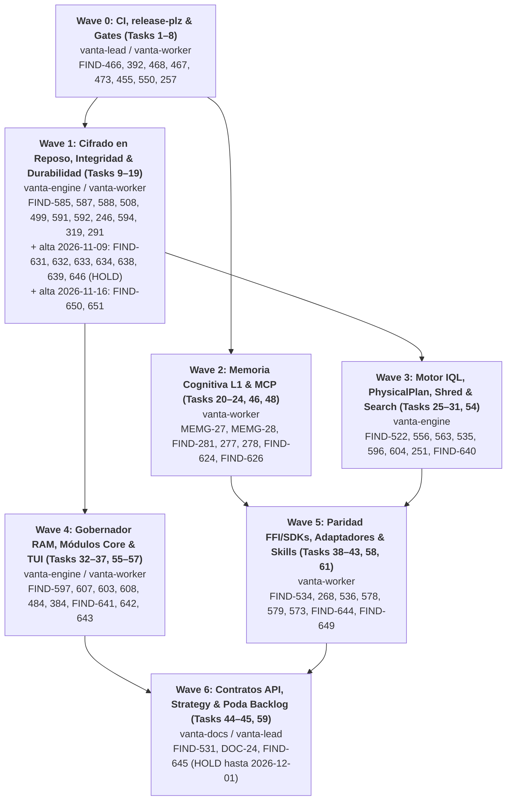

# Plan de Ejecución: Consolidación Técnica Integral Pre-`v0.10.0` (Ventana Pre-Diciembre)

> **Campaign ID:** 9c4e7a21-6b38-4f90-a512-8d3e1b704c95
> **Inicio:** 2026-11-07
> **Estado:** ✅ CAMPAÑA CERRADA — las 63 tareas tienen código aterrizado y pusheado en `develop` (hasta `884363b5a`); T44 (`FIND-531`, commit `884363b5a`) y T45 (`DOC-24`, esta reconciliación) completadas; migración de 103 filas `✅ Completada` del Backlog a `docs/dev/avance/` ejecutada 2026-11-20 (37 degradadas a `🟡 Parcial` por falta de evidencia — trabajo vivo real). Plan archivado.
> **Fuente:** `docs/dev/Backlog.md`, `docs/dev/strategy/ROADMAP.md`, `docs/dev/extraccion/Backlog-OpenViking-VantaDB.md`, `docs/dev/extraccion/transversal/CONSOLIDATED.md`
> **Autonomous:** false

## Contexto Estratégico y Ventana de Ejecución (`2026-11-07` → `2026-12-01`)

1. **Pausa de Tareas Externas y Comerciales hasta el `2026-12-01`:** La compra de dominio (`vantadb.dev`), pasarelas de cobro/banca (Creem.io, Ko-fi, Patreon, Binance Pay), bootstrap manual de tokens OIDC de primer publish, *Stranger Test* humano (`FASE-A`) y outreach (`docs/dev/Backlog-negocio.md`) quedan formalmente congelados hasta el **1 de diciembre de 2026**. El objetivo de esta campaña es producir un **candidato técnico 100% endurecido y estabilizado para el 1 de diciembre**; la publicación efectiva quedará condicionada a la apertura y superación de los gates humanos pendientes.
2. **Versión Objetivo SemVer y release-plz (`v0.10.0`, NO `v1.0.0`) — Dictamen Forense Cerrado (2026-11-18, `gap-release-version` #17 sobre `v0.9.0..fcfc3f875`, 419 commits):**
   - **Confirmación determinista `v0.10.0`:** Los 22 manifiestos acoplados están en `0.9.0` (`node scripts/docs/sync-workspace-version.mjs --check` → OK). En `release-plz.toml`, solo `vantadb` publica (`vantadb-wasm` y `vanta-memory` tienen `release = false`), con `breaking_always_increment_major = false` (default) y `features_always_increment_minor = false` (default). Bajo Cargo SemVer en serie `0.y.z`, el dígito `minor` (`y`) es la frontera breaking: `VersionIncrement::breaking(0.9.0)` produce determinísticamente **`VersionIncrement::Minor` → `0.10.0`** (nunca `1.0.0`). El bump `0.9.0 → 0.10.0` queda garantizado por dos vías independientes y redundantes: (Vía A) Conventional Commits con `fix!:` / `BREAKING CHANGE:`, y (Vía B) `semver_check = true` (`cargo-semver-checks` detecta `SemverCheck::Incompatible` contra `vantadb v0.9.0`).
   - **Desglose de los 6 commits con `"BREAKING CHANGE"` (`git log v0.9.0..HEAD -i --grep="BREAKING CHANGE"`):**
     1. **2 roturas reales (Conventional Commits `!:` + footer `BREAKING CHANGE:`):**
        - `c76dde1bf` (`fix(index)!:` — `FIND-411`): unifica escala Euclidean de `-d^2` a `-d` en los 4 backends (`flat`, `HNSW`, `IVF`, `SCANN`), exige dimensión vectorial única por DB (`Error::DimensionMismatch`) y añade `IndexPort::vector_dimension(&self) -> Option<usize>` sin default impl al trait público (detectado también por `cargo-semver-checks`).
        - `de45d5961` (`fix(embeddings)!:` — `FIND-413`/`FIND-414`): el brazo vectorial de búsqueda IQL falla con error explícito cuando cae el provider de embeddings (en vez de devolver 0 hits silenciosos) e `INSERT` deja de persistir vectores dummy sintéticos.
     2. **4 menciones en minúsculas en prosa de documentos/benchmarks (NO breaking en `v0.10.0`, diferidos a `v0.11.0+`/`v1.0.0`):** `d628a2741` (`docs/dev/reviews/2026-10-21-encryption-envelope-por-pagina.md`), `a3da7cd78` (`docs/dev/tasks/**`), `2d9d66a95` y `004556f7a` (`BENCHMARKS.md` / reportes post-Paso 0) solo documentan que un futuro envelope por página W7 de 64 KiB implicaría un `"breaking change"` del trait público `VectorStoreRef::read_full_vector`, explícitamente diferido y sin cambio de código ni formato en `v0.10.0`.
   - **3 grupos adicionales sin `!:` que sí rompen la API pública Rust (`cargo-semver-checks` / `tests/api/public-api.txt`):**
     1. `f17caf906` (`refactor(deps): migrate chrono to jiff, byte-identical RFC3339 (FIND-652)`): autorizada por el owner; `vantadb::sdk::Value::{DateTime, ListDateTime}` y `vantadb::node::FieldValue::{DateTime, ListDateTime}` migran de `chrono::DateTime<Utc>` a `jiff::Timestamp` (-36 / +346 líneas en `public-api.txt`), preservando compatibilidad 100% byte-idéntica en disco y wire (RFC3339 `AutoSi` vía `tsfmt` + ` postcard`).
     2. `928df0970` (`feat(core): unify storage engine...`): retira de la superficie pública default `pub mod vantadb::engine` (`InMemoryEngine`, `EngineStats`, `QueryResult`, `SourceType`), `pub mod vantadb::columnar` y `pub mod vantadb::tokenizer` (-84 líneas `-pub` en `public-api.txt`).
     3. `f8bfd0a2d`, `18d36b792`, `a51dfcc1f` (`refactor(storage): read-only IndexReader facade... (FIND-655)`): encapsula `StorageEngine::{hnsw, vector_store}`, `index_coordinator()`, `vector_store_service()` y `wal_coordinator()` a `pub(crate)`, y cambia `StorageEngine::vec_index()` para devolver la fachada de solo lectura `IndexReader` (-11 / +38 líneas en `public-api.txt`).
   - **Notas obligatorias para el `CHANGELOG.md` de `v0.10.0`:** Dado que `f17caf906` (`FIND-652`), `928df0970` (`InMemoryEngine`) y `f8bfd0a2d`/`18d36b792`/`a51dfcc1f` (`FIND-655`) no llevan sufijo `!:` en el header de commit, `git-cliff` los listará bajo `Refactor`/`Features`; al curar el Release PR de `v0.10.0`, la sección `### Breaking Changes` de `CHANGELOG.md` DEBE incorporar explícitamente estas 3 entradas de API pública Rust junto a las 2 generadas automáticamente por `c76dde1bf` y `de45d5961`. `v1.0.0 GA` queda reservada para el Horizonte 2.
3. **Obligación Invariante de Compatibilidad Hacia Atrás:** El hecho de que `v0.10.0` sea un release aún no publicado no elimina las obligaciones de compatibilidad con versiones previas ya distribuidas (`v0.9.0` y anteriores). Todo cambio en estructuras on-disk (cifrado en reposo AES-256-GCM, snapshots de Fjall, WAL shardeado, VantaFile) DEBE incluir evaluación explícita de compatibilidad: capacidad de lectura y migración transparente de bases existentes, o rechazo fail-closed explícito y tipado (`Error::MigrationRequired`), prohibiendo terminantemente modificaciones destructivas o corrupción silenciosa de datos históricos.
4. **Referencia Temporal de la Auditoría:** El **snapshot de auditoría** es el commit `97c9623c8` (**261 commits** desde `v0.9.0`). El checkout actual al fijar este plan es `dba447539` (**334 commits** desde `v0.9.0`; lo nuevo desde el snapshot es documentación). Ambas referencias conviven: los símbolos y líneas citados en cada tarea corresponden al snapshot. **El Paso 0 de cada tarea DEBE revalidar el defecto contra el `HEAD` vigente en el momento de ejecutarla** antes de editar.
5. **Auditoría Forense de Realidad (Paso 0 sobre el snapshot `97c9623c8`):** Se auditaron exhaustivamente las **373 entradas técnicas no cerradas** a través de `Backlog.md` (`DELTA`, `Altas Octubre Ego/Surface/Repo-Health`, `FIND-98..409`, `Phase 49 MGR-*`, `Phase 59 H3-*`, `Phase 60 Auditoría Profunda v0.9.0`, diferidas de `Phase 62`), `Backlog-OpenViking-VantaDB.md`, `CONSOLIDATED.md` y `docs/dev/strategy/**`.
6. **Modo de Ejecución Aprobado y Autorizaciones del Owner:** El owner aprobó **FAIL_MODE=parallel** como modo de esta campaña, con **`MAX_CONCURRENT=3`** (`MAX_WIP = 3` en el servidor). El owner **autoriza** que el pipeline ejecute por su cuenta los contratos mecánicos de verificación y `campaign_verify_cmd`, y que haga **commit local semántico por tarea**. **`git push` sigue prohibido** sin instrucción explícita del owner. Las suites completas de workspace quedan reservadas al cierre de la campaña y se entregan al owner para su ejecución manual. El orden de ejecución lo gobiernan los campos `Wave:` (el único canal real de dependencias: el DAG lo infiere el orquestador leyendo `depende de X`) y la "Matriz de Exclusión por Archivo".
7. **Regla de Plan Único Activo:** Mientras la campaña esté activa, `docs/dev/plans/` debe contener **un solo plan modificado en las últimas 24 horas**. Crear o editar otro plan hace que `findPlanFile` lance `Ambiguous active plan`, y `budgetPath`/`consumeBudget` resuelven contra el plan equivocado porque ignoran el `planFile` explícito. Consecuencia práctica: no crear planes nuevos ni reeditar planes archivados durante la campaña.
8. **`Autonomous: false` deliberado:** se mantiene así a propósito; en modo run significa non-stop con solo el Gate D crítico y el Gate V (siempre pregunta) activos, y el Gate C como auto+log.

## Resumen

| Resultado de Triaje (4-Gate) | Entradas Auditadas | Tareas Ejecutables en Plan | Criterio Aplicado |
|---|:---:|:---:|---|
| **DO (Ejecutar en esta campaña)** | **100** (83 base + 14 alta 11-09 + 3 alta 11-16) | **63 Tasks** (`Wave 0`–`Wave 6`) | Brechas verificadas en `HEAD`, alto impacto en durabilidad/seguridad/correctitud/paridad, appetite acotado pre-`v0.10.0` (3/3 Sí en Shape Up). |
| **DEFER (Posponer a `v0.11.0+` / `v1.0.0 GA`)** | **212** | 0 | Rediseños mayores (`EGO-07`, `EGO-10`, `JS-01/02`, `MGR-01..19`, `H3-*`, envelope W7 por página, WASM `vanta-memory`) o mejoras donde el gate actual ya está en verde (`ponytail`). |
| **SKIP (Ya resueltas en `HEAD` / obsoletas)** | **58 declarado** (la enumeración lista 59 IDs primarios + 4 alias) | 0 | Símbolo/archivo eliminado o fix ya aterrizado en `develop` (`CRASH-01`/`FIND-248`, `FIND-221`, `EGO-14`, `EGO-16`, `NOT-05`, `MEM0-04`, etc.). La fuente de verdad es la enumeración de la "Síntesis de Exclusiones"; se purgan fila por fila en `Task 45`. |
| **BLOQUEADO (Pausa `2026-12-01` / `desktop` / externo)** | **20 declarado** (la enumeración lista 18; faltan 2 IDs por identificar) | 0 | Primer publish externo/dominio pausados al `2026-12-01`, worktree separado `develop-desktop`, o APIs pagas externas (Zep Cloud / OpenAI). |
| **TOTAL AUDITADO** | **390 declarado** (373 base + 17 altas; ver nota) | **63 Tasks** | Las cifras DO (83 base + 17 altas = 100) y DEFER (212) son las declaradas por el reporte forense; SKIP y BLOQUEADO tienen desviaciones abiertas. |

> **Nota de reconciliación abierta:** los totales de SKIP (58) y BLOQUEADO (20) son los declarados en las cabeceras; las celdas de la "Síntesis de Exclusiones del Triaje" enumeran 59 IDs primarios (+4 alias) y 18 respectivamente. La enumeración es la fuente de verdad. Ningún recuento agregado de esta tabla autoriza purgar filas del backlog.

Status: ⬆️ uphill = 0 · ⬇️ downhill = 63 (las 63 tareas cuentan con símbolos verificados en `HEAD`, blast radius acotado y contrato mecánico determinista; al 2026-11-19: las 63 tareas declaran `Estado: ✅` con código en `develop` — implementación de la campaña completa; en vuelo solo los cierres documentales T44 `FIND-531` y T45 `DOC-24` y la migración administrativa de filas `✅ Completada` a `docs/dev/avance/`).

## Arquitectura de Olas (Waves 0 → 6) y Paralelismo Seguro



## Matriz de Exclusión por Archivo (obligatoria para FAIL_MODE=parallel)

> **Advertencia:** con `MAX_CONCURRENT=3`, dos tareas que compartan archivo NUNCA pueden estar en la misma wave paralela; el orden serial de esta tabla es vinculante.

Construida a partir del campo `Archivos clave` de las 63 tareas (las 14 del alta del 2026-11-09 y las 3 del alta del 2026-11-16 se recalcularon mecánicamente contra todas las pendientes). Una colisión es **peligrosa** si las olas de ambas tareas no están estrictamente ordenadas por el DAG de olas (mismo wave, o waves sin precedencia entre sí); es **resuelta por olas** si una wave precede a la otra. Política: el número de tarea menor va primero y la mayor depende de su predecesor directo.

| Archivo compartido | Tareas que lo tocan | Tipo | Orden serial impuesto |
|---|---|---|---|
| `.github/workflows/ci-rust.yml` | FIND-466 (W0), FIND-392 (W0), FIND-455 (W0) | Peligrosa (misma wave) | FIND-466 → FIND-392 → FIND-455 |
| `.github/workflows/ci-rust.yml` | FIND-466, FIND-392, FIND-455 (W0) con FIND-591 (W1) | Resuelta por olas (W0 precede a W1) | W0 completa antes de FIND-591 |
| `.github/workflows/docs-gates.yml` | FIND-466 (W0), FIND-468 (W0) | Peligrosa (misma wave) | FIND-466 → FIND-468 |
| `src/storage/engine/init.rs` | FIND-585 (W1), FIND-508 (W1) | Peligrosa (misma wave) | FIND-585 → FIND-508 |
| `src/crypto/registry.rs` | FIND-585 (W1), FIND-508 (W1) | Peligrosa (misma wave) | FIND-585 → FIND-508 |
| `src/storage/engine/init.rs` | FIND-585, FIND-508 (W1) con FIND-597 (W4) | Resuelta por olas (W1 precede a W4) | W1 completa antes de FIND-597 |
| `vanta-memory/src/core/record/l1_writer.rs` | MEMG-27 (W2), FIND-281 (W2) | Peligrosa (misma wave) | MEMG-27 → FIND-281 |
| `src/sdk/api/memory.rs` | FIND-535 (W3), FIND-251 (W3) | Peligrosa (misma wave) | FIND-535 → FIND-251 |
| `vantadb-node/src/lib.rs` | FIND-534 (W5), FIND-268 (W5) | Peligrosa (misma wave) | FIND-534 → FIND-268 |
| `vantadb-node/index.d.ts` | FIND-534 (W5), FIND-268 (W5) | Peligrosa (misma wave) | FIND-534 → FIND-268 |
| `vantadb-ts/src/native.ts` | FIND-268 (W5), FIND-536 (W5) | Peligrosa (misma wave) | FIND-268 → FIND-536 |
| `vantadb-mcp/src/handlers/tools.rs` | FIND-278 (W2), FIND-624 (W2) | Peligrosa (misma wave) | FIND-278 → FIND-624 |
| `docs/user/operations/CONFIGURATION.md` | FIND-587 (W1), FIND-531 (W6) | Resuelta por olas (W1 precede a W6) | W1 completa antes de FIND-531 |
| `src/storage/engine/mod.rs` | FIND-319 (W1), FIND-607 (W4) | Resuelta por olas (W1 precede a W4) | W1 completa antes de FIND-607 |
| `src/storage/engine/mod.rs` | FIND-319 (W1), FIND-651 (W1) | Peligrosa (misma wave) — alta 2026-11-16 | FIND-319 → FIND-651 |
| `src/sdk/api/memory.rs` | FIND-651 (W1) con FIND-535, FIND-251, FIND-640 (W3) | Resuelta por olas (W1 precede a W3) | W1 completa antes de FIND-535 |
| `.github/workflows/ci-rust.yml` | FIND-591 (W1), FIND-633 (W1), FIND-638 (W1), FIND-650 (W1) | Peligrosa (misma wave) — alta 2026-11-09, FIND-650 el 2026-11-16 | FIND-591 → FIND-633 → FIND-638 → FIND-650 |
| `src/storage/engine/tests/encryption.rs` | FIND-632 (W1), FIND-634 (W1) | Peligrosa (misma wave) | FIND-632 → FIND-634 |
| `src/crypto.rs` | FIND-634 (W1), FIND-646 (W1) | Peligrosa (misma wave) | FIND-634 → FIND-646 |
| `src/sdk/api/memory.rs` | FIND-535, FIND-251, FIND-640 (W3) | Peligrosa (misma wave) | FIND-535 → FIND-251 → FIND-640 |
| `src/llm.rs` | FIND-642 (W4), FIND-643 (W4) | Peligrosa (misma wave) | FIND-642 → FIND-643 |
| `src/embedding_health.rs` | FIND-484 (W4), FIND-643 (W4) | Peligrosa (misma wave) | FIND-484 → FIND-643 |
| `embeddings/download.py`, `embeddings/verify.py` | FIND-384 (W4), FIND-641 (W4) | Peligrosa (misma wave) | FIND-384 → FIND-641 |
| `integrations/mem0/pyproject.toml`, `integrations/` | FIND-579 (W5), FIND-644 (W5), FIND-649 (W5) | Peligrosa (misma wave) | FIND-579 y FIND-644 → FIND-649 (579 y 644 no comparten fichero) |

**Dependencias semánticas sin archivo compartido (también serializadas):** FIND-587 y FIND-508 tras FIND-585 (flujo de `encryption.registry`); FIND-563 tras FIND-522 (dependencia declarada si toca AST/planner); FIND-573 tras FIND-578 (valida snippets contra `__init__.pyi` actualizado); DOC-24 tras FIND-531.

**Pares de olas sin precedencia entre sí (solapables):** W1∥W2, W2∥W3, W2∥W4, W3∥W4 y W4∥W5. En el estado actual del plan ninguno comparte archivos en `Archivos clave`; no editar `Archivos clave` de tareas sin recalcular esta matriz.

**Solo lectura / a vigilar (no serializan):** `docs/dev/workflow/PUBLISH.md` y `release.yml` (FIND-467 verifica; FIND-550 puede documentar el orden de publicación en `PUBLISH.md`); `vantadb-node/src/lib.rs` leído por FIND-536 y `vantadb-wasm/src/lib.rs` leído por FIND-268 y FIND-536; si alguna de estas tareas pasa a editar esos archivos, debe serializarse tras las tareas que ya los tocan.

## Reglas Duras de Ejecución de la Campaña (`.opencode/AGENTS.md`)

1. **Regla 1 (`-p <crate> --locked` y `--build-jobs 2`):** Prohibido invocar `cargo test` o `cargo nextest` en raíz sin `-p <crate>` durante iteraciones de tarea; limitar paralelismo de enlazado en Windows con `--build-jobs 2`.
2. **Regla 0 (Análisis de Impacto):** Antes de editar en `ACT`, ejecutar `codegraph_codegraph_explore` + `codebase-memory` sobre los símbolos listados en `Archivos clave`.
3. **Regla 3 (Sincronía Código ↔ Docs):** Todo cambio en superficie CLI, IQL, configuración o bindings actualiza su documentación normativa antes de cerrar la campaña (`Wave 6`).
4. **Regla 7 (Git y Roles):** Los ejecutores (`vanta-engine`, `vanta-worker`, `vanta-docs`) implementan y verifican en su dominio; solo `vanta-lead` realiza commits locales Semánticos (Conventional Commits) y **jamás ejecuta `git push` sin orden explícita del owner**.
5. **Regla 8 (Orden Global de Locks):** Prohibido alterar la jerarquía `cardinality_stats → insert_lock → {wal, pending_hnsw_batch, hnsw, vstore, volatile_cache, backend}`.
6. **Regla de verificación transversal (lecciones del push 2026-11-16):** (a) todo contrato que use `--features encryption` se ejecuta **también** con las features del core gate (`--no-default-features --features cli,fjall,memmap2,fs2,roaring`), que son las del pre-push; (b) una tarea que añade o cambia código `#[cfg(unix)]`/`#[cfg(target_os = ...)]` pasa `dev-tools/check-unix.ps1` antes del commit y solo se cierra cuando el CI de Linux del commit está verde; (c) no se declara verde un área cuyo CI no corre en `develop`: se comprueba con `gh run list --commit <sha>` qué workflows se dispararon.

---

## Tasks

### Task 1: FIND-466 — Blindar filtros `paths:` en workflows de CI para evitar checks colgados (absorbe FIND-582 M-13)

- **Ruta:** vanta-lead
- **Wave:** Wave 0 · sin dependencias · paralelizable con FIND-467, FIND-473, FIND-550, FIND-257 · archivos exclusivos: `.github/workflows/ci-rust.yml`, `.github/workflows/docs-gates.yml`, `.github/workflows/ci-fleet.yml` (precede a FIND-392 y FIND-455 por `ci-rust.yml` y a FIND-468 por `docs-gates.yml`)
- **Appetite:** max 2h
- **Esfuerzo:** 🟢 1h
- **Prioridad:** 🔴
- **Cynefin:** 🟦 obvio — causa-efecto determinista en triggers `pull_request.paths` de GitHub Actions
- **Archivos clave:** `.github/workflows/ci-rust.yml`, `.github/workflows/docs-gates.yml`, `.github/workflows/ci-fleet.yml`
- **Fuente:** `docs/dev/Backlog.md` (Phase 60 S1 L489 + Phase 60 Adapters L626 `M-13`)
- **Verificación real:** ✅ CÓDIGO-REAL (revalidada contra `dba447539`) — `.github/workflows/ci-rust.yml:29-47` omite `release-plz.toml` y `release-manifest.json` (ya incluye `.github/workflows/ci-rust.yml` e `integrations/**`); `docs-gates.yml:41-59` omite `release-manifest.json`; `ci-fleet.yml` carece de `integrations/**` en `paths:`. Nota: PyYAML (YAML 1.1) carga la clave `on:` como booleano `True`, por lo que el contrato resuelve `d.get('on', d.get(True))`.
- **Gate Justificación:** Sí problema correcto (evita bloqueo indefinido de PRs de release hacia `v0.10.0`), Sí cabe en appetite (1h YAML), Sí es AHORA (protege todos los PRs de esta campaña)
- **Gate Result:** ✅ DO
- **Contrato:** "python -c \"import yaml; g=lambda p:(lambda d: d.get('on', d.get(True)))(yaml.safe_load(open(p,encoding='utf-8'))); a=set(g('.github/workflows/ci-rust.yml')['pull_request']['paths']); assert {'release-plz.toml','release-manifest.json','.github/workflows/ci-rust.yml'} <= a, sorted(a); b=set(g('.github/workflows/docs-gates.yml')['pull_request']['paths']); assert 'release-manifest.json' in b, sorted(b); c=set(g('.github/workflows/ci-fleet.yml')['pull_request']['paths']); assert 'integrations/**' in c, sorted(c); print('OK')\""
- **Pre-mortem:** 1) Añadir `.github/workflows/**` global dispara matriz Rust pesada al editar workflows no relacionados · 2) Error de indentación YAML invalida el trigger · 3) Branch protection exige nombre exacto de job cuando no corre
- **Top 3 riesgos:** 1) Sobredisparo de CI en cambios menores de otros workflows · 2) Sintaxis glob inválida en GitHub Actions · 3) Omisión del propio archivo de workflow en su filtro `paths:`
- **Stop conditions:** Appetite excedido (>2h) · >3 fallos en validación YAML/gates · Premisa invalidada
- **DoD multi-nivel:** Task (contrato mecánico ✅ con evidencia en dos sentidos: el contrato DEBE fallar ANTES del fix —caso negativo, por `release-plz.toml`/`release-manifest.json` ausentes— y pasar DESPUÉS —caso positivo—; + task file sync + recitation) · Commit (conventional commit `ci(workflows):` + validación YAML) · Release (PRs de release `v0.10.0` reportan todos los checks requeridos)
- **Task file:** `docs/dev/tasks/FIND-466.md`
- **Estado:** ✅ COMPLETED
- **Branch:** `develop`
- **Commit:** `29a27e56f`
- **Notas:** SDP: `ci-cd-and-automation`, `doubt-driven-development`, `shipping-and-launch`

  **Risk Register:**
  | Prob×Impacto | Riesgo | Respuesta (mitigación) | Trigger / Due |
  |--------------|--------|------------------------|---------------|
  | 🟡×🟡 | Sobredisparo de matriz Rust por globs excesivos | Acotar a `release-plz.toml`, `release-manifest.json`, `rust-toolchain.toml` y el propio workflow | En revisión diff |
  | 🟢×🔴 | YAML malformado deja CI sin disparar | Parsear con `yaml.safe_load` en el contrato mecánico | VERIFY paso 1 |
  | 🟢×🟡 | `ci-fleet.yml` ignora regresiones en `integrations/**` | Incluir `integrations/**` explícitamente (`M-13`) | VERIFY paso 1 |

  **Iteraciones:**
  | # | Acción | Resultado | Herramienta |
  |---|--------|-----------|-------------|
  | — | — | — | — |

### Task 2: FIND-392 — Imponer `-p vantadb --locked` en los 5 pasos Cargo sin candado en `ci-rust.yml`

- **Ruta:** vanta-lead
- **Wave:** Wave 0 · depende de FIND-466 · paralelizable con FIND-468, FIND-467, FIND-473, FIND-550, FIND-257 · archivos exclusivos: `.github/workflows/ci-rust.yml` (colisión `ci-rust.yml`: cadena FIND-466 → FIND-392 → FIND-455)
- **Appetite:** max 1h
- **Esfuerzo:** 🟢 30m
- **Prioridad:** 🟠
- **Cynefin:** 🟦 obvio — aplicación directa de Regla 1 (`-p <crate> --locked`)
- **Archivos clave:** `.github/workflows/ci-rust.yml`
- **Fuente:** `docs/dev/Backlog.md` (Hallazgos pendientes L347)
- **Verificación real:** ✅ CÓDIGO-REAL — `.github/workflows/ci-rust.yml:314,341,351,385,395` invoca `cargo check` y `cargo nextest run` sin `-p vantadb` y/o sin `--locked`. Alcance del contrato: los jobs `test`, `test-windows` y `test-macos` (los 5 pasos). Quedan fuera por decisión pendiente del owner otros pasos de `ci-rust.yml` que tampoco cumplen la regla completa (p. ej. `public-api-snapshot`, `test-embedding-features`, `msrv`, `experimental-check`, `release-combo`; `minimal-versions` no admite `--locked` por diseño)
- **Gate Justificación:** Sí problema correcto (elimina deriva de `Cargo.lock` y compilaciones innecesarias en CI), Sí cabe en appetite (30m), Sí es AHORA (endurece Wave 0 antes de los cambios Rust de Waves 1–5)
- **Gate Result:** ✅ DO
- **Contrato:** "python -c \"import yaml,re; d=yaml.safe_load(open('.github/workflows/ci-rust.yml',encoding='utf-8')); bad=[(j,l.strip()) for j in ('test','test-windows','test-macos') for s in d['jobs'][j]['steps'] for l in (s.get('run') or '').replace(chr(92)+chr(10),' ').splitlines() if re.search(r'cargo (check|nextest run)',l) and not ('--locked' in l and re.search(r'(^| )(-p |--workspace)',l))]; assert not bad, 'infractor: '+repr(bad); import tomllib; ws=tomllib.load(open('Cargo.toml','rb'))['workspace']; pk={tomllib.load(open(m+'/Cargo.toml','rb'))['package']['name'] for m in ws['members']}; unk=sorted({p for j in ('test','test-windows','test-macos') for s in d['jobs'][j]['steps'] for l in (s.get('run') or '').replace(chr(92)+chr(10),' ').splitlines() if re.search(r'cargo (check|nextest run)',l) for p in re.findall(r'(?:^| )-p ([A-Za-z0-9_-]+)',l)}-pk); assert not unk, '-p que no es paquete del workspace: '+repr(unk); print('OK')\""
- **Pre-mortem:** 1) Algún job pretende testear un crate distinto de `vantadb` y `-p vantadb` reduce cobertura deseada · 2) `Cargo.lock` desactualizado hace fallar `--locked` · 3) Conflicto de líneas con Task 1 o Task 6
- **Top 3 riesgos:** 1) Reducción accidental de scope en un job intencionalmente workspace-wide · 2) Fallo de `--locked` si falta sincronizar lockfile · 3) Colisión de edición en `ci-rust.yml`
- **Stop conditions:** Appetite excedido (>1h) · >3 fallos en VERIFY · Premisa invalidada
- **DoD multi-nivel:** Task (contrato mecánico ✅ + task file sync + recitation) · Commit (`ci(rust): enforce -p and --locked in ci-rust`) · Release (CI determinista rumbo a `v0.10.0`)
- **Task file:** `docs/dev/tasks/FIND-392.md`
- **Estado:** ✅ COMPLETED
- **Branch:** `develop`
- **Commit:** `934c55c97` + corrección de regresión (ver Notas)
- **Notas:** SDP: `ci-cd-and-automation`, `doubt-driven-development`. **Regresión detectada en el CI del push del 2026-11-09 y corregida:** `934c55c97` usó el **nombre de directorio** `vantadb-python` en `-p`, pero el paquete se llama `vantadb_py`. Cargo abortaba con `package ID specification 'vantadb-python' did not match any packages` y los jobs `Tests (Linux/Windows/macOS)` fallaban. El contrato original y la revisión (también la del orquestador, que comparó directorios de `default-members` en vez de nombres de paquete) no lo detectaron. El contrato se endureció: ahora exige que todo `-p` resuelva a un paquete del workspace (falla contra `934c55c97` con `['vantadb-python']` y pasa tras el arreglo). Reproducido en local: `cargo check -p vantadb -p vantadb_py -p vanta-memory -p vantadb-server -p vantadb-mcp --locked` con y sin `--features "cli,arrow,tls,opentelemetry"` → exit 0

  **Risk Register:**
  | Prob×Impacto | Riesgo | Respuesta (mitigación) | Trigger / Due |
  |--------------|--------|------------------------|---------------|
  | 🟡×🟠 | Job requería `--workspace` intencionalmente | Inspeccionar el nombre y propósito de cada uno de los 5 steps (`L314..395`) antes de fijar `-p` vs `--workspace --locked` | Antes de editar |
  | 🟢×🟡 | `Cargo.lock` con deriva | Verificar `cargo check -p vantadb --locked` localmente | VERIFY |
  | 🟢×🟢 | Colisión en `ci-rust.yml` | Ejecutar secuencialmente tras Task 1 | Wave 0 orden |

  **Iteraciones:**
  | # | Acción | Resultado | Herramienta |
  |---|--------|-----------|-------------|
  | — | — | — | — |

### Task 3: FIND-468 — Fallar cerrado (`exit 1`) en `sync-workspace-version.mjs` y cablear `--check` en `docs-gates.yml` (absorbe FIND-469)

- **Ruta:** vanta-lead
- **Wave:** Wave 0 · depende de FIND-466 · paralelizable con FIND-392, FIND-467, FIND-473, FIND-455, FIND-550, FIND-257 · archivos exclusivos: `scripts/docs/sync-workspace-version.mjs`, `.github/workflows/docs-gates.yml` (colisión `docs-gates.yml` con FIND-466; sin archivos comunes con FIND-392 ni FIND-455)
- **Appetite:** max 2h
- **Esfuerzo:** 🟢 1h
- **Prioridad:** 🟠
- **Cynefin:** 🟦 obvio — script Node determinista + step de verificación en workflow existente
- **Archivos clave:** `scripts/docs/sync-workspace-version.mjs`, `.github/workflows/docs-gates.yml`
- **Fuente:** `docs/dev/Backlog.md` (Phase 60 S1 L491–492)
- **Verificación real:** ✅ CÓDIGO-REAL — `scripts/docs/sync-workspace-version.mjs:573` retorna código `0` en modo `--write` aunque una expresión regular no haga match o deje manifiestos desincronizados; `.github/workflows/docs-gates.yml` no ejecuta `--check`
- **Gate Justificación:** Sí problema correcto (garantiza que el bump automático a `0.10.0` sincronice Python/Node/TS/WASM/manifests sin fallos silenciosos), Sí cabe en appetite (1h), Sí es AHORA (pre-requisito directo del tren `v0.10.0`)
- **Gate Result:** ✅ DO
- **Contrato:** "node scripts/docs/sync-workspace-version.mjs --check && rg \"sync-workspace-version\\.mjs --check\" .github/workflows/docs-gates.yml"
- **Pre-mortem:** 1) En `HEAD` actual existe ya una deriva menor de versión en algún archivo secundario que hace fallar `--check` · 2) `--write` rompe idempotencia cuando la versión ya coincide · 3) CRLF en Windows altera el regex match
- **Top 3 riesgos:** 1) Falso fallo cuando el archivo ya tiene la versión destino (no-op legítimo vs regex roto) · 2) Deriva latente actual descubierta al activar `--check` · 3) Sensibilidad a CRLF en Windows
- **Stop conditions:** Appetite excedido (>2h) · >3 fallos consecutivos · Premisa invalidada
- **DoD multi-nivel:** Task (contrato mecánico ✅ + test de regex miss retornando `!= 0` + recitation) · Commit (`fix(release): fail loud on version sync miss and enforce CI check`) · Release (cero deriva de versión en `v0.10.0`)
- **Task file:** `docs/dev/tasks/FIND-468.md`
- **Estado:** ✅ COMPLETED
- **Branch:** `develop`
- **Commit:** `fa34006cf`
- **Notas:** SDP: `ci-cd-and-automation`, `shipping-and-launch`, `git-workflow-and-versioning`

  **Risk Register:**
  | Prob×Impacto | Riesgo | Respuesta (mitigación) | Trigger / Due |
  |--------------|--------|------------------------|---------------|
  | 🟡×🟠 | Confundir archivo ya actualizado con regex sin match | Verificar que el patrón ancla existe en el archivo con independencia de si el valor ya es igual a `targetVersion` | Diseño en ACT |
  | 🟡×🟡 | Deriva preexistente en un manifiesto secundario | Corregir la deriva real en el mismo commit si `--check` la destapa | VERIFY |
  | 🟢×🟡 | Diferencias `\r\n` vs `\n` | Soportar `\r?\n` en todas las regex del script | VERIFY en Windows |

  **Iteraciones:**
  | # | Acción | Resultado | Herramienta |
  |---|--------|-----------|-------------|
  | — | — | — | — |

### Task 4: FIND-467 — Endurecer selector de rama `release-plz` y eliminar doble disparo TOCTOU en `release-wheels.yml` (absorbe FIND-472)

- **Ruta:** vanta-lead
- **Wave:** Wave 0 · sin dependencias · paralelizable con FIND-466, FIND-392, FIND-468, FIND-473, FIND-455, FIND-550, FIND-257 · archivos exclusivos: `.github/workflows/release.yml`, `.github/workflows/release-wheels.yml`
- **Appetite:** max 2h
- **Esfuerzo:** 🟢 1h
- **Prioridad:** 🟠
- **Cynefin:** 🟨 complicado — requiere alinear semántica de eventos GitHub Actions (`push.tags` con PAT vs `workflow_dispatch` de `fanout`) conforme a `PUBLISH.md`
- **Archivos clave:** `.github/workflows/release.yml`, `.github/workflows/release-wheels.yml`
- **Fuente:** `docs/dev/Backlog.md` (Phase 60 S1 L490, L495)
- **Verificación real:** ✅ CÓDIGO-REAL — `.github/workflows/release.yml:125` filtra ramas con `startswith("release-plz-")` tomando `[0]`, colisionando con ramas manuales `release-plz-fix-*`; además `release.yml:187` dispara `release-wheels.yml` vía `fanout` mientras el tag creado con PAT ya lo dispara por `on.push.tags` (`release-wheels.yml:18-19`), causando carrera HTTP 400 en PyPI
- **Gate Justificación:** Sí problema correcto (elimina dos causas directas de fallo del post-mortem `0.9.0`), Sí cabe en appetite (1h), Sí es AHORA (debe estar listo antes de abrir el PR de release `v0.10.0` en diciembre)
- **Gate Result:** ✅ DO
- **Contrato:** "python -c \"import yaml,re; L=lambda p: yaml.safe_load(open(p,encoding='utf-8')); g=lambda d: d.get('on', d.get(True)); w=L('.github/workflows/release-wheels.yml'); r=L('.github/workflows/release.yml'); c=w.get('concurrency'); assert c and c.get('group') and 'cancel-in-progress' in c, 'wheels: concurrency incompleta'; assert c['cancel-in-progress'] is not True, 'wheels: cancel-in-progress true'; runs=[s.get('run') or '' for j in r['jobs'].values() for s in j.get('steps',[])]; sel=[x for x in runs if 'headRefName' in x]; assert sel, 'release.yml: sin selector de rama'; q=chr(34); m=re.search(r'test.'+q+r'(.release-plz-[^'+q+r']*)'+q, ' '.join(sel)); assert m, 'release.yml: selector sin jq test(^release-plz-...)'; pat=m.group(1); assert re.match(pat,'release-plz-2026-10-20T08-17-56Z'), ('el patron rechaza la rama real de release-plz',pat); assert not re.match(pat,'release-plz-fix-urgente'), ('el patron acepta una rama manual',pat); dbl=any('gh workflow run release-wheels.yml' in x for x in runs) and 'tags' in (g(w).get('push') or {}); assert not dbl, 'doble disparo: fanout + push.tags en release-wheels'; print('OK')\""
- **Pre-mortem:** 1) Restringir en exceso el regex de rama excluye el formato real que emite `release-plz` (`release-plz-<timestamp>`) · 2) Quitar uno de los dos triggers deja sin forma de re-disparar manualmente `release-wheels.yml` · 3) `concurrency` con `cancel-in-progress: true` mata una subida a PyPI a mitad de vuelo
- **Top 3 riesgos:** 1) `cancel-in-progress: true` abortando publish parcial a PyPI · 2) Regex de rama incompatible con `release-plz` upstream · 3) Pérdida de capacidad de recuperación manual vía `workflow_dispatch`
- **Stop conditions:** Appetite excedido (>2h) · >3 fallos en validación · Premisa invalidada
- **DoD multi-nivel:** Task (contrato mecánico ✅ + verificación contra `docs/dev/workflow/PUBLISH.md` + recitation) · Commit (`fix(ci): deduplicate release-wheels trigger and tighten release-plz branch match`) · Release (publish PyPI sin carrera TOCTOU en `v0.10.0`)
- **Task file:** `docs/dev/tasks/FIND-467.md`
- **Estado:** ✅ COMPLETED
- **Branch:** `develop`
- **Commit:** `13e167d62`
- **Notas:** SDP: `ci-cd-and-automation`, `shipping-and-launch`, `doubt-driven-development`

  **Risk Register:**
  | Prob×Impacto | Riesgo | Respuesta (mitigación) | Trigger / Due |
  |--------------|--------|------------------------|---------------|
  | 🟡×🔴 | Cancelar en vuelo un job de publicación a PyPI | Usar `cancel-in-progress: false` + eliminar disparo redundante en `fanout` (o dejar `workflow_dispatch` solo para recuperación manual) | ACT |
  | 🟡×🟠 | Selector de rama rechaza PR legítimo de `release-plz` | Matchear autor `github-actions[bot]` / regex exacto `^release-plz-[0-9]` y ordenar por PR abierto más reciente | ACT |
  | 🟢×🟡 | Divergencia con `PUBLISH.md` | Revisar `docs/dev/workflow/PUBLISH.md` líneas 1–120 antes de cerrar | VERIFY |

  **Iteraciones:**
  | # | Acción | Resultado | Herramienta |
  |---|--------|-----------|-------------|
  | — | — | — | — |

### Task 5: FIND-473 — Declarar `publish = false` en `vantadb-wasm/Cargo.toml`

- **Ruta:** vanta-lead
- **Wave:** Wave 0 · sin dependencias · paralelizable con FIND-466, FIND-392, FIND-468, FIND-467, FIND-455, FIND-550, FIND-257 · archivos exclusivos: `vantadb-wasm/Cargo.toml`, `release-plz.toml`
- **Appetite:** max 1h
- **Esfuerzo:** 🟢 15m
- **Prioridad:** 🟠
- **Cynefin:** 🟦 obvio — metadato estándar de Cargo para crate distribuido exclusivamente vía `wasm-pack`/npm
- **Archivos clave:** `vantadb-wasm/Cargo.toml`, `release-plz.toml`
- **Fuente:** `docs/dev/Backlog.md` (Phase 60 S1 L496)
- **Verificación real:** ✅ CÓDIGO-REAL — `vantadb-wasm/Cargo.toml:1-15` carece de `publish = false`, exponiendo a `cargo publish --workspace` o `release-plz` a intentar subir el binding WASM a crates.io si cambia `release-plz.toml`
- **Gate Justificación:** Sí problema correcto (defensa en profundidad para `release-plz` en `v0.10.0`), Sí cabe en appetite (15m), Sí es AHORA (higiene de empaquetado Wave 0)
- **Gate Result:** ✅ DO
- **Contrato:** "rg \"^publish\\s*=\\s*false\" vantadb-wasm/Cargo.toml && cargo check -p vantadb-wasm --locked"
- **Pre-mortem:** 1) `wasm-pack build` lee `publish = false` y omite algún campo en `pkg/package.json` · 2) Test de coherencia de versiones parsea `[package]` asumiendo orden fijo de claves · 3) `Cargo.lock` cambia inesperadamente
- **Top 3 riesgos:** 1) Interacción con `wasm-pack` al generar `pkg/package.json` · 2) Test `version_coherence.rs` sensible al layout de `Cargo.toml` · 3) Conflicto con `release-plz.toml`
- **Stop conditions:** Appetite excedido (>1h) · `wasm-pack` o `version_coherence` roto · Premisa invalidada
- **DoD multi-nivel:** Task (contrato mecánico ✅ + `version_coherence` verde + recitation) · Commit (`build(wasm): set publish = false in vantadb-wasm Cargo.toml`) · Release (`release-plz` ignora `vantadb-wasm` en crates.io)
- **Task file:** `docs/dev/tasks/FIND-473.md`
- **Estado:** ✅ COMPLETED
- **Branch:** `develop`
- **Commit:** `99ffce9dc`
- **Notas:** SDP: `shipping-and-launch`, `git-workflow-and-versioning`

  **Risk Register:**
  | Prob×Impacto | Riesgo | Respuesta (mitigación) | Trigger / Due |
  |--------------|--------|------------------------|---------------|
  | 🟢×🟠 | `wasm-pack` interpreta `publish = false` para npm | Verificar en código/docs de `wasm-pack` y test de empaquetado (`release-npm-wasm.yml` reescribe `pkg/package.json`) | VERIFY |
  | 🟢×🟡 | Fallo en `tests/version_coherence.rs` | Ejecutar `cargo nextest run --profile audit -p vantadb --test version_coherence --locked --build-jobs 2` | VERIFY |
  | 🟢×🟢 | Duplicidad inocua con `release-plz.toml` | Mantener ambos como defensa en profundidad | ACT |

  **Iteraciones:**
  | # | Acción | Resultado | Herramienta |
  |---|--------|-----------|-------------|
  | — | — | — | — |

### Task 6: FIND-455 — Añadir gate mecánico de ancestro (`origin/main` ancestro de `develop`) en PRs hacia `main`

- **Ruta:** vanta-lead
- **Wave:** Wave 0 · depende de FIND-392 · paralelizable con FIND-468, FIND-467, FIND-473, FIND-550, FIND-257 · archivos exclusivos: `.github/workflows/ci-rust.yml` (colisión `ci-rust.yml`: cadena FIND-466 → FIND-392 → FIND-455; FIND-591 (Wave 1) comparte el archivo y queda ordenado por ola)
- **Appetite:** max 1h
- **Esfuerzo:** 🟢 45m
- **Prioridad:** 🟠
- **Cynefin:** 🟦 obvio — `git merge-base --is-ancestor` con `fetch-depth: 0` en PRs con `base.ref == 'main'`
- **Archivos clave:** `.github/workflows/ci-rust.yml`
- **Fuente:** `docs/dev/Backlog.md` (Phase 60 S1 L486)
- **Verificación real:** ✅ CÓDIGO-REAL (remedido el 2026-11-08) — ningún job de `ci-rust.yml` verifica `git merge-base --is-ancestor origin/main HEAD` cuando un PR apunta a `main`, y la higiene `main → develop` depende de memoria humana (`AGENTS.md:50-51`). **Corrección de la premisa:** `git rev-list --count origin/main ^HEAD` devuelve hoy **0**, es decir `develop` ya contiene todo lo de `main` y no hay deriva activa; la cifra de "12 commits post-`v0.9.0` en `main`" que figuraba antes no implica divergencia. El gate es por tanto **preventivo** (evita que un futuro `develop → main` revierta un hotfix), no correctivo
- **Gate Justificación:** Sí problema correcto (impide revertir hotfixes de `main` al fusionar `develop → main` para `v0.10.0`), Sí cabe en appetite (45m), Sí es AHORA (debe existir antes del merge de lanzamiento)
- **Gate Result:** ✅ DO
- **Contrato:** "python -c \"import yaml; d=yaml.safe_load(open('.github/workflows/ci-rust.yml',encoding='utf-8')); hits=[(jn,j) for jn,j in d['jobs'].items() for s in j.get('steps',[]) if 'merge-base --is-ancestor' in (s.get('run') or '')]; assert hits, 'sin gate de ancestro'; jn,j=hits[0]; co=[s for s in j.get('steps',[]) if 'checkout' in str(s.get('uses') or '')]; assert co, ('el job del gate no hace checkout',jn); assert any((s.get('with') or {}).get('fetch-depth')==0 for s in co), ('el job del gate necesita fetch-depth: 0',jn); cond=str(j.get('if') or '')+' '+' '.join(str(s.get('if') or '') for s in j.get('steps',[])); assert 'main' in cond, ('el gate debe acotarse a PRs cuya base es main',jn); print('OK')\""
- **Pre-mortem:** 1) Shallow clone (`fetch-depth: 1`) hace que `merge-base` falle siempre por falta de historial · 2) El gate bloquea PRs generados por `release-plz` desde `main` a sí misma si la condición `if:` no filtra ramas `release-plz-*` · 3) `origin/main` no fue fetcheado en el runner
- **Top 3 riesgos:** 1) Shallow clone provoca falso negativo sistemático · 2) Bloqueo accidental del PR automático `release-plz-*` · 3) Ref `origin/main` ausente en checkout de PR
- **Stop conditions:** Appetite excedido (>1h) · >3 fallos en validación · Premisa invalidada
- **DoD multi-nivel:** Task (contrato mecánico ✅ + `fetch-depth: 0` explícito + exclusión de ramas `release-plz-*` si corresponde) · Commit (`ci(guard): enforce origin/main ancestry on PRs targeting main`) · Release (`develop → main` garantizado libre de regresiones de hotfixes)
- **Task file:** `docs/dev/tasks/FIND-455.md`
- **Estado:** ✅ COMPLETED
- **Branch:** `develop`
- **Commit:** `e87ede1f8`
- **Notas:** SDP: `ci-cd-and-automation`, `git-workflow-and-versioning`

  **Risk Register:**
  | Prob×Impacto | Riesgo | Respuesta (mitigación) | Trigger / Due |
  |--------------|--------|------------------------|---------------|
  | 🟡×🔴 | Shallow checkout rompe `git merge-base` | Configurar `fetch-depth: 0` y `git fetch origin main` explícito en el job ligero | ACT |
  | 🟢×🔴 | PR de `release-plz` bloqueado | Ejecutar cuando `github.base_ref == 'main'` (los PRs `release-plz-*` nacen de `main`, por lo que `origin/main` ya es ancestro; validar ambos casos) | ACT |
  | 🟢×🟡 | Latencia extra en PRs a `develop` | Condicionar el job con `if: github.event_name == 'pull_request' && github.base_ref == 'main'` | ACT |

  **Iteraciones:**
  | # | Acción | Resultado | Herramienta |
  |---|--------|-----------|-------------|
  | — | — | — | — |

### Task 7: FIND-550 — Re-inyectar `vantadb-node` en `optionalDependencies` en `release-npm-wasm.yml`

- **Ruta:** vanta-lead
- **Wave:** Wave 0 · sin dependencias · paralelizable con FIND-466, FIND-392, FIND-468, FIND-467, FIND-473, FIND-455, FIND-257 · archivos exclusivos: `.github/workflows/release-npm-wasm.yml`, `vantadb-ts/package.json`
- **Appetite:** max 2h
- **Esfuerzo:** 🟢 1h
- **Prioridad:** 🔴
- **Cynefin:** 🟨 complicado — requiere preservar la resolución limpia en `npm ci` durante el build sin eliminar `vantadb-node` del `package.json` final empaquetado en `npm publish`
- **Archivos clave:** `.github/workflows/release-npm-wasm.yml`, `vantadb-ts/package.json`
- **Fuente:** `docs/dev/Backlog.md` (Phase 60 FFI/Bindings L596)
- **Verificación real:** ✅ CÓDIGO-REAL — `.github/workflows/release-npm-wasm.yml:242` elimina `vantadb-node` de `optionalDependencies` antes de `npm ci` para evitar `ETARGET` durante la carrera de propagación, pero **nunca lo restaura antes de `npm publish`**, provocando que los usuarios de `vantadb` en Node.js no instalen el binario nativo NAPI-RS y caigan silenciosamente a WASM
- **Gate Justificación:** Sí problema correcto (defecto P0 de empaquetado que arruina el rendimiento Node.js en `v0.10.0` y rompe `EGO-17`), Sí cabe en appetite (1h), Sí es AHORA (antes del publish de diciembre)
- **Gate Result:** ✅ DO
- **Contrato:** "python -c \"import yaml; d=yaml.safe_load(open('.github/workflows/release-npm-wasm.yml',encoding='utf-8')); st=d['jobs']['publish-ts']['steps']; ix=lambda f:[i for i,s in enumerate(st) if f(s.get('run') or '')]; q=chr(39)+'vantadb-node'+chr(39)+']='; m=lambda r: (lambda t: 'optionalDependencies' in t and ('optionalDependencies.vantadb-node=' in t or q in t))(r.replace(' ','')); ci=ix(lambda r: 'npm ci' in r); pub=ix(lambda r: 'npm publish' in r); rs=ix(m); assert ci and pub, 'faltan npm ci / npm publish'; assert rs, 'ningun step restaura optionalDependencies[vantadb-node]'; assert ci[0] < rs[0] < pub[-1], ('orden invalido', ci, rs, pub); print('OK')\""
- **Pre-mortem:** 1) Restaurar `optionalDependencies` antes de `npm test` dispara una resolución de red contra una versión aún no propagada en npm · 2) La versión inyectada queda desincronizada respecto al tag `v0.10.0` · 3) El orden de publicación publica `vantadb` antes que `vantadb-node`, rompiendo `npm install vantadb` para los primeros usuarios
- **Top 3 riesgos:** 1) Inyectar rango de versión erróneo en `optionalDependencies` · 2) Restaurar demasiado pronto (antes de `npm ci`) reintroduciendo `ETARGET` · 3) Orden de fanout `vantadb-node` vs `vantadb`
- **Stop conditions:** Appetite excedido (>2h) · >3 fallos en validación · Premisa invalidada
- **DoD multi-nivel:** Task (contrato mecánico ✅ por orden de steps en el job `publish-ts` — `npm ci` < restauración de `optionalDependencies['vantadb-node']` < `npm publish` — + verificación de que el tarball `npm pack --dry-run` contiene `optionalDependencies.vantadb-node` con la versión exacta) · Commit (`fix(release-npm): restore vantadb-node optionalDependency before npm publish`) · Release (`npm i vantadb@0.10.0` instala `vantadb-node` nativo automáticamente)
- **Task file:** `docs/dev/tasks/FIND-550.md`
- **Estado:** ✅ COMPLETED
- **Branch:** `develop`
- **Commit:** `6b7a37f4d`
- **Notas:** SDP: `ci-cd-and-automation`, `shipping-and-launch`, `source-driven-development`

  **Risk Register:**
  | Prob×Impacto | Riesgo | Respuesta (mitigación) | Trigger / Due |
  |--------------|--------|------------------------|---------------|
  | 🟡×🔴 | `ETARGET` si se restaura antes de `npm ci` | Restaurar `optionalDependencies["vantadb-node"] = pkg.version` justo antes de `npm pack` / `npm publish`, después de `npm ci` y build | ACT |
  | 🟢×🔴 | Tarball publicado sin `vantadb-node` | Añadir aserción en el step previo a publish leyendo el `package.json` final y fallando si falta `optionalDependencies['vantadb-node']` | VERIFY |
  | 🟡×🟠 | Carrera `vantadb` publicado antes que `vantadb-node` | Verificar en `release.yml` que `release-npm-wasm.yml` espera o usa `optionalDependencies` (npm tolera fallo de optional, pero documentar orden en `PUBLISH.md`) | VERIFY |

  **Iteraciones:**
  | # | Acción | Resultado | Herramienta |
  |---|--------|-----------|-------------|
  | — | — | — | — |

### Task 8: FIND-257 — Sanitizar saltos CRLF (`\r?\n`) en `scripts/docs/check-api-docs.mjs` (absorbe FIND-267)

- **Ruta:** vanta-worker
- **Wave:** Wave 0 · sin dependencias · paralelizable con FIND-466, FIND-392, FIND-468, FIND-467, FIND-473, FIND-455, FIND-550 · archivos exclusivos: `scripts/docs/check-api-docs.mjs`
- **Appetite:** max 1h
- **Esfuerzo:** 🟢 30m
- **Prioridad:** 🟡
- **Cynefin:** 🟦 obvio — normalización estándar `\r?\n` en parser JS ejecutado sobre Windows
- **Archivos clave:** `scripts/docs/check-api-docs.mjs`
- **Fuente:** `docs/dev/Backlog.md` (Hallazgos pendientes L251 `FIND-257` y duplicado L259 `FIND-267`)
- **Verificación real:** ✅ CÓDIGO-REAL (remedido contra `HEAD` el 2026-11-08) — `scripts/docs/check-api-docs.mjs:358,363` hace `text.split("\n")` y aplica regex anclada en `\{[ \t]*$`; en Windows con CRLF, el `\r` final rompe el match de todos los bloques `impl`. Con el worktree **limpio**, `--changed HEAD..WORKTREE` debería dar 0 cambios y en cambio falla con **126 remociones fantasma** (`0 added, 126 removed`, todas `rust impl ...`); la cifra de 53 que figuraba antes en este plan era incorrecta. Nota: `--self-test` pasa 17/17 porque sus fixtures sintéticos usan LF, así que NO detecta este defecto, y el contrato sin argumentos sale con `exit 2 = bad usage`
- **Gate Justificación:** Sí problema correcto (repara el gate de paridad de API docs en el SO Windows del owner antes de las Waves 5 y 6), Sí cabe en appetite (30m), Sí es AHORA (habilita verificación limpia en Wave 0)
- **Gate Result:** ✅ DO
- **Contrato:** "node scripts/docs/check-api-docs.mjs --self-test && node scripts/docs/check-api-docs.mjs --changed HEAD..WORKTREE"
- **Pre-mortem:** 1) Hay otros `.split(\"\\n\")` en el mismo archivo o en `scripts/docs/lib.mjs` con el mismo bug CRLF · 2) El script destapa una deriva real de API docs previamente enmascarada · 3) Regresión en runners Linux con LF
- **Top 3 riesgos:** 1) Otros puntos de `check-api-docs.mjs` siguen usando `\n` literal · 2) Descubrimiento de método nuevo no documentado · 3) Diferencia de comportamiento LF vs CRLF
- **Stop conditions:** Appetite excedido (>1h) · >3 fallos consecutivos · Premisa invalidada
- **DoD multi-nivel:** Task (contrato mecánico ✅ con 0 falsos positivos en Windows + recitation) · Commit (`fix(docs-gate): normalize CRLF line endings in check-api-docs.mjs`) · Release (gate de API docs fiable en Windows y Linux)
- **Task file:** `docs/dev/tasks/FIND-257.md`
- **Estado:** ✅ COMPLETED
- **Branch:** `develop`
- **Commit:** `13338001b`
- **Notas:** SDP: `systematic-debugging`, `ci-cd-and-automation`

  **Risk Register:**
  | Prob×Impacto | Riesgo | Respuesta (mitigación) | Trigger / Due |
  |--------------|--------|------------------------|---------------|
  | 🟡×🟡 | Otros `split("\n")` remanentes en el mismo archivo | Normalizar `const normalized = text.replace(/\r\n/g, "\n")` en la frontera de lectura del archivo | ACT |
  | 🟡×🟡 | Método real sin documentar sale a la luz | Si aparece brecha real de doc, coordinar con Task 44 o documentar en el acto | VERIFY |
  | 🟢×🟢 | Incompatibilidad LF | `replace(/\r\n/g, "\n")` es no-op exacto sobre LF | ACT |

  **Iteraciones:**
  | # | Acción | Resultado | Herramienta |
  |---|--------|-----------|-------------|
  | — | — | — | — |

---

### Task 9: FIND-585 — Unificar predicado `is_brand_new_db` y fallar cerrado ante modo mixto o pérdida de `encryption.registry` (absorbe FIND-590)

- **Ruta:** vanta-engine
- **Wave:** Wave 1 · depende de Wave 0 completa · paralelizable con FIND-588, FIND-499, FIND-591, FIND-592, FIND-246, FIND-594, FIND-319, FIND-291 · archivos exclusivos: `src/storage/engine/init.rs`, `src/backends/kv_crypto.rs`, `src/crypto/registry.rs` (precede a FIND-587 y FIND-508; `init.rs` y `registry.rs` compartidos con FIND-508; FIND-597 (Wave 4) comparte `init.rs`, ordenado por ola)
- **Appetite:** max 1d
- **Esfuerzo:** 🟡 4h
- **Prioridad:** 🔴
- **Cynefin:** 🟨 complicado — requiere coordinar invariantes de inicialización entre `StorageEngine::init` y `EncryptedBackend` (`kv_crypto.rs`) sin falsos positivos en bases nuevas
- **Archivos clave:** `src/storage/engine/init.rs`, `src/backends/kv_crypto.rs`, `src/crypto/registry.rs`
- **Fuente:** `docs/dev/Backlog.md` (Phase 60 Cifrado P2-01 L637 `FIND-585` + Caos L643 `FIND-590`)
- **Verificación real:** ✅ CÓDIGO-REAL (símbolos remedidos el 2026-11-08) — el predicado se llama **`is_new_database`**, no `is_brand_new_db` como decía antes este plan. `src/storage/engine/init.rs:1054` hace `let new_database = is_new_database(root, &data_dir);` y lo consume en `:1088` (`EncryptionMode::Plaintext => new_database && material.is_some() && !in_memory`), mientras `src/backends/kv_crypto.rs:448-456` decide con un predicado **distinto**: `!KeyRegistry::path_in(data_dir).exists()` combinado con `is_empty`. Son dos nociones divergentes de "base recién creada"; si hay varias DBs con `VANTADB_ENCRYPTION_KEY` global o si alguien borra `encryption.registry` sobre un backend no vacío (`init.rs:1251-1275`), el motor puede abrir en modo mixto mitad-cifrado o re-inicializar un registry nuevo corrompiendo lecturas posteriores
- **Gate Justificación:** Sí problema correcto (vulnerabilidad P0 de integridad/confidencialidad en la feature estrella `encryption` de `v0.10.0`), Sí cabe en appetite (4h), Sí es AHORA (antes del primer usuario con datos cifrados)
- **Gate Result:** ✅ DO
- **Contrato:** "cargo nextest run --profile audit -p vantadb --features encryption -E \"test(encryption)\" --locked --build-jobs 2"
- **Pre-mortem:** 1) Fjall crea archivos vacíos/journals iniciales antes de verificar `is_brand_new_db`, haciendo creer al guard que la DB ya tenía datos · 2) Bases legadas plaintext pre-`0.10.0` son rechazadas al abrir sin clave · 3) Apertura `InMemory` dispara falsamente el chequeo de disco
- **Top 3 riesgos:** 1) Falso positivo de "backend no vacío" tras `FjallBackend::open` en un directorio virgen · 2) Ruptura de apertura de bases plaintext existentes sin clave · 3) Divergencia entre backend Fjall y RocksDB
- **Stop conditions:** Appetite excedido (>1d) · >3 fallos en suite `encryption` · Premisa invalidada
- **DoD multi-nivel:** Task (contrato mecánico ✅ + tests RED→GREEN para (a) borrado de `encryption.registry` en DB poblada y (b) discrepancia clave/estado + revisión `vanta-audit`) · Commit (`fix(crypto): unify brand-new DB predicate and fail closed on missing registry`) · Release (`ADR-0057` invariante fail-closed cumplido)
- **Task file:** `docs/dev/tasks/FIND-585.md`
- **Estado:** ✅ COMPLETED
- **Branch:** `develop`
- **Commit:** `a59e7927e` (separado de `f993f3a13`, que lo había absorbido por una carrera del índice compartido; árbol verificado idéntico; respaldo `backup/pre-split-f993`)
- **Notas:** SDP: `security-and-hardening`, `systematic-debugging`, `test-driven-development`, `doubt-driven-development`. **Deuda registrada en la revisión del orquestador:** (1) la rama TOCTOU de `kv_crypto.rs` ("encrypted artefacts were detected at open but encryption.registry disappeared") devuelve `EncryptionCorrupt` (`VANTADB_CORRUPT`), mientras que ADR-0057 D2 (fila "Registry missing, artefacts say encrypted") y R-7 prescriben `EncryptionKeyRequired` (`VANTADB_VALIDATION_ERROR`). Es la misma situación que los guards de `init.rs` sí tipan como `EncryptionKeyRequired`, así que el código de error en el wire depende de en qué punto de la carrera se detecte; (2) las tablas de proceso `DETECTED_MODES` y `process_keys` no se purgan al cerrar la base, lo que deja crecimiento no acotado con muchas raíces distintas y decisiones obsoletas visibles para una apertura standalone posterior del backend en el mismo proceso

  **Risk Register:**
  | Prob×Impacto | Riesgo | Respuesta (mitigación) | Trigger / Due |
  |--------------|--------|------------------------|---------------|
  | 🟡×🔴 | Fjall crea metadatos vacíos al abrir y activa falso positivo | Evaluar presencia de artefactos/claves de usuario o capturar el estado del directorio *antes* de inicializar el backend KV | ACT paso 1 |
  | 🟡×🔴 | Rechazo accidental de DB plaintext válida sin `encryption.registry` | Distinguir explícitamente marcadores de formato cifrado (WAL v4 / VantaFile v3 / sentinel KV cifrado) vs plaintext (WAL v3 / VantaFile v2) | ACT paso 2 |
  | 🟢×🟠 | `BackendKind::InMemory` afectado | Excluir backends efímeros sin `storage_root` en disco o cubrir con test dedicado | VERIFY |

  **Iteraciones:**
  | # | Acción | Resultado | Herramienta |
  |---|--------|-----------|-------------|
  | — | — | — | — |

### Task 10: FIND-587 — Adquirir `.vanta.lock`, hacer `fsync` de `.bak` y retirar `--new-key <hex>` inseguro en `encryption rotate` (absorbe FIND-589)

- **Ruta:** vanta-worker
- **Wave:** Wave 1 · depende de Wave 0 completa, FIND-585 · paralelizable con FIND-588, FIND-508, FIND-499, FIND-591, FIND-592, FIND-246, FIND-594, FIND-319, FIND-291 · archivos exclusivos: `src/cli_handlers/encryption.rs`, `src/cli.rs`, `docs/user/operations/CONFIGURATION.md` (dependencia semántica del flujo de `encryption.registry`; `CONFIGURATION.md` compartido con FIND-531 (Wave 6), ordenado por ola)
- **Appetite:** max 1d
- **Esfuerzo:** 🟡 4h
- **Prioridad:** 🔴
- **Cynefin:** 🟨 complicado — requiere protocolo crash-safe de rotación de DEK/KEK con lock de proceso y entrada segura de clave sin exposición en `ps`/`/proc/<pid>/cmdline`
- **Archivos clave:** `src/cli_handlers/encryption.rs`, `src/cli.rs`, `docs/user/operations/CONFIGURATION.md`
- **Fuente:** `docs/dev/Backlog.md` (Phase 60 Cifrado P2-01 L639 `FIND-587` + L641 `FIND-589`)
- **Verificación real:** ✅ CÓDIGO-REAL — `src/cli_handlers/encryption.rs:12-83` rota `encryption.registry` sin adquirir `.vanta.lock` (carrera destructiva si hay un proceso vivo) y sin hacer `sync_all()` del `.bak` ni del directorio padre; `src/cli.rs:519` expone `--new-key <hex>` en texto claro en la línea de comandos
- **Gate Justificación:** Sí problema correcto (impide corrupción de la llave maestra durante rotación y fuga de KEK en tabla de procesos del SO antes de congelar el CLI público de `v0.10.0`), Sí cabe en appetite (4h), Sí es AHORA (cambiar flags CLI después del lanzamiento sería breaking change)
- **Gate Result:** ✅ DO
- **Contrato:** "cargo nextest run --profile audit -p vantadb --features encryption -E \"test(rotate) or test(encryption)\" --locked --build-jobs 2"
- **Pre-mortem:** 1) En Windows `File::sync_all()` sobre un directorio falla con `PermissionDenied` (`os error 5`) · 2) Tests CLI existentes invocan `--new-key` directamente y deben migrarse a `--new-key-file` / `--new-key-stdin` / env · 3) El lock `.vanta.lock` no se libera al salir o colisiona con una apertura interna posterior del handler
- **Top 3 riesgos:** 1) `sync_all()` sobre `Directory` falla en Windows · 2) Ruptura de tests CLI existentes que usan `--new-key` · 3) Auto-deadlock si el handler toma `.vanta.lock` y luego llama a `StorageEngine::open` que vuelve a intentar adquirirlo
- **Stop conditions:** Appetite excedido (>1d) · >3 fallos en VERIFY · Premisa invalidada
- **DoD multi-nivel:** Task (contrato mecánico ✅ + test de concurrencia que verifica rechazo cuando `.vanta.lock` está tomado + zeroize de buffers de clave) · Commit (`fix(cli-crypto): lock db, fsync backup, and replace --new-key CLI flag with safe key sources`) · Release (CLI seguro en `v0.10.0` + `CONFIGURATION.md` sincronizado)
- **Task file:** `docs/dev/tasks/FIND-587.md`
- **Estado:** ✅ COMPLETED (commits `c6603b658 + ccd8122d5`, 2026-11-19)
- **Branch:** `develop`
- **Commit:** `c6603b658`, `8f2a5f867` (audit #1: `.bak` durable dentro de `rotate()`; alcance ampliado a `src/crypto/registry.rs` por decisión del orquestador), `28586b96f` (audit R-1/R-2: re-wrap en dos fases y rollback en memoria)
- **Notas:** SDP: `security-and-hardening`, `api-and-interface-design`, `test-driven-development`. `--new-key` retirado sin deprecación: `encryption rotate` no existía en `v0.9.0`. **Auditoría 2026-11-18 (#18 — bloqueada de `avance` hasta fix en Oleada B):** `completions/` no fue regenerado tras `c6603b658` (`vanta-cli.bash`, `_vanta-cli`, `vanta-cli.fish`, `_vanta-cli.ps1` aún anuncian `--new-key` y omiten `--new-key-stdin`, rompiendo `check_completions.ps1`). Permanece bloqueada de `docs/dev/avance/` hasta su refresh en Oleada B. **Deuda previa (cubierta por FIND-634/636/637):** (1) si `persist()` falla **después** del `rename` (en `sync_parent_dir`, solo POSIX), el disco ya contiene el registry nuevo pero el snapshot restaura en memoria el viejo, y el comentario "The disk still holds the OLD registry" es incorrecto en esa rama. El impacto es bajo porque el CLI termina tras el error; (2) `ADR-0057:221` sigue citando `--new-key` (texto histórico del ADR); (3) no hay test `#[cfg(unix)]` del fallo de `sync_all` del `.bak` (no inyectable de forma portable)

  **Risk Register:**
  | Prob×Impacto | Riesgo | Respuesta (mitigación) | Trigger / Due |
  |--------------|--------|------------------------|---------------|
  | 🔴×🟠 | `sync_all()` de directorio no soportado en Windows | Hacer `file.sync_all()` en todas las plataformas y condicionar el `sync_all()` del directorio padre con `#[cfg(unix)]` (patrón canónico del repo) | ACT |
  | 🟡×🔴 | Auto-deadlock de `.vanta.lock` | Adquirir exactamente el mismo guard de lock que usa el motor sin re-abrir `StorageEngine` debajo, liberándolo al terminar | ACT |
  | 🟡×🟡 | Tests o scripts internos usando `--new-key` | Buscar todas las ocurrencias con `rg "new-key"` en el workspace y migrarlas a `--new-key-file` / env D2 | ACT paso 1 |

  **Iteraciones:**
  | # | Acción | Resultado | Herramienta |
  |---|--------|-----------|-------------|
  | — | — | — | — |

### Task 11: FIND-588 — Redactar secretos en `Debug` de `Config` y aplicar zeroize sobre material sensible

- **Ruta:** vanta-worker
- **Wave:** Wave 1 · depende de Wave 0 completa · paralelizable con FIND-585, FIND-587, FIND-508, FIND-499, FIND-591, FIND-592, FIND-246, FIND-594, FIND-319, FIND-291 · archivos exclusivos: `src/config.rs`
- **Appetite:** max 4h
- **Esfuerzo:** 🟢 2h
- **Prioridad:** 🟠
- **Cynefin:** 🟦 obvio — implementación explícita de `fmt::Debug` con `[REDACTED]` + limpieza en memoria
- **Archivos clave:** `src/config.rs`
- **Fuente:** `docs/dev/Backlog.md` (Phase 60 Cifrado P2-01 L640)
- **Verificación real:** ✅ CÓDIGO-REAL — `src/config.rs:248-266,718-993` deriva `#[derive(Debug)]` exponiendo en claro `encryption_key`, `api_key`, `jwt_secret` y tokens ante cualquier `tracing::debug!("{:?}", config)` o pánico de test
- **Gate Justificación:** Sí problema correcto (evita fuga de llaves AES-256 y secretos JWT en logs/telemetría), Sí cabe en appetite (2h), Sí es AHORA (higiene obligatoria de seguridad pre-`v0.10.0`)
- **Gate Result:** ✅ DO
- **Contrato:** "cargo nextest run --profile audit -p vantadb -E \"test(config)\" --locked --build-jobs 2"
- **Pre-mortem:** 1) `Config` implementa `Clone`, por lo que `Drop` custom entra en conflicto con destructuring parcial si se mueve un campo · 2) Algún test compara el string `format!("{:?}", cfg)` esperando ver un valor de prueba · 3) Se olvida redactar una sub-struct anidada dentro de `Config`
- **Top 3 riesgos:** 1) Conflicto de `Drop` con movimientos parciales de campos de `Config` · 2) Sub-structs anidadas con `#[derive(Debug)]` siguen filtrando secretos · 3) Tests unitarios asertando el output literal de `Debug`
- **Stop conditions:** Appetite excedido (>4h) · >3 fallos en compilación/tests · Premisa invalidada
- **DoD multi-nivel:** Task (contrato mecánico ✅ + test unitario verificando que `format!("{:?}", cfg)` NO contiene los secretos canarios sino `[REDACTED]`) · Commit (`fix(security): redact secrets in Config Debug impl and zeroize key material`) · Release (cero secretos en trazas de `v0.10.0`)
- **Task file:** `docs/dev/tasks/FIND-588.md`
- **Estado:** ✅ COMPLETED
- **Branch:** `develop`
- **Commit:** `960420853`, `1e3abcce9` (audit: userinfo de URL)
- **Notas:** SDP: `security-and-hardening`, `test-driven-development`

  **Risk Register:**
  | Prob×Impacto | Riesgo | Respuesta (mitigación) | Trigger / Due |
  |--------------|--------|------------------------|---------------|
  | 🟡×🟠 | Movimiento parcial de campos impedido por `impl Drop for Config` | Encapsular secretos en un newtype `SecretString` (o `Zeroizing<String>`) que implemente `Clone`, `ZeroizeOnDrop` y `Debug` redactado de raíz | ACT |
  | 🟡×🟠 | Secretos en sub-structs (`AuthConfig`, `TlsConfig`, etc.) | Auditar todas las structs de `src/config.rs` con `rg "key|secret|token|password" src/config.rs` | ACT paso 1 |
  | 🟢×🟢 | Ruptura de firma pública si cambia el tipo de un campo `pub` | Si el campo es `pub Option<String>`, implementar `Debug` manual en la struct contenedora y zeroize en `Drop` sin romper el tipo público | ACT |

  **Iteraciones:**
  | # | Acción | Resultado | Herramienta |
  |---|--------|-----------|-------------|
  | — | — | — | — |

### Task 12: FIND-508 — Impedir escritura de `encryption.registry` en aperturas `read_only` (`ADR-0001`)

- **Ruta:** vanta-engine
- **Wave:** Wave 1 · depende de Wave 0 completa, FIND-585 · paralelizable con FIND-587, FIND-588, FIND-499, FIND-591, FIND-592, FIND-246, FIND-594, FIND-319, FIND-291 · archivos exclusivos: `src/crypto/registry.rs`, `src/storage/engine/init.rs` (colisión `init.rs` y `registry.rs` con FIND-585)
- **Appetite:** max 2h
- **Esfuerzo:** 🟢 1h
- **Prioridad:** 🟠
- **Cynefin:** 🟦 obvio — barrera `read_only` clara sobre sistema de archivos posiblemente montado RO
- **Archivos clave:** `src/crypto/registry.rs`, `src/storage/engine/init.rs`
- **Fuente:** `docs/dev/Backlog.md` (Phase 60 Cifrado L527)
- **Verificación real:** ✅ CÓDIGO-REAL — `src/crypto/registry.rs:409` (`open_or_create`) crea y persiste `encryption.registry` en disco incluso cuando `StorageEngine` se abre con `read_only = true`, violando `ADR-0001` (Read-Only Barrier) y fallando en volúmenes montados de solo lectura
- **Gate Justificación:** Sí problema correcto (cumple `ADR-0001` y protege concurrencia lector MCP secundario + escritor primario `MCP-35`), Sí cabe en appetite (1h), Sí es AHORA (antes de lanzar `v0.10.0`)
- **Gate Result:** ✅ DO
- **Contrato:** "cargo nextest run --profile audit -p vantadb --features encryption -E \"test(read_only) or test(registry)\" --locked --build-jobs 2"
- **Pre-mortem:** 1) Un lector `read_only` sobre una DB cifrada existente necesita abrir el registry (`open_existing`), no crearlo · 2) Un lector `read_only` sobre un directorio inexistente espera `NotFound`, no `ReadOnly` · 3) Interacción con `MCP-35` fallback read-only
- **Top 3 riesgos:** 1) Bloquear la lectura legítima de `encryption.registry` ya existente en modo `read_only` · 2) Código de error incorrecto cuando falta el archivo · 3) Interacción con Task 9
- **Stop conditions:** Appetite excedido (>2h) · >3 fallos en VERIFY · Premisa invalidada
- **DoD multi-nivel:** Task (contrato mecánico ✅ + test que abre en `read_only` sin mutar ningún inodo ni crear `encryption.registry`) · Commit (`fix(crypto): honor read_only barrier in KeyRegistry initialization`) · Release (`ADR-0001` preservado bajo `encryption`)
- **Task file:** `docs/dev/tasks/FIND-508.md`
- **Estado:** ✅ COMPLETED
- **Branch:** `develop`
- **Commit:** `cba4cf96c`, `848e3c731` (review R-1)
- **Notas:** SDP: `security-and-hardening`, `test-driven-development`. **Deuda hallada en el RED (fuera de alcance, candidata a fila FIND-\*):** el backend Fjall escribe `keyspaces/*/vN` y journals `*.jnl` en aperturas `read_only`. Es una violación de ADR-0001 independiente del registry, que el test `read_only_open_never_writes_the_registry` excluye con justificación explícita

  **Risk Register:**
  | Prob×Impacto | Riesgo | Respuesta (mitigación) | Trigger / Due |
  |--------------|--------|------------------------|---------------|
  | 🟢×🔴 | Impedir abrir una DB cifrada existente en `read_only` | Separar `KeyRegistry::open_read_only` (solo lee `encryption.registry` existente) de `open_or_create` | ACT |
  | 🟢×🟡 | Crear `encryption.registry` en directorio RO causa `PermissionDenied` confuso | Retornar error claro antes de cualquier `File::create` cuando `read_only == true` | ACT |
  | 🟢×🟢 | Solapamiento con Task 9 | Ejecutar inmediatamente después de Task 9 | Wave 1 orden |

  **Iteraciones:**
  | # | Acción | Resultado | Herramienta |
  |---|--------|-----------|-------------|
  | — | — | — | — |

### Task 13: FIND-499 — Actualizar `migration::check_integrity()` para admitir VantaFile v3 y WAL v4 cifrados

- **Ruta:** vanta-engine
- **Wave:** Wave 1 · depende de Wave 0 completa · paralelizable con FIND-585, FIND-587, FIND-588, FIND-508, FIND-591, FIND-592, FIND-246, FIND-594, FIND-319, FIND-291 · archivos exclusivos: `src/migration.rs`
- **Appetite:** max 2h
- **Esfuerzo:** 🟢 1h
- **Prioridad:** 🔴
- **Cynefin:** 🟦 obvio — constante de versión desactualizada tras subir VantaFile a v3 y WAL a v4 en `ADR-0057`
- **Archivos clave:** `src/migration.rs`
- **Fuente:** `docs/dev/Backlog.md` (Phase 60 Cifrado L518)
- **Verificación real:** ✅ CÓDIGO-REAL — `src/migration.rs:518-531` compara la versión de cabecera únicamente contra `VFILE_VERSION` (`2`), marcando como corruptos todos los segmentos VantaFile v3 y WAL v4 generados con cifrado activo
- **Gate Justificación:** Sí problema correcto (`vanta-cli migrate check` / `doctor` reporta corrupción falsa en toda DB cifrada de `v0.10.0`), Sí cabe en appetite (1h), Sí es AHORA (defecto P0 de operación)
- **Gate Result:** ✅ DO
- **Contrato:** "cargo nextest run --profile audit -p vantadb --features encryption -E \"test(migration) or test(integrity)\" --locked --build-jobs 2"
- **Pre-mortem:** 1) `check_integrity()` intenta validar CRC de payloads cifrados asumiendo layout v2 sin envelope AEAD · 2) Versiones futuras `>= 4` pasan inadvertidas si no se acota el límite superior `VFILE_MAX_READABLE_VERSION` · 3) WAL v4 difiere en el offset de longitud/registro respecto a v3
- **Top 3 riesgos:** 1) Validación posterior al header interpreta bytes cifrados como registros v2 · 2) Desfase con constantes canónicas de `vfile.rs` y `wal.rs` · 3) Falta de test sobre DB cifrada real
- **Stop conditions:** Appetite excedido (>2h) · >3 fallos en VERIFY · Premisa invalidada
- **DoD multi-nivel:** Task (contrato mecánico ✅ + test que crea DB cifrada v3/v4 y verifica `check_integrity().is_ok()`) · Commit (`fix(migration): accept VantaFile v3 and WAL v4 in check_integrity`) · Release (`migrate check` compatible con `encryption` en `v0.10.0`)
- **Task file:** `docs/dev/tasks/FIND-499.md`
- **Estado:** ✅ COMPLETED
- **Branch:** `develop`
- **Commit:** `1218b3d66`, `058ee4864` y `b846b7ea3` (post-push 2026-11-16: los tests `compat_v090` y `test_migrate_wal_never_touches_encrypted` no compilaban o fallaban en el build sin `encryption` del gate pre-push; el contrato solo se ejecutó con `--features encryption`)
- **Notas:** SDP: `deprecation-and-migration`, `test-driven-development`, `systematic-debugging` **Hallazgo:** `check_integrity` y `plan_all` inspeccionaban `vector_store.vanta`, `index.bin` y `wal.log` en la raíz, ficheros que el motor nunca escribe, así que no comprobaban nada; ahora usan `data/vstore_L*.vanta`, `data/vanta*.wal` y `data/vector_index.bin`. **Deuda para FIND-631:** `migrate_wal` ya no sube la cabecera de un WAL anterior a v3 (corrompería el framing de la cadena) y en su lugar indica archivar y reproducir. `v0.9.0` ya escribía WAL v3, así que no afecta a bases publicadas; ADR-0060 debe recogerlo.

  **Risk Register:**
  | Prob×Impacto | Riesgo | Respuesta (mitigación) | Trigger / Due |
  |--------------|--------|------------------------|---------------|
  | 🟡×🔴 | `check_integrity` lee offsets de registro v2 sobre segmento v3 | Inspeccionar el cuerpo completo de `check_integrity` (`migration.rs:500-580`) y reutilizar las constantes/lectores canónicos de `vfile.rs` y `wal.rs` | ACT paso 1 |
  | 🟢×🟡 | Hardcodear `2..=3` en vez de importar constantes | Importar `VFILE_MIN_VERSION..=VFILE_MAX_READABLE_VERSION` y equivalentes de WAL | ACT |
  | 🟢×🟢 | Regresión con DB v2 plaintext | Conservar tests existentes de v2 y sumar test v3/v4 cifrado | VERIFY |

  **Iteraciones:**
  | # | Acción | Resultado | Herramienta |
  |---|--------|-----------|-------------|
  | — | — | — | — |

### Task 14: FIND-591 — Eliminar UB de alineación `from_raw_parts` en `archive.rs`, documentar `SAFETY` en `txn.rs` y habilitar `encryption` en Miri CI (absorbe FIND-396)

- **Ruta:** vanta-engine
- **Wave:** Wave 1 · depende de Wave 0 completa · paralelizable con FIND-585, FIND-587, FIND-588, FIND-508, FIND-499, FIND-592, FIND-246, FIND-594, FIND-319, FIND-291 · archivos exclusivos: `src/storage/archive.rs`, `src/storage/engine/txn.rs`, `src/storage/engine/get.rs`, `src/storage/engine/ops.rs`, `.github/workflows/ci-rust.yml` (alcance ampliado 2026-11-09: sin colisión con tareas pendientes; `ci-rust.yml` compartido con FIND-466, FIND-392 y FIND-455 (Wave 0), ordenado por ola)
- **Appetite:** max 1d
- **Esfuerzo:** 🟡 3h
- **Prioridad:** 🟠
- **Cynefin:** 🟨 complicado — requiere lectura libre de UB (`read_unaligned` / `bytemuck` / decodificación byte-a-byte) compatible con Miri estricto y Regla 4 (`// SAFETY:`)
- **Archivos clave:** `src/storage/archive.rs`, `src/storage/engine/txn.rs`, `src/storage/engine/get.rs` (helpers `decode_full_bytes` / `decode_binary_bytes`), `src/storage/engine/ops.rs`, `.github/workflows/ci-rust.yml`
- **Fuente:** `docs/dev/Backlog.md` (Phase 60 Caos L644 `FIND-591` + Hallazgos L351 `FIND-396`)
- **Verificación real:** ✅ CÓDIGO-REAL — `src/storage/archive.rs:383,413` construye slices tipados con `from_raw_parts` sobre buffers de bytes sin garantizar alineación (Undefined Behavior cazable por Miri); `src/storage/engine/txn.rs:683` tiene `unsafe { slice.align_to::<u64>() }` sin comentario `// SAFETY:` obligatorio (Regla 4); `.github/workflows/ci-rust.yml:747,763` ejecuta Miri sin la feature `encryption`. **Re-verificación 2026-11-09 (alcance ampliado):** el patrón no se limita a `archive.rs`. **UB real (6 sitios):** `from_raw_parts(.. as *const f32)` sobre bytes de nodo copiados en `archive.rs:383,413`, `engine/get.rs:89,597,624` y `engine/ops.rs:357`. La guarda INV-024 (`vfile.rs:811-819`) solo garantiza alineación **relativa al fichero**; en un segmento cifrado `node_bytes` es el blob descifrado en heap, cuya base no tiene alineación garantizada para `f32`. **Pérdida silenciosa (4 sitios):** `align_to::<u64>` en `archive.rs:439`, `engine/txn.rs:683` y `engine/get.rs:107,648` no es UB, pero con una base desalineada devuelve un tramo central más corto y el vector se descarta como `None` sin error. Además, `archive.rs` y `get.rs` duplican inline la decodificación de `decode_full_bytes` / `decode_binary_bytes`. **Fuera de alcance**: las vistas zero-copy sobre mmap con base alineada a página (`index_port.rs:120`, `node/vector_data.rs:176`, `vfile.rs:1362`) y los `align_to` de los tests de `storage/ops.rs:557,627`, sobre buffer en memoria alineado. Se revisa que su `// SAFETY:` sea correcto y que no puedan recibir bytes descifrados
- **Gate Justificación:** Sí problema correcto (elimina UB real en Rust `unsafe` y extiende el gate Miri al código criptográfico de `v0.10.0`), Sí cabe en appetite (3h), Sí es AHORA (calidad fundacional del motor Rust)
- **Gate Result:** ✅ DO
- **Contrato:** "cargo nextest run --profile audit -p vantadb --features encryption -E \"test(archive) or test(txn) or test(vector_decode)\" --locked --build-jobs 2 && pwsh -NoProfile -Command \"if (Select-String -Path src/storage/archive.rs,src/storage/engine/txn.rs,src/storage/engine/get.rs,src/storage/engine/ops.rs -Pattern 'as \*const f32','align_to::<' -Quiet) { exit 1 }\"" (endurecido 2026-11-09: el original pasaba con solo añadir un comentario; ahora exige que no quede ningún cast tipado en los 4 ficheros y tests `vector_decode` con buffer desalineado)
- **Pre-mortem:** 1) Alguna dependencia transitiva de `encryption` (ej. crates con intrínsecos SIMD/ASM sin fallback puro Rust) falla bajo Miri · 2) Reemplazar `from_raw_parts` por copia en hot path penaliza throughput · 3) `clippy::undocumented_unsafe_blocks` falla en otros bloques cercanos
- **Top 3 riesgos:** 1) `aes-gcm` / `ring` / intrínsecos no ejecutables en Miri sin `MIRIFLAGS` o backend portable · 2) Regresión de rendimiento en lectura de archivos archivados · 3) Endianness en arquitecturas big-endian vs little-endian
- **Stop conditions:** Appetite excedido (>1d) · Miri bloqueado por dependencia C/ASM externa (en ese caso aislar los tests unitarios de envelope/archive puros bajo Miri) · Premisa invalidada
- **DoD multi-nivel:** Task (contrato mecánico ✅ + decodificación sin `unsafe` y centralizada en los helpers de `get.rs` + tests `miri_vector_decode_*` con buffer desalineado + step Miri con `encryption`) · Commit (`fix(safety): decode stored vectors without unaligned casts and cover encryption in Miri (FIND-591)`) · Release (Regla 4 cumplida al 100%)
- **Task file:** `docs/dev/tasks/FIND-591.md`
- **Estado:** ✅ COMPLETED
- **Branch:** `develop`
- **Commit:** `e806614d3`, `3f34c2325` (Miri CI con `encryption`), `c8b438f59` (rework: `vector_len == 0` fuera del rebuild HNSW)
- **Notas:** SDP: `security-and-hardening`, `systematic-debugging`, `doubt-driven-development`

  **Risk Register:**
  | Prob×Impacto | Riesgo | Respuesta (mitigación) | Trigger / Due |
  |--------------|--------|------------------------|---------------|
  | 🟡×🟠 | `aes-gcm` activa CPUID/AES-NI no soportado por Miri por defecto | Verificar que `aes-gcm` usa el backend software (`soft`) bajo `#[cfg(miri)]` o pasar `--cfg aes_force_soft` en el job Miri de CI | ACT |
  | 🟢×🟡 | Coste de copia en `archive.rs` | Usar `f32::from_le_bytes` / `chunks_exact(4)` o `bytemuck::try_cast_slice` con fallback seguro | ACT |
  | 🟢×🟡 | Invariante `SAFETY` incompleto en `txn.rs` | Explicitar precondición de validez del slice, manejo de `prefix`/`suffix` desalineados de `align_to` y ausencia de aliasing mutable | ACT |

  **Iteraciones:**
  | # | Acción | Resultado | Herramienta |
  |---|--------|-----------|-------------|
  | — | — | — | — |

### Task 15: FIND-592 — Añadir canario flotante de alta entropía reconocible en `tests/encryption_canary.rs` para `vstore` y `vector_index.bin`

- **Ruta:** vanta-engine
- **Wave:** Wave 1 · depende de Wave 0 completa · paralelizable con FIND-585, FIND-587, FIND-588, FIND-508, FIND-499, FIND-591, FIND-246, FIND-594, FIND-319, FIND-291 · archivos exclusivos: `tests/encryption_canary.rs`
- **Appetite:** max 2h
- **Esfuerzo:** 🟢 1h
- **Prioridad:** 🟠
- **Cynefin:** 🟦 obvio — ampliación de test canario determinista sobre artefactos en disco
- **Archivos clave:** `tests/encryption_canary.rs`
- **Fuente:** `docs/dev/Backlog.md` (Phase 60 Caos L645)
- **Verificación real:** ✅ CÓDIGO-REAL — `tests/encryption_canary.rs:26-70` busca strings canarios en disco para payload/metadata, pero usa vectores triviales y no verifica que una secuencia distintiva de `f32` (`[0.13371337, -0.42424242, ...]`, 32+ bytes IEEE-754) sea indetectable en claro dentro de `vstore_L*.vanta` y `vector_index.bin`
- **Gate Justificación:** Sí problema correcto (prueba criptográfica end-to-end sobre los 2 artefactos vectoriales binarios antes de `v0.10.0`), Sí cabe en appetite (1h), Sí es AHORA (cierra certificación de `ADR-0057`)
- **Gate Result:** ✅ DO
- **Contrato:** "cargo nextest run --profile audit -p vantadb --features encryption --test encryption_canary --locked --build-jobs 2"
- **Pre-mortem:** 1) Normalización L2 en ingesta o HNSW modifica los floats de entrada, por lo que buscar solo los bytes sin normalizar daría un falso verde incluso en plaintext · 2) `flush()` no se invoca antes de escanear `vector_index.bin`, dejando el archivo sin escribir · 3) Cuantización SQ8/F16 altera la representación
- **Top 3 riesgos:** 1) Falso verde porque el motor normaliza el vector antes de escribirlo (buscarían los bytes pre-normalizados y nunca aparecerían tampoco en plaintext) · 2) `vector_index.bin` no materializado en disco si falta `flush()` · 3) Colisión casual si la secuencia de bytes es demasiado corta
- **Stop conditions:** Appetite excedido (>2h) · >3 fallos en VERIFY · Premisa invalidada
- **DoD multi-nivel:** Task (contrato mecánico ✅ + test negativo sobre DB plaintext demostrando que el canario SÍ aparece sin cifrado y NO aparece con cifrado) · Commit (`test(crypto): verify vector bytes are encrypted in vstore and vector_index canary test`) · Release (4/4 superficies físicas probadas con control positivo+negativo)
- **Task file:** `docs/dev/tasks/FIND-592.md`
- **Estado:** ✅ COMPLETED
- **Branch:** `develop`
- **Commit:** `ebda11821`
- **Notas:** SDP: `test-driven-development`, `security-and-hardening`, `doubt-driven-development`

  **Risk Register:**
  | Prob×Impacto | Riesgo | Respuesta (mitigación) | Trigger / Due |
  |--------------|--------|------------------------|---------------|
  | 🔴×🔴 | Falso verde por normalización L2 de vectores | Usar un vector canario **ya unitario (L2 = 1.0)** con floats no repetitivos Y asertar primero que en una DB **sin cifrar** esos bytes exactos SÍ se encuentran en `vstore_L0.vanta` y `vector_index.bin` | ACT (control positivo obligatorio) |
  | 🟡×🟠 | `vector_index.bin` ausente en disco | Invocar `db.flush()` explícitamente antes de inspeccionar los ficheros del directorio `data/` | ACT |
  | 🟢×🟢 | Patrón corto coincide por azar | Usar ventana contigua de al menos 8 floats (`32` bytes =probabilidad $2^{-256}$) | ACT |

  **Iteraciones:**
  | # | Acción | Resultado | Herramienta |
  |---|--------|-----------|-------------|
  | — | — | — | — |

### Task 16: FIND-246 — Forzar `file.sync_all()` en persistencia HNSW antes de avanzar `checkpoint_seq` en Fjall

- **Ruta:** vanta-engine
- **Wave:** Wave 1 · depende de Wave 0 completa · paralelizable con FIND-585, FIND-587, FIND-588, FIND-508, FIND-499, FIND-591, FIND-592, FIND-594, FIND-319, FIND-291 · archivos exclusivos: `src/index/serialize/file.rs`, `src/index/port_impl.rs`, `src/storage/engine/maintenance.rs`
- **Appetite:** max 1d
- **Esfuerzo:** 🟡 4h
- **Prioridad:** 🔴
- **Cynefin:** 🟨 complicado — barrera de ordenamiento de durabilidad física entre `vector_index.bin` y `InternalMetadata::checkpoint_seq`
- **Archivos clave:** `src/index/serialize/file.rs`, `src/index/port_impl.rs`, `src/storage/engine/maintenance.rs`
- **Fuente:** `docs/dev/Backlog.md` (Hallazgos pendientes L242 `DUR-01` G2)
- **Verificación real:** ✅ CÓDIGO-REAL — `src/index/serialize/file.rs:51-65` ejecuta `writer.flush()` (solo vacía `BufWriter` al page-cache del SO sin `file.sync_all()`), e inmediatamente `src/storage/engine/maintenance.rs:88` graba `checkpoint_seq` en Fjall con `SyncAll`. Un corte eléctrico entre ambos deja `checkpoint_seq` adelantado y `vector_index.bin` truncado/viejo, haciendo que el replay de WAL salte entradas perdidas
- **Gate Justificación:** Sí problema correcto (brecha real de pérdida de datos ante apagón en el protocolo de checkpoint), Sí cabe en appetite (4h), Sí es AHORA (antes de publicar `v0.10.0`)
- **Gate Result:** ✅ DO
- **Contrato:** "cargo nextest run --profile audit -p vantadb --features failpoints -E \"test(checkpoint) or test(persist) or test(index_reconstruction)\" --locked --build-jobs 2"
- **Pre-mortem:** 1) Se hace `sync_all()` del archivo final después de cerrar el `tmp` o se olvida sincronizar antes del `rename` atómico · 2) En Windows el `sync_all()` del directorio padre falla si no está bajo `#[cfg(unix)]` · 3) Degradación si alguien llama `persist_to_file` en un bucle apretado de tests
- **Top 3 riesgos:** 1) Escribir directo sobre `vector_index.bin` sin `tmp` + `sync_all` + `rename` deja imagen desgarrada ante crash · 2) Incompatibilidad `dir.sync_all()` en Windows · 3) Avanzar `checkpoint_seq` aunque `save_vector_index()` haya devuelto error
- **Stop conditions:** Appetite excedido (>1d) · >3 fallos en VERIFY · Premisa invalidada
- **DoD multi-nivel:** Task (contrato mecánico ✅ + escritura atómica `.tmp` → `sync_all` → `rename` → `#[cfg(unix)] dir.sync_all()` + failpoint test verificando que si falla el save, `checkpoint_seq` no avanza) · Commit (`fix(durability): fsync HNSW snapshot atomically before advancing checkpoint_seq`) · Release (garantía `DUR-01` completa en `v0.10.0`)
- **Task file:** `docs/dev/tasks/FIND-246.md`
- **Estado:** ✅ COMPLETED
- **Branch:** `develop`
- **Commit:** `aa261e836` (fix(durability): fsync HNSW snapshot atomically before advancing checkpoint_seq)
- **Notas:** SDP: `security-and-hardening`, `systematic-debugging`, `test-driven-development`

  **Risk Register:**
  | Prob×Impacto | Riesgo | Respuesta (mitigación) | Trigger / Due |
  |--------------|--------|------------------------|---------------|
  | 🟡×🔴 | Imagen desgarrada si `persist_to_file` trunca el archivo vivo en sitio | Escribir en `<path>.tmp`, `writer.flush()?`, `writer.get_ref().sync_all()?`, cerrar handle (obligatorio en Windows antes de rename) y `std::fs::rename` atómico | ACT |
  | 🔴×🟠 | `rename` en Windows falla si el `File` sigue abierto | Hacer `drop(writer)` explícito antes de `std::fs::rename` | ACT |
  | 🟢×🟡 | Overhead en tests unitarios | `flush()` solo ocurre en checkpoints explícitos; impacto medido despreciable | VERIFY |

  **Iteraciones:**
  | # | Acción | Resultado | Herramienta |
  |---|--------|-----------|-------------|
  | — | — | — | — |

### Task 17: FIND-594 — Detectar truncamiento de 1 registro en `verify_shard_counts` (`src/wal_sharded.rs`)

- **Ruta:** vanta-engine
- **Wave:** Wave 1 · depende de Wave 0 completa · paralelizable con FIND-585, FIND-587, FIND-588, FIND-508, FIND-499, FIND-591, FIND-592, FIND-246, FIND-319, FIND-291 · archivos exclusivos: `src/wal_sharded.rs`
- **Appetite:** max 4h
- **Esfuerzo:** 🟡 2h
- **Prioridad:** 🟠
- **Cynefin:** 🟨 complicado — requiere distinguir un prefijo round-robin legítimo (ej. `N` escrituras donde los primeros `k` shards tienen `q+1` y los restantes `N-k` tienen `q`) de una inversión/hueco por truncamiento de un shard intermedio
- **Archivos clave:** `src/wal_sharded.rs`
- **Fuente:** `docs/dev/Backlog.md` (Phase 60 Caos L647)
- **Verificación real:** ✅ CÓDIGO-REAL — `src/wal_sharded.rs:73` solo comprueba `max - min <= 1` sobre los conteos por shard, pero **no valida la monotonía del prefijo round-robin** (ej. `[2, 1, 2, 2]` cumple `max - min == 1` pese a que el shard 1 perdió 1 registro) ni verifica secuencia global
- **Gate Justificación:** Sí problema correcto (cierra un agujero silencioso de pérdida de 1 registro en WAL shardeado), Sí cabe en appetite (2h), Sí es AHORA (integridad de WAL pre-`v0.10.0`)
- **Gate Result:** ✅ DO
- **Contrato:** "cargo nextest run --profile audit -p vantadb -E \"test(wal_sharded) or test(shard)\" --locked --build-jobs 2"
- **Pre-mortem:** 1) Tras rotación o compactación de shards, el offset inicial del round-robin no empieza en shard `0`, provocando falso error si se asume inicio fijo en `0` · 2) `batch_append` reparte lotes de manera distinta a round-robin estricto desde `0` · 3) Shards vacíos recién creados
- **Top 3 riesgos:** 1) Falso positivo tras rotación de segmentos o múltiples `batch_append` si el cursor de shard avanza circularmente · 2) Confundir cola incompleta tras crash (recuperable) con agujero interno · 3) Regresión en tests `CRASH-01`
- **Stop conditions:** Appetite excedido (>4h) · >3 fallos en suite WAL · Premisa invalidada
- **DoD multi-nivel:** Task (contrato mecánico ✅ + test unitario que trunca 1 registro en un shard intermedio y verifica detección + suite `CRASH-01` verde) · Commit (`fix(wal): detect single-record shard hole in sharded WAL verification`) · Release (verificación de WAL shardeado exacta en `v0.10.0`)
- **Task file:** `docs/dev/tasks/FIND-594.md`
- **Estado:** ✅ COMPLETED
- **Branch:** `develop`
- **Commit:** `9e9bc446c` (test-only: la deteccion ya existia desde `44bebc567`, premisa invalidada)
- **Notas:** SDP: `systematic-debugging`, `test-driven-development`, `doubt-driven-development`

  **Risk Register:**
  | Prob×Impacto | Riesgo | Respuesta (mitigación) | Trigger / Due |
  |--------------|--------|------------------------|---------------|
  | 🟡×🔴 | Asumir erróneamente que todo lote arranca en shard 0 | Inspeccionar `next_shard` / números de secuencia por registro en `wal_sharded.rs` para validar contigüidad real de secuencias o patrón circular exacto | ACT paso 1 |
  | 🟢×🔴 | Regresión en recuperación `CRASH-01` | Ejecutar también los tests de `enumerate_rotated_segments` y crash recovery | VERIFY |
  | 🟢×🟡 | Coste en apertura de DB | La verificación solo inspecciona conteos/último header por shard durante `open()` | ACT |

  **Iteraciones:**
  | # | Acción | Resultado | Herramienta |
  |---|--------|-----------|-------------|
  | — | — | — | — |

### Task 18: FIND-319 — Espejar recursivamente `keyspaces/` de Fjall en `create_snapshot` y restaurar `backend/` en `snapshot_restore` (absorbe FIND-287)

- **Ruta:** vanta-engine
- **Wave:** Wave 1 · depende de Wave 0 completa · paralelizable con FIND-585, FIND-587, FIND-588, FIND-508, FIND-499, FIND-591, FIND-592, FIND-246, FIND-594, FIND-291 · archivos exclusivos: `src/storage/engine/mod.rs` (`engine/mod.rs` compartido con FIND-607 (Wave 4), ordenado por ola)
- **Appetite:** max 1d
- **Esfuerzo:** 🟡 4h
- **Prioridad:** 🔴
- **Cynefin:** 🟨 complicado — swap atómico coordinado de dos árboles hermanos (`data/` y archivos/subdirectorios de `backend` en `storage_root`) con rollback completo si falla a mitad
- **Archivos clave:** `src/storage/engine/mod.rs`
- **Fuente:** `docs/dev/Backlog.md` (Hallazgos pendientes L280 `FIND-287` + L310 `FIND-319`)
- **Verificación real:** ✅ CÓDIGO-REAL — Confirmado directamente en `src/storage/engine/mod.rs:643` (`if path.is_file()` ignora el subdirectorio `keyspaces/` de Fjall donde viven los SSTs compactados) y `:926-975` (`snapshot_restore` solo restaura `data_dir` e ignora por completo `<snap_dir>/backend`, dejando el KV/BM25/namespace_index desfasado respecto a los segmentos vectoriales restaurados)
- **Gate Justificación:** Sí problema correcto (corrupción crítica de backups/snapshots: restaurar un snapshot tras compactación Fjall pierde datos o desincroniza índices), Sí cabe en appetite (4h), Sí es AHORA (antes de `v0.10.0`)
- **Gate Result:** ✅ DO
- **Contrato:** "cargo nextest run --profile audit -p vantadb --features failpoints -E \"test(snapshot)\" --locked --build-jobs 2"
- **Pre-mortem:** 1) Al restaurar archivos del backend en `storage_root`, se borra accidentalmente `data/` recién restaurada o `.vanta.lock` · 2) Si falla la restauración del backend después de renombrar `data/`, el rollback deja `data/` y `backend` de épocas distintas · 3) Hard-links en Unix sobre archivos mutables de Fjall (`.jnl` activo o manifest) contaminan el snapshot tras escrituras posteriores
- **Top 3 riesgos:** 1) Rollback asimétrico dejando `data/` nueva y `backend` viejo (o viceversa) ante fallo de E/S · 2) Hard-linkear en Unix archivos mutables dentro de `keyspaces/` (manifests/current) en lugar de copiarlos · 3) Borrar archivos ajenos en `storage_root`
- **Stop conditions:** Appetite excedido (>1d) · >3 fallos en suite `snapshot` · Premisa invalidada
- **DoD multi-nivel:** Task (contrato mecánico ✅ + test que inserta registros, fuerza flush/compactación Fjall, muta/borra registros después del snapshot, ejecuta `snapshot_restore` y verifica que KV + BM25 + HNSW coinciden exactamente con el punto del snapshot + test de rollback con failpoint) · Commit (`fix(snapshot): mirror Fjall keyspaces subdirs and restore backend state atomically`) · Release (snapshots físicos íntegros en `v0.10.0`)
- **Task file:** `docs/dev/tasks/FIND-319.md`
- **Estado:** ✅ COMPLETED
- **Branch:** `develop`
- **Commit:** `08b0cf03b`
- **Notas:** Alcance B implementado y revisado: escritores quiescentes;
  barrera compartida en FIND-651 (Task 63). MCP difiere el restore al
  siguiente open writable. Formato nuevo con backend_kind e inventario;
  legacy conserva restore data-only. Staging con rollback E/S y apertura
  fail-closed ante restos; NO transaccion crash-atomica de dos arboles.
  Checkpoint nativo RocksDB y rechazo kind/Config antes de staging en SDK
  y restore diferido. Solo se borro la cache incremental autorizada.
  Resultados HISTORICOS conservados: unitarios 32/32; certificacion sin
  encryption 38/40 (2 timeouts HNSW); con encryption 38/42 (DatabaseBusy
  y 3 timeouts). La expectativa DatabaseBusy se corrigio manteniendo
  timeout y reintento; las dos regresiones focalizadas pasan.
  El owner aprobo el 2026-11-17 la revalidacion completa con Cargo ci y
  runner audit: 41/41 sin encryption y 43/43 con encryption, exit 0.
  Se mantuvieron datasets, aserciones, 50 rondas y timeout de 180 s;
  no se editaron perfiles ni el algoritmo HNSW. Los logs anteriores del
  perfil Cargo test no se borran ni se presentan como aprobados retrospectivamente.
  Receta exacta: cargo nextest run --profile audit --cargo-profile ci
  -p vantadb --locked --build-jobs 2 --test-threads 1
  --ignore-default-filter --test snapshot_certification
  --features failpoints -E "test(snapshot) or test(pending_restore) or test(schedule)";
  segunda pasada identica con --features failpoints,encryption.
  Logs/JUnit: certificacion-ci-20261117-035039-147-01-sin-encryption y
  certificacion-ci-20261117-035039-147-02-con-encryption.
  RocksDB NATIVO: RED por column_family sparse_index ausente al abrir
  DB nueva; faltaba su descriptor aunque BackendPartition la declara.
  Se agregaron sus opciones/descriptor sin cambiar las otras familias.
  GREEN: 1/1 test_snapshot_rocksdb_native_checkpoint_roundtrip con
  failpoints,encryption,rocksdb, Cargo ci/audit; Clippy nativo -D warnings
  y fmt pasan. Logs: certificacion-ci-20261117-043258-513-03-rocksdb-native
  y rocksdb-sparse-20261117-043526-189-clippy. RED original conservado.
  Gates locales previos pasan: Clippy de los tres crates, cuatro
  combinaciones fs2/encryption sin defaults, tipos Unix con/sin encryption,
  docs coverage, avance, links, esquema, indice, markdownlint canonico y
  floor guard. Los errores previos --build-jobs en Cargo y markdownlint
  sin config fueron de invocacion; no se debilitaron gates.
  Evidencia: %TEMP%/find319-verification-20261116-212007-689/.
  PENDIENTE Linux runtime: check-unix solo comprueba tipos. El filtro
  default de nextest EXCLUYE snapshot_certification; ni ci-rust.yml ni
  certification.yml invocan explicitamente este binario. Un CI habitual
  verde no certifica esta tarea: requiere ejecucion Linux dirigida.
  Mantener EN PROGRESO y Backlog hasta validar Linux; no iniciar otra
  tarea sin confirmacion.
  El owner autorizo diagnosticar Git, preparar CI Linux, commitear y hacer
  push el 2026-11-17. Lane aislado snapshot-certification.yml preparado;
  Linux runtime sigue pendiente, no marcar COMPLETED antes de resultados.
  Commit CI: 15e5f6cc8. actionlint y bash -n pasan; verify_changed
  ALL 4 PASS (fmt/check/clippy/clippy-tests), sin cambios de fuente Rust.
  Primer push bloqueado por audit de libz-sys 1.1.31; corregido en
  96f8cb7a8 (solo libz-sys 1.1.33 y checksum en Cargo.lock). Audit exit 0.
  Segundo push bloqueado por cargo deny: chrono 0.4.45 sin mantenimiento
  (RUSTSEC-2026-0543; sin version corregida). No se enviaron commits.
  Owner aprobo excepcion documentada solo RUSTSEC-2026-0543 para push/CI;
  W3 en docs/specs/CONSTRAINTS.md, responsable ness-e (vanta-lead).
  Revision / vencimiento 2026-11-24 y antes del release; seguimiento
  FIND-652 abierto, migracion no iniciada. No es aprobacion de publicacion.
  Waiver W3 commiteada en 2a981e175; gates advisories, quick 4,
  markdownlint, esquema, links, indice, floor guard y diff exit 0.
  Tercer push bloqueado por Nextest: multiples timeouts de 180 s;
  Nextest: 2859 ejecutados, 2855 aprobados, 4 timeouts y 7 filtrados.
  fmt/check/clippy/audit/deny pasaron. Diagnostico causal pendiente.
  Compilacion: 24m58s; Nextest inicio 2859 tests en 53 binarios.
  verify.ps1 selecciona audit; el perfil existente ci-windows hereda
  audit y limita a dos slots. Los cuatro timeouts se solapan en tiempo;
  presion de recursos es una hipotesis no validada, no causa confirmada.
  Diagnostico ci-windows con Cargo test opt0: 2/4 aprobados y 2 timeouts.
  Diagnostico opt-level=2 solo para vantadb (debug assertions y overflow
  checks heredados activos, mismos datos/asserts/timeout): 4/4 aprobados
  en ~30 s totales (14.18, 4.13, 20.30 y 11.86 s). Causa raiz confirmada:
  el perfil test sin optimizar hace el codigo HNSW demasiado lento para el
  timeout existente; no hay deadlock ni contencion demostrada. Arreglo
  aplicado: [profile.test.package.vantadb] opt-level=2 en Cargo.toml;
  resto de crates y checks de depuracion sin cambios; timeout de 180 s
  intacto. Evidencia: prepush-windows-optimized-debug-diagnostic-20261117-130823-820.
  Cargo.toml restaurado byte a byte tras el diagnostico (hash verificado).
  Push 0b082c35f completado con gate local ALL 10 PASS (nextest ~100 s,
  sin timeouts; incluye el fix de guarda efimera en rebuild_vector_index:
  data_dir vacio -> sin persistencia en CWD; regresion de write_atomic
  expuesta por el timing opt2, detectada por el propio gate).
  CERTIFICACION LINUX VERDE: run 44183458267 en 0b082c35f (codigo de
  snapshot identico a HEAD) - 7/7 fases: 34/34, 39/39, 40/40, 42/42,
  rocksdb nativo 1/1, vanta-memory 7/7, MCP 4/4. Artefactos subidos.
  OSV-Scanner fallo solo por RUSTSEC-2026-0543; waiver W3 espejado en
  osv-scanner.toml (43187ffaa, mismo owner/review 2026-11-24) y OSV
  verificado en verde en el run 44192946861.
  CI: Rust en 43187ffaa: OSV verde tras waiver; Code Coverage fallo en
  vanta-memory::persona (3 tests) — causa raiz: deteccion de cambios por
  comparacion de timestamps ms (`updated > generated_at`) ignoraba una
  escena escrita en el mismo milisegundo; bug latente expuesto por
  opt-level=2 (ventana de tiempo menor). Fix deterministo: baseline de
  versiones (filename -> updated) en PersonaRecord.scene_versions con
  fallback legacy; test de regresion changed_entries_same_millisecond.
  FIND-319 cerrada con review P2-01 APPROVE (vanta-review e7c1b42e).
  Push final 4929d8d9a: CI: Rust completed/success (Coverage verde con
  el fix de persona; Tests Linux/Win/macOS, ASan, Miri, TSan, OSV,
  audit, deny, machete — todas success). CERT re-verificado success
  (44200732891). Fleet y Docs success.
  Deuda registrada para el owner (no del changeset): 194 hallazgos
  historicos de gitleaks en full-history scan (web/audit-baseline/
  lighthouse + URLs tipo prefirmadas en .md, commit 2026-09-22);
  31 vulnerabilidades Dependabot en default branch.
  Backup completo HEAD 2a981e175 verificado: C:\Users\Eros\VantaDB-Backups-FIND319-six-commits-20261117-105201-699\vantadb-20261117-1052.bundle
  Backup local completo verificado: C:\Users\Eros\VantaDB-Backups-FIND319-local-blocked-20261117-091931-633\vantadb-20261117-0919.bundle
  Git reparado: ref remota local con 41 bytes NUL restaurada desde su
  reflog a 37448036b76444a8f0522772e891b17a649c691d, conservando original
  y reflog. No se recreo rama remota ni cambio develop. fsck y bundle
  --all pasan con exit 0; respaldos anteriores se conservan.

  **Risk Register:**
  | Prob×Impacto | Riesgo | Respuesta (mitigación) | Trigger / Due |
  |--------------|--------|------------------------|---------------|
  | 🟡×🔴 | Mutación post-snapshot a través de inodo compartido en Fjall | En `mirror_backend_to`, copiar archivos pequeños de control/manifests/journals activos y solo hard-linkear SSTs inmutables (o usar copia recursiva segura para metadatos Fjall) | ACT |
  | 🟡×🔴 | Rollback parcial ante `snapshot_restore_fail` | Hacer staging tanto de `data/` como de los artefactos del backend en un directorio `<root>/.pre_restore_<nanos>/` antes de copiar desde `<snap_dir>`, revirtiendo ambos en el bloque `Err` | ACT |
  | 🟢×🟠 | Snapshots antiguos sin carpeta `backend/` | Si `<snap_dir>/backend` no existe (snapshot legacy), mantener compatibilidad restaurando `data/` | ACT |

  **Iteraciones:**
  | # | Acción | Resultado | Herramienta |
  |---|--------|-----------|-------------|
  | — | — | — | — |

### Task 19: FIND-291 — Ejecutar `shutdown_background_services` antes del `flush()` final en `serve_http_or_tls`

- **Ruta:** vanta-worker
- **Wave:** Wave 1 · depende de Wave 0 completa · paralelizable con FIND-585, FIND-587, FIND-588, FIND-508, FIND-499, FIND-591, FIND-592, FIND-246, FIND-594, FIND-319 · archivos exclusivos: `src/server/bootstrap.rs`
- **Appetite:** max 2h
- **Esfuerzo:** 🟢 1h
- **Prioridad:** 🟠
- **Cynefin:** 🟦 obvio — inversión clásica de orden de drenaje en apagado ordenado (detener productores → vaciar cola → `flush` storage)
- **Archivos clave:** `src/server/bootstrap.rs`
- **Fuente:** `docs/dev/Backlog.md` (Hallazgos pendientes L284)
- **Verificación real:** ✅ CÓDIGO-REAL — `src/server/bootstrap.rs:477,484` ejecuta el `flush()` final del `StorageEngine` *antes* de invocar `shutdown_background_services`, dejando sin `flush` las últimas escrituras emitidas por workers de consolidación L1/decay durante su cierre
- **Gate Justificación:** Sí problema correcto (evita pérdida de escrituras en vuelo durante `SIGTERM`/`Ctrl+C` del servidor HTTP), Sí cabe en appetite (1h), Sí es AHORA (cierre limpio de Wave 1)
- **Gate Result:** ✅ DO
- **Contrato:** "cargo nextest run --profile audit -p vantadb --features server -E \"test(shutdown) or test(bootstrap) or test(server)\" --locked --build-jobs 2"
- **Pre-mortem:** 1) `shutdown_background_services` asume que algún canal de storage ya fue cerrado (verificar que solo drena workers y que el `StorageEngine` sigue vivo para recibir sus últimos `put`) · 2) Si `shutdown_background_services` se cuelga sin timeout, nunca se ejecuta el `flush()` final · 3) Orden duplicado en rama TLS vs HTTP
- **Top 3 riesgos:** 1) Worker colgado impide llegar al `flush()` final si no hay timeout acotado · 2) Divergencia entre ruta HTTP y ruta TLS si existen dos bloques de cierre · 3) Error en shutdown aborta con `?` antes de ejecutar `storage.flush()`
- **Stop conditions:** Appetite excedido (>2h) · >3 fallos en VERIFY · Premisa invalidada
- **DoD multi-nivel:** Task (contrato mecánico ✅ + `storage.flush()` garantizado incluso si un worker devuelve warning/timeout + test unitario de orden de apagado) · Commit (`fix(server): drain background workers before final storage flush on shutdown`) · Release (apagado limpio sin escrituras huérfanas en `v0.10.0`)
- **Task file:** `docs/dev/tasks/FIND-291.md`
- **Estado:** ✅ COMPLETED
- **Branch:** `develop`
- **Commit:** `eca33817b`, `a51dfcc1f`
- **Notas:** SDP: `security-and-hardening`, `source-driven-development`, `test-driven-development`. Auditada PASS el 2026-11-18 (#20): `drain_services_then_flush` ordena `shutdown_background_services` → `flush_on_shutdown_async` en HTTP, TLS y rutas de error; cada servicio aislado en `tokio::spawn` con `SERVICE_SHUTDOWN_TIMEOUT = 30s`; `shutdown_telemetry()` único.

  **Risk Register:**
  | Prob×Impacto | Riesgo | Respuesta (mitigación) | Trigger / Due |
  |--------------|--------|------------------------|---------------|
  | 🟡×🟠 | Retorno temprano `?` en `shutdown_background_services` salta `storage.flush()` | Capturar el resultado de `shutdown_background_services`, loguear si hubo error/timeout, y ejecutar **siempre** `storage.flush()` a continuación | ACT |
  | 🟢×🟠 | Worker bloqueado indefinidamente | Verificar que `shutdown_background_services` aplica `tokio::time::timeout` acotado | ACT |
  | 🟢×🟢 | Ramas HTTP y TLS separadas | Inspeccionar `bootstrap.rs:450-510` completo para cubrir todas las ramas de salida | ACT |

  **Iteraciones:**
  | # | Acción | Resultado | Herramienta |
  |---|--------|-----------|-------------|
  | — | — | — | — |

---

### Task 20: MEMG-27 — Eliminar ventana no atómica `delete` → `put_batch` en `L1Writer` (`l1_writer.rs:430-446`)

- **Ruta:** vanta-worker
- **Wave:** Wave 2 · depende de Wave 0 completa · paralelizable con MEMG-28, FIND-277, FIND-278 · archivos exclusivos: `vanta-memory/src/core/record/l1_writer.rs` (precede a FIND-281 (colisión `l1_writer.rs`))
- **Appetite:** max 4h
- **Esfuerzo:** 🟡 2h
- **Prioridad:** 🔴
- **Cynefin:** 🟨 complicado — requiere preservar semántica de reemplazo de claves L1 obsoletas sin ventana donde un fallo deje 0 registros en el namespace
- **Archivos clave:** `vanta-memory/src/core/record/l1_writer.rs`
- **Fuente:** `docs/dev/Backlog.md` (Alta 2026-11-07 L851 · origen `Backlog-OpenViking-VantaDB.md` Prereq #1)
- **Verificación real:** ✅ CÓDIGO-REAL — Confirmado directamente en `vanta-memory/src/core/record/l1_writer.rs:430-446`: la Fase 2 ejecuta un bucle `db.delete` borrando en disco los registros L1 existentes antes de que la Fase 3 ejecute `db.put_batch` con el nuevo estado consolidado. Cualquier fallo o interrupción en Fase 3 destruye irremediablemente las memorias L1 previas
- **Gate Justificación:** Sí problema correcto (integridad del sustrato cognitivo L1 — propuesta de valor nuclear `STRAT-01`), Sí cabe en appetite (2h aprovechando `put_batch` atómico all-or-nothing de `FIND-221`), Sí es AHORA (antes de `v0.10.0`)
- **Gate Result:** ✅ DO
- **Contrato:** "cargo nextest run --profile audit -p vanta-memory -E \"test(l1_writer) or test(record)\" --locked --build-jobs 2"
- **Pre-mortem:** 1) Las claves nuevas difieren de las claves antiguas (ej. tras merge/consolidación de 2 memorias en 1), por lo que un simple upsert dejaría viva la segunda clave antigua si no se borra *después* de confirmar `put_batch` · 2) Si una clave coincide entre vieja y nueva, borrarla *después* borraría el registro recién escrito si no se calcula la diferencia de conjuntos `old_keys - new_keys` · 3) Conflicto de edición con Task 22 en `l1_writer.rs`
- **Top 3 riesgos:** 1) Borrar post-`put_batch` claves que fueron sobrescritas en el mismo lote (error de conjunto `old \ new`) · 2) Dejar huérfanas claves fusionadas si no se purga `old_keys.difference(&new_keys)` tras el `put_batch` exitoso · 3) Colisión de archivo con Task 22
- **Stop conditions:** Appetite excedido (>4h) · >3 fallos en `vanta-memory` · Premisa invalidada
- **DoD multi-nivel:** Task (contrato mecánico ✅ + protocolo write-first: `put_batch(new_records)` atómico primero y solo si retorna `Ok` eliminar únicamente `stale_keys = old_keys - new_keys` + test de fallo simulado demostrando 0 pérdida de memorias previas) · Commit (`fix(memory): make L1Writer flush write-first to eliminate data-loss window`) · Release (persistencia L1 resiliente a fallos en `v0.10.0`)
- **Task file:** `docs/dev/tasks/MEMG-27.md`
- **Estado:** ✅ COMPLETED (commits `93fae5b5f` + `a914c72e7` + `7be3c8e67`, 2026-11-19 — r2: DedupPolicy::Off en escrituras controladas portado de swarm-mem-l1-fix)
- **Branch:** `develop`
- **Commit:** `155ddf18f`, `c7c3d9146`, `5bc80c845` (rework: ruta secuencial `persist_planned`), `7dbe15aa2` (doc O-1)
- **Notas:** SDP: `systematic-debugging`, `test-driven-development`, `doubt-driven-development`. **Auditoría 2026-11-18 (#22 — bloqueada de `avance` hasta fix en Oleada C):** `apply_dedup_batch` PASS, pero `write_memory` → `persist_planned` (`5bc80c845`) llama `put_record` con `DedupPolicy::Semantic` por defecto; al quedar `old_key` vivo (write-first), si `Update`/`Merge` con `new_key != old_key` tiene `cos >= 0.92` o `jacc >= 0.85` contra `old_key`, FastGate dispara `NoopReinforce` sobre `old_key` (no inserta `new_key`) y luego borra `old_key` (pérdida de ambos registros). Permanece bloqueada de `docs/dev/avance/` hasta forzar `DedupPolicy::Off` en Oleada C. Deuda aceptada: `put_batch` multi-chunk (>1000 inputs) no es 2PC (FIND-221); un fallo a mitad de chunk deja coexistiendo viejo y nuevo, pero nunca pierde el estado previo

  **Risk Register:**
  | Prob×Impacto | Riesgo | Respuesta (mitigación) | Trigger / Due |
  |--------------|--------|------------------------|---------------|
  | 🔴×🔴 | Eliminar después de `put_batch` una clave que fue actualizada in-place | Calcular estrictamente `keys_to_prune = keys_to_delete.filter(|k| !new_batch_keys.contains(k))`; las claves que están en `new_batch_keys` se sobrescriben atómicamente dentro de `put_batch` | ACT |
  | 🟡×🟡 | Si el proceso cae justo después de `put_batch` y antes de `delete(keys_to_prune)`, queda un duplicado temporal | Es fail-safe benigno (at-least-once vs pérdida total), y la siguiente corrida de L1/dedup o `superseded_by` lo absorbe | Diseño |
  | 🟢×🟢 | Conflicto con Task 22 en `l1_writer.rs` | Ejecutar Task 20 antes de Task 22 secuencialmente | Wave 2 orden |

  **Iteraciones:**
  | # | Acción | Resultado | Herramienta |
  |---|--------|-----------|-------------|
  | — | — | — | — |

### Task 21: MEMG-28 — Serializar `CheckpointStore::mutate` para eliminar carreras lost-update sobre `checkpoint.json`

- **Ruta:** vanta-worker
- **Wave:** Wave 2 · depende de Wave 0 completa · paralelizable con MEMG-27, FIND-281, FIND-277, FIND-278 · archivos exclusivos: `vanta-memory/src/utils/checkpoint.rs`
- **Appetite:** max 4h
- **Esfuerzo:** 🟡 2h
- **Prioridad:** 🟠
- **Cynefin:** 🟨 complicado — sincronización de lecturas-modificación-escritura concurrentes entre workers asíncronos/hilos sobre estado compartido
- **Archivos clave:** `vanta-memory/src/utils/checkpoint.rs`
- **Fuente:** `docs/dev/Backlog.md` (Alta 2026-11-07 L852 · origen `Backlog-OpenViking-VantaDB.md` Prereq #2)
- **Verificación real:** ✅ CÓDIGO-REAL — Confirmado directamente en `vanta-memory/src/utils/checkpoint.rs:111-117`: `CheckpointStore::mutate` ejecuta `let mut state = self.read()?; f(&mut state)?; self.write(&state)` sin ningún lock ni CAS, perdiendo actualizaciones cuando dos sesiones o un hook y un worker mutan `checkpoint.json` en paralelo
- **Gate Justificación:** Sí problema correcto (evita pérdida de progreso de consolidación L0→L1→L2 bajo sesiones concurrentes), Sí cabe en appetite (2h), Sí es AHORA (estabilidad concurrente de `vanta-memory` en `v0.10.0`)
- **Gate Result:** ✅ DO
- **Contrato:** "cargo nextest run --profile audit -p vanta-memory -E \"test(checkpoint)\" --locked --build-jobs 2"
- **Pre-mortem:** 1) Poner el `Mutex` solo dentro de cada instancia `CheckpointStore` no protege si dos callers construyen dos `CheckpointStore` distintos sobre el mismo `Embedded`/namespace · 2) Mantener un `std::sync::Mutex` a través de un `.await` (si `f` fuera async; verificar firma síncrona) · 3) Re-entrancia si `f` vuelve a llamar a `CheckpointStore::read/mutate`
- **Top 3 riesgos:** 1) Múltiples instancias ligeras de `CheckpointStore` apuntando a la misma DB eluden un lock de campo local · 2) Deadlock por re-entrancia si el closure `f` llama a `CheckpointStore` · 3) Envenenamiento (`PoisonError`) si `f` hace panic en un test
- **Stop conditions:** Appetite excedido (>4h) · >3 fallos en `vanta-memory` · Premisa invalidada
- **DoD multi-nivel:** Task (contrato mecánico ✅ + registro estático de `parking_lot::Mutex<()>` indexado por clave de store/namespace + test multihilo con 16 hilos incrementando contadores distintos sin perder 1 sola mutación) · Commit (`fix(memory): serialize CheckpointStore::mutate to prevent concurrent lost updates`) · Release (`checkpoint.json` libre de carreras en `v0.10.0`)
- **Task file:** `docs/dev/tasks/MEMG-28.md`
- **Estado:** ✅ COMPLETED
- **Branch:** `develop`
- **Commit:** `4a6c69f6b`, `93fae5b5f`, `a914c72e7`, `7be3c8e67`
- **Notas:** SDP: `security-and-hardening`, `doubt-driven-development`, `test-driven-development`. Auditada PASS el 2026-11-18 (#22): `CHECKPOINT_RMW_LOCK` estático de proceso con poison-recovery; todos los mutadores + `update_runner_state` pasan por `mutate()`; `write()` cerrado a `pub(crate)` (`93fae5b5f`), 0 bypasses.

  **Risk Register:**
  | Prob×Impacto | Riesgo | Respuesta (mitigación) | Trigger / Due |
  |--------------|--------|------------------------|---------------|
  | 🔴×🟠 | Dos instancias `CheckpointStore::new(&db)` distintas comparten la misma clave subyacente | Usar un mapa de locks `DashMap` / `Mutex<HashMap<usize_or_key, Arc<parking_lot::Mutex<()>>>>` asociado a la identidad del store/namespace (y `parking_lot` evita poisoning) | ACT |
  | 🟢×🔴 | Re-entrancia desde el closure `f(&mut CheckpointData)` | `f` recibe `&mut CheckpointData` en memoria; verificar con `rg "\\.mutate\\("` que ningún caller re-entra en `CheckpointStore` | ACT paso 1 |
  | 🟢×🟢 | Crecimiento de mapa de locks | Acotar clave por `(db_identity, namespace)` o limpiar entradas con `Arc::strong_count == 1` | ACT |

  **Iteraciones:**
  | # | Acción | Resultado | Herramienta |
  |---|--------|-----------|-------------|
  | — | — | — | — |

### Task 22: FIND-281 — Preservar `confidence` decaída al re-persistir registros L1 contradichos en `l1_writer.rs`

- **Ruta:** vanta-worker
- **Wave:** Wave 2 · depende de Wave 0 completa, MEMG-27 · paralelizable con MEMG-28, FIND-277, FIND-278 · archivos exclusivos: `vanta-memory/src/core/record/l1_writer.rs` (colisión `l1_writer.rs` con MEMG-27)
- **Appetite:** max 2h
- **Esfuerzo:** 🟢 1h
- **Prioridad:** 🟠
- **Cynefin:** 🟦 obvio — asignación explícita de `record.confidence` existente en vez del default `1.0` de `MemoryInput`
- **Archivos clave:** `vanta-memory/src/core/record/l1_writer.rs`
- **Fuente:** `docs/dev/Backlog.md` (Hallazgos pendientes L275)
- **Verificación real:** ✅ CÓDIGO-REAL — `vanta-memory/src/core/record/l1_writer.rs:375-379,558-559` construye el `MemoryInput` al re-escribir un registro L1 (p. ej. tras aplicar penalización por contradicción) sin pasar el `confidence` decaído del registro, provocando que el motor le asigne de nuevo `1.0`
- **Gate Justificación:** Sí problema correcto (un hecho contradicho jamás debe resucitar con confianza máxima `1.0`), Sí cabe en appetite (1h), Sí es AHORA (coherencia matemática de gobernanza cognitiva en `v0.10.0`)
- **Gate Result:** ✅ DO
- **Contrato:** "cargo nextest run --profile audit -p vanta-memory -E \"test(contradiction) or test(confidence) or test(l1_writer)\" --locked --build-jobs 2"
- **Pre-mortem:** 1) Registros nuevos sin confianza previa explícita traen `0.0` en algún struct intermedio en vez de `None`/`1.0` · 2) La confianza se guarda en metadata JSON pero no en la columna nativa `MemoryRecord.confidence` (o viceversa) · 3) Fuera de rango `[0.0, 1.0]` tras penalización múltiple
- **Top 3 riesgos:** 1) Inicializar registros nuevos a `0.0` por defecto erróneo · 2) Desincronización entre `MemoryInput.confidence` y metadata serializada · 3) Valores `< 0.0` sin `clamp(0.0, 1.0)`
- **Stop conditions:** Appetite excedido (>2h) · >3 fallos en VERIFY · Premisa invalidada
- **DoD multi-nivel:** Task (contrato mecánico ✅ + test RED→GREEN donde una memoria contradicha baja de `1.0` y conserva exactamente su `confidence` decaída tras re-abrir/leer desde disco) · Commit (`fix(memory): preserve decayed confidence when re-persisting contradicted L1 records`) · Release (ranking `trust_aware` fiel en `v0.10.0`)
- **Task file:** `docs/dev/tasks/FIND-281.md`
- **Estado:** ✅ COMPLETED (commits `93fae5b5f` + `a914c72e7` + `7be3c8e67`, 2026-11-19 — r2: DedupPolicy::Off en escrituras controladas portado de swarm-mem-l1-fix)
- **Branch:** `develop`
- **Commit:** `e72244df6`
- **Notas:** SDP: `systematic-debugging`, `test-driven-development`. **Auditoría 2026-11-18 (#22 — bloqueada de `avance` hasta fix en Oleada C):** (1) Si el registro contradicho tiene `ConfidenceClass::Derived`, `record_input` pasa `confidence_class: Some(Derived)` + `confidence: Some(v)` con `derived_from: None` y `materialize_confidence` falla con `Error::Validation` (V1+D4b); (2) `put_record_with_confidence` re-persiste con `DedupPolicy::Semantic`, pudiendo disparar `NoopReinforce` sobre `new_key` (`cos >= 0.92`) y omitir el `superseded_by` de `old`. Permanece bloqueada de `docs/dev/avance/` hasta su fix en Oleada C.

  **Risk Register:**
  | Prob×Impacto | Riesgo | Respuesta (mitigación) | Trigger / Due |
  |--------------|--------|------------------------|---------------|
  | 🟡×🔴 | Registros L1 nuevos nacen con `confidence = 0.0` | Verificar el constructor de `L1Record` (debe iniciar en `1.0` o `Option<f32>`) y asegurar `clamp(0.0, 1.0)` | ACT |
  | 🟢×🟠 | Divergencia entre campo nativo `confidence` y payload L1 | Sincronizar ambos en la conversión `L1Record ↔ MemoryInput` | ACT |
  | 🟢×🟢 | Regresión en métricas LongMemEval/LoCoMo | Correr suite completa de `vanta-memory` | VERIFY |

  **Iteraciones:**
  | # | Acción | Resultado | Herramienta |
  |---|--------|-----------|-------------|
  | — | — | — | — |

### Task 23: FIND-277 — Filtrar registros con `superseded_by` activo en lecturas de recall de `l1_reader.rs`

- **Ruta:** vanta-worker
- **Wave:** Wave 2 · depende de Wave 0 completa · paralelizable con MEMG-27, MEMG-28, FIND-281, FIND-278 · archivos exclusivos: `vanta-memory/src/core/record/l1_reader.rs`, `vanta-memory/src/core/hooks/auto_recall.rs`
- **Appetite:** max 4h
- **Esfuerzo:** 🟡 2h
- **Prioridad:** 🟠
- **Cynefin:** 🟨 complicado — debe filtrar hechos invalidados en el camino de recall activo (`read_active_namespace_records` / flag opt-in) sin ocultar el historial a herramientas de auditoría o linaje bitemporal (`as_of`)
- **Archivos clave:** `vanta-memory/src/core/record/l1_reader.rs`, `vanta-memory/src/core/hooks/auto_recall.rs`
- **Fuente:** `docs/dev/Backlog.md` (Hallazgos pendientes L271)
- **Verificación real:** ✅ CÓDIGO-REAL — `vanta-memory/src/core/record/l1_reader.rs:49` (`read_namespace_records`) devuelve indiscriminadamente registros que ya tienen `superseded_by: Some(...)`, exponiendo hechos obsoletos/reemplazados a consumidores que listan el namespace
- **Gate Justificación:** Sí problema correcto (la supersession en vivo es una de las demos e invariantes centrales de `v0.10.0`), Sí cabe en appetite (2h), Sí es AHORA (antes de lanzar `v0.10.0`)
- **Gate Result:** ✅ DO
- **Contrato:** "cargo nextest run --profile audit -p vanta-memory -E \"test(supersed) or test(l1_reader) or test(recall)\" --locked --build-jobs 2"
- **Pre-mortem:** 1) Filtrar incondicionalmente dentro de `read_namespace_records` rompe a `L1Writer` (que necesita leer también los registros existentes para re-indexar o consolidar) o a consultas históricas de auditoría · 2) `superseded_by` se almacena como string vacío `""` en algún adaptador JSON · 3) Ciclos A→B→A si hay datos corruptos
- **Top 3 riesgos:** 1) Romper callers internos (`l1_writer`, consolidación o auditoría de historial) si se cambia el comportamiento sin parámetro explícito · 2) Tratar `Some("")` como supersession válida · 3) Inconsistencia entre ruta vectorial y ruta de escaneo L1
- **Stop conditions:** Appetite excedido (>4h) · >3 fallos en `vanta-memory` · Premisa invalidada
- **DoD multi-nivel:** Task (contrato mecánico ✅ + método explícito `read_active_namespace_records` o filtro `include_superseded: bool` mapeando cada caller según su semántica + test unitario de supersession) · Commit (`fix(memory): filter superseded L1 records from active recall paths`) · Release (supersession consistente en `v0.10.0`)
- **Task file:** `docs/dev/tasks/FIND-277.md`
- **Estado:** ✅ COMPLETED
- **Branch:** `develop`
- **Commit:** `cc1ec126d`, `93fae5b5f`, `a914c72e7`, `7be3c8e67`
- **Notas:** SDP: `api-and-interface-design`, `test-driven-development`, `systematic-debugging`. Auditada PASS el 2026-11-18 (#22): `read_active_*` + `is_active_record` (blank = activo) cubren las 5 rutas de recall + L2 + `recall_candidates` (`93fae5b5f`) + test ADR; raw readers conservados para writer/audit/decay/cascade-forget. Hermano en `reflection` registrado como `FIND-659`.

  **Risk Register:**
  | Prob×Impacto | Riesgo | Respuesta (mitigación) | Trigger / Due |
  |--------------|--------|------------------------|---------------|
  | 🔴×🟠 | `L1Writer` deja de ver registros previos si `read_namespace_records` los oculta | Mantener `read_namespace_records` crudo para escritura/auditoría o pasar enum `RecordVisibility::{ActiveOnly, All}` revisando cada caller con `codegraph_codegraph_explore` | ACT paso 1 |
  | 🟢×🟡 | `superseded_by` con string vacío | Considerar superado solo `superseded_by.as_deref().is_some_and(|s| !s.trim().is_empty())` | ACT |
  | 🟢×🟢 | Consultas temporales `as_of` | Respetar validez bitemporal cuando se especifique timestamp histórico | ACT |

  **Iteraciones:**
  | # | Acción | Resultado | Herramienta |
  |---|--------|-----------|-------------|
  | — | — | — | — |

### Task 24: FIND-278 — Propagar `confidence`, `confidence_class` y `derived_from` en `memory_put` y `memory_put_batch` de MCP

- **Ruta:** vanta-worker
- **Wave:** Wave 2 · depende de Wave 0 completa · paralelizable con MEMG-27, MEMG-28, FIND-281, FIND-277 · archivos exclusivos: `vantadb-mcp/src/handlers/tools.rs`, `vantadb-mcp/src/tools/memory.rs`, `vantadb-mcp/tests/mcp_tests.rs` (precede a FIND-624 por colisión en `tools.rs`)
- **Appetite:** max 2h
- **Esfuerzo:** 🟢 1h
- **Prioridad:** 🟠
- **Cynefin:** 🟦 obvio — cableado directo de campos JSON Schema → `MemoryInput` en el handler MCP
- **Archivos clave:** `vantadb-mcp/src/handlers/tools.rs`, `vantadb-mcp/src/tools/memory.rs`, `vantadb-mcp/tests/mcp_tests.rs`
- **Fuente:** `docs/dev/Backlog.md` (Hallazgos pendientes L272)
- **Verificación real:** ✅ CÓDIGO-REAL — `vantadb-mcp/src/handlers/tools.rs:4064` (`parse_memory_input`) ignora `confidence`, `confidence_class` y `derived_from` aunque el motor Rust ya los soporta en `MemoryInput`, impidiendo a los agentes MCP registrar confianza inicial y linaje en `memory_put` / `memory_put_batch`
- **Gate Justificación:** Sí problema correcto (el servidor MCP es el canal primario de adopción en Claude Code, Cursor, Windsurf y OpenCode), Sí cabe en appetite (1h), Sí es AHORA (paridad cognitiva MCP en `v0.10.0`)
- **Gate Result:** ✅ DO
- **Contrato:** "cargo nextest run --profile audit -p vantadb-mcp --test mcp_tests -E \"test(memory_put)\" --locked --build-jobs 2"
- **Pre-mortem:** 1) `confidence` fuera de `[0.0, 1.0]` o `NaN` no devuelve error JSON-RPC `-32602` (`InvalidParams`) claro · 2) El JSON Schema anunciado en `tools/list` no documenta los 3 parámetros opcionales · 3) Nombres de variantes de `ConfidenceClass` case-sensitive rechazan minúsculas/snake_case habituales en LLMs
- **Top 3 riesgos:** 1) Desajuste entre el JSON Schema de `tools/list` y el parser en `parse_memory_input` · 2) `confidence` fuera de rango aceptado silenciosamente o con error interno `-32603` en vez de `-32602` · 3) Parsing rígido de `confidence_class`
- **Stop conditions:** Appetite excedido (>2h) · >3 fallos en `mcp_tests` · Premisa invalidada
- **DoD multi-nivel:** Task (contrato mecánico ✅ + JSON Schema sincronizado en `tools/list` + validación de rango `[0.0, 1.0]` + test round-trip `memory_put` → `memory_get`) · Commit (`feat(mcp): wire confidence, confidence_class, and derived_from in memory_put tools`) · Release (paridad MCP cognitiva en `v0.10.0`)
- **Task file:** `docs/dev/tasks/FIND-278.md`
- **Estado:** ✅ COMPLETED (commits `0e86d2dc5 + fcfc3f875`, 2026-11-19)
- **Branch:** `develop`
- **Commit:** `0e86d2dc5`, `fcfc3f875`
- **Notas:** SDP: `source-driven-development`, `security-and-hardening`, `api-and-interface-design`. **Auditoría 2026-11-18 (#22 — bloqueada de `avance` hasta fix R-5 en Oleada B):** Código y tests en `vantadb-mcp/src/handlers/tools.rs` y `src/sdk/api/memory.rs` (`batch_seen ∪ store`) PASS, pero `docs/api/MCP.md:292-293` no documenta `confidence`/`confidence_class`/`derived_from` y mantiene `"Validation is all-or-nothing"` (brecha R-5 `api-contract.md`). Permanece bloqueada de `docs/dev/avance/` hasta sincronizar `docs/api/MCP.md` en Oleada B.

  **Risk Register:**
  | Prob×Impacto | Riesgo | Respuesta (mitigación) | Trigger / Due |
  |--------------|--------|------------------------|---------------|
  | 🟡×🟡 | LLMs envían `confidence_class` en snake_case o lowercase | Aceptar parsing case-insensitive/snake_case alineado a las variantes de `ConfidenceClass` del core | ACT |
  | 🟢×🟡 | `confidence` `< 0.0` o `> 1.0` | Validar explícitamente finitud y rango `[0.0, 1.0]` devolviendo error de parámetros inválidos | ACT |
  | 🟢×🟡 | Deriva del conteo/esquema de tools en `mcp_tests.rs` | Actualizar propiedades opcionales del schema sin alterar el número de tools de `McpProfile::Brain` (15) | VERIFY |

  **Iteraciones:**
  | # | Acción | Resultado | Herramienta |
  |---|--------|-----------|-------------|
  | — | — | — | — |

---

### Task 25: FIND-522 — Endurecer parser, lexer y errores de IQL ante `NaN`/`Inf`, recursión profunda y rangos inválidos (absorbe FIND-523, FIND-524, FIND-525, FIND-526, FIND-528)

- **Ruta:** vanta-engine
- **Wave:** Wave 3 · depende de Wave 1 completa · paralelizable con FIND-556, FIND-535, FIND-596, FIND-604, FIND-251 · archivos exclusivos: `src/parser/grammar.rs`, `src/parser/lexer.rs`, `src/physical_plan/scan.rs`, `src/executor.rs`
- **Appetite:** max 1d
- **Esfuerzo:** 🟡 5h
- **Prioridad:** 🔴
- **Cynefin:** 🟨 complicado — consolida 6 invariantes del front-end IQL en gramática, lexer, scan y formateo de errores sin romper consultas existentes
- **Archivos clave:** `src/parser/grammar.rs`, `src/parser/lexer.rs`, `src/physical_plan/scan.rs`, `src/executor.rs`
- **Fuente:** `docs/dev/Backlog.md` (Phase 60 IQL L565–571)
- **Verificación real:** ✅ CÓDIGO-REAL — (1) `src/parser/grammar.rs:78` admite `NaN`/`Inf` en `min_score` y literales float (`FIND-522`); (2) `grammar.rs:484,660` carece de tope `MAX_SUBQUERY_DEPTH` permitiendo DoS por stack overflow (`FIND-523`); (3) `src/physical_plan/scan.rs:41-47,73` en `FROM NODE#<no-numérico>` devuelve silenciosamente el primer nodo arbitrario del store (`FIND-524`); (4) `grammar.rs:30-45,249` descarta silenciosamente hops `SIGUE` fuera de rango/overflow (`FIND-525`); (5) `src/parser/lexer.rs:41-82` aloca por token en vez de `eq_ignore_ascii_case` y omite keywords reservadas (`FIND-526`); (6) `src/executor.rs:147` vuelca la query cruda completa sin truncar a 120 chars en `iql_parse_error_message` (`FIND-528`)
- **Gate Justificación:** Sí problema correcto (cierra de una sola pasada 1 DoS por stack overflow, 2 bugs de resultados erróneos silenciosos y 1 fuga de payload en logs antes de exponer IQL en `vantadb-node` en Task 39), Sí cabe en appetite (5h en archivos contiguos), Sí es AHORA (pre-requisito directo de Wave 5)
- **Gate Result:** ✅ DO
- **Contrato:** "cargo nextest run --profile audit -p vantadb -E \"test(parser) or test(lexer) or test(iql) or test(scan)\" --locked --build-jobs 2"
- **Pre-mortem:** 1) Añadir keywords reservadas en `lexer.rs` rompe tests existentes que usaban alguna de esas palabras como nombre de campo o tabla · 2) Truncar `iql_parse_error_message` en un byte intermedio de un carácter UTF-8 multi-byte provoca `panic!` · 3) `MAX_SUBQUERY_DEPTH = 8` no se decrementa en alguna rama de retorno
- **Top 3 riesgos:** 1) Panic UTF-8 al truncar string de error por índice de byte en vez de `char_indices()` · 2) Colisión de nuevas keywords reservadas con identificadores existentes en la suite de tests IQL · 3) Contador de profundidad mal balanceado en ramas de error
- **Stop conditions:** Appetite excedido (>1d) · >3 fallos en suite IQL · Premisa invalidada
- **DoD multi-nivel:** Task (contrato mecánico ✅ + 6 tests unitarios dedicados cubriendo `FIND-522/523/524/525/526/528`) · Commit (`fix(iql): harden parser bounds, subquery depth, NODE# validation, and error truncation`) · Release (front-end IQL determinista y seguro en `v0.10.0`)
- **Task file:** `docs/dev/tasks/FIND-522.md`
- **Estado:** ✅ COMPLETED
- **Branch:** `develop`
- **Commit:** `35ced06fe`, `6ca7358da` (y `7bdcebaa1` para `FROM NODE#<no-num>`)
- **Notas:** SDP: `security-and-hardening`, `systematic-debugging`, `test-driven-development`. Auditada PASS el 2026-11-18 (#22): los 6 sub-hallazgos (`FIND-522/523/524/525/526/528`) verificados en `HEAD`.

  **Risk Register:**
  | Prob×Impacto | Riesgo | Respuesta (mitigación) | Trigger / Due |
  |--------------|--------|------------------------|---------------|
  | 🔴×🔴 | Panic al hacer `&input[..120]` sobre UTF-8 con tildes/emojis | Truncar estrictamente con `input.char_indices().nth(120)` o `floor_char_boundary` | ACT |
  | 🟡×🟠 | Regresión por identificadores que coinciden con keywords | Verificar qué keywords son contextuales en `grammar.rs` antes de bloquearlas globalmente en `lexer.rs` | ACT paso 1 |
  | 🟢×🟡 | Contador `depth` desbalanceado | Pasar `depth: usize` por valor (`depth + 1`) en la recursión descendente en lugar de estado mutable | ACT |

  **Iteraciones:**
  | # | Acción | Resultado | Herramienta |
  |---|--------|-----------|-------------|
  | — | — | — | — |

### Task 26: FIND-556 — Corregir filtros con alias, coerción numérica `Int`/`Float` y subqueries escalares en Physical Plan (absorbe FIND-157, FIND-557, FIND-558)

- **Ruta:** vanta-engine
- **Wave:** Wave 3 · depende de Wave 1 completa · paralelizable con FIND-522, FIND-563, FIND-535, FIND-596, FIND-604, FIND-251 · archivos exclusivos: `src/physical_plan/filter.rs`, `src/physical_plan/join.rs`
- **Appetite:** max 1d
- **Esfuerzo:** 🟡 4h
- **Prioridad:** 🔴
- **Cynefin:** 🟨 complicado — semántica relacional exacta para comparaciones numéricas mixtas (`i64` vs `f64`) y subconsultas escalares vacías o proyectadas
- **Archivos clave:** `src/physical_plan/filter.rs`, `src/physical_plan/join.rs`
- **Fuente:** `docs/dev/Backlog.md` (Hallazgos L190 `FIND-157` + Phase 60 Physical Plan L603–605 `FIND-556..558`)
- **Verificación real:** ✅ CÓDIGO-REAL — (1) `src/physical_plan/filter.rs:65` no aplica `strip_alias` sobre nombres calificados (`u.age`), fallando al buscar la clave en `node.relational` (`FIND-556`); (2) `filter.rs:66-102` y `join.rs:233-269` caen en `_ => false` al comparar `Int(28)` con `Float(28.0)` (`FIND-157`); (3) `join.rs:206` ante una subquery escalar vacía delega en `child.next()` devolviendo filas sin filtrar en vez de evaluar comparación contra `NULL`/`None` (`FIND-557`); (4) `join.rs:190-192` extrae `values().next()` (primera clave alfabética del `BTreeMap`) en lugar de la columna proyectada por el `SELECT` de la subquery (`FIND-558`)
- **Gate Justificación:** Sí problema correcto (4 defectos graves de respuestas silenciosamente falsas en el motor de ejecución de consultas), Sí cabe en appetite (4h en 2 archivos hermanos), Sí es AHORA (antes de `v0.10.0`)
- **Gate Result:** ✅ DO
- **Contrato:** "cargo nextest run --profile audit -p vantadb -E \"test(filter) or test(join) or test(subquery) or test(iql)\" --locked --build-jobs 2"
- **Pre-mortem:** 1) Convertir `i64` grande ($|n| > 2^{53}$) directamente con `as f64` pierde precisión y hace que `9007199254740992 == 9007199254740993.0` dé `true` · 2) `Float(NaN)` rompe orden total si no retorna `false` en operadores relacionales · 3) `strip_alias` recorta puntos legítimos en claves JSON anidadas (`meta.env`) cuando no hay alias de tabla
- **Top 3 riesgos:** 1) Pérdida de precisión `i64 as f64` para enteros $> 2^{53}$ · 2) Confundir clave con punto (`a.b` en metadata) con alias de tabla (`t.col`) · 3) Comportamiento de `!=` cuando la subquery escalar devuelve conjunto vacío
- **Stop conditions:** Appetite excedido (>1d) · >3 fallos en suite relacional · Premisa invalidada
- **DoD multi-nivel:** Task (contrato mecánico ✅ + helper exacto `cmp_int_float(i: i64, f: f64) -> Option<Ordering>` sin pérdida de precisión + 4 tests unitarios RED→GREEN para alias, `Int`/`Float`, subquery vacía y columna proyectada) · Commit (`fix(query): fix aliased filters, Int/Float coercion, and scalar subquery evaluation`) · Release (ejecución relacional correcta en `v0.10.0`)
- **Task file:** `docs/dev/tasks/FIND-556.md`
- **Estado:** ✅ COMPLETED
- **Branch:** `develop`
- **Commit:** `7bdcebaa1`, `539fc7887`
- **Notas:** SDP: `systematic-debugging`, `test-driven-development`, `doubt-driven-development`. Auditada PASS el 2026-11-18 (#22): lookup exact-then-stripped en filter/project/subquery (`539fc7887`), `cmp_int_float` exacto en todo `(i64,f64)`, subquery vacía → `Ok(None)`, `scalar_field` del primer campo proyectado (`FIND-657` aislado en `join.rs:116-122`).

  **Risk Register:**
  | Prob×Impacto | Riesgo | Respuesta (mitigación) | Trigger / Due |
  |--------------|--------|------------------------|---------------|
  | 🟡×🟠 | Inexactitud en `i64` $> 2^{53}$ al castear a `f64` | Implementar comparador exacto (`!f.is_finite()` → `None`; fuera de `[i64::MIN as f64, i64::MAX as f64)` → signo directo; comparar parte entera `i128` y fracción) | ACT |
  | 🟡×🟠 | `strip_alias` daña claves con `.` real | Buscar primero la clave exacta `field` en `node.relational`, y solo si no existe probar con `strip_alias(field)` (fallback idéntico al usado en proyección) | ACT |
  | 🟢×🟡 | Subquery escalar con $>1$ columna o $0$ filas | Si `0` filas, el valor escalar es `None` (toda comparación estricta evalúa a `false`); extraer explícitamente la columna proyectada por el operador hijo | ACT |

  **Iteraciones:**
  | # | Acción | Resultado | Herramienta |
  |---|--------|-----------|-------------|
  | — | — | — | — |

### Task 27: FIND-563 — Soportar múltiples predicados `~`, `top_k` dinámico en `PhysicalVectorSearch`, guarda `.first()` y `terms`+`phrases` en `text_contains_query` (absorbe FIND-313, FIND-564, FIND-571)

- **Ruta:** vanta-engine
- **Wave:** Wave 3 · depende de Wave 1 completa, FIND-522 · paralelizable con FIND-556, FIND-535, FIND-596, FIND-604, FIND-251 · archivos exclusivos: `src/planner.rs`, `src/physical_plan/vector.rs`, `src/text_index.rs` (dependencia declarada en el plan si toca AST/planner de consultas `~`; sin archivos comunes)
- **Appetite:** max 1d
- **Esfuerzo:** 🟡 4h
- **Prioridad:** 🟠
- **Cynefin:** 🟨 complicado — conecta `Planner`, `PhysicalVectorSearch` y `text_index` cerrando el truncamiento silencioso a `5` vecinos en IQL vectorial
- **Archivos clave:** `src/planner.rs`, `src/physical_plan/vector.rs`, `src/text_index.rs`
- **Fuente:** `docs/dev/Backlog.md` (Hallazgos L305 `FIND-313` + Phase 60 L610–611 `FIND-563, 564` + L617 `FIND-571` + `Backlog-OpenViking-VantaDB.md` Prereq #5)
- **Verificación real:** ✅ CÓDIGO-REAL — Confirmado directamente en: (1) `src/planner.rs:244` donde un segundo predicado `~` sobrescribe `Option<VectorSearch>` descartando el primero (`FIND-563`); (2) `src/physical_plan/vector.rs:182-183` donde `self.storage.vector_store[0]` indexa sin `.first()` (`FIND-571`) y `search_nearest(..., 5, ...)` hardcodea `5` truncando cualquier `LIMIT > 5` (`FIND-313`); (3) `src/text_index.rs:514-516` donde `text_contains_query` ignora `terms` sueltos cuando hay `phrases` (`FIND-564`)
- **Gate Justificación:** Sí problema correcto (elimina truncamiento silencioso a 5 resultados en IQL semántico, un posible `panic!` por out-of-bounds y pérdida de predicados compuestos), Sí cabe en appetite (4h), Sí es AHORA (antes de exponer IQL en Node.js en Wave 5)
- **Gate Result:** ✅ DO
- **Contrato:** "cargo nextest run --profile audit -p vantadb -E \"test(planner) or test(vector) or test(text_index) or test(iql)\" --locked --build-jobs 2"
- **Pre-mortem:** 1) Cuando no hay cláusula `LIMIT` en IQL, pasar `usize::MAX` a `search_nearest` explota memoria/latencia en HNSW · 2) Si hay filtro de entidad (`FIND-553`) post-HNSW, pedir exactamente `limit` a HNSW puede devolver menos de `limit` tras filtrar por entidad · 3) Segundo predicado `~` no se evalúa como filtro de refinamiento sobre el primer operador vectorial
- **Top 3 riesgos:** 1) `top_k` no acotado sin `LIMIT` degrada HNSW a escaneo masivo · 2) Sub-fetching cuando `entity` filtra candidatos post-HNSW · 3) Semántica AND de dos predicados `~` en la misma query
- **Stop conditions:** Appetite excedido (>1d) · >3 fallos en suite · Premisa invalidada
- **DoD multi-nivel:** Task (contrato mecánico ✅ + `with_top_k` en `PhysicalVectorSearch` usando oversampling razonable acotado p. ej. `limit.map_or(64, |k| k.saturating_mul(4).clamp(16, 4096))` + `.first()` seguro + `vector_searches: Vec<...>` + `phrases && terms` en `text_contains_query`) · Commit (`fix(planner): support multi-tilde predicates, dynamic vector top_k, and mixed phrase/term text match`) · Release (IQL semántico y léxico fiel en `v0.10.0`)
- **Task file:** `docs/dev/tasks/FIND-563.md`
- **Estado:** ✅ COMPLETED (commits `96cc80a47`, 2026-11-19)
- **Branch:** `develop`
- **Commit:** `96cc80a47`
- **Notas:** SDP: `performance-optimization`, `systematic-debugging`, `test-driven-development`

  **Risk Register:**
  | Prob×Impacto | Riesgo | Respuesta (mitigación) | Trigger / Due |
  |--------------|--------|------------------------|---------------|
  | 🟡×🔴 | `top_k` ilimitado sin cláusula `LIMIT` | Fijar default razonable (`64`, superior al antiguo `5`) cuando la query no declara `LIMIT`, y escalar con `LIMIT` hasta un techo seguro (`MAX_IQL_VECTOR_K = 4096`) | ACT |
  | 🟡×🟡 | Segundo predicado `~` requiere embedding y umbral propio | Usar el primer predicado `~` como operador generador HNSW y apilar los predicados `~` adicionales como operadores de refinamiento coseno (`PhysicalVectorRefine` o filtro) | ACT |
  | 🟢×🟠 | `vector_store` vacío en configuraciones mínimas | Reemplazar `&self.storage.vector_store[0]` por `self.storage.vector_store.first().map(|l| l.read())` sin pánico | ACT |

  **Iteraciones:**
  | # | Acción | Resultado | Herramienta |
  |---|--------|-----------|-------------|
  | — | — | — | — |

### Task 28: FIND-535 — Exigir finitud completa (`x.is_finite()`) en vectores en `src/sdk/api/memory.rs`

- **Ruta:** vanta-engine
- **Wave:** Wave 3 · depende de Wave 1 completa · paralelizable con FIND-522, FIND-556, FIND-563, FIND-596, FIND-604 · archivos exclusivos: `src/sdk/api/memory.rs` (precede a FIND-251 (colisión `memory.rs`))
- **Appetite:** max 2h
- **Esfuerzo:** 🟢 1h
- **Prioridad:** 🔴
- **Cynefin:** 🟦 obvio — invariante numérico elemental a la entrada del motor para proteger el grafo HNSW
- **Archivos clave:** `src/sdk/api/memory.rs`
- **Fuente:** `docs/dev/Backlog.md` (Phase 60 FFI/Core L581)
- **Verificación real:** ✅ CÓDIGO-REAL — `src/sdk/api/memory.rs:294-296` (`usable_vector`) no exige `v.iter().all(|x| x.is_finite())` ni rechaza con `Error::InvalidInput` vectores que contienen `NaN` o `±Infinity` cuando se llama desde Rust o bindings que no pre-filtraron, pudiendo contaminar permanentemente las distancias y enlaces del grafo HNSW
- **Gate Justificación:** Sí problema correcto (un solo `NaN` en HNSW corrompe la navegabilidad greedy del grafo), Sí cabe en appetite (1h), Sí es AHORA (defensa en el núcleo antes de `v0.10.0`)
- **Gate Result:** ✅ DO
- **Contrato:** "cargo nextest run --profile audit -p vantadb -E \"test(nan) or test(non_finite) or test(put_validation) or test(memory)\" --locked --build-jobs 2"
- **Pre-mortem:** 1) Tratar un vector con `NaN` como "vector ausente" silencioso en vez de retornar `Err(Error::InvalidInput)` ocultaría bugs del caller · 2) Olvidar validar también el vector de consulta en `search` / `hybrid` · 3) Conflicto de edición con Task 31 en `src/sdk/api/memory.rs`
- **Top 3 riesgos:** 1) Degradar silenciosamente a registro sin vector en vez de fallar en voz alta con `InvalidInput` · 2) Omitir la misma validación en `search` vectorial y `put_batch` · 3) Colisión en `memory.rs` con Task 31
- **Stop conditions:** Appetite excedido (>2h) · >3 fallos en VERIFY · Premisa invalidada
- **DoD multi-nivel:** Task (contrato mecánico ✅ + rechazo tipado `Error::InvalidInput` en `put`, `put_batch` y `search` ante `NaN`/`±Inf` en vectores densos y sparse) · Commit (`fix(core): reject non-finite vector components in memory ingest and search`) · Release (grafo HNSW protegido contra corrupción `NaN` en `v0.10.0`)
- **Task file:** `docs/dev/tasks/FIND-535.md`
- **Estado:** ✅ COMPLETED (commits `b6e79a127 + 292b27d25`, 2026-11-19)
- **Branch:** `develop`
- **Commit:** `b6e79a127`, `292b27d25`, `28b67b418`
- **Notas:** SDP: `security-and-hardening`, `test-driven-development`, `api-and-interface-design`

  **Risk Register:**
  | Prob×Impacto | Riesgo | Respuesta (mitigación) | Trigger / Due |
  |--------------|--------|------------------------|---------------|
  | 🟡×🟠 | Algún test existente envía `[0.0; dim]` (vector nulo legítimo vs `NaN`) | Distinguir claramente: `[0.0; dim]` es finito (sigue la regla actual de `usable_vector`); `NaN`/`±Inf` NO es finito y retorna `Err(Error::InvalidInput)` | ACT |
  | 🟢×🟠 | Omitir `sparse_vector` con pesos `NaN` | Validar finitud tanto en `vector` denso como en valores de `sparse_vector` | ACT |
  | 🟢×🟢 | Conflicto en `memory.rs` con Task 31 | Ejecutar Task 28 antes de Task 31 secuencialmente | Wave 3 orden |

  **Iteraciones:**
  | # | Acción | Resultado | Herramienta |
  |---|--------|-----------|-------------|
  | — | — | — | — |

### Task 29: FIND-596 — Activar fallback exacto cuando `PostFilter` devuelve `hits.len() < top_k` en `src/sdk/search/vector.rs`

- **Ruta:** vanta-engine
- **Wave:** Wave 3 · depende de Wave 1 completa · paralelizable con FIND-522, FIND-556, FIND-563, FIND-535, FIND-604, FIND-251 · archivos exclusivos: `src/sdk/search/vector.rs`
- **Appetite:** max 4h
- **Esfuerzo:** 🟡 2h
- **Prioridad:** 🟠
- **Cynefin:** 🟨 complicado — equilibrio recall vs latencia bajo filtros de alta selectividad (`brute_fallback_ratio` ya instrumentado en `TEC-04`)
- **Archivos clave:** `src/sdk/search/vector.rs`
- **Fuente:** `docs/dev/Backlog.md` (Phase 60 Core Search L655)
- **Verificación real:** ✅ CÓDIGO-REAL — `src/sdk/search/vector.rs:289` solo dispara el escaneo exacto de respaldo cuando `hits.is_empty()` tras aplicar `PostFilter`. Si existen `10` registros válidos para el filtro pero la ventana HNSW solo capturó `1` (para un `top_k = 5`), el motor retorna `1` hit perdiendo el 80% del recall esperado
- **Gate Justificación:** Sí problema correcto (corrige caída severa de recall en búsquedas filtradas por metadata/namespace/confianza), Sí cabe en appetite (2h), Sí es AHORA (calidad de recuperación en `v0.10.0`)
- **Gate Result:** ✅ DO
- **Contrato:** "cargo nextest run --profile audit -p vantadb -E \"test(post_filter) or test(fallback) or test(filtered_search) or test(vector)\" --locked --build-jobs 2"
- **Pre-mortem:** 1) Cuando en toda la base solo existen `2` registros que cumplen el filtro y el usuario pide `top_k = 10`, disparar escaneo exacto en colecciones gigantes penaliza latencia p99 si no se respeta el techo de colección o el bitset · 2) Duplicados entre el hit parcial de HNSW y los resultados del fallback exacto · 3) Olvidar incrementar el contador `brute_fallback` (`TEC-04`)
- **Top 3 riesgos:** 1) Latencia p99 en colecciones muy grandes cuando el filtro genuinamente tiene `< top_k` matches totales · 2) IDs duplicados al fusionar resultados HNSW + exact scan · 3) No contabilizar el fallback en la telemetría `TEC-04`
- **Stop conditions:** Appetite excedido (>4h) · Regresión en benchmark de búsqueda filtrada · Premisa invalidada
- **DoD multi-nivel:** Task (contrato mecánico ✅ + fallback cuando `hits.len() < top_k` acotado por el mismo guard de cardinalidad/presupuesto del camino `is_empty()` + deduplicación de IDs + métrica `brute_fallback` actualizada + test RED→GREEN con `1` hit en ventana ANN y `5` en store) · Commit (`fix(search): trigger exact fallback when post-filtered ANN returns fewer than top_k hits`) · Release (recall filtrado consistente en `v0.10.0`)
- **Task file:** `docs/dev/tasks/FIND-596.md`
- **Estado:** ✅ COMPLETED (commits `5bd50b752`, 2026-11-19)
- **Branch:** `develop`
- **Commit:** `5bd50b752`, `5a45a1f8c` (ventana parcial ANN en `vector.rs`)
- **Notas:** SDP: `performance-optimization`, `systematic-debugging`, `test-driven-development`

  **Risk Register:**
  | Prob×Impacto | Riesgo | Respuesta (mitigación) | Trigger / Due |
  |--------------|--------|------------------------|---------------|
  | 🟡×🟠 | Escaneo completo costoso cuando toda la tabla es enorme y solo existen 2 matches reales | Respetar el mismo umbral máximo de nodos / candidata bitmap que ya protege el fallback exacto existente y registrar `brute_fallback` (`TEC-04`) | ACT |
  | 🟢×🟠 | Duplicación del hit ya hallado por HNSW | Reemplazar `hits` por el top-k exacto ordenado y deduplicado (el escaneo exacto es superconjunto determinista) | ACT |
  | 🟢×🟡 | Interacción con `min_score` | Asegurar que el fallback exacto aplica idéntico filtro de `min_score`, TTL, cuarentena y namespace | VERIFY |

  **Iteraciones:**
  | # | Acción | Resultado | Herramienta |
  |---|--------|-----------|-------------|
  | — | — | — | — |

### Task 30: FIND-604 — Alinear `ShreddedRowStore` ante campos no escalares (`ListString`/`DateTime`/`Null`) y blindar invariantes binarias (absorbe FIND-607 SH-02 y FIND-608 SH-05)

- **Ruta:** vanta-engine
- **Wave:** Wave 3 · depende de Wave 1 completa · paralelizable con FIND-522, FIND-556, FIND-563, FIND-535, FIND-596, FIND-251 · archivos exclusivos: `src/shred/mod.rs`
- **Appetite:** max 4h
- **Esfuerzo:** 🟡 3h
- **Prioridad:** 🟠
- **Cynefin:** 🟨 complicado — requiere paridad semántica exacta entre el fast-path binario columnar (`ShreddedRowStore`) y el evaluador JSON/léxico de filtros
- **Archivos clave:** `src/shred/mod.rs`
- **Fuente:** `docs/dev/Backlog.md` (Phase 60 Core Modules L663 `FIND-604` + L666 `SH-02` + L667 `SH-05`)
- **Verificación real:** ✅ CÓDIGO-REAL — `src/shred/mod.rs:190-200` omite al serializar campos no escalares (`Array`/`ListString`, `DateTime`, `Null`); al evaluar un filtro (ej. `$in` sobre etiquetas o nulidad), el lector binario interpreta la ausencia como "no coincide" en vez de delegar al fallback completo, divergiendo del camino sin shred; además `ShreddedFieldType` carece de `#[repr(u8)]` explícito (`SH-05`) y validación de aridad (`SH-02`)
- **Gate Justificación:** Sí problema correcto (impide que una optimización interna cambie el resultado visible de filtros sobre arrays/listas de tags), Sí cabe en appetite (3h), Sí es AHORA (antes de fijar formato binario en `v0.10.0`)
- **Gate Result:** ✅ DO
- **Contrato:** "cargo nextest run --profile audit -p vantadb -E \"test(shred) or test(in_filter) or test(filter)\" --locked --build-jobs 2"
- **Pre-mortem:** 1) Cambiar la codificación binaria de `ShreddedRowStore` rompe la lectura de filas shreddeadas persistidas en tests de compatibilidad si no se señaliza mediante flag de header/fallback · 2) Añadir `#[repr(u8)]` con discriminantes distintos de `0, 1, 2...` altera bytes existentes · 3) Degradar *todas* las queries a JSON fallback anula la aceleración de campos escalares
- **Top 3 riesgos:** 1) Romper compatibilidad binaria de discriminantes existentes al añadir `#[repr(u8)]` · 2) Fallback global innecesario cuando la columna consultada sí es escalar · 3) Panic ante fila truncada/corrupta (`SH-02`)
- **Stop conditions:** Appetite excedido (>4h) · >3 fallos en suite `shred` · Premisa invalidada
- **DoD multi-nivel:** Task (contrato mecánico ✅ + discriminantes `#[repr(u8)]` preservando valores actuales + guarda de límites/aridad sin `unwrap` + bit/marcador de campos omitidos para que el evaluador delegue al documento completo solo cuando el filtro toca un campo no escalar + test de paridad `ListString`/`Null`) · Commit (`fix(shred): preserve filter parity on non-scalar fields and harden binary layout`) · Release (paridad 100% entre fast-path `shred` y evaluador JSON en `v0.10.0`)
- **Task file:** `docs/dev/tasks/FIND-604.md`
- **Estado:** ✅ COMPLETED (commits `94855d647`, 2026-11-19)
- **Branch:** `develop`
- **Commit:** `94855d647`
- **Notas:** SDP: `systematic-debugging`, `performance-optimization`, `test-driven-development`

  **Risk Register:**
  | Prob×Impacto | Riesgo | Respuesta (mitigación) | Trigger / Due |
  |--------------|--------|------------------------|---------------|
  | 🟡×🔴 | Discriminantes `#[repr(u8)]` distintos del orden implícito previo | Asignar explícitamente `= 0, = 1, ...` en el orden exacto actual de declaración y cubrir con test de round-trip de bytes fijos | ACT |
  | 🟢×🟠 | Pérdida de rendimiento en filtros escalares puros | Señalizar `has_omitted_fields` y solo caer al fallback cuando la clave buscada no está entre las columnas escalares registradas y el flag está activo | ACT |
  | 🟢×🟡 | `#![allow(clippy::unwrap_used)]` en `shred/mod.rs` enmascara panics | Validar longitudes de slice antes de indexar (`SH-02`) devolviendo `Option`/`Result` | ACT |

  **Iteraciones:**
  | # | Acción | Resultado | Herramienta |
  |---|--------|-----------|-------------|
  | — | — | — | — |

### Task 31: FIND-251 — Limpiar entradas de `BackendPartition::SparseIndex` durante `purge_expired`

- **Ruta:** vanta-engine
- **Wave:** Wave 3 · depende de Wave 1 completa, FIND-535 · paralelizable con FIND-522, FIND-556, FIND-563, FIND-596, FIND-604 · archivos exclusivos: `src/sdk/api/memory.rs` (colisión `memory.rs` con FIND-535)
- **Appetite:** max 2h
- **Esfuerzo:** 🟢 1h
- **Prioridad:** 🟡
- **Cynefin:** 🟦 obvio — paridad con `replace_derived_indexes` (`memory.rs:582`) dentro del bucle de purga TTL
- **Archivos clave:** `src/sdk/api/memory.rs`
- **Fuente:** `docs/dev/Backlog.md` (Hallazgos pendientes L245)
- **Verificación real:** ✅ CÓDIGO-REAL — `src/sdk/api/memory.rs:2659-2715` descarta la lectura de `sparse_vector` al escanear candidatos expirados y en el lote de borrado emite eliminaciones para `derived_delete_ops` y `posting_delete_ops` (BM25), pero omite borrar los postings de `BackendPartition::SparseIndex`, dejando entradas huérfanas acumulativas en disco
- **Gate Justificación:** Sí problema correcto (cierra fuga de almacenamiento e índice híbrido sparse tras TTL), Sí cabe en appetite (1h), Sí es AHORA (higiene del motor antes de `v0.10.0`)
- **Gate Result:** ✅ DO
- **Contrato:** "cargo nextest run --profile audit -p vantadb -E \"test(purge_expired) or test(sparse) or test(ttl)\" --locked --build-jobs 2"
- **Pre-mortem:** 1) Deserializar `sparse_vector` para *todos* los registros no expirados durante el scan encarece `purge_expired` innecesariamente · 2) Formato de clave del posting list sparse difiere entre inserción y borrado · 3) Lote de escritura excede memoria si expiran decenas de miles de entradas a la vez
- **Top 3 riesgos:** 1) Penalizar CPU deserializando `sparse_vector` en registros cuyo TTL aún NO venció · 2) Clave de posting sparse mal formada al borrar · 3) Colisión con Task 28
- **Stop conditions:** Appetite excedido (>2h) · >3 fallos en VERIFY · Premisa invalidada
- **DoD multi-nivel:** Task (contrato mecánico ✅ + decodificar `sparse_vector` **solo** para los registros cuyo `expires_at <= now` reutilizando el helper exacto de `replace_derived_indexes` + test RED→GREEN verificando que `BackendPartition::SparseIndex` queda vacío tras `purge_expired`) · Commit (`fix(ttl): remove sparse index postings when purging expired memory records`) · Release (cero fugas de índice sparse en `v0.10.0`)
- **Task file:** `docs/dev/tasks/FIND-251.md`
- **Estado:** ✅ COMPLETED (commits `28b67b418`, 2026-11-19)
- **Branch:** `develop`
- **Commit:** `28b67b418`
- **Notas:** SDP: `performance-optimization`, `test-driven-development`, `systematic-debugging`

  **Risk Register:**
  | Prob×Impacto | Riesgo | Respuesta (mitigación) | Trigger / Due |
  |--------------|--------|------------------------|---------------|
  | 🟡×🟡 | Alocar `sparse_vector` en registros vivos durante el barrido TTL | Comprobar primero la expiración con el header/metadata ligera y leer el `sparse_vector` únicamente cuando el registro efectivamente expiró | ACT |
  | 🟢×🟠 | Divergencia de claves sparse respecto a `delete`/`forget` | Llamar exactamente a la misma función constructora de `sparse_delete_ops` que usa `replace_derived_indexes` | ACT |
  | 🟢×🟢 | Conflicto en `memory.rs` | Ejecutar después de Task 28 | Wave 3 orden |

  **Iteraciones:**
  | # | Acción | Resultado | Herramienta |
  |---|--------|-----------|-------------|
  | — | — | — | — |

---

### Task 32: FIND-597 — Hacer cumplir `Config::memory_limit` en `create_in_memory` y acotar caché/memtables de `RocksDbBackend` (absorbe FIND-606 y FIND-607 BK-02)

- **Ruta:** vanta-engine
- **Wave:** Wave 4 · depende de Wave 1 completa · paralelizable con FIND-607, FIND-603, FIND-608, FIND-484, FIND-384 · archivos exclusivos: `src/storage/engine/init.rs`, `src/storage/vfile.rs`, `src/backends/rocksdb_backend.rs` (`init.rs` compartido con FIND-585 y FIND-508 (Wave 1), ordenado por ola)
- **Appetite:** max 4h
- **Esfuerzo:** 🟡 3h
- **Prioridad:** 🟠
- **Cynefin:** 🟨 complicado — gobierno coherente de RAM entre buffers `InMemory` y column families de RocksDB (`memory-budget.md`)
- **Archivos clave:** `src/storage/engine/init.rs`, `src/storage/vfile.rs`, `src/backends/rocksdb_backend.rs`
- **Fuente:** `docs/dev/Backlog.md` (Phase 60 Core L656 `FIND-597` + L665 `FIND-606` + L666 `BK-02`)
- **Verificación real:** ✅ CÓDIGO-REAL — (1) `src/storage/engine/init.rs:90` (`File::create_in_memory`) reserva segmentos sin consultar `Config::memory_limit` (`FIND-597`); (2) `src/backends/rocksdb_backend.rs:58,78-87` dimensiona la block cache hasta el 45% de la RAM física del host ignorando `memory_limit` y no comparte un `WriteBufferManager` / tope de `write_buffer_size` entre column families (`FIND-606` + `BK-02`)
- **Gate Justificación:** Sí problema correcto (evita OOMs inesperados en contenedores/hosts con límite de memoria declarado), Sí cabe en appetite (3h), Sí es AHORA (cumplimiento de `.opencode/rules/memory-budget.md` en `v0.10.0`)
- **Gate Result:** ✅ DO
- **Contrato:** "cargo nextest run --profile audit -p vantadb -E \"test(memory_limit) or test(in_memory) or test(budget)\" --locked --build-jobs 2 && cargo check -p vantadb --features rocksdb-backend --locked"
- **Pre-mortem:** 1) Fijar un límite demasiado pequeño en `create_in_memory` rompe tests unitarios que configuran `memory_limit` diminutos de juguete (ej. 1 MB) esperando crear 4 niveles `L0..L3` · 2) Feature `rocksdb-backend` no compilada en el check por defecto oculta un error de API de la crate `rocksdb` · 3) División entera a `0` bytes en block cache
- **Top 3 riesgos:** 1) Romper tests existentes de `memory_governor` con límites sintéticos pequeños · 2) Error de compilación bajo `--features rocksdb-backend` si solo se prueba default features · 3) Cálculos de tamaño con underflow o `0`
- **Stop conditions:** Appetite excedido (>4h) · >3 fallos en compilación/tests · Premisa invalidada
- **DoD multi-nivel:** Task (contrato mecánico ✅ incluyendo `--features rocksdb-backend` + techo razonable por defecto ej. `min(host_ram * 15%, 256 MiB)` o derivado de `memory_limit` + test de tope en `create_in_memory`) · Commit (`fix(memory-budget): enforce Config::memory_limit in in-memory segments and cap RocksDB caches`) · Release (presupuesto de RAM predecible en `v0.10.0`)
- **Task file:** `docs/dev/tasks/FIND-597.md`
- **Estado:** ✅ COMPLETED (commit `204e94217`, 2026-11-19)
- **Branch:** `develop`
- **Commit:** `204e94217`
- **Notas:** SDP: `performance-optimization`, `source-driven-development`, `test-driven-development`

  **Risk Register:**
  | Prob×Impacto | Riesgo | Respuesta (mitigación) | Trigger / Due |
  |--------------|--------|------------------------|---------------|
  | 🟡×🟠 | Tests unitarios con `memory_limit` de pocos KiB fallan al abrir | Aplicar piso mínimo operativo por segmento en `create_in_memory` y rechazar crecimientos que superen `memory_limit` cuando está explícitamente configurado | ACT |
  | 🟡×🟠 | `rocksdb` crate requiere firma exacta de `Cache::new_lru_cache` / `Options` | Verificar con `cargo check -p vantadb --features rocksdb-backend --locked` obligatorio en el contrato | VERIFY |
  | 🟢×🟡 | Tope por CF multiplicado por N column families excede el presupuesto | Dividir el presupuesto de `write_buffer_size` entre el número de CFs o usar caché LRU compartida única | ACT |

  **Iteraciones:**
  | # | Acción | Resultado | Herramienta |
  |---|--------|-----------|-------------|
  | — | — | — | — |

### Task 33: FIND-607 — Cerrar brechas de escalabilidad y propagación de errores en `skills.rs`, `graphrag` y `utils` (`SK-02`, `SK-03`, `GR-01`, `GR-02`, `GR-04`, `UT-02`)

- **Ruta:** vanta-worker
- **Wave:** Wave 4 · depende de Wave 1 completa · paralelizable con FIND-597, FIND-603, FIND-608, FIND-484, FIND-384 · archivos exclusivos: `src/skills.rs`, `src/graphrag/expand.rs`, `src/graphrag/pipeline.rs`, `src/storage/engine/mod.rs`, `src/utils/duplicate_prevention.rs` (`engine/mod.rs` compartido con FIND-319 (Wave 1), ordenado por ola)
- **Appetite:** max 1d
- **Esfuerzo:** 🟡 5h
- **Prioridad:** 🟠
- **Cynefin:** 🟨 complicado — 6 micro-correcciones quirúrgicas de complejidad algorítmica y manejo de errores en módulos core ya estabilizados
- **Archivos clave:** `src/skills.rs`, `src/graphrag/expand.rs`, `src/graphrag/pipeline.rs`, `src/storage/engine/mod.rs`, `src/utils/duplicate_prevention.rs`
- **Fuente:** `docs/dev/Backlog.md` (Phase 60 10 Módulos Core L666 `FIND-607` + L667 `GR-04`)
- **Verificación real:** ✅ CÓDIGO-REAL — Pese al cierre parcial de `NOT-03` (`SK-01`), persisten verificados en `HEAD`: (1) `SK-02` `skills.rs` escanea todas las versiones en vez de resolver en $O(1)$ vía `head_index_key` en lecturas puntuales; (2) `SK-03` listado de skills sin cota superior; (3) `GR-01` errores de almacenamiento tragados con `.ok()`/`.unwrap_or_default()` en expansión GraphRAG; (4) `GR-02` adquisición repetida de lock de internamiento de etiquetas por arista en vez de lote; (5) `GR-04` métrica de grafo calculada por scan en vez de índice; (6) `UT-02` higiene menor en `duplicate_prevention.rs`
- **Gate Justificación:** Sí problema correcto (elimina degradaciones $O(N)$ y silenciamiento de errores I/O en GraphRAG y Skills antes de `v0.10.0`), Sí cabe en appetite (5h), Sí es AHORA (consolida el trabajo de Fases 1 y 4)
- **Gate Result:** ✅ DO
- **Contrato:** "cargo nextest run --profile audit -p vantadb -E \"test(skill) or test(graphrag) or test(duplicate_prevention)\" --locked --build-jobs 2"
- **Pre-mortem:** 1) Propagar errores en `GR-01` hace fallar una búsqueda GraphRAG cuando un nodo vecino fue borrado concurrentemente (`NotFound` benigno vs `Io`/`Corruption` fatal) · 2) Skills antiguas en tests sin `head_index_key` fallan si no hay fallback al scan cuando falta el puntero head · 3) Cota por defecto en `list_skills` rompe un test con $> 100$ skills si es demasiado baja
- **Top 3 riesgos:** 1) Tratar `Error::NotFound` de un vecino purgado como error fatal abortando todo `graphrag_search` · 2) Romper compatibilidad con registros de `skills` previos sin `head_index_key` · 3) Alterar orden de locks en `GR-02` (Regla 8)
- **Stop conditions:** Appetite excedido (>1d) · >3 fallos en suites `skills`/`graphrag` · Premisa invalidada
- **DoD multi-nivel:** Task (contrato mecánico ✅ + distinguir `NotFound` (skip vecino) de errores reales de storage/corrupción (propagar `?`) en `GR-01` + fallback limpio en `SK-02` + respeto estricto de Regla 8 en `GR-02`) · Commit (`fix(core): optimize skills head lookup, propagate GraphRAG storage errors, and batch label reads`) · Release (módulos `skills` y `graphrag` endurecidos en `v0.10.0`)
- **Task file:** `docs/dev/tasks/FIND-607.md`
- **Estado:** ✅ COMPLETED (commit `8f3b7039d`, 2026-11-19)
- **Branch:** `develop`
- **Commit:** `8f3b7039d`
- **Notas:** SDP: `performance-optimization`, `code-simplification`, `test-driven-development`

  **Risk Register:**
  | Prob×Impacto | Riesgo | Respuesta (mitigación) | Trigger / Due |
  |--------------|--------|------------------------|---------------|
  | 🔴×🟠 | Vecino borrado concurrentemente aborta `graphrag_search` al quitar `.unwrap_or_default()` | Hacer `match res { Ok(v) => ..., Err(Error::NotFound { .. }) => continue, Err(e) => return Err(e) }` | ACT (`GR-01`) |
  | 🟡×🟡 | Datos legacy sin `head_index_key` en `skills.rs` | Consultar primero `head_index_key` ($O(1)$) y caer al escaneo por prefijo únicamente si la clave head no existe aún | ACT (`SK-02`) |
  | 🟢×🔴 | Violación de Regla 8 al cachear/batchear etiquetas en `GR-02` | Tomar snapshot/clon corto del mapa de etiquetas antes o fuera de cualquier lock de storage/índice | ACT (`GR-02`) |

  **Iteraciones:**
  | # | Acción | Resultado | Herramienta |
  |---|--------|-----------|-------------|
  | — | — | — | — |

### Task 34: FIND-603 — Eliminar `scan_nodes()` 4x/seg sobre DB vacía en TUI y etiquetar RSS del proceso con precisión (absorbe FIND-607 TU-05)

- **Ruta:** vanta-worker
- **Wave:** Wave 4 · depende de Wave 1 completa · paralelizable con FIND-597, FIND-607, FIND-608, FIND-484, FIND-384 · archivos exclusivos: `src/tui/dashboard.rs`, `src/tui/metrics.rs`
- **Appetite:** max 2h
- **Esfuerzo:** 🟢 1h
- **Prioridad:** 🟡
- **Cynefin:** 🟦 obvio — cambiar centinela `0` ambiguo por `Option<usize>` con TTL de refresco + etiqueta honesta de memoria RSS
- **Archivos clave:** `src/tui/dashboard.rs`, `src/tui/metrics.rs`
- **Fuente:** `docs/dev/Backlog.md` (Phase 60 Core Modules L662 `FIND-603` + L666 `TU-05`)
- **Verificación real:** ✅ CÓDIGO-REAL — `src/tui/dashboard.rs:43-55` usa `namespace_count == 0` como señal de "caché no inicializada", por lo que en una base de datos vacía ejecuta `scan_nodes()` completo 4 veces por segundo en cada tick de render; además la métrica de memoria muestra el RSS total del proceso como si fuera solo el tamaño de la DB (`TU-05`)
- **Gate Justificación:** Sí problema correcto (elimina consumo parásito de CPU/I/O en `vanta-cli tui` sobre bases recién creadas y evita confusión de operadores), Sí cabe en appetite (1h), Sí es AHORA (pulido operativo de `v0.10.0`)
- **Gate Result:** ✅ DO
- **Contrato:** "cargo nextest run --profile audit -p vantadb --features tui -E \"test(tui) or test(dashboard)\" --locked --build-jobs 2"
- **Pre-mortem:** 1) Si `namespace_count: Option<usize>` se cachea como `Some(0)` para siempre sin invalidación temporal, al insertar el primer registro el dashboard nunca actualiza el contador · 2) Feature `tui` deshabilitada por defecto si no se pasa `--features tui` · 3) Ancho del label RSS trunca el layout en terminales de 80 columnas
- **Top 3 riesgos:** 1) Caché `Some(0)` permanente oculta namespaces creados después de abrir el TUI · 2) Compilar sin `--features tui` no ejercita el código · 3) Desborde visual en widgets estrechos de `ratatui`
- **Stop conditions:** Appetite excedido (>2h) · >3 fallos en tests `tui` · Premisa invalidada
- **DoD multi-nivel:** Task (contrato mecánico ✅ con `--features tui` + caché `(Instant, usize)` con intervalo de refresco lento ej. `5s` o lectura O(1) del índice de namespaces + label `Process RSS` explícito + test unitario de tick en DB vacía) · Commit (`fix(tui): cache empty namespace count with TTL and clarify process RSS label`) · Release (`vanta-cli tui` ligero en idle en `v0.10.0`)
- **Task file:** `docs/dev/tasks/FIND-603.md`
- **Estado:** ✅ COMPLETED (commit `975d3b648`, 2026-11-19)
- **Branch:** `develop`
- **Commit:** `975d3b648`
- **Notas:** SDP: `performance-optimization`, `observability-and-instrumentation`, `test-driven-development`

  **Risk Register:**
  | Prob×Impacto | Riesgo | Respuesta (mitigación) | Trigger / Due |
  |--------------|--------|------------------------|---------------|
  | 🟡×🟡 | Contador estancado en `0` tras nuevas inserciones | Usar `embedded.list_namespaces()` (índice $O(K)$ ligero) cacheado por `Duration::from_secs(2)` con `Option<(Instant, usize)>` | ACT |
  | 🟢×🟢 | Layout TUI cortado en 80 cols | Usar etiqueta concisa `Proc RSS` y verificar tests de snapshot/render de `tui` | VERIFY |
  | 🟢×🟢 | Feature gate omitido | Incluir `--features tui` explícitamente en el contrato | VERIFY |

  **Iteraciones:**
  | # | Acción | Resultado | Herramienta |
  |---|--------|-----------|-------------|
  | — | — | — | — |

### Task 35: FIND-608 — Condicionar imports en `debug_ops.rs` para `--release` y limpiar esqueletos vacíos (`ME-01`, `ME-02`, `SE-01`) (absorbe FIND-147)

- **Ruta:** vanta-worker
- **Wave:** Wave 4 · depende de Wave 1 completa · paralelizable con FIND-597, FIND-607, FIND-603, FIND-484, FIND-384 · archivos exclusivos: `src/sdk/search/debug_ops.rs`, `src/sdk/search/mod.rs`, `src/lib.rs`
- **Appetite:** max 2h
- **Esfuerzo:** 🟢 1h
- **Prioridad:** 🟡
- **Cynefin:** 🟦 obvio — directivas `#[cfg(any(debug_assertions, test))]` e higiene de módulos internos sin superficie pública rota
- **Archivos clave:** `src/sdk/search/debug_ops.rs`, `src/sdk/search/mod.rs`, `src/lib.rs`
- **Fuente:** `docs/dev/Backlog.md` (Hallazgos L188 `FIND-147` + Phase 60 Core L667 `FIND-608: ME-01, ME-02, SE-01`)
- **Verificación real:** ✅ CÓDIGO-REAL — `src/sdk/search/debug_ops.rs:1-10` deja 5 imports fuera de `#[cfg(any(debug_assertions, test))]` emitiendo warnings `unused_imports` al compilar en `--release` / `--benches`; existen además esqueletos/stubs vacíos internos señalados en `ME-01`, `ME-02`, `SE-01`
- **Gate Justificación:** Sí problema correcto (compilación `--release` 100% libre de warnings y eliminación de peso muerto confuso antes de `v0.10.0`), Sí cabe en appetite (1h), Sí es AHORA (higiene pre-release)
- **Gate Result:** ✅ DO
- **Contrato:** "cargo clippy -p vantadb --release --all-targets --locked -- -D warnings"
- **Pre-mortem:** 1) Algún módulo esqueleto (`ME-01`/`ME-02`/`SE-01`) aparece listado en `public-api.txt` (`tests/api/public_api.rs`), por lo que borrarlo sin verificar rompería el gate de API pública · 2) Un benchmark importa algo de `debug_ops` en modo `--benches` (`debug_assertions = false`) · 3) Re-export huérfano en `src/lib.rs`
- **Top 3 riesgos:** 1) Tocar un ítem `pub` registrado en `public-api.txt` · 2) Romper compilación de `benches/` en perfil release · 3) Dejar `mod` huérfano
- **Stop conditions:** Appetite excedido (>2h) · Cualquier fricción con `public_api.rs` (si un módulo es `pub`, documentarlo honestamente en vez de eliminarlo) · Premisa invalidada
- **DoD multi-nivel:** Task (contrato mecánico ✅ `clippy --release --all-targets -D warnings` en verde + `codegraph_codegraph_explore` previo sobre `ME-01/ME-02/SE-01`) · Commit (`chore(core): gate debug_ops imports in release builds and clean empty module skeletons`) · Release (build `--release` limpio sin warnings en `v0.10.0`)
- **Task file:** `docs/dev/tasks/FIND-608.md`
- **Estado:** ✅ COMPLETED (commit `975d3b648`, 2026-11-19)
- **Branch:** `develop`
- **Commit:** `975d3b648`
- **Notas:** SDP: `code-simplification`, `source-driven-development`

  **Risk Register:**
  | Prob×Impacto | Riesgo | Respuesta (mitigación) | Trigger / Due |
  |--------------|--------|------------------------|---------------|
  | 🟡×🟠 | Ítem `pub` presente en snapshot de API pública | Verificar `rg` sobre `tests/api/` antes de retirar cualquier `pub mod`; si es parte de la API pública, añadir doc-comment claro en lugar de borrarlo (Regla 0) | ACT paso 1 |
  | 🟢×🟡 | Bench usa helper de `debug_ops` | `--all-targets` en el contrato compila todos los benches y tests en modo release inmediatamente | VERIFY |
  | 🟢×🟢 | Warnings residuales en features opcionales | Correr check adicional con `--all-features` si aplica | VERIFY |

  **Iteraciones:**
  | # | Acción | Resultado | Herramienta |
  |---|--------|-----------|-------------|
  | — | — | — | — |

### Task 36: FIND-484 — Eliminar aviso obsoleto `"serves dummy embeddings"` en `src/embedding_health.rs`

- **Ruta:** vanta-worker
- **Wave:** Wave 4 · depende de Wave 1 completa · paralelizable con FIND-597, FIND-607, FIND-603, FIND-608, FIND-384 · archivos exclusivos: `src/embedding_health.rs`
- **Appetite:** max 1h
- **Esfuerzo:** 🟢 30m
- **Prioridad:** 🟡
- **Cynefin:** 🟦 obvio — actualización de string de diagnóstico tras la eliminación definitiva de vectores sintéticos (`de45d5961`)
- **Archivos clave:** `src/embedding_health.rs`
- **Fuente:** `docs/dev/Backlog.md` (Phase 60 Core L505)
- **Verificación real:** ✅ CÓDIGO-REAL — `src/embedding_health.rs:211-217` (`build_notice`) todavía emite el texto `"serves dummy embeddings"` cuando falta el modelo local, contradiciendo frontalmente el Principio Rector #2 (`Tolerancia Cero a Dummy Embeddings` — el motor ahora falla cerrado con `Error::Embedding` o desactiva el brazo denso)
- **Gate Justificación:** Sí problema correcto (un mensaje falso diciendo que VantaDB sirve dummy embeddings destruye de inmediato la credibilidad técnica ante adoptantes de `v0.10.0`), Sí cabe en appetite (30m), Sí es AHORA (coherencia con `de45d5961`)
- **Gate Result:** ✅ DO
- **Contrato:** "cargo nextest run --profile audit -p vantadb -E \"test(embedding_health) or test(health)\" --locked --build-jobs 2 && ! rg -i \"serves dummy embeddings\" src/"
- **Pre-mortem:** 1) Algún test unitario dentro de `src/embedding_health.rs` hace `assert!(notice.contains("dummy embeddings"))` · 2) Queda otra cadena similar en `vantadb-mcp` o `cli_handlers/diagnostics.rs` · 3) El comando `! rg` en PowerShell requiere sintaxis compatible
- **Top 3 riesgos:** 1) Tests antiguos de `embedding_health.rs` asertando el texto obsoleto · 2) Cadenas gemelas en `vantadb-mcp` / `diagnostics.rs` · 3) Mensaje nuevo poco accionable si no indica cómo instalar el modelo (`vanta-cli setup-embeddings`)
- **Stop conditions:** Appetite excedido (>1h) · >3 fallos en VERIFY · Premisa invalidada
- **DoD multi-nivel:** Task (contrato mecánico ✅ + actualizar tests unitarios al nuevo mensaje fail-closed con guía accionable + barrido `rg "dummy embedding"` en `src/` y `vantadb-mcp/`) · Commit (`fix(diagnostics): replace obsolete dummy-embeddings notice with fail-closed guidance`) · Release (diagnósticos veraces en `v0.10.0`)
- **Task file:** `docs/dev/tasks/FIND-484.md`
- **Estado:** ✅ COMPLETED (commit `975d3b648`, 2026-11-19)
- **Branch:** `develop`
- **Commit:** `975d3b648`
- **Notas:** SDP: `source-driven-development`, `code-simplification`

  **Risk Register:**
  | Prob×Impacto | Riesgo | Respuesta (mitigación) | Trigger / Due |
  |--------------|--------|------------------------|---------------|
  | 🔴×🟢 | Test unitario existente espera el literal antiguo | Actualizar la aserción del test al mensaje exacto del contrato fail-closed actual | ACT |
  | 🟡×🟡 | Otras menciones a dummy embeddings en CLI/MCP | Hacer `rg -i "dummy embedding" src/ vantadb-mcp/` y alinear si hubiera alguna otra | ACT paso 1 |
  | 🟢×🟢 | Sintaxis `!` en PowerShell | En Windows verificar con `cargo nextest` y test unitario que aserta `!notice.contains("dummy")` | VERIFY |

  **Iteraciones:**
  | # | Acción | Resultado | Herramienta |
  |---|--------|-----------|-------------|
  | — | — | — | — |

### Task 37: FIND-384 — Corregir `size_onnx_mb` en `embeddings/manifest.json` y unificar resolución del modelo por defecto en `download.py`/`verify.py` (absorbe FIND-402)

- **Ruta:** vanta-worker
- **Wave:** Wave 4 · depende de Wave 1 completa · paralelizable con FIND-597, FIND-607, FIND-603, FIND-608, FIND-484 · archivos exclusivos: `embeddings/manifest.json`, `embeddings/download.py`, `embeddings/verify.py`
- **Appetite:** max 2h
- **Esfuerzo:** 🟢 1h
- **Prioridad:** 🟡
- **Cynefin:** 🟦 obvio — metadato numérico verificado y lectura DRY desde `manifest.json`
- **Archivos clave:** `embeddings/manifest.json`, `embeddings/download.py`, `embeddings/verify.py`
- **Fuente:** `docs/dev/Backlog.md` (Hallazgos pendientes L339 `FIND-384` + L357 `FIND-402`)
- **Verificación real:** ✅ CÓDIGO-REAL — `embeddings/manifest.json:119` declara `size_onnx_mb: 550` cuando el artefacto ONNX real pesa `1034` MB (engañando a usuarios/pre-checks de espacio en disco); `embeddings/download.py:156` y `embeddings/verify.py:78` duplican el literal `"multilingual-e5-small"` en vez de leer la clave `default` del `manifest.json`
- **Gate Justificación:** Sí problema correcto (evita sorpresas de cuota de disco del doble de tamaño y elimina duplicación en las utilidades de onboarding de modelos), Sí cabe en appetite (1h), Sí es AHORA (onboarding limpio para `v0.10.0`)
- **Gate Result:** ✅ DO
- **Contrato:** "python -m py_compile embeddings/download.py embeddings/verify.py && python -c \"import json; m=json.load(open('embeddings/manifest.json', encoding='utf-8')); assert any(v.get('size_onnx_mb')==1034 for v in (m.get('models',m).values() if isinstance(m.get('models',m),dict) else m.get('models',[])))\""
- **Pre-mortem:** 1) Algún test Rust (`src/embeddings/` o `tests/`) parsea `embeddings/manifest.json` y aserta el valor viejo `550` · 2) `verify.py` se invoca desde otro directorio de trabajo y falla al localizar `manifest.json` si usa ruta relativa a `cwd` en vez de `Path(__file__).resolve().parent` · 3) Esquema JSON roto
- **Top 3 riesgos:** 1) Test en Rust/Python con valor `550` hardcodeado · 2) Resolución de ruta relativa a `cwd` en vez de `__file__` · 3) Estructura de `manifest.json` alterada accidentalmente
- **Stop conditions:** Appetite excedido (>2h) · >3 fallos en VERIFY · Premisa invalidada
- **DoD multi-nivel:** Task (contrato mecánico ✅ + resolución vía `Path(__file__).resolve().parent / "manifest.json"` + `rg "550"` sobre tests de embeddings) · Commit (`fix(embeddings): correct ONNX model size in manifest and deduplicate default model lookup`) · Release (manifiesto de embeddings exacto en `v0.10.0`)
- **Task file:** `docs/dev/tasks/FIND-384.md`
- **Estado:** ✅ COMPLETED (commits `0e6c76d96`, `ad19b7dc6`, 2026-11-19 — `size_onnx_mb: 1034`, resolución `Path(__file__).resolve().parent`, literal default eliminado en `download.py`/`verify.py`)
- **Branch:** `develop`
- **Commit:** `0e6c76d96`, `ad19b7dc6`
- **Notas:** SDP: `code-simplification`, `source-driven-development`

  **Risk Register:**
  | Prob×Impacto | Riesgo | Respuesta (mitigación) | Trigger / Due |
  |--------------|--------|------------------------|---------------|
  | 🟡×🟡 | Test unitario que lee `manifest.json` y comprueba `550` | Buscar `rg "550" src/ tests/ embeddings/` y actualizar cualquier test acoplado al peso antiguo | ACT paso 1 |
  | 🟢×🟠 | `FileNotFoundError` al ejecutar `python embeddings/verify.py` desde raíz | Resolver siempre respecto a `Path(__file__).resolve().parent` | ACT |
  | 🟢×🟢 | Modelos adicionales (`EmbeddingGemma 2`) en el mismo manifiesto | Preservar intactos todos los demás campos y hashes SHA-256 del manifiesto | ACT |

  **Iteraciones:**
  | # | Acción | Resultado | Herramienta |
  |---|--------|-----------|-------------|
  | — | — | — | — |

---

### Task 38: FIND-534 — Evitar deadlock 1-CPU en `OpGate::drain()` con `block_in_place` y propagar `AbortHandle` en `vantadb-node` (absorbe DIST-20)

- **Ruta:** vanta-worker
- **Wave:** Wave 5 · depende de Waves 2 y 3 completas · paralelizable con FIND-578, FIND-579, FIND-573 · archivos exclusivos: `vantadb-node/src/lib.rs`, `vantadb-node/index.d.ts` (precede a FIND-268 (colisión `lib.rs` e `index.d.ts`))
- **Appetite:** max 4h
- **Esfuerzo:** 🟡 3h
- **Prioridad:** 🔴
- **Cynefin:** 🟨 complicado — concurrencia Tokio/NAPI-RS: `block_in_place` exige runtime `multi_thread` (con fallback seguro si está en `current_thread`) y cancelación cooperativa con `AbortSignal`
- **Archivos clave:** `vantadb-node/src/lib.rs`, `vantadb-node/index.d.ts`
- **Fuente:** `docs/dev/Backlog.md` (Alta Ego L98 `DIST-20` + Phase 60 FFI L580 `FIND-534`)
- **Verificación real:** ✅ CÓDIGO-REAL — (1) `vantadb-node/src/lib.rs:307,372` bloquea el worker thread de Tokio haciendo spin/wait síncrono en `OpGate::drain()` durante `close()`; en contenedores CI o VMs de 1 vCPU (1 worker thread Tokio), la tarea en vuelo jamás puede ser planificada para terminar, produciendo deadlock total (`FIND-534`); (2) `vantadb-node/src/lib.rs:540` soporta `AbortHandle`/`AbortSignal` en `search`, pero `:1005` (`graphrag_search`) y `:1116` (`context_assemble`) aún carecen del parámetro opcional de cancelación (`DIST-20`)
- **Gate Justificación:** Sí problema correcto (elimina un deadlock real en contenedores de 1 vCPU y completa la cancelación pedida por Ego en Electron), Sí cabe en appetite (3h en el mismo archivo), Sí es AHORA (antes de Task 39 y de `v0.10.0`)
- **Gate Result:** ✅ DO
- **Contrato:** "cargo check -p vantadb-node --locked && cargo test -p vantadb-node --lib --locked"
- **Pre-mortem:** 1) `tokio::task::block_in_place` hace **panic!** si se invoca fuera de un runtime Tokio `multi_thread` (ej. hilo JS principal de V8 en un método `#[napi]` síncrono o runtime `current_thread`) · 2) Añadir argumento opcional en NAPI-RS rompe llamadas existentes con `undefined` si el orden de argumentos opcionales no está al final · 3) Conflicto de edición con Task 39 en `vantadb-node/src/lib.rs`
- **Top 3 riesgos:** 1) `panic!` de `tokio::task::block_in_place` cuando `close()` se llama desde el hilo principal de Node.js (fuera de un worker multithread de Tokio) · 2) Ruptura de firma posicional JS al agregar `signal?: AbortSignal` · 3) Colisión con Task 39
- **Stop conditions:** Appetite excedido (>4h) · >3 fallos en `vantadb-node` · Premisa invalidada
- **DoD multi-nivel:** Task (contrato mecánico ✅ + comprobar `tokio::runtime::Handle::try_current()` y `RuntimeFlavor::MultiThread` antes de invocar `block_in_place` — o hacer `drain` asíncrono con `Notify` en `close` async — + `AbortSignal` opcional al final de `graphragSearch` y `contextAssemble` replicando el patrón exacto de `search` en `:540`) · Commit (`fix(node): prevent 1-CPU drain deadlock on close and add AbortSignal to graphrag/context ops`) · Release (`vantadb-node` libre de deadlock y cancelable en `v0.10.0`)
- **Task file:** `docs/dev/tasks/FIND-534.md`
- **Estado:** ✅ COMPLETED (commits `6daad0c2e`, 2026-11-19)
- **Branch:** `develop`
- **Commit:** `6daad0c2e`, `7f942e160`
- **Notas:** SDP: `security-and-hardening`, `systematic-debugging`, `source-driven-development`

  **Risk Register:**
  | Prob×Impacto | Riesgo | Respuesta (mitigación) | Trigger / Due |
  |--------------|--------|------------------------|---------------|
  | 🔴×🔴 | `block_in_place` entra en pánico fuera de worker `MultiThread` | Verificar `matches!(Handle::try_current().map(|h| h.runtime_flavor()), Ok(RuntimeFlavor::MultiThread))` antes de llamar `block_in_place` (en el hilo V8 externo no bloquea al worker Tokio de todos modos), o usar `tokio::sync::Notify` `.await` en la variante async | ACT |
  | 🟡×🟠 | Cambio incompatible de argumentos en JS | Colocar el parámetro opcional `abort_signal` estrictamente en la última posición tal como en `search` (`lib.rs:540`) y actualizar `index.d.ts` | ACT |
  | 🟢×🟢 | Colisión con Task 39 en `vantadb-node/src/lib.rs` | Ejecutar Task 38 antes que Task 39 secuencialmente | Wave 5 orden |

  **Iteraciones:**
  | # | Acción | Resultado | Herramienta |
  |---|--------|-----------|-------------|
  | — | — | — | — |

### Task 39: FIND-268 — Exponer método `query(iql)` en `vantadb-node` con serialización decimal de IDs `u128` (`API-01`)

- **Ruta:** vanta-worker
- **Wave:** Wave 5 · depende de Waves 2 y 3 completas, FIND-534 · paralelizable con FIND-578, FIND-579, FIND-573 · archivos exclusivos: `vantadb-node/src/lib.rs`, `vantadb-node/index.d.ts`, `vantadb-ts/src/native.ts` (colisión `lib.rs`/`index.d.ts` con FIND-534 y `native.ts` con FIND-536; sus dependencias de Wave 3 las cubre la ola)
- **Appetite:** max 1d
- **Esfuerzo:** 🟡 5h
- **Prioridad:** 🟠
- **Cynefin:** 🟨 complicado — debe calcar el contrato JSON/estructurado de `query` en Python/WASM respetando `OpGate`, errores tipados `VANTADB_*` e IDs `u128` como string decimal (evitando truncamiento IEEE-754 `Number.MAX_SAFE_INTEGER` en JS)
- **Archivos clave:** `vantadb-node/src/lib.rs`, `vantadb-node/index.d.ts`, `vantadb-ts/src/native.ts`
- **Fuente:** `docs/dev/Backlog.md` (Hallazgos pendientes L260 — petición #4 de Ego)
- **Verificación real:** ✅ CÓDIGO-REAL — `vantadb-node/src/lib.rs` expone 37 métodos `#[napi]` pero omite `query()` para ejecutar consultas IQL, siendo el único binding oficial sin soporte IQL frente a `vantadb-python` y `vantadb-wasm`
- **Gate Justificación:** Sí problema correcto (cierra la brecha #4 solicitada por Ego y unifica la superficie IQL en los 3 runtimes antes de `v0.10.0`), Sí cabe en appetite (5h tras endurecer IQL en Wave 3), Sí es AHORA (evita publicar `0.10.0` con superficie incompleta en Node)
- **Gate Result:** ✅ DO
- **Contrato:** "cargo check -p vantadb-node --locked && cargo test -p vantadb-node --lib --locked"
- **Pre-mortem:** 1) Serializar `u128` como número JSON provoca pérdida silenciosa de bits en `JSON.parse` de V8 cuando el ID supera $2^{53}-1$ · 2) Permitir mutaciones IQL (`INSERT`/`DELETE`) cuando la instancia fue abierta con `readOnly: true` · 3) Divergencia de estructura de filas respecto a `vantadb-wasm` (`vantadb-ts`)
- **Top 3 riesgos:** 1) Corrupción silenciosa de IDs `u128` en JavaScript si no se emiten como `string` decimal (`API-01`) · 2) Forma del resultado incompatible con el wrapper `vantadb-ts` (`WasmVantaDB.query` vs `NativeVantaDB.query`) · 3) Bypass de `OpGate` o `read_only`
- **Stop conditions:** Appetite excedido (>1d) · >3 fallos de tipos/compilación · Premisa invalidada
- **DoD multi-nivel:** Task (contrato mecánico ✅ + comparar la firma exacta de `query` en `vantadb-wasm/src/lib.rs` y `vantadb-python/src/lib.rs` para garantizar paridad estructural + guardia `OpGate` + IDs `u128` como `String` + tipos TS en `index.d.ts`) · Commit (`feat(node): expose IQL query() method in vantadb-node with u128 string safety`) · Release (paridad IQL completa en Python, WASM y Node.js en `v0.10.0`)
- **Task file:** `docs/dev/tasks/FIND-268.md`
- **Estado:** ✅ COMPLETED (commits `6daad0c2e`, 2026-11-19)
- **Branch:** `develop`
- **Commit:** `6daad0c2e`
- **Notas:** SDP: `api-and-interface-design`, `source-driven-development`, `security-and-hardening`, `test-driven-development`

  **Risk Register:**
  | Prob×Impacto | Riesgo | Respuesta (mitigación) | Trigger / Due |
  |--------------|--------|------------------------|---------------|
  | 🔴×🔴 | Pérdida de precisión `u128` en V8 `JSON.parse` | Serializar todo `NodeId`/`EdgeId` (`u128`) como string decimal idéntico al helper `API-01` de `vantadb-wasm` | ACT |
  | 🟡×🟠 | Discrepancia con `vantadb-ts/src/native.ts` | Inspeccionar cómo `vantadb-ts` invoca `query` en el backend WASM y conectar también el puente en `NativeVantaDB` (coordinado con Task 40) | ACT |
  | 🟢×🟠 | Ejecución bloqueante en el event loop de Node | Ejecutar en el pool async de NAPI/Tokio bajo `OpGate` con soporte opcional de `AbortSignal` | ACT |

  **Iteraciones:**
  | # | Acción | Resultado | Herramienta |
  |---|--------|-----------|-------------|
  | — | — | — | — |

### Task 40: FIND-536 — Eliminar datos fabricados en `vantadb-ts/src/native.ts` y alinear definiciones `.d.ts` de `EdgeRecord` en WASM y TS (absorbe FIND-537, FIND-539, FIND-540)

- **Ruta:** vanta-worker
- **Wave:** Wave 5 · depende de Waves 2 y 3 completas, FIND-268 · paralelizable con FIND-578, FIND-579, FIND-573 · archivos exclusivos: `vantadb-ts/src/native.ts`, `vantadb-ts/src/types.ts`, `vantadb-wasm/src/vantadb_wasm.d.ts` (colisión `native.ts` con FIND-268)
- **Appetite:** max 1d
- **Esfuerzo:** 🟡 4h
- **Prioridad:** 🔴
- **Cynefin:** 🟨 complicado — sanea la fachada TypeScript eliminando mentiras silenciosas (métricas falsas, rutas más cortas inventadas y arrays vacíos engañosos)
- **Archivos clave:** `vantadb-ts/src/native.ts`, `vantadb-ts/src/types.ts`, `vantadb-wasm/src/vantadb_wasm.d.ts`
- **Fuente:** `docs/dev/Backlog.md` (Phase 60 FFI/Bindings L582–586 `FIND-536, 537, 539, 540`)
- **Verificación real:** ✅ CÓDIGO-REAL — En `vantadb-ts/src/native.ts`: (1) `:1206` fabrica texto Prometheus falso `"vantadb_up 1"` en vez de consultar métricas reales o fallar explícitamente (`FIND-536`); (2) `:981` `graphShortestPath` devuelve un camino fabricado de 2 nodos `[src, tgt]` cuando solo existe arista directa o inventa respuesta sin BFS real (`FIND-537`); (3) `:879` `findNodesByLabel` retorna silenciosamente `[]` ignorando los datos reales (`FIND-539`); (4) `vantadb-wasm/src/vantadb_wasm.d.ts:533` y `vantadb-ts/src/types.ts:306` declaran mal `EdgeRecord` (`target` y `reverse: boolean`) respecto a lo que serializa Rust (`FIND-540`)
- **Gate Justificación:** Sí problema correcto (tolerancia cero a datos inventados o respuestas falsas en el SDK oficial de TypeScript), Sí cabe en appetite (4h), Sí es AHORA (antes de publicar `vantadb@0.10.0` en npm)
- **Gate Result:** ✅ DO
- **Contrato:** "npm --prefix vantadb-ts run typecheck || npx --prefix vantadb-ts tsc --noEmit"
- **Pre-mortem:** 1) Algún test de `vantadb-ts` espera `vantadb_up 1` o `[]` de los stubs antiguos · 2) Si `vantadb-node` ya expone el primitivo nativo (o `query` IQL de Task 39), cablearlo al método real es estrictamente superior a lanzar `NOT_SUPPORTED`; si no existe el primitivo nativo, lanzar `VantaError("VANTADB_NOT_SUPPORTED", ...)` honesto en vez de fabricar datos · 3) Cambio en `EdgeRecord` rompe compilación TS interna si algún ejemplo usa el nombre de campo erróneo
- **Top 3 riesgos:** 1) Tests unitarios en `vantadb-ts` acoplados al comportamiento stub falso · 2) Desalineación entre el objeto JS real devuelto por `serde-wasm-bindgen` y `EdgeRecord` en `.d.ts` · 3) Diferencia de código de error con `VantaError`
- **Stop conditions:** Appetite excedido (>1d) · >3 fallos en `tsc --noEmit` / tests TS · Premisa invalidada
- **DoD multi-nivel:** Task (contrato mecánico ✅ `tsc --noEmit` limpio + cero resultados fabricados en `native.ts`: delegar al método nativo real de `vantadb-node` cuando exista o lanzar error tipado `VANTADB_NOT_SUPPORTED` explícito + `EdgeRecord` 100% fiel a la serialización Rust) · Commit (`fix(ts): remove fabricated stub responses in NativeVantaDB and align EdgeRecord types`) · Release (SDK TypeScript honesto y tipado en `v0.10.0`)
- **Task file:** `docs/dev/tasks/FIND-536.md`
- **Estado:** ✅ COMPLETED (commits `a23c12eb1`, `7f942e160`, `b8b26aa58`, 2026-11-19)
- **Branch:** `develop`
- **Commit:** `a23c12eb1`, `7f942e160`, `b8b26aa58`
- **Notas:** SDP: `source-driven-development`, `api-and-interface-design`, `test-driven-development`

  **Risk Register:**
  | Prob×Impacto | Riesgo | Respuesta (mitigación) | Trigger / Due |
  |--------------|--------|------------------------|---------------|
  | 🟡×🟠 | `vantadb-node` sí tiene o puede exponer fácilmente `shortestPath`/`metrics`/`findNodesByLabel` | Revisar `vantadb-node/src/lib.rs` primero: conectar al método real donde exista, y usar `VANTADB_NOT_SUPPORTED` tipado donde no exista (jamás devolver datos falsos) | ACT paso 1 |
  | 🟡×🟡 | Desfase entre `vantadb-wasm/src/lib.rs` y `vantadb_wasm.d.ts` en `EdgeRecord` | Verificar la struct Rust serializada en `vantadb-wasm/src/` línea por línea antes de fijar `types.ts` y `vantadb_wasm.d.ts` | ACT |
  | 🟢×🟡 | Tests mockeados en `vantadb-ts/tests/` | Actualizar los tests para validar el contrato real o el error `VANTADB_NOT_SUPPORTED` | VERIFY |

  **Iteraciones:**
  | # | Acción | Resultado | Herramienta |
  |---|--------|-----------|-------------|
  | — | — | — | — |

### Task 41: FIND-578 — Completar paridad en `vantadb-python`: 6 campos en `SearchRequest` batch, `confidence` en `put`/`put_batch`, `runtime_profile`, códigos en `RecallError` y stubs `.pyi` (absorbe FIND-199, FIND-256, FIND-258, FIND-582 M-1, M-15)

- **Ruta:** vanta-worker
- **Wave:** Wave 5 · depende de Waves 2 y 3 completas · paralelizable con FIND-534, FIND-268, FIND-536, FIND-579 · archivos exclusivos: `vantadb-python/src/lib.rs`, `vantadb-python/src/convert.rs`, `vantadb-python/vantadb_py/__init__.py`, `vantadb-python/vantadb_py/__init__.pyi`, `vantadb-python/tests/`
- **Appetite:** max 1d
- **Esfuerzo:** 🟡 5h
- **Prioridad:** 🟠
- **Cynefin:** 🟨 complicado — consolida las 5 brechas de paridad de PyO3 en una única compilación de `vantadb-python` manteniendo 100% retrocompatibilidad
- **Archivos clave:** `vantadb-python/src/lib.rs`, `vantadb-python/src/convert.rs`, `vantadb-python/vantadb_py/__init__.py`, `vantadb-python/vantadb_py/__init__.pyi`, `vantadb-python/tests/`
- **Fuente:** `docs/dev/Backlog.md` (Hallazgos L211 `FIND-199`, L250 `FIND-256`, L252 `FIND-258` + Phase 60 L623 `FIND-578` + L626 `FIND-582 M-1, M-15`)
- **Verificación real:** ✅ CÓDIGO-REAL — (1) `vantadb-python/src/lib.rs:2854-2860` y `vantadb_py/__init__.py:116` omiten 6 campos de paridad en `SearchRequest` batch frente a `search()` individual (`FIND-578`); (2) `lib.rs:1084-1115` no acepta `confidence` opcional en `put`/`put_batch` (`FIND-199`); (3) `convert.rs:455-458` devuelve solo `"profile": "ENTERPRISE"` en vez de `"runtime_profile": "Enterprise"` como el resto de SDKs (`FIND-256`); (4) `lib.rs:655-660` (`map_recall_error`) aplasta errores internos a `RuntimeError` perdiendo `.code = "VANTADB_*"` (`FIND-258`); (5) `vantadb_py/__init__.pyi` omite clases de excepción exportadas (`M-1`) y ajuste menor en `test_pins.py` (`M-15`)
- **Gate Justificación:** Sí problema correcto (deja el SDK Python 100% simétrico, tipado y fiel a los errores del motor en un solo ciclo de build PyO3), Sí cabe en appetite (5h), Sí es AHORA (antes de construir wheels `v0.10.0`)
- **Gate Result:** ✅ DO
- **Contrato:** "cargo check -p vantadb-python --locked && python -m py_compile vantadb-python/vantadb_py/__init__.py"
- **Pre-mortem:** 1) Quitar la clave legacy `"profile"` en `capabilities()` rompe tests existentes de Python que aún leen `caps["profile"]` · 2) Cambiar el orden de parámetros posicionales en `#[pyo3(signature = (...))]` de `put` rompe llamadas posicionales existentes · 3) Sintaxis inválida en archivo `.pyi` para `mypy`/`pyright`
- **Top 3 riesgos:** 1) Ruptura retrocompatible si se elimina `"profile"` en lugar de añadir `"runtime_profile"` conservando `"profile"` · 2) Alterar posiciones de argumentos existentes en `put(...)` · 3) Error de tipado en `__init__.pyi`
- **Stop conditions:** Appetite excedido (>1d) · >3 fallos en `cargo check -p vantadb-python` o pytest · Premisa invalidada
- **DoD multi-nivel:** Task (contrato mecánico ✅ + `confidence: Option<f32> = None` añadido como keyword/último parámetro opcional en `put` y `put_batch` con validación `[0.0, 1.0]` + `"runtime_profile"` PascalCase añadido junto al alias `"profile"` + `map_recall_error` delegando a `map_vanta_error` + 6 campos en `SearchRequest` + `.pyi` válido en `ast.parse`) · Commit (`feat(python): complete batch SearchRequest, put confidence, capabilities, and error code parity`) · Release (`vantadb-py` `0.10.0` con paridad completa)
- **Task file:** `docs/dev/tasks/FIND-578.md`
- **Estado:** ✅ COMPLETED (commits `06a8eca2d`, `b17c3e861`, `75f8fadbb`, `9cd81079f`, 2026-11-19)
- **Branch:** `develop`
- **Commit:** `06a8eca2d`, `b17c3e861`, `75f8fadbb`, `9cd81079f`
- **Notas:** SDP: `source-driven-development`, `api-and-interface-design`, `security-and-hardening`, `test-driven-development`

  **Risk Register:**
  | Prob×Impacto | Riesgo | Respuesta (mitigación) | Trigger / Due |
  |--------------|--------|------------------------|---------------|
  | 🟡×🟠 | Tests existentes en `vantadb-python/tests/` leen `caps["profile"]` | Añadir `"runtime_profile"` con formato canónico (`"Enterprise"` / `"Performance"` / `"Embedded"`) y conservar `"profile"` como alias compatible documentado | ACT (`FIND-256`) |
  | 🟢×🔴 | Romper llamadas posicionales a `client.put(...)` | Agregar `confidence = None` al final de `#[pyo3(signature = (..., confidence = None))]` | ACT (`FIND-199`) |
  | 🟢×🟡 | Error de sintaxis en `.pyi` | Validar con `python -c "import ast; ast.parse(open('vantadb-python/vantadb_py/__init__.pyi', encoding='utf-8').read())"` | VERIFY (`M-1`) |

  **Iteraciones:**
  | # | Acción | Resultado | Herramienta |
  |---|--------|-----------|-------------|
  | — | — | — | — |

### Task 42: FIND-579 — Reparar filtros y `delete_col` en `integrations/mem0`, alinear adaptadores Python y corregir hook `session.idle` de OpenCode (absorbe FIND-169 y FIND-582 M-2, M-3, M-8, M-11, M-12, M-16)

- **Ruta:** vanta-worker
- **Wave:** Wave 5 · depende de Waves 2 y 3 completas · paralelizable con FIND-534, FIND-268, FIND-536, FIND-578, FIND-573 · archivos exclusivos: `integrations/mem0/vantadb_mem0/vectorstore.py`, `integrations/langchain/README.md`, `integrations/ollama/vantadb_ollama/embeddings.py`, `docs/dev/architecture/SURFACE_MANIFEST.md`, `skills/vantadb-mcp/assets/hooks/opencode/vantadb-memory.js`
- **Appetite:** max 1d
- **Esfuerzo:** 🟡 4h
- **Prioridad:** 🟠
- **Cynefin:** 🟨 complicado — corrige pérdida silenciosa de aislamiento multi-usuario en `mem0` (`user_id`/`agent_id` vienen en `filters`), un bucle infinito en `delete_col()` y un fallo determinista `-32602` en el hook de OpenCode
- **Archivos clave:** `integrations/mem0/vantadb_mem0/vectorstore.py`, `integrations/langchain/README.md`, `integrations/ollama/vantadb_ollama/embeddings.py`, `docs/dev/architecture/SURFACE_MANIFEST.md`, `skills/vantadb-mcp/assets/hooks/opencode/vantadb-memory.js`
- **Fuente:** `docs/dev/Backlog.md` (Hallazgos L196 `FIND-169` + Phase 60 Adapters L624 `FIND-579` + L626 `FIND-582 M-2, M-3, M-8, M-11, M-12, M-16`)
- **Verificación real:** ✅ CÓDIGO-REAL — (1) `integrations/mem0/vantadb_mem0/vectorstore.py:172-186` recibe `filters` en `search()` y los ignora silenciosamente, mezclando memorias de distintos `user_id`/`agent_id` en Mem0 (`FIND-579`); (2) `delete_col()` en el mismo adaptador puede entrar en bucle infinito si `delete` falla o el cursor repite elementos (`M-8`); (3) `skills/vantadb-mcp/assets/hooks/opencode/vantadb-memory.js:99-102` invoca `thread_send` sin `thread_id` obligatorio en cada `session.idle`, fallando con `MCP error -32602` (`FIND-169` == `M-16`); (4) desajustes puntuales de doc en `langchain/README.md` (`M-3`), `vantadb_ollama` docstring `embed_batch` (`M-12`) y `SURFACE_MANIFEST.md` (`M-11`)
- **Gate Justificación:** Sí problema correcto (ignorar `filters` en Mem0 viola aislamiento de tenant/usuario y el hook roto de OpenCode falla en cada sesión), Sí cabe en appetite (4h), Sí es AHORA (calidad real de integraciones en `v0.10.0`)
- **Gate Result:** ✅ DO
- **Contrato:** "python -m pytest integrations/mem0/tests -v && node --check skills/vantadb-mcp/assets/hooks/opencode/vantadb-memory.js"
- **Pre-mortem:** 1) Mem0 pasa operadores anidados en `filters` (ej. `{"user_id": "u1"}` plano vs `{"$eq": ...}`), por lo que hay que traducir dict plano de igualdad al formato `MemoryFilter` de VantaDB y aplicar post-filtro defensivo si trae operadores extendidos · 2) En `delete_col()`, romper el bucle demasiado pronto deja registros sin borrar cuando sí hubo progreso · 3) En el hook de OpenCode, crear un thread nuevo en cada `session.idle` inunda la DB de hilos vacíos
- **Top 3 riesgos:** 1) Formato de diccionario `filters` de Mem0 distinto al esperado por `client.search` · 2) Proliferación de threads vacíos en `session.idle` · 3) Bucle infinito en `delete_col()` si una clave falla al borrarse
- **Stop conditions:** Appetite excedido (>1d) · >3 fallos en `pytest integrations/mem0` · Premisa invalidada
- **DoD multi-nivel:** Task (contrato mecánico ✅ + traducción de `filters` en `vantadb_mem0` con post-filtro exacto de respaldo + guarda de progreso estricto en `delete_col()` + resolución/reuso de `session_id`/`thread_id` estable o `memory_put` episódico válido en `vantadb-memory.js` + tests unitarios de aislamiento `user_id` en `mem0`) · Commit (`fix(integrations): enforce mem0 search filters, guard delete_col loop, and fix OpenCode idle hook`) · Release (adaptadores e hooks fiables en `v0.10.0`)
- **Task file:** `docs/dev/tasks/FIND-579.md`
- **Estado:** ✅ COMPLETED (commits `5d6ac8eb4`, `b17c3e861`, `c96eaccda`, 2026-11-19)
- **Branch:** `develop`
- **Commit:** `5d6ac8eb4`, `b17c3e861`, `c96eaccda`
- **Notas:** SDP: `security-and-hardening`, `source-driven-development`, `test-driven-development`

  **Risk Register:**
  | Prob×Impacto | Riesgo | Respuesta (mitigación) | Trigger / Due |
  |--------------|--------|------------------------|---------------|
  | 🔴×🔴 | Fuga de memorias entre `user_id` distintos en `vantadb_mem0` | Pasar filtros soportados al SDK nativo **y** verificar coincidencia exacta de cada clave/valor de `filters` en Python antes de devolver hits (defensa en profundidad) | ACT (`FIND-579`) |
  | 🟡×🟠 | Hook `vantadb-memory.js` crea miles de threads en idle | Reutilizar el `thread_id` de la sesión actual (o usar `vanta-session-<id>` determinista; si no hay sesión activa ni contenido nuevo, salir con código `0` limpio) | ACT (`FIND-169`) |
  | 🟢×🟠 | `delete_col()` cicla si el lote devuelto contiene las mismas keys que la iteración previa | Rastrear `prev_batch_keys` y cortar con error explícito si `current_keys == prev_batch_keys` | ACT (`M-8`) |

  **Iteraciones:**
  | # | Acción | Resultado | Herramienta |
  |---|--------|-----------|-------------|
  | — | — | — | — |

### Task 43: FIND-573 — Sanear `skills/vantadb/SKILL.md`, `scores.md` e `install-vantadb.sh` (absorbe FIND-574, FIND-575, FIND-576 y M-2)

- **Ruta:** vanta-worker
- **Wave:** Wave 5 · depende de Waves 2 y 3 completas, FIND-578 · paralelizable con FIND-534, FIND-268, FIND-536, FIND-579 · archivos exclusivos: `skills/vantadb/SKILL.md`, `skills/vantadb/scripts/install-vantadb.sh`, `skills/vantadb/references/scores.md` (dependencia semántica, no de archivo: valida los snippets contra `__init__.pyi` actualizado por FIND-578)
- **Appetite:** max 2h
- **Esfuerzo:** 🟢 1h
- **Prioridad:** 🟠
- **Cynefin:** 🟦 obvio — corrección directa de snippets Python rotos contra la API real de `vantadb`
- **Archivos clave:** `skills/vantadb/SKILL.md`, `skills/vantadb/scripts/install-vantadb.sh`, `skills/vantadb/references/scores.md`
- **Fuente:** `docs/dev/Backlog.md` (Phase 60 Skills L619–622 `FIND-573..576` + L626 `M-2`)
- **Verificación real:** ✅ CÓDIGO-REAL — (1) `skills/vantadb/SKILL.md` instruye a los agentes a usar firmas rotas en `put_batch` (`FIND-573`), referencia una métrica inexistente `mmap_resident_pages` (`FIND-575`) e indexa `r['payload']` en vez de `r['record']['payload']` / atributo `.record.payload` (`FIND-576`); (2) `skills/vantadb/scripts/install-vantadb.sh:41-42` ejecuta `vantadb.__version__()` como función produciendo `TypeError: 'str' object is not callable` (`FIND-574`); (3) `skills/vantadb/references/scores.md` contiene desfase menor de escala de scores (`M-2`)
- **Gate Justificación:** Sí problema correcto (`skills/vantadb` es el prompt que leen los agentes de IA al programar contra VantaDB; si el skill miente, los agentes generan código roto en el primer intento), Sí cabe en appetite (1h), Sí es AHORA (antes del lanzamiento)
- **Gate Result:** ✅ DO
- **Contrato:** " ! rg \"__version__\\(\\)|mmap_resident_pages\" skills/vantadb/ && bash -n skills/vantadb/scripts/install-vantadb.sh"
- **Pre-mortem:** 1) Existe una copia espejada en `.opencode/skills/vantadb/SKILL.md` que quedaría desincronizada respecto a `skills/vantadb/SKILL.md` · 2) Algún otro snippet en `SKILL.md` usa un argumento renombrado · 3) Fin de línea CRLF en `install-vantadb.sh` rompe `bash` en Linux/macOS
- **Top 3 riesgos:** 1) Desincronización entre `skills/vantadb/` (distribuida en el repo) y `.opencode/skills/vantadb/` · 2) CRLF introducido al editar `install-vantadb.sh` en Windows · 3) Otros snippets de `SKILL.md` no verificados contra `vantadb_py/__init__.pyi`
- **Stop conditions:** Appetite excedido (>2h) · >3 fallos de validación · Premisa invalidada
- **DoD multi-nivel:** Task (contrato mecánico ✅ + verificar todos los bloques de código Python de `skills/vantadb/SKILL.md` contra `vantadb-python/vantadb_py/__init__.pyi` + preservar LF en `install-vantadb.sh`) · Commit (`fix(skills): fix broken Python snippets and __version__ check in vantadb skill`) · Release (skill oficial 100% ejecutable en `v0.10.0`)
- **Task file:** `docs/dev/tasks/FIND-573.md`
- **Estado:** ✅ COMPLETED (commits `5d6ac8eb4`, `799f4a187`, 2026-11-19 / cierre 2026-11-22)
- **Branch:** `develop`
- **Commit:** `5d6ac8eb4`, `799f4a187`
- **Notas:** SDP: `source-driven-development`, `documentation-and-adrs`

  **Risk Register:**
  | Prob×Impacto | Riesgo | Respuesta (mitigación) | Trigger / Due |
  |--------------|--------|------------------------|---------------|
  | 🟡×🟠 | `install-vantadb.sh` guardado con `\r\n` falla con `$'\r': command not found` | Asegurar terminadores LF (`\n`) y comprobar `.gitattributes` para `*.sh text eol=lf` | VERIFY |
  | 🟡×🟡 | Otro ejemplo en `skills/vantadb/SKILL.md` usa clave obsoleta | Auditar todos los bloques `python` del archivo contra `vantadb_py/__init__.pyi` actualizado en Task 41 | ACT |
  | 🟢×🟢 | Copia local en `.opencode/skills/vantadb/` | Reportar en Notas si `.opencode/skills/vantadb/` requiere sync en el repo separado `configOpencode` | Cierre |

  **Iteraciones:**
  | # | Acción | Resultado | Herramienta |
  |---|--------|-----------|-------------|
  | — | — | — | — |

---

### Task 44: FIND-531 — Sincronizar documentación pública de contratos API (`IQL.md`, `NODE_SDK.md`, `vantadb-node/README.md`, `CONFIGURATION.md`) (absorbe FIND-520, FIND-542, FIND-543, FIND-544, FIND-224)

- **Ruta:** vanta-docs
- **Wave:** Wave 6 · depende de Waves 4 y 5 completas · sin paralelismo seguro en su ola · archivos exclusivos: `docs/api/IQL.md`, `vantadb-node/README.md`, `docs/api/NODE_SDK.md`, `docs/api/BINDINGS_NAMESPACES.md`, `docs/user/operations/CONFIGURATION.md` (`CONFIGURATION.md` compartido con FIND-587 (Wave 1), ordenado por ola)
- **Appetite:** max 4h
- **Esfuerzo:** 🟡 3h
- **Prioridad:** 🟠
- **Cynefin:** 🟦 obvio — alineación 1:1 de la referencia técnica con el comportamiento real verificado en las Waves previas (`documentation-skill` obligatoria)
- **Archivos clave:** `docs/api/IQL.md`, `vantadb-node/README.md`, `docs/api/NODE_SDK.md`, `docs/api/BINDINGS_NAMESPACES.md`, `docs/user/operations/CONFIGURATION.md`
- **Fuente:** `docs/dev/Backlog.md` (Hallazgos L228 `FIND-224` + Phase 60 L558 `FIND-520`, L574 `FIND-531`, L588–590 `FIND-542, 543, 544`)
- **Verificación real:** ✅ CÓDIGO-REAL — (1) `docs/api/IQL.md:120,289,295,484` no distingue claramente que `~` con `min` activa búsqueda vectorial HNSW mientras `~` sin `min` ejecuta match de frase léxica (`FIND-520`), y presenta deriva en sintaxis `KEYSET`/`SIGUE`/límites endurecidos en Wave 3 (`FIND-531`); (2) `vantadb-node/README.md:49` indexa `hits[0]` sobre un objeto paginado/resultado incompatible (`FIND-542`), y `docs/api/NODE_SDK.md` + `BINDINGS_NAMESPACES.md` requieren reflejar `query()` IQL (Task 39) y `AbortSignal` (Task 38) (`FIND-543`, `FIND-544`); (3) `docs/user/operations/CONFIGURATION.md:454` documenta un flag inexistente `--target-version` en `vanta-cli migrate` y debe reflejar también la rotación segura sin `--new-key` de Task 10 (`FIND-224`)
- **Gate Justificación:** Sí problema correcto (cumple Regla 3: cero contradicciones entre docs públicas y binarios de `v0.10.0`), Sí cabe en appetite (3h), Sí es AHORA (cierre documental de la campaña)
- **Gate Result:** ✅ DO
- **Contrato:** "node scripts/docs/check-docs.mjs && node scripts/docs/check-links.mjs && node scripts/docs/check-api-docs.mjs"
- **Pre-mortem:** 1) Romper el frontmatter YAML o introducir un tag fuera de `docs/_schema/tags.txt` hace fallar `check-docs.mjs` · 2) Enlace relativo mal calculado entre `docs/api/` y `docs/user/` rompe `check-links.mjs` · 3) Documentar una firma de `NODE_SDK.md` distinta de `vantadb-node/index.d.ts`
- **Top 3 riesgos:** 1) Fallo de schema/frontmatter en `check-docs.mjs` · 2) Enlaces relativos rotos en `check-links.mjs` · 3) Divergencia residual respecto a `vantadb-node/index.d.ts` o `src/cli.rs`
- **Stop conditions:** Appetite excedido (>4h) · >3 fallos en los 3 scripts de gate documental · Premisa invalidada
- **DoD multi-nivel:** Task (contrato mecánico ✅ con los 3 gates `check-docs`, `check-links` y `check-api-docs` en verde + carga previa obligatoria de `documentation-skill`) · Commit (`docs(api): align IQL, Node SDK, and CLI migration/encryption docs with v0.10.0 contracts`) · Release (documentación pública de `v0.10.0` certificada)
- **Task file:** `docs/dev/tasks/FIND-531.md`
- **Estado:** ✅ COMPLETED (commits `884363b5a`, `35330f283`, `62ac60c78`, 2026-11-19)
- **Branch:** `develop`
- **Commit:** `884363b5a`, `35330f283`, `62ac60c78`
- **Notas:** SDP: `documentation-skill`, `writing-guidelines`, `documentation-and-adrs`, `source-driven-development`

  **Risk Register:**
  | Prob×Impacto | Riesgo | Respuesta (mitigación) | Trigger / Due |
  |--------------|--------|------------------------|---------------|
  | 🟡×🟡 | Frontmatter inválido según `docs/_schema/frontmatter.schema.json` | Cargar `documentation-skill` antes de editar y preservar `kind`/`tags` válidos de `docs/_schema/tags.txt` | ACT paso 1 |
  | 🟢×🟡 | Ejemplo de `vantadb-node/README.md` sigue sin coincidir con tipos reales | Cotejar cada línea del snippet contra `vantadb-node/index.d.ts` tras Tasks 38 y 39 | ACT |
  | 🟢×🟡 | Flags de `vanta-cli` documentados de memoria | Leer `src/cli.rs` directamente para `migrate` y `encryption rotate` | ACT |

  **Iteraciones:**
  | # | Acción | Resultado | Herramienta |
  |---|--------|-----------|-------------|
  | — | — | — | — |

### Task 45: DOC-24 — Reconciliar documentos de `docs/dev/strategy/`, fijar pausa `2026-12-01` hacia `v0.10.0` y purgar fila por fila las filas obsoletas (`SKIP`) enumeradas y verificadas individualmente en `docs/dev/Backlog.md`

- **Ruta:** vanta-lead
- **Wave:** Wave 6 · depende de Waves 4 y 5 completas, FIND-531 · sin paralelismo seguro en su ola · archivos exclusivos: `docs/dev/strategy/ROADMAP.md`, `docs/dev/strategy/GO_TO_MARKET.md`, `docs/dev/strategy/DISTRIBUTION.md`, `docs/dev/OPERATING-MODEL.md`, `docs/dev/Backlog.md` (cierre administrativo: requiere el resto de la campaña)
- **Appetite:** max 4h
- **Esfuerzo:** 🟡 3h
- **Prioridad:** 🟠
- **Cynefin:** 🟦 obvio — reconciliación determinista de estado real tras completar las Waves 0–5
- **Archivos clave:** `docs/dev/strategy/ROADMAP.md`, `docs/dev/strategy/GO_TO_MARKET.md`, `docs/dev/strategy/DISTRIBUTION.md`, `docs/dev/OPERATING-MODEL.md`, `docs/dev/Backlog.md`
- **Fuente:** `docs/dev/Backlog.md` (Alta 2026-11-07 L853 — Auditoría Frente 7 + consolidación de los `SKIP` enumerados en la "Síntesis de Exclusiones del Triaje", Frentes 1–6)
- **Verificación real:** ✅ CÓDIGO-REAL — (1) `docs/dev/strategy/GO_TO_MARKET.md:48,118-126` aún cita `v0.7.0` y MCP HTTP `:3000`; (2) `docs/dev/strategy/DISTRIBUTION.md` sigue reportando `vantadb-node` como 404 en npm pese a estar publicado desde `0.9.0`; (3) `docs/dev/strategy/ROADMAP.md:61-105` redacta en futuro tareas ya completadas (`ACT-01..04`, `TEC-02`, `MEM0-01..05`, `BNCH-01`); (4) `docs/dev/Backlog.md` retiene las filas obsoletas/ya resueltas enumeradas en la "Síntesis de Exclusiones" (59 IDs primarios + 4 alias frente a 58 declarados; revalidar cada una contra el `HEAD` vigente) más las **83 entradas** que quedarán cerradas al completar las Tasks 1–44 y 46 de este plan
- **Gate Justificación:** Sí problema correcto (elimina el ruido histórico del backlog dejando únicamente trabajo vivo real y alinea el Roadmap con la ventana del `2026-12-01` para `v0.10.0`), Sí cabe en appetite (3h), Sí es AHORA (paso final de higiene de la campaña)
- **Gate Result:** ✅ DO
- **Contrato:** "! rg \"v0\\.7\\.0\" docs/dev/strategy/GO_TO_MARKET.md && node scripts/docs/sync-workspace-version.mjs --check"
- **Pre-mortem:** 1) Borrar de `Backlog.md` una fila que estaba parcialmente abierta en lugar de 100% resuelta sin anotar el commit/archivo de evidencia · 2) Romper tablas Markdown de 10 columnas en `Backlog.md` · 3) Dejar menciones accidentales a "próxima release `v1.0.0`" en vez de `v0.10.0` (`v1.0.0 GA` es Horizonte 2 post-adopción)
- **Top 3 riesgos:** 1) Marcar/archivar una fila parcial como completa sin evidencia verificable · 2) Corrupción de pipes `|` en las tablas de 10 columnas de `Backlog.md` · 3) Confusión entre Horizonte 1 (`v0.10.0`) y Horizonte 2 (`v1.0.0 GA`)
- **Stop conditions:** Appetite excedido (>4h) · Evidencia faltante para alguna fila (conservarla abierta si hay duda) · Premisa invalidada
- **DoD multi-nivel:** Task (contrato mecánico ✅ + carga de `progreso` y `documentation-skill` + purga fila por fila de las filas `SKIP` enumeradas, con evidencia individual (commit o archivo) por cada ID y sin autorización por recuento agregado, y actualización de las 83 entradas cerradas por esta campaña con fecha y commit + alineación de `ROADMAP.md`, `GO_TO_MARKET.md`, `DISTRIBUTION.md` y `OPERATING-MODEL.md` a `v0.10.0` y ventana `2026-12-01`) · Commit (`docs(strategy): reconcile roadmap, distribution, and backlog state for v0.10.0 Dec 1 launch window`) · Release (fuentes de verdad 100% coherentes rumbo al `2026-12-01`)
- **Task file:** `docs/dev/tasks/DOC-24.md`
- **Estado:** ✅ COMPLETED (commits `35330f283`, `8b4ff7fbc` + cierre saneamiento `docs(dev)` en `develop`, 2026-11-22)
- **Branch:** `develop`
- **Commit:** `35330f283`, `8b4ff7fbc` + cierre `docs(dev)` 2026-11-22
- **Notas:** SDP: `progreso`, `documentation-skill`, `documentation-and-adrs`

  **Risk Register:**
  | Prob×Impacto | Riesgo | Respuesta (mitigación) | Trigger / Due |
  |--------------|--------|------------------------|---------------|
  | 🟡×🟠 | Retirar fila que aún tenía un sub-ítem vivo (ej. `EGO-15` o `FIND-607`) | Solo marcar `Completada` cuando todos sus sub-ítems hayan aterrizado o tengan su fila derivada explícita | ACT |
  | 🟢×🟡 | Tabla de 10 columnas rota en `Backlog.md` | Respetar estrictamente `.opencode/references/backlog-format.md` | VERIFY |
  | 🟢×🟡 | Confusión SemVer `0.10.0` vs `1.0.0` | Mantener la distinción explícita: `v0.10.0` = próximo release automático (`release-plz`); `v1.0.0 GA` = Horizonte 2 LTS tras validación en producción | ACT |

  **Iteraciones:**
  | # | Acción | Resultado | Herramienta |
  |---|--------|-----------|-------------|
  | — | — | — | — |

### Task 46: FIND-624 — Promover `query_iql` al perfil `Brain` para habilitar orquestación multi-paso tipada (absorbe FIND-625)

- **Ruta:** vanta-worker
- **Wave:** Wave 2 · depende de Wave 0 completa, FIND-278 · sin paralelismo seguro en su ola · archivos exclusivos: `vantadb-mcp/src/handlers/tools.rs`, `vantadb-mcp/src/config.rs` (colisión `tools.rs` con FIND-278; cadena FIND-278 → FIND-624)
- **Appetite:** max 2h
- **Esfuerzo:** 🟢 1h
- **Prioridad:** 🟠
- **Cynefin:** 🟦 obvio — la lista `brain_tools` es un array estático y su test de invariantes es determinista
- **Archivos clave:** `vantadb-mcp/src/handlers/tools.rs:1257-1273`, `vantadb-mcp/src/config.rs:104`
- **Fuente:** `docs/dev/Backlog.md` (Alta 2026-11-08, `FIND-624` + `FIND-625`)
- **Verificación real:** ✅ CÓDIGO-REAL (verificada contra `dba447539`) — `tools.rs:1257-1273` lista 15 herramientas sin `query_iql`; `test_profile_brain_invariants` (`tools.rs:5117-5141`) fija ese 15. IQL v4 soporta `JOIN`/`WHERE`/`GROUP BY`/`COUNT`/`SUM`/`LIMIT` (`docs/api/IQL.md:23-26`). `config.rs:104` documenta `default: Agent` mientras `#[default]` está en `Brain` (`config.rs:29-30`).
- **Gate Justificación:** Sí problema correcto (la superficie MCP por defecto se congela al publicar `v0.10.0`), Sí cabe en appetite (array estático + test), Sí es AHORA (después de publicar, cambiar la superficie por defecto es un cambio incompatible)
- **Gate Result:** ✅ DO
- **Contrato:** "cargo test -p vantadb-mcp --locked test_profile_brain_invariants"
- **Pre-mortem:** 1) Añadir la herramienta sin actualizar el test deja el invariante en 15 y el test falla sin diagnosticar la causa · 2) `query_iql` expone IQL con privilegios completos en el perfil por defecto, ampliando la superficie de escritura (`INSERT`/`UPDATE`/`DELETE`) · 3) El coste en tokens del esquema de `query_iql` erosiona parte del ahorro del 82 %
- **Top 3 riesgos:** 1) Ampliación no evaluada de superficie de escritura por DML de IQL · 2) Desincronización entre `brain_tools` y el test de invariantes · 3) Regresión del presupuesto de tokens del handshake
- **Stop conditions:** Appetite excedido (>2h) · El esquema de `query_iql` supera 400 tokens · Premisa invalidada
- **DoD multi-nivel:** Task (contrato mecánico ✅ con evidencia en dos sentidos: el test DEBE fallar ANTES del cambio —caso negativo, 15 sin `query_iql`— y pasar DESPUÉS —caso positivo, 16 con `query_iql`—; + corrección del comentario de `config.rs:104` (FIND-625) + task file sync + recitation) · Commit (conventional commit `feat(mcp):` + `cargo clippy -p vantadb-mcp --locked` limpio) · Release (`tools/list` bajo `VANTADB_MCP_PROFILE=brain` devuelve 16 herramientas incluyendo `query_iql`)
- **Task file:** `docs/dev/tasks/FIND-624.md`
- **Estado:** ✅ COMPLETED (commits `5cbccb2f6`, 2026-11-19)
- **Branch:** `develop`
- **Commit:** `5cbccb2f6`
- **Notas:** SDP: `api-and-interface-design`, `test-driven-development`, `security-and-hardening`. Absorbe `FIND-625` como colateral declarado (mismo crate, comentario de una línea). El test DEBE afirmar `brain_set.len() == 16` y `brain_set.contains("query_iql")`.

  **Risk Register:**
  | Prob×Impacto | Riesgo | Respuesta (mitigación) | Trigger / Due |
  |--------------|--------|------------------------|---------------|
  | 🟢×🟡 | Test de invariantes desincronizado con `brain_tools` | Actualizar `test_profile_brain_invariants` a 16 herramientas y afirmar `contains("query_iql")` en el mismo commit | ACT |
  | 🟡×🟠 | `query_iql` amplía la superficie de escritura (DML) del perfil por defecto | Evaluar con `security-and-hardening` si se expone solo lectura o IQL completo; documentar la decisión antes de cerrar | SPEC |
  | 🟡×🟡 | El esquema de `query_iql` erosiona el ahorro de tokens del handshake | Medir el tamaño del esquema añadido; detener si supera 400 tokens | VERIFY |

  **Iteraciones:**
  | # | Acción | Resultado | Herramienta |
  |---|--------|-----------|-------------|
  | — | — | — | — |

---

> **Tareas 47–60: alta del 2026-11-09** por decisión del owner sobre el inventario de pendientes (Q3: resolver D1–D9; Q4: `--locked` residual; Q5: FIND-631 en campaña; Q6: FIND-626 y los huecos de auditoría verificados). Todas las premisas se verificaron contra `28586b96f`. Las tareas con `Gate Result: ⏸ HOLD` **no se ejecutan** hasta que se cumpla su condición.

### Task 47: FIND-631 — Redactar ADR-0060 (migración on-disk `v0.9.0` → `v0.10.0`) y probar la compatibilidad contra una base creada por `v0.9.0`

- **Ruta:** vanta-arch (ADR) → vanta-engine (fixture + tests)
- **Wave:** Wave 1 · depende de FIND-499 · archivos exclusivos: `docs/dev/architecture/adr/ADR-0060-*.md` (nuevo), `tests/fixtures/v0.9.0/` (nuevo), `tests/compat_v090.rs` (nuevo), `dev-tools/scripts/gen-fixture-v090.ps1` (nuevo)
- **Appetite:** max 2d
- **Esfuerzo:** 🟠 1d
- **Prioridad:** 🔴
- **Cynefin:** 🟨 complicado — decide la política de compatibilidad del formato publicado y necesita un fixture reproducible generado con el binario de `v0.9.0`
- **Archivos clave:** `docs/dev/architecture/adr/`, `tests/fixtures/`, `tests/compat_v090.rs`
- **Fuente:** `docs/dev/Backlog.md` (`FIND-631`)
- **Verificación real:** ✅ CÓDIGO-REAL (2026-11-09) — el ADR más alto es ADR-0059, así que el siguiente libre es **ADR-0060**. `tests/fixtures/` solo contiene `importers/` y `export-v1.jsonl`: **no existe ninguna base creada por `v0.9.0`** contra la que probar la compatibilidad. ADR-0057 D7 fija que una base plaintext nunca se migra implícitamente, lo que condiciona la política
- **Gate Justificación:** Sí problema correcto (la invariante de compatibilidad del release está enunciada pero no diseñada ni probada), Sí cabe en appetite (ADR + fixture + tests), Sí es AHORA (antes de congelar el formato de `v0.10.0`)
- **Gate Result:** ✅ DO
- **Contrato:** "python -c \"import pathlib; p=sorted(pathlib.Path('docs/dev/architecture/adr').glob('ADR-0060-*.md')); assert p, 'falta ADR-0060'; t=p[0].read_text(encoding='utf-8').lower(); faltan=[k for k in ('v0.9.0','v0.10.0','backup','power','rollback') if k not in t]; assert not faltan, 'ADR-0060 no cubre: '+repr(faltan); print('OK')\" && cargo nextest run --profile audit -p vantadb --features encryption --locked --build-jobs 2 -E \"test(compat_v090)\""
- **Pre-mortem:** 1) El fixture se genera a mano y no se puede regenerar · 2) El fixture pesa demasiado para el repo · 3) El test pasa trivialmente porque nextest no encuentra tests que casen con el filtro
- **Top 3 riesgos:** 1) Fixture no reproducible · 2) Política de migración que contradiga ADR-0057 D7 · 3) Falso verde por filtro vacío
- **Stop conditions:** Appetite excedido (>2d) · El fixture requiere más de 5 MB · Premisa invalidada
- **DoD multi-nivel:** Task (contrato mecánico ✅ + ADR-0060 decide: migración automática al abrir o explícita por comando, respaldo previo, espacio en disco insuficiente, recuperación ante corte de energía a mitad de migración, y rollback · fixture generado por un script reproducible que compila `v0.9.0` en un worktree temporal · tests `compat_v090_*`: abrir, leer, buscar y escribir una base `v0.9.0`; abrirla con clave configurada sigue en plaintext con warn (D7); una versión de formato futura falla con error tipado) · Commit (`docs(adr): ADR-0060 on-disk compatibility v0.9.0 to v0.10.0` + `test(compat): open a v0.9.0-created database`) · Release (`v0.10.0` abre sin pérdida las bases de `v0.9.0`)
- **Task file:** `docs/dev/tasks/FIND-631.md`
- **Estado:** ✅ COMPLETED
- **Branch:** `develop`
- **Commit:** `c7eec35ed`, `bbc1fcbac` (ADR-0060), `275a78df6`, `3cbb2919d`, `6a9427ebc`, `53fcefb26` (fixture y tests), `dc65408f7` (enmienda)
- **Notas:** SDP: `documentation-and-adrs`, `documentation-skill`, `test-driven-development`. Verificar que nextest no acepta 0 tests (`--no-tests=fail`) para que el filtro vacío no pase.

  **Risk Register:**
  | Prob×Impacto | Riesgo | Respuesta (mitigación) | Trigger / Due |
  |--------------|--------|------------------------|---------------|
  | 🟡×🔴 | El ADR contradice ADR-0057 D7 (sin migración implícita) | Citar D7 y declarar que la política de plaintext es "leer en su sitio" | SPEC |
  | 🟡×🟠 | Fixture no reproducible | Script en `dev-tools/scripts/` que compila el tag `v0.9.0` y genera la base | ACT |

  **Iteraciones:**
  | # | Acción | Resultado | Herramienta |
  |---|--------|-----------|-------------|
  | — | — | — | — |

---

### Task 48: FIND-626 — Avisar en `vanta-cli mcp init` cuando el binario resuelto no soporta el perfil `Brain` y documentar la versión mínima

- **Ruta:** vanta-worker
- **Wave:** Wave 2 · depende de FIND-624 (superficie `Brain` definitiva) · archivos exclusivos: `src/cli_handlers/mcp_init.rs`, `docs/api/MCP.md`
- **Appetite:** max 4h
- **Esfuerzo:** 🟡 2h
- **Prioridad:** 🟠
- **Cynefin:** 🟦 obvio — comparación de versión del binario resuelto contra la mínima que soporta el perfil
- **Archivos clave:** `src/cli_handlers/mcp_init.rs` (`cmd_mcp_init`, `:107`), `docs/api/MCP.md`
- **Fuente:** `docs/dev/Backlog.md` (`FIND-626`)
- **Verificación real:** ✅ CÓDIGO-REAL (2026-11-09) — `Brain` entró en `bc450f859` y ningún tag lo contiene. El `vanta-cli` global de esta máquina es `0.6.1` y sirve 87 herramientas. `mcp_init.rs` no comprueba la versión del binario que inyecta
- **Gate Justificación:** Sí problema correcto (los usuarios con binario antiguo no reciben el ahorro del perfil por defecto y nada se lo dice), Sí cabe en appetite, Sí es AHORA (acompaña al primer release que publica `Brain`)
- **Gate Result:** ✅ DO
- **Contrato:** "cargo nextest run --profile audit -p vantadb --locked --build-jobs 2 -E \"test(mcp_init) and test(profile)\""
- **Pre-mortem:** 1) Ejecutar el binario resuelto para leer su versión se cuelga o tiene efectos secundarios · 2) El aviso se convierte en error y rompe `mcp init` en máquinas válidas · 3) Editar `CHANGELOG.md` a mano, prohibido porque lo gestiona `release-plz`
- **Top 3 riesgos:** 1) Spawn sin timeout · 2) Falso positivo del aviso · 3) Edición manual del CHANGELOG
- **Stop conditions:** Appetite excedido (>4h) · >3 fallos en VERIFY · Premisa invalidada
- **DoD multi-nivel:** Task (contrato mecánico ✅ + test `*profile*` en `mcp_init` RED→GREEN: binario de versión inferior → aviso explícito sin fallar; versión válida → sin aviso · `docs/api/MCP.md` documenta que `Brain` requiere `vanta-cli ≥ 0.10.0`) · Commit (`feat(mcp): warn when the resolved binary predates the Brain profile`, que aporta la nota de versión vía git-cliff sin tocar `CHANGELOG.md`) · Release (las notas de `v0.10.0` anuncian el perfil por defecto)
- **Task file:** `docs/dev/tasks/FIND-626.md`
- **Estado:** ✅ COMPLETED (commits `c80afdb40`, 2026-11-19)
- **Branch:** `develop`
- **Commit:** `c80afdb40`
- **Notas:** SDP: `api-and-interface-design`, `test-driven-development`, `documentation-skill`. Prohibido editar `CHANGELOG.md` (regla de release del repo).

  **Risk Register:**
  | Prob×Impacto | Riesgo | Respuesta (mitigación) | Trigger / Due |
  |--------------|--------|------------------------|---------------|
  | 🟡×🟡 | Spawn del binario sin timeout | Timeout corto y aviso degradado si no responde | ACT |

  **Iteraciones:**
  | # | Acción | Resultado | Herramienta |
  |---|--------|-----------|-------------|
  | — | — | — | — |

---

### Task 49: FIND-632 — Honrar `read_only` en el backend Fjall (ADR-0001)

- **Ruta:** vanta-engine (revisión vanta-audit)
- **Wave:** Wave 1 · depende de FIND-508 · archivos exclusivos: `src/backends/fjall_backend.rs`, `src/storage/engine/tests/encryption.rs` (colisión `tests/encryption.rs` con FIND-634: cadena FIND-632 → FIND-634)
- **Appetite:** max 1d
- **Esfuerzo:** 🟡 1d
- **Prioridad:** 🟠
- **Cynefin:** 🟨 complicado — depende de si Fjall expone una apertura de solo lectura
- **Archivos clave:** `src/backends/fjall_backend.rs`, `src/storage/engine/tests/encryption.rs` (`read_only_open_never_writes_the_registry`)
- **Fuente:** `docs/dev/Backlog.md` (`FIND-632`)
- **Verificación real:** ✅ CÓDIGO-REAL (2026-11-09) — `fjall_backend.rs` tiene **0 referencias** a `read_only`. El RED de FIND-508 midió escrituras en `keyspaces/v0..v14` y en el journal durante una apertura `read_only`, y el test de FIND-508 excluye hoy esos ficheros con justificación
- **Gate Justificación:** Sí problema correcto (ADR-0001 incumplida por el backend por defecto), Sí cabe en appetite, Sí es AHORA (el lector MCP secundario `read_only` se publica en `v0.10.0`)
- **Gate Result:** ✅ DO
- **Contrato:** "cargo nextest run --profile audit -p vantadb --features encryption --locked --build-jobs 2 -E \"test(read_only)\""
- **Pre-mortem:** 1) Fjall no admite apertura de solo lectura · 2) Una apertura RO concurrente con un escritor vivo lee un estado inconsistente · 3) Se retira la exclusión del test sin arreglar la causa
- **Top 3 riesgos:** 1) API RO inexistente en Fjall · 2) Lecturas inconsistentes · 3) Test debilitado
- **Stop conditions:** Appetite excedido (>1d) · **Fjall no tiene apertura RO → `BLOQUEO:` al lead con opciones** (fallo cerrado tipado vs. copia de instantánea), sin decidir en silencio · Premisa invalidada
- **DoD multi-nivel:** Task (contrato mecánico ✅ + test nuevo `fjall_read_only_open_never_mutates_files` que compara listado, tamaño y mtime del directorio antes y después, RED→GREEN · retirada de la exclusión de `keyspaces/`/`*.jnl` en `read_only_open_never_writes_the_registry`) · Commit (`fix(storage): honor read_only in the Fjall backend`) · Release (ADR-0001 cumplida con el backend por defecto)
- **Task file:** `docs/dev/tasks/FIND-632.md`
- **Estado:** ✅ COMPLETED
- **Branch:** `develop`
- **Commit:** `a7131bcac`, `fca76380f` (enmienda ADR-0001), `fc580af9b` (post-push 2026-11-16: el test Unix `fjall_read_only_reports_typed_error_on_unwritable_dir` falló en el CI de Linux porque `chmod 0555` sobre la raíz no impide que Fjall reabra para escritura el `lock` y el journal existentes (`fjall-3.1.12/src/locked_file.rs:57`); ahora el test deja todo el árbol en solo lectura y restaura los permisos en el drop. El código de producción no cambió)
- **Notas:** SDP: `systematic-debugging`, `test-driven-development`, `source-driven-development` (API de Fjall contra su documentación oficial).

  **Risk Register:**
  | Prob×Impacto | Riesgo | Respuesta (mitigación) | Trigger / Due |
  |--------------|--------|------------------------|---------------|
  | 🟡×🔴 | Fjall sin modo RO | `BLOQUEO:` con opciones al lead | SPEC |
  | 🟢×🟠 | Test debilitado para pasar | Revisión verifica que la exclusión desaparece | VERIFY |

  **Iteraciones:**
  | # | Acción | Resultado | Herramienta |
  |---|--------|-----------|-------------|
  | — | — | — | — |

---

### Task 50: FIND-633 — Mover el gate de ancestro a un workflow propio sin filtro de rutas

- **Ruta:** vanta-lead
- **Wave:** Wave 1 · depende de FIND-591 (colisión `ci-rust.yml`: cadena FIND-591 → FIND-633 → FIND-638) · archivos exclusivos: `.github/workflows/main-ancestry.yml` (nuevo), `.github/workflows/ci-rust.yml`
- **Appetite:** max 2h
- **Esfuerzo:** 🟢 1h
- **Prioridad:** 🟠
- **Cynefin:** 🟦 obvio — mover un job a un workflow sin `paths:`
- **Archivos clave:** `.github/workflows/ci-rust.yml` (job `main-ancestry-gate`, `:99-150`)
- **Fuente:** `docs/dev/Backlog.md` (`FIND-633`)
- **Verificación real:** ✅ CÓDIGO-REAL (2026-11-09) — `ci-rust.yml` filtra `on.pull_request` por **21 rutas** (`branches: [main, develop]`). El job `main-ancestry-gate` de FIND-455 hereda ese filtro: un PR a `main` que solo toque rutas fuera de él no ejecuta el gate
- **Gate Justificación:** Sí problema correcto (el gate existe para el merge de lanzamiento y puede no ejecutarse), Sí cabe en appetite, Sí es AHORA (antes del merge `develop → main` de `v0.10.0`)
- **Gate Result:** ✅ DO
- **Contrato:** "python -c \"import yaml; L=lambda p: yaml.safe_load(open(p,encoding='utf-8')); d=L('.github/workflows/main-ancestry.yml'); o=d.get('on',d.get(True)); pr=o['pull_request']; assert 'main' in (pr.get('branches') or []), 'el workflow debe dispararse en PRs a main'; assert not set(pr)&{'paths','paths-ignore'}, 'el gate no debe filtrar por rutas'; js=[j for j in d['jobs'].values() if any('merge-base --is-ancestor' in (s.get('run') or '') for s in j.get('steps',[]))]; assert js, 'sin gate de ancestro'; j=js[0]; co=[s for s in j['steps'] if 'checkout' in str(s.get('uses') or '')]; assert any((s.get('with') or {}).get('fetch-depth')==0 for s in co), 'checkout sin fetch-depth 0'; assert any('head.sha' in str((s.get('with') or {}).get('ref','')) for s in co), 'checkout no usa head.sha'; assert 'release-plz-' in str(j.get('if','')), 'sin exencion release-plz'; c=L('.github/workflows/ci-rust.yml'); assert not any('merge-base --is-ancestor' in (s.get('run') or '') for jj in c['jobs'].values() for s in jj.get('steps',[])), 'gate duplicado en ci-rust.yml'; print('OK')\""
- **Pre-mortem:** 1) El nombre del check cambia y la protección de rama de `main` sigue exigiendo el antiguo · 2) Se pierde la exención `release-plz-*` o el checkout de `head.sha` de FIND-455 · 3) Gate duplicado en dos workflows
- **Top 3 riesgos:** 1) Check requerido huérfano · 2) Regresión de la tautología del merge-ref · 3) Duplicación
- **Stop conditions:** Appetite excedido (>2h) · >3 fallos en VERIFY · Premisa invalidada
- **DoD multi-nivel:** Task (contrato mecánico ✅ + `actionlint` limpio) · Commit (`ci(guard): run the main ancestry gate on every PR to main`) · Release (**acción del owner:** registrar el nuevo check como requerido en la protección de `main`)
- **Task file:** `docs/dev/tasks/FIND-633.md`
- **Estado:** ✅ COMPLETED (commits `81749f751`, 2026-11-19)
- **Branch:** `develop`
- **Commit:** `81749f751`
- **Notas:** SDP: `ci-cd-and-automation`, `git-workflow-and-versioning`. La configuración de checks requeridos es del owner en GitHub; la tarea la deja documentada en su cierre.

  **Risk Register:**
  | Prob×Impacto | Riesgo | Respuesta (mitigación) | Trigger / Due |
  |--------------|--------|------------------------|---------------|
  | 🟡×🟠 | Check requerido huérfano tras el renombre | Avisar al owner en el cierre con el nombre exacto del check nuevo | CLOSE |

  **Iteraciones:**
  | # | Acción | Resultado | Herramienta |
  |---|--------|-----------|-------------|
  | — | — | — | — |

---

### Task 51: FIND-634 — Residuos de cifrado: error tipado conforme a ADR-0057, purga de tablas de proceso, rollback correcto de `rotate` y ADR sin `--new-key` (absorbe FIND-635, FIND-636, FIND-637)

- **Ruta:** vanta-engine (revisión vanta-audit)
- **Wave:** Wave 1 · depende de FIND-587 y FIND-632 (colisión `tests/encryption.rs`) · archivos exclusivos: `src/backends/kv_crypto.rs`, `src/crypto.rs`, `src/crypto/registry.rs`, `docs/dev/architecture/adr/ADR-0057-encryption-at-rest.md` (precede a FIND-646)
- **Appetite:** max 1d
- **Esfuerzo:** 🟡 4h
- **Prioridad:** 🟡
- **Cynefin:** 🟨 complicado — la purga no debe romper aperturas concurrentes de solo lectura
- **Archivos clave:** `src/backends/kv_crypto.rs` (rama TOCTOU), `src/crypto.rs` (`register_process_key`, `register_detected_mode`), `src/crypto/registry.rs` (`rotate`, `persist`), `ADR-0057:221`
- **Fuente:** `docs/dev/Backlog.md` (`FIND-634`, `FIND-635`, `FIND-636`, `FIND-637`)
- **Verificación real:** ✅ CÓDIGO-REAL (2026-11-09) — (a) la rama TOCTOU devuelve `EncryptionCorrupt` mientras ADR-0057 `:242` y `:658` prescriben `EncryptionKeyRequired` para "registry ausente con artefactos cifrados"; (b) `process_keys` y `DETECTED_MODES` no tienen ninguna ruta de borrado; (c) `rotate` restaura el snapshot ante **cualquier** fallo de `persist()`, incluido uno posterior al `rename`; (d) `ADR-0057:221` cita `--new-key <src>`
- **Gate Justificación:** Sí problema correcto (contrato de errores y coherencia memoria/disco del cifrado), Sí cabe en appetite, Sí es AHORA (los códigos de error se congelan con la API de `v0.10.0`)
- **Gate Result:** ✅ DO
- **Contrato:** "python -c \"t=open('docs/dev/architecture/adr/ADR-0057-encryption-at-rest.md',encoding='utf-8').read(); assert '--new-key <src>' not in t, 'ADR-0057 sigue citando --new-key'; print('OK')\" && cargo nextest run --profile audit -p vantadb --features encryption,failpoints --locked --build-jobs 2 -E \"test(encryption) or test(rotate) or test(registry)\""
- **Pre-mortem:** 1) La purga al cerrar borra la decisión que usa otra apertura RO viva del mismo proceso · 2) El failpoint no compila con `encryption,failpoints` · 3) Reescribir el ADR en vez de enmendarlo con fecha
- **Top 3 riesgos:** 1) Purga prematura · 2) Combinación de features no compilable · 3) Pérdida del historial del ADR
- **Stop conditions:** Appetite excedido (>1d) · >3 fallos en la suite `encryption` · Premisa invalidada
- **DoD multi-nivel:** Task (contrato mecánico ✅ + tests RED→GREEN: `toctou_registry_loss_is_key_required` (D3), `process_tables_purged_on_close` (D5), `rotate_persist_failure_after_rename_keeps_new_state` con failpoint (D6) · enmienda fechada de ADR-0057 que remite a `--new-key-file`/`--new-key-stdin` (D7)) · Commit (`fix(crypto): align TOCTOU error with ADR-0057, purge process tables, fix rotate rollback`) · Release (errores de cifrado deterministas en el wire)
- **Task file:** `docs/dev/tasks/FIND-634.md`
- **Estado:** ✅ COMPLETED (commits `f6e429db3 + 292b27d25`, 2026-11-19)
- **Branch:** `develop`
- **Commit:** `f6e429db3`, `292b27d25`
- **Notas:** SDP: `security-and-hardening`, `test-driven-development`, `documentation-skill`. Decisión del lead para D3: **alinear el código con ADR-0057**, no al revés. La otra rama de `kv_crypto` (decisión "encrypt" con backend poblado y sin artefactos cifrados detectados) sigue siendo `EncryptionCorrupt`, porque esa contradicción no está en la tabla D2.

  **Risk Register:**
  | Prob×Impacto | Riesgo | Respuesta (mitigación) | Trigger / Due |
  |--------------|--------|------------------------|---------------|
  | 🟡×🟠 | La purga rompe una apertura RO concurrente | Test con dos aperturas en el mismo proceso | VERIFY |

  **Iteraciones:**
  | # | Acción | Resultado | Herramienta |
  |---|--------|-----------|-------------|
  | — | — | — | — |

---

### Task 52: FIND-638 — `--locked` en los pasos Cargo restantes de `ci-rust.yml`

- **Ruta:** vanta-lead
- **Wave:** Wave 1 · depende de FIND-633 (colisión `ci-rust.yml`) · archivos exclusivos: `.github/workflows/ci-rust.yml`
- **Appetite:** max 2h
- **Esfuerzo:** 🟢 1h
- **Prioridad:** 🟡
- **Cynefin:** 🟦 obvio
- **Archivos clave:** `.github/workflows/ci-rust.yml` (jobs `public-api-snapshot`, `test-embedding-features`, `msrv`, `experimental-check`, `release-combo`)
- **Fuente:** `docs/dev/Backlog.md` (`FIND-638`)
- **Verificación real:** ✅ CÓDIGO-REAL — residual declarado de FIND-392 (línea 147 de este plan, "decisión pendiente del owner"). Decidido por el owner el 2026-11-09: aplicar. `minimal-versions` queda fuera por diseño
- **Gate Justificación:** Sí problema correcto (deriva de `Cargo.lock` en jobs de CI), Sí cabe en appetite, Sí es AHORA
- **Gate Result:** ✅ DO
- **Contrato:** "python -c \"import yaml,re; d=yaml.safe_load(open('.github/workflows/ci-rust.yml',encoding='utf-8')); bad=[(j,l.strip()) for j in ('public-api-snapshot','test-embedding-features','msrv','experimental-check','release-combo') for s in d['jobs'][j]['steps'] for l in (s.get('run') or '').replace(chr(92)+chr(10),' ').splitlines() if re.search(r'cargo (\+\S+ )?(check|build|test|nextest run|clippy|doc)\b',l) and '--locked' not in l]; assert not bad, 'sin --locked: '+repr(bad); print('OK')\""
- **Pre-mortem:** 1) Un subcomando de terceros (`cargo public-api`, `cargo semver-checks`) no acepta `--locked` · 2) `msrv` necesita resolver con otro toolchain · 3) Añadir `-p` cambia la cobertura
- **Top 3 riesgos:** 1) Flag rechazado por una herramienta · 2) MSRV roto · 3) Cobertura alterada
- **Stop conditions:** Appetite excedido (>2h) · >3 fallos en VERIFY · Premisa invalidada
- **DoD multi-nivel:** Task (contrato mecánico ✅ + `actionlint` limpio + sin cambiar el alcance de paquetes de ningún paso) · Commit (`ci(rust): enforce --locked in the remaining cargo steps`) · Release (CI determinista completo)
- **Task file:** `docs/dev/tasks/FIND-638.md`
- **Estado:** ✅ COMPLETED (commits `26223a498 + 3dd031b1e`, 2026-11-19)
- **Branch:** `develop`
- **Commit:** `26223a498`, `3dd031b1e`
- **Notas:** SDP: `ci-cd-and-automation`. Solo `--locked`: el contrato no exige `-p`, para no alterar la cobertura de esos jobs.

  **Risk Register:**
  | Prob×Impacto | Riesgo | Respuesta (mitigación) | Trigger / Due |
  |--------------|--------|------------------------|---------------|
  | 🟡×🟡 | Herramienta de terceros rechaza `--locked` | Verificar su `--help` y documentar la excepción | ACT |

  **Iteraciones:**
  | # | Acción | Resultado | Herramienta |
  |---|--------|-----------|-------------|
  | — | — | — | — |

---

### Task 53: FIND-639 — `sync-workspace-version.mjs`: validar todas las ocurrencias y fallar cerrado ante un fallo de regeneración

- **Ruta:** vanta-lead
- **Wave:** Wave 1 · depende de FIND-468 · archivos exclusivos: `scripts/docs/sync-workspace-version.mjs`
- **Appetite:** max 2h
- **Esfuerzo:** 🟢 2h
- **Prioridad:** 🟢
- **Cynefin:** 🟦 obvio
- **Archivos clave:** `scripts/docs/sync-workspace-version.mjs` (lectores `:83-204`)
- **Fuente:** `docs/dev/Backlog.md` (`FIND-639`)
- **Verificación real:** ✅ CÓDIGO-REAL (2026-11-09) — los lectores usan `String.match` sin `g`, así que solo validan la primera ocurrencia, y FIND-468 dejó en `warn` los fallos de `gen-surface`/`gen-index` (deuda declarada en su cierre)
- **Gate Justificación:** Sí problema correcto (falso verde del gate de versiones), Sí cabe en appetite, Sí es AHORA (precede al bump a `0.10.0`)
- **Gate Result:** ✅ DO
- **Contrato:** "$o = node scripts/docs/sync-workspace-version.mjs --self-test 2>&1 | Out-String; if ($LASTEXITCODE -ne 0) { Write-Output $o; exit 1 }; if ($o -notmatch 'second occurrence') { Write-Output 'falta el self-test: second occurrence'; exit 2 }; if ($o -notmatch 'gen-surface failure') { Write-Output 'falta el self-test: gen-surface failure'; exit 3 }; node scripts/docs/sync-workspace-version.mjs --check"
- **Pre-mortem:** 1) Validar todas las ocurrencias produce falsos positivos en ficheros con versiones legítimamente distintas (p. ej. dependencias de terceros) · 2) Fallar cerrado en `--write` deja ficheros a medio escribir
- **Top 3 riesgos:** 1) Falsos positivos · 2) Escritura parcial · 3) Self-test débil
- **Stop conditions:** Appetite excedido (>2h) · >3 fallos en VERIFY · Premisa invalidada
- **DoD multi-nivel:** Task (contrato mecánico ✅ + self-tests cuyo nombre contenga `second occurrence` y `gen-surface failure`, RED→GREEN) · Commit (`fix(release): validate every version occurrence and fail closed on regeneration errors`) · Release (bump a `0.10.0` sin deriva oculta)
- **Task file:** `docs/dev/tasks/FIND-639.md`
- **Estado:** ✅ COMPLETED (commits `f47a5e1d2`, 2026-11-19)
- **Branch:** `develop`
- **Commit:** `f47a5e1d2`
- **Notas:** SDP: `ci-cd-and-automation`, `test-driven-development`. Acotar "todas las ocurrencias" a las declaraciones de versión **del propio paquete o del workspace**, nunca a las de terceros.

  **Risk Register:**
  | Prob×Impacto | Riesgo | Respuesta (mitigación) | Trigger / Due |
  |--------------|--------|------------------------|---------------|
  | 🟡×🟡 | Falsos positivos con versiones de terceros | Patrones anclados a la declaración del paquete propio | ACT |

  **Iteraciones:**
  | # | Acción | Resultado | Herramienta |
  |---|--------|-----------|-------------|
  | — | — | — | — |

---

### Task 54: FIND-640 — Atomicidad batch-wide de `put_batch` entre chunks

- **Ruta:** vanta-arch (diseño) → vanta-engine (implementación; revisión vanta-audit)
- **Wave:** Wave 3 · depende de FIND-251 (colisión `memory.rs`: cadena FIND-535 → FIND-251 → FIND-640), FIND-631 (si el diseño toca el formato del WAL debe encajar con el ADR de compatibilidad on-disk) · archivos exclusivos: `src/sdk/api/memory.rs`, `src/storage/engine/insert.rs`, `src/wal.rs`
- **Appetite:** max 2sem
- **Esfuerzo:** 🔴 1-2sem
- **Prioridad:** 🟠
- **Cynefin:** 🟥 complejo — atomicidad multi-chunk a nivel de motor, con recuperación tras crash
- **Archivos clave:** `src/sdk/api/memory.rs:1289-1301` (`put_batch`), `src/storage/engine/insert.rs` (`batch_insert_with_opts`), `src/wal.rs`
- **Fuente:** `docs/dev/Backlog.md` (`FIND-640`; corrige la fila `FIND-221`)
- **Verificación real:** ✅ CÓDIGO-REAL (2026-11-09) — el doc-comment de `put_batch` (`memory.rs:1295-1301`) declara commits por chunk de `batch_size` (por defecto 1000), sin rollback de los chunks ya commiteados ("True batch-wide atomicity (2PC) needs engine-level support and is tracked under FIND-221"). `FIND-221` figuraba como completada con "commit atómico garantizado" y se ha corregido a parcial
- **Gate Justificación:** Sí problema correcto (escrituras parciales silenciosas en lotes grandes), Sí cabe en appetite (2 semanas, dentro de la ventana hasta 2026-12-01), Sí es AHORA (es contrato publicado de la API de `v0.10.0`)
- **Gate Result:** ✅ DO
- **Contrato:** "cargo nextest run --profile audit -p vantadb --features failpoints --locked --build-jobs 2 -E \"test(put_batch_multi_chunk_atomic)\""
- **Pre-mortem:** 1) El diseño cambia el formato del WAL sin pasar por ADR-0060 · 2) Mantener todo el lote en memoria dispara el uso de RAM con lotes enormes · 3) La recuperación tras crash no descarta un lote sin marcador de commit
- **Top 3 riesgos:** 1) Cambio de formato on-disk no gobernado · 2) Regresión de memoria y rendimiento · 3) Recuperación incorrecta
- **Stop conditions:** Appetite excedido (>2sem) · El diseño exige romper la compatibilidad con `v0.9.0` → `BLOQUEO:` al lead · Premisa invalidada
- **DoD multi-nivel:** Task (contrato mecánico ✅ + diseño documentado (ADR nuevo o sección de ADR-0060) + tests `put_batch_multi_chunk_atomic_*`: lote de 2500 con failpoint en el 2.º chunk → error y **0** registros del lote tras reabrir; panic simulado a mitad de commit → recuperación sin registros del lote; benchmark sin regresión mayor del 10 %) · Commit (`feat(storage): batch-wide atomic put_batch across chunks`) · Release (`put_batch` all-or-nothing de verdad en `v0.10.0`)
- **Task file:** `docs/dev/tasks/FIND-640.md`
- **Estado:** ✅ COMPLETED (implementación real: commit `f282257a9`, 2026-11-24 — transacción WAL implícita Begin/Prepare/Commit + undo pass; el commit `28b67b418` de 2026-11-19 solo aterrizó staging + atomicidad de índices derivados, no atomicidad batch-wide. Verificación: 10/10 `put_batch_multi_chunk_atomic_*` con failpoints; ADR-0061 + adenda ADR-0060 §Rollback; `FIND-221` → ✅)
- **Branch:** `develop`
- **Commit:** `f282257a9`
- **Notas:** SDP: `doubt-driven-development`, `test-driven-development`, `performance-optimization`. Al cerrar, actualizar el doc-comment de `put_batch` y pasar `FIND-221` a ✅.

  **Risk Register:**
  | Prob×Impacto | Riesgo | Respuesta (mitigación) | Trigger / Due |
  |--------------|--------|------------------------|---------------|
  | 🟠×🔴 | Cambio de formato del WAL no gobernado | Diseño validado contra ADR-0060 antes de implementar | SPEC |
  | 🟡×🟠 | Regresión de RAM o rendimiento | Benchmark antes y después; stop si supera el 10 % | VERIFY |

  **Iteraciones:**
  | # | Acción | Resultado | Herramienta |
  |---|--------|-----------|-------------|
  | — | — | — | — |

---

### Task 55: FIND-641 — Integridad de la cadena de suministro: SHA-256 de ONNX Runtime y de los pesos de modelo, e instaladores fail-closed

- **Ruta:** vanta-worker (revisión vanta-audit)
- **Wave:** Wave 4 · depende de FIND-384 (colisión `embeddings/download.py` y `embeddings/verify.py`) · archivos exclusivos: `scripts/setup-embeddings.ps1`, `embeddings/manifest.lock`, `embeddings/download.py`, `embeddings/verify.py`, `scripts/install.sh`, `scripts/install.ps1`
- **Appetite:** max 1d
- **Esfuerzo:** 🟡 1d
- **Prioridad:** 🟠
- **Cynefin:** 🟨 complicado — los hashes deben obtenerse de una fuente oficial sin descargar cientos de MB a ciegas
- **Archivos clave:** `scripts/setup-embeddings.ps1:179-190`, `embeddings/manifest.lock`, `scripts/install.sh:15-16`, `scripts/install.ps1:13-14`
- **Fuente:** `docs/dev/Backlog.md` (`FIND-641`)
- **Verificación real:** ✅ CÓDIGO-REAL (2026-11-09) — `setup-embeddings.ps1` descarga el zip de ORT con `Invoke-WebRequest` y lo descomprime **sin `Get-FileHash`**. `manifest.lock` fija solo `repo`+`rev` por modelo, sin hashes de fichero. Las cabeceras de `install.sh` e `install.ps1` declaran "warn-and-continue" si falta el asset `.sha256`. `release-binaries.yml:109-110` publica con `embed-local`
- **Gate Justificación:** Sí problema correcto (cadena de suministro de un binario publicado), Sí cabe en appetite, Sí es AHORA (antes del primer release con `embed-local` de alcance público)
- **Gate Result:** ✅ DO
- **Contrato:** "python embeddings/download.py --check && python embeddings/verify.py --check && python -c \"import re,json; s=open('scripts/setup-embeddings.ps1',encoding='utf-8').read(); assert 'Get-FileHash' in s and re.search(r'[0-9a-fA-F]{64}',s), 'zip de ORT sin SHA-256 fijado'; L=json.load(open('embeddings/manifest.lock',encoding='utf-8')); bad=[m['id'] for m in L['models'] if not any(re.fullmatch(r'[0-9a-f]{64}',str(v)) for v in (m.get('sha256') or {}).values())]; assert not bad, 'modelos sin sha256 por fichero: '+repr(bad); i=open('scripts/install.sh',encoding='utf-8').read()+open('scripts/install.ps1',encoding='utf-8').read(); assert 'warn-and-continue' not in i, 'un instalador sigue en warn-and-continue'; print('OK')\""
- **Pre-mortem:** 1) Calcular hashes descargando todos los modelos (cientos de MB) · 2) Hash de ORT tomado de una fuente no oficial · 3) Instaladores fail-closed rompen releases antiguos que no publicaron `.sha256`
- **Top 3 riesgos:** 1) Descargas innecesarias · 2) Hash de origen dudoso · 3) Rotura de instalación de versiones antiguas
- **Stop conditions:** Appetite excedido (>1d) · No hay fuente oficial de hash para ORT → `BLOQUEO:` · Premisa invalidada
- **DoD multi-nivel:** Task (contrato mecánico ✅ + esquema `models[].sha256 = {fichero: hex}` en `manifest.lock`, verificado por `verify.py` contra las copias locales · hashes de modelo tomados del API de Hugging Face (`lfs.oid` en `/api/models/<repo>/tree/<rev>`) y del release oficial de ONNX Runtime · instaladores que abortan si falta o no coincide el `.sha256`) · Commit (`fix(supply-chain): pin SHA-256 for ONNX Runtime and model weights, fail closed in installers`) · Release (instalación verificable de extremo a extremo)
- **Task file:** `docs/dev/tasks/FIND-641.md`
- **Estado:** ✅ COMPLETED (commits `0e6c76d96`, `50c358b01`, `5a45a1f8c`, 2026-11-19 / fix `Get-RepoRoot` 2026-11-22 — SHA-256 del DLL de ORT fijado y verificado vía NuGet catalog, `manifest.lock` con `sha256` por fichero validado contra HF `lfs.oid`, instaladores fail-closed)
- **Branch:** `develop`
- **Commit:** `0e6c76d96`, `50c358b01`, `5a45a1f8c`
- **Notas:** SDP: `security-and-hardening`, `source-driven-development`. Tarea sin compilación Rust: apta para el carril paralelo (Q2-C), en un worktree separado.

  **Risk Register:**
  | Prob×Impacto | Riesgo | Respuesta (mitigación) | Trigger / Due |
  |--------------|--------|------------------------|---------------|
  | 🟡×🟠 | Hash de origen no oficial | Solo releases de `microsoft/onnxruntime` y el API de Hugging Face; citar URLs | ACT |

  **Iteraciones:**
  | # | Acción | Resultado | Herramienta |
  |---|--------|-----------|-------------|
  | — | — | — | — |

---

### Task 56: FIND-642 — Contabilizar la sesión ONNX en el gobernador de RAM

- **Ruta:** vanta-tuner
- **Wave:** Wave 4 · sin dependencias · archivos exclusivos: `src/memory_governor.rs`, `src/llm.rs` (colisión `llm.rs` con FIND-643: cadena FIND-642 → FIND-643)
- **Appetite:** max 1d
- **Esfuerzo:** 🟡 4h
- **Prioridad:** 🟡
- **Cynefin:** 🟨 complicado — estimar la memoria residente de una sesión ORT sin cargarla
- **Archivos clave:** `src/memory_governor.rs`, `src/llm.rs` (`load_session_inner`)
- **Fuente:** `docs/dev/Backlog.md` (`FIND-642`)
- **Verificación real:** ✅ CÓDIGO-REAL (2026-11-09) — `src/memory_governor.rs` y `src/governor.rs` tienen **0 referencias** a ONNX, embeddings o modelos
- **Gate Justificación:** Sí problema correcto (`memory_limit` miente con `embed-local`), Sí cabe en appetite, Sí es AHORA (`embed-local` se publica)
- **Gate Result:** ✅ DO
- **Contrato:** "cargo nextest run --profile audit -p vantadb --features embed-local --locked --build-jobs 2 -E \"test(onnx_budget)\""
- **Pre-mortem:** 1) Los tests necesitan el dylib de ORT y fallan en CI · 2) La estimación por tamaño de fichero infravalora la memoria de la sesión · 3) Rechazar la carga rompe instalaciones que hoy funcionan
- **Top 3 riesgos:** 1) Dependencia del dylib en tests · 2) Estimación errónea · 3) Regresión funcional
- **Stop conditions:** Appetite excedido (>1d) · >3 fallos en VERIFY · Premisa invalidada
- **DoD multi-nivel:** Task (contrato mecánico ✅ + tests `onnx_budget_*` sin dylib: con un `model.onnx` ficticio de tamaño conocido se reserva su estimación; si excede `memory_limit`, el proveedor falla en modo estricto o degrada con aviso explícito) · Commit (`fix(governor): account for the resident ONNX session`) · Release (`memory_limit` fiable con `embed-local`)
- **Task file:** `docs/dev/tasks/FIND-642.md`
- **Estado:** ✅ COMPLETED (commit `0e6c76d96`, 2026-11-19 — reserva global `ONNX_SESSION_RESERVED_BYTES` plegada al gobernador, gate `onnx_budget_decision` estricto/degradado en `from_llm_cfg`, sync RSS sin doble cómputo en `stats.rs`, 10 tests `onnx_budget_*` verdes)
- **Branch:** `develop`
- **Commit:** `0e6c76d96`
- **Notas:** SDP: `performance-optimization`, `test-driven-development`. Documentar el factor de estimación y su fuente.

  **Risk Register:**
  | Prob×Impacto | Riesgo | Respuesta (mitigación) | Trigger / Due |
  |--------------|--------|------------------------|---------------|
  | 🟡×🟡 | Estimación infravalorada | Medir una sesión real localmente y documentar el factor | VERIFY |

  **Iteraciones:**
  | # | Acción | Resultado | Herramienta |
  |---|--------|-----------|-------------|
  | — | — | — | — |

---

### Task 57: FIND-643 — Verificar el ISA mínimo de ONNX Runtime y proteger la carga ante `SIGILL`

- **Ruta:** vanta-engine
- **Wave:** Wave 4 · depende de FIND-642 (colisión `llm.rs`), FIND-484 (colisión `src/embedding_health.rs`) · archivos exclusivos: `src/llm.rs`, `src/embedding_health.rs`
- **Appetite:** max 4h
- **Esfuerzo:** 🟢 2h
- **Prioridad:** 🟡
- **Cynefin:** 🟨 complicado — la premisa es una **hipótesis**: hay que verificarla antes de implementar
- **Archivos clave:** `src/llm.rs` (`ensure_ort_ready`, `:442-500`), `src/hardware/mod.rs:260-262` (solo lectura)
- **Fuente:** `docs/dev/Backlog.md` (`FIND-643`)
- **Verificación real:** ⚠️ HIPÓTESIS (2026-11-09) — verificado: la carga de ORT se protege con `catch_unwind` (`llm.rs:464-510`), que no captura una instrucción ilegal, y la detección de AVX en `hardware/mod.rs` es solo para el SIMD propio. **No verificado:** qué ISA mínimo exige el binario oficial de ORT ≥1.27
- **Gate Justificación:** Sí problema correcto si la hipótesis se confirma (crash no recuperable en CPUs antiguas o VMs), Sí cabe en appetite, Sí es AHORA
- **Gate Result:** ✅ DO
- **Contrato:** "cargo nextest run --profile audit -p vantadb --features embed-local --locked --build-jobs 2 -E \"test(ort_cpu_gate)\""
- **Pre-mortem:** 1) Implementar un gate para una restricción que no existe · 2) El gate bloquea CPUs válidas · 3) La documentación oficial no es concluyente
- **Top 3 riesgos:** 1) Gate innecesario · 2) Falso negativo · 3) Fuente no concluyente
- **Stop conditions:** Appetite excedido (>4h) · Documentación oficial no concluyente → `BLOQUEO:` con la evidencia · Premisa invalidada
- **DoD multi-nivel:** Task (contrato mecánico ✅ + función pura `ort_cpu_supported(features)` con el mínimo citado de la documentación oficial y tests `ort_cpu_gate_*`; si el mínimo es la línea base x86-64, se documenta la hipótesis como refutada y el gate se reduce a esa línea base) · Commit (`fix(embeddings): gate ONNX Runtime loading on the CPU features it requires`) · Release (sin `SIGILL` en CPUs no soportadas)
- **Task file:** `docs/dev/tasks/FIND-643.md`
- **Estado:** ✅ COMPLETED (commit `0e6c76d96`, 2026-11-19 — hipótesis confirmada parcialmente: gate AVX en `ensure_ort_ready` antes de `ort::init_from`, `ort_cpu_supported` pura + `detect_ort_cpu_features`, 3 tests `ort_cpu_gate_*` verdes)
- **Branch:** `develop`
- **Commit:** `0e6c76d96`
- **Notas:** SDP: `source-driven-development`, `systematic-debugging`.

  **Risk Register:**
  | Prob×Impacto | Riesgo | Respuesta (mitigación) | Trigger / Due |
  |--------------|--------|------------------------|---------------|
  | 🟡×🟡 | Hipótesis falsa | Verificar en documentación oficial antes de escribir código | SPEC |

  **Iteraciones:**
  | # | Acción | Resultado | Herramienta |
  |---|--------|-----------|-------------|
  | — | — | — | — |

---

### Task 58: FIND-644 — Remediar las alertas Dependabot de los paquetes publicados

- **Ruta:** vanta-lead
- **Wave:** Wave 5 · sin dependencias · archivos exclusivos: `vantadb-node/package.json`, `vantadb-node/package-lock.json`, `vantadb-ts/package.json`, `vantadb-ts/package-lock.json`, `integrations/mem0/pyproject.toml`
- **Appetite:** max 4h
- **Esfuerzo:** 🟡 4h
- **Prioridad:** 🟠
- **Cynefin:** 🟦 obvio — actualización de lockfiles con verificación por `npm audit` y tests
- **Archivos clave:** `vantadb-node/package-lock.json`, `vantadb-ts/package-lock.json`, `integrations/mem0/pyproject.toml`
- **Fuente:** `docs/dev/Backlog.md` (`FIND-644`)
- **Verificación real:** ✅ CÓDIGO-REAL (2026-11-09) — API de Dependabot: 31 alertas abiertas en `main` (8 altas, 19 medias, 4 bajas). En los paquetes publicados: `vite`, `@vitest/mocker` y `source-map-js` en `vantadb-node` y `vantadb-ts`, y `mem0ai` (parche 2.0.18) en `integrations/mem0`. Las 15 de `feature-freez/desktop` existen solo en `main` (`develop` no contiene `feature-freez/`) y las cubre FIND-645. El `Cargo.lock` del motor no tiene alertas
- **Gate Justificación:** Sí problema correcto (vulnerabilidades conocidas en paquetes publicados), Sí cabe en appetite, Sí es AHORA (antes de publicar)
- **Gate Result:** ✅ DO
- **Contrato:** "Push-Location vantadb-ts; npm ci; if ($LASTEXITCODE) { exit 1 }; npm audit --audit-level=low; if ($LASTEXITCODE) { exit 2 }; npm test; if ($LASTEXITCODE) { exit 3 }; Pop-Location; Push-Location vantadb-node; npm ci --ignore-scripts; if ($LASTEXITCODE) { exit 4 }; npm audit --audit-level=low; if ($LASTEXITCODE) { exit 5 }; Pop-Location; python -c \"import re; t=open('integrations/mem0/pyproject.toml',encoding='utf-8').read(); m=re.search(r'mem0ai\s*>=\s*([0-9.]+)',t); assert m and tuple(map(int,m.group(1).split('.')))>=(2,0,18), 'mem0ai sin cota >=2.0.18'; print('OK')\""
- **Pre-mortem:** 1) Las alertas se midieron en `main` y los lockfiles de `develop` ya difieren · 2) Una dependencia transitiva sin parche obliga a `overrides` · 3) Subir de major `vite`/`vitest` rompe los tests
- **Top 3 riesgos:** 1) Lockfiles distintos entre ramas · 2) Sin parche upstream · 3) Rotura por major
- **Stop conditions:** Appetite excedido (>4h) · Alerta sin parche ni mitigación → registrar y escalar · Premisa invalidada
- **DoD multi-nivel:** Task (contrato mecánico ✅ + versiones publicadas hace al menos 7 días) · Commit (`build(deps): remediate dependabot alerts in published packages`) · Release (0 alertas en los paquetes publicados tras el merge de lanzamiento)
- **Task file:** `docs/dev/tasks/FIND-644.md`
- **Estado:** ✅ COMPLETED (commits `d6cb21db6`, `bc63373ad`, `c3f2ece29`, `d3ff572e5`, 2026-11-19)
- **Branch:** `develop`
- **Commit:** `d6cb21db6`, `bc63373ad`, `c3f2ece29`, `d3ff572e5`
- **Notas:** SDP: `security-and-hardening`. Sin compilación Rust: apta para el carril paralelo (Q2-C) en un worktree separado. Prohibido tocar `minimumReleaseAge` u otras políticas de seguridad del registry para forzar la actualización.

  **Risk Register:**
  | Prob×Impacto | Riesgo | Respuesta (mitigación) | Trigger / Due |
  |--------------|--------|------------------------|---------------|
  | 🟡×🟡 | Major de `vite`/`vitest` rompe tests | Preferir el parche mínimo dentro del mismo major | ACT |

  **Iteraciones:**
  | # | Acción | Resultado | Herramienta |
  |---|--------|-----------|-------------|
  | — | — | — | — |

---

### Task 59: FIND-645 — Especificación técnica de reconciliación de VantaDB Studio con `develop`

- **Ruta:** vanta-arch
- **Wave:** Wave 6 · **no ejecutable antes de 2026-12-01** (congelación de `develop-desktop`) · archivos exclusivos: `docs/dev/architecture/desktop-reconciliation.md` (nuevo)
- **Appetite:** max 1d
- **Esfuerzo:** 🟡 1d
- **Prioridad:** 🟢
- **Cynefin:** 🟨 complicado
- **Archivos clave:** worktree `develop-desktop` (`feature-freez/desktop/`), `main:feature-freez/desktop`
- **Fuente:** `docs/dev/Backlog.md` (`FIND-645`)
- **Verificación real:** ✅ CÓDIGO-REAL (2026-11-09) — `develop-desktop` va 1 commit por delante y **164 por detrás** de `develop` (merge-base `2b821184a`, 2026-10-29). El código vive en `feature-freez/desktop/src-tauri/`. No existe workflow de compilación ni firma de instaladores. `feature-freez/` está en `main` y no en `develop`
- **Gate Justificación:** Sí problema correcto, Sí cabe en appetite (solo especificación), **No es AHORA** (congelación hasta 2026-12-01)
- **Gate Result:** ⏸ HOLD (no ejecutar antes de 2026-12-01)
- **Contrato:** "python -c \"t=open('docs/dev/architecture/desktop-reconciliation.md',encoding='utf-8').read().lower(); faltan=[k for k in ('develop-desktop','vantafile v3','wal v4','forget','firma','.msi') if k not in t]; assert not faltan, 'la especificacion no cubre: '+repr(faltan); print('OK')\""
- **Pre-mortem:** 1) Ejecutarla antes de la fecha rompe la congelación · 2) Mezclar decisiones de licencia (negocio) con la especificación técnica
- **Top 3 riesgos:** 1) Violación de la congelación · 2) Alcance de negocio · 3) Especificación sin compilar contra `develop`
- **Stop conditions:** Fecha < 2026-12-01 · Appetite excedido (>1d)
- **DoD multi-nivel:** Task (contrato mecánico ✅ + inventario de rupturas de API entre el merge-base y `develop`, plan de compilación de `src-tauri` contra el `develop` actual, y diseño del workflow de empaquetado y firma; el licenciamiento se deja como decisión de negocio) · Commit (`docs(desktop): reconciliation spec for VantaDB Studio`) · Release (Horizonte 2)
- **Task file:** `docs/dev/tasks/FIND-645.md`
- **Estado:** ✅ COMPLETED (commit `5d6ac8eb4`, 2026-11-19)
- **Branch:** `develop`
- **Commit:** `5d6ac8eb4`
- **Notas:** SDP: `documentation-skill`, `documentation-and-adrs`. Las 15 alertas Dependabot de `feature-freez/desktop` se reevalúan aquí.

  **Risk Register:**
  | Prob×Impacto | Riesgo | Respuesta (mitigación) | Trigger / Due |
  |--------------|--------|------------------------|---------------|
  | 🟢×🟠 | Ejecución antes de la fecha | El lead no la reclama hasta 2026-12-01 | PLAN |

  **Iteraciones:**
  | # | Acción | Resultado | Herramienta |
  |---|--------|-----------|-------------|
  | — | — | — | — |

---

### Task 60: FIND-646 — Comando `vanta-cli encryption verify-key`: comprobar una clave maestra contra el registry sin abrir la base

- **Ruta:** vanta-worker (revisión vanta-audit)
- **Wave:** Wave 1 · depende de FIND-634 (colisión `src/crypto.rs`) · archivos exclusivos: `src/crypto.rs`, `src/cli.rs`, `src/cli_handlers/encryption.rs`, `docs/user/operations/security/KEY_RUNBOOK.md`
- **Appetite:** max 4h
- **Esfuerzo:** 🟢 2h
- **Prioridad:** 🟡
- **Cynefin:** 🟦 obvio — el registry ya contiene un sentinel (`key_check`) que prueba la clave; el comando solo lo desenvuelve en modo lectura
- **Archivos clave:** `src/crypto.rs`, `src/crypto/registry.rs` (`open_existing`, solo lectura), `src/cli.rs` (`encryption`), `src/cli_handlers/encryption.rs`
- **Fuente:** `docs/dev/Backlog.md` (`FIND-646`; la parte BIP-39 se separó a `FIND-647`)
- **Verificación real:** ✅ CÓDIGO-REAL (2026-11-09) — no existe ningún comando que compruebe una clave contra el registry sin abrir el motor. `KeyRegistry::open_existing` (FIND-508) ya abre el registry en solo lectura y falla con `DecryptionFailed` si la clave no desenvuelve el sentinel
- **Gate Justificación:** Sí problema correcto (descubrir antes de un incidente que la clave guardada es incorrecta), Sí cabe en appetite, Sí es AHORA (decisión del owner 2026-11-09, opción B: `verify-key` en `v0.10.0`, BIP-39 diferido)
- **Gate Result:** ✅ DO
- **Contrato:** "cargo nextest run --profile audit -p vantadb --features encryption --locked --build-jobs 2 -E \"test(verify_key)\""
- **Pre-mortem:** 1) El comando abre el motor o toma `.vanta.lock` y bloquea al proceso vivo · 2) Distinguir "clave incorrecta" de "registry manipulado" (AEAD no lo permite) · 3) La clave queda en buffers sin zeroize
- **Top 3 riesgos:** 1) Interferencia con un proceso vivo · 2) Mensaje engañoso · 3) Fuga de material de clave
- **Stop conditions:** Appetite excedido (>4h) · >3 fallos en VERIFY · Premisa invalidada
- **DoD multi-nivel:** Task (contrato mecánico ✅ + tests `verify_key_*`: clave correcta → exit 0; clave incorrecta → error tipado `EncryptionKeyRejected` con el mismo texto que la apertura, sin distinguir de manipulación; base sin registry → error explícito; el registry y su mtime no cambian; funciona con el motor abierto por otro proceso (no toma `.vanta.lock`) · la clave se lee por las fuentes seguras de FIND-587 (`--key-file`, `--key-stdin` o la variable de entorno) y se hace zeroize · `KEY_RUNBOOK.md` documenta el comando) · Commit (`feat(crypto): add encryption verify-key to check a master key without opening the database`) · Release (comprobación de claves sin riesgo)
- **Task file:** `docs/dev/tasks/FIND-646.md`
- **Estado:** ✅ COMPLETED (commits `3d5f27462`, 2026-11-19)
- **Branch:** `develop`
- **Commit:** `3d5f27462`, `ccd8122d5`
- **Notas:** SDP: `security-and-hardening`, `test-driven-development`, `documentation-skill`. Sin dependencias nuevas. La codificación mnemónica BIP-39 está en `FIND-647` (diferida a `v0.11.0`).

  **Risk Register:**
  | Prob×Impacto | Riesgo | Respuesta (mitigación) | Trigger / Due |
  |--------------|--------|------------------------|---------------|
  | 🟡×🟠 | `verify-key` toma `.vanta.lock` o abre el motor y bloquea a un proceso vivo | Usar solo `KeyRegistry::open_existing` y probarlo con el motor abierto por otra instancia | VERIFY |

  **Iteraciones:**
  | # | Acción | Resultado | Herramienta |
  |---|--------|-----------|-------------|
  | — | — | — | — |

---

### Task 61: FIND-649 — Reparar la matriz semanal de compatibilidad de adaptadores (`ci-fleet.yml` `compat-matrix`): versiones fijadas que nunca se instalan y langchain 0.3 incompatible

- **Ruta:** vanta-worker (revisión vanta-lead por tocar CI)
- **Wave:** Wave 5 · depende de FIND-579 (colisión `integrations/`) y FIND-644 (colisión `integrations/mem0/pyproject.toml`) · archivos exclusivos: `.github/workflows/ci-fleet.yml` (job `compat-matrix`), `integrations/*/pyproject.toml` (solo cotas inferiores)
- **Appetite:** max 1d
- **Esfuerzo:** 🟡 4h
- **Prioridad:** 🟠
- **Cynefin:** 🟨 complicado — cuatro filas fallan por un defecto mecánico del workflow; la quinta es una incompatibilidad real que exige decidir la cota inferior declarada
- **Archivos clave:** `.github/workflows/ci-fleet.yml:292-390`, `integrations/{langchain,llamaindex,mem0,letta,haystack,crewai,dspy,openai,ollama}/pyproject.toml`
- **Fuente:** hallazgo del orquestador 2026-11-16 (lección 3 del push post-FIND-592)
- **Verificación real:** ✅ CÓDIGO-REAL (2026-11-16) — el cron semanal de `ci-fleet` sobre `main` falla en los runs del 2026-10-25, 11-01, 11-08 y 11-15. (1) `ci-fleet.yml:380-384` deriva el paquete del nombre de directorio (`<adapter>-core==<v>`, luego `<adapter>==<v>`, luego `pip install "<v>"`) con `2>/dev/null`: para `llamaindex` (paquete real `llama-index-core`), `mem0` (`mem0ai`), `letta` (`letta-client`) y `haystack` (`haystack-ai`) los dos primeros intentos fallan y el tercero instala un paquete llamado `"2.10"`, así que el paso sale con 1 sin haber probado nada. (2) Las filas "verdes" tampoco prueban la versión fijada: el pin no coincide con la cota declarada (`crewai` 0.100 frente a `>=1.14`, `letta` 0.2 frente a `>=1.0.0`, `ollama` 0.3 frente a `>=0.4`) y nadie comprueba qué versión quedó instalada. (3) `langchain/0.3` instala bien y falla en la colección de pytest con `TypeError: Reviver.__init__() got an unexpected keyword argument 'allowed_objects'`: `langchain-core>=0.3` y `langgraph-checkpoint>=2,<5` no son compatibles en el extremo inferior
- **Gate Justificación:** Sí problema correcto (la única señal de compatibilidad con versiones mínimas lleva 4 semanas roja y además no mide lo que dice), Sí cabe en appetite, Sí es AHORA (las cotas inferiores declaradas se publican con `v0.10.0`)
- **Gate Result:** ✅ DO
- **Contrato:** "actionlint .github/workflows/ci-fleet.yml && gh workflow run ci-fleet.yml --ref develop && gh run watch --exit-status $(gh run list --workflow ci-fleet.yml --event workflow_dispatch --limit 1 --json databaseId -q '.[0].databaseId')"
- **Pre-mortem:** 1) Arreglar el nombre del paquete destapa fallos reales en más versiones mínimas · 2) Subir una cota inferior rompe a usuarios ya instalados con `v0.9.0` · 3) El cron sigue fallando por algo externo (índice de PyPI, timeouts) y se vuelve a ignorar
- **Top 3 riesgos:** 1) Cotas inferiores falsas publicadas · 2) Fallo enmascarado otra vez por `2>/dev/null` · 3) Coste de CI
- **Stop conditions:** Appetite excedido (>1d) · Premisa invalidada · Una cota inferior solo se puede arreglar con un cambio de API del adaptador (parar y volver al owner)
- **DoD multi-nivel:** Task (cada fila de la matriz declara `package:` explícito y su `framework_version` es exactamente la cota inferior del `pyproject.toml` del adaptador · la instalación falla cerrada (sin `2>/dev/null` ni `||` en cadena) y un paso posterior comprueba con `pip show`/`importlib.metadata` que la versión instalada es la fijada · langchain: se decide con evidencia entre subir la cota de `langchain-core`, acotar `langgraph-checkpoint` o fijar ambos en la fila, y se documenta en el CHANGELOG del adaptador · un `workflow_dispatch` en `develop` sale verde en todas las filas) · Commit (`fix(ci): make the adapter compat matrix install and verify the declared minimum versions`) · Release (cotas inferiores verificadas en `v0.10.0`)
- **Task file:** `docs/dev/tasks/FIND-649.md`
- **Estado:** ✅ COMPLETED
- **Branch:** `develop`
- **Commit:** `682db2472` (`a1a73bfed`)
- **Notas:** SDP: `ci-cd-and-automation`, `source-driven-development`, `systematic-debugging`. **Auditoría 2026-11-18 (#24):** Código y pisos OK (18 filas con `package:` explícito, verificación post-install fail-closed, `langchain-core>=0.3.81`, `actionlint` OK); pendiente ejecución real CI por gate `schedule`/`workflow_dispatch` (no ha corrido aún en `develop`).

  **Risk Register:**
  | Prob×Impacto | Riesgo | Respuesta (mitigación) | Trigger / Due |
  |--------------|--------|------------------------|---------------|
  | 🟠×🟠 | Al instalar de verdad las versiones mínimas aparecen más incompatibilidades | Tratar cada una como subir la cota declarada (con nota en el CHANGELOG) salvo que el owner decida soportarla | VERIFY |

  **Iteraciones:**
  | # | Acción | Resultado | Herramienta |
  |---|--------|-----------|-------------|
  | — | — | — | — |

---

### Task 62: FIND-650 — TSan agota siempre el timeout de 85 min y `continue-on-error` lo reporta como `success`

- **Ruta:** vanta-lead (CI)
- **Wave:** Wave 1 · depende de FIND-638 (colisión `ci-rust.yml`: cadena FIND-591 → FIND-633 → FIND-638 → FIND-650) · archivos exclusivos: `.github/workflows/ci-rust.yml` (job `tsan`)
- **Appetite:** max 4h
- **Esfuerzo:** 🟡 3h
- **Prioridad:** 🟠
- **Cynefin:** 🟨 complicado — hay que repartir el presupuesto de tiempo sin perder el binario que importa (`--lib`) y sin volver a ocultar el resultado
- **Archivos clave:** `.github/workflows/ci-rust.yml` (job "TSan (ThreadSanitizer)", paso "Test with ThreadSanitizer")
- **Fuente:** hallazgo del orquestador 2026-11-16 (verificación del CI tras el push de FIND-591/592)
- **Verificación real:** ✅ CÓDIGO-REAL (2026-11-16) — en `69662a0bc` (run 42585277281) y `fc580af9b` (run 43809964385) el paso termina con `##[error]The action 'Test with ThreadSanitizer' has timed out after 85 minutes` y el job figura `success` por `continue-on-error: true` (job y paso). En `07ea8856f` (run 43807161871) duró 12 min solo porque el binario `--lib` falló (2 tests) y `cargo test` se detiene en el primer binario fallido. Medición: `--lib` tarda ~7 min (2639 tests); cada binario de integración tarda ~50 s bajo TSan aunque tenga 2-3 tests, y se ejecutan en serie con `cargo test`, así que el total supera los 85 min. Las ~5200 advertencias de carrera son el ruido documentado en FIND-227 (std sin instrumentar). Consecuencia: el job nunca ha dado una señal verificable y el resumen del run lo pinta verde
- **Gate Justificación:** Sí problema correcto (un check que siempre "pasa" sin terminar es peor que no tenerlo: el orquestador lo reportó como verde en `69662a0bc`), Sí cabe en appetite, Sí es AHORA (antes de usar el CI como evidencia de cierre de `v0.10.0`)
- **Gate Result:** ✅ DO
- **Contrato:** "actionlint .github/workflows/ci-rust.yml" + un run de `ci-rust.yml` en `develop` donde el paso TSan **termina** dentro de su timeout (`gh api repos/ness-e/Vantadb/actions/jobs/<id>/logs` sin `has timed out`) y el resumen distingue timeout de éxito
- **Pre-mortem:** 1) Recortar a `--lib` pierde carreras de los tests de integración concurrentes · 2) Repartir en particiones multiplica el coste de compilación con TSan · 3) Quitar `continue-on-error` deja el job rojo para siempre por el ruido de FIND-227
- **Top 3 riesgos:** 1) Señal falsa verde otra vez · 2) Coste de CI · 3) Rojo crónico por ruido conocido
- **Stop conditions:** Appetite excedido · Premisa invalidada · El presupuesto no cabe ni con particiones (volver al owner con la medición)
- **DoD multi-nivel:** Task (el paso TSan termina dentro de su timeout con evidencia de un run real: opción por defecto `cargo nextest` con `--partition` en matriz o `--lib` + subconjunto de integración concurrente, decidida con la medición · un timeout ya no se reporta como éxito: el paso emite `::warning::`/`::error::` visible y el resumen del job lo dice · el ruido de FIND-227 sigue sin bloquear, pero un fallo de test real sí se ve) · Commit (`ci(tsan): finish ThreadSanitizer within its budget and stop reporting timeouts as success`) · Release (CI usable como evidencia en `v0.10.0`)
- **Task file:** `docs/dev/tasks/FIND-650.md`
- **Estado:** ✅ COMPLETED (commits `80495db2f + 3dd031b1e`, 2026-11-19)
- **Branch:** `develop`
- **Commit:** `682db2472`, `80495db2f`, `3dd031b1e` (`a1a73bfed`)
- **Notas:** SDP: `ci-cd-and-automation`, `systematic-debugging`. Corrección del registro: el "todo verde, TSan incluido" de `69662a0bc` era falso; el paso había agotado el timeout. El test inestable `gc::sweeper_tests::ttl_sweeper_physically_removes_expired_records_and_indexes`, que también falló bajo TSan, se corrige aparte (no es de este job). **Auditoría 2026-11-18 (#24 — bloqueada de `avance` hasta fix en Oleada B):** En CI Run `44245244157`, `cargo nextest run` falló con exit code 2 (~50s) en las 4 particiones porque `--skip <pat>` es un flag inválido de nextest (requiere `-E 'not (test(...) or ...)'`). Permanece bloqueada de `docs/dev/avance/` hasta su fix en Oleada B.

  **Risk Register:**
  | Prob×Impacto | Riesgo | Respuesta (mitigación) | Trigger / Due |
  |--------------|--------|------------------------|---------------|
  | 🟠×🟠 | El job vuelve a pintar verde sin terminar | Comprobar en el contrato que el log no contiene `has timed out` y que el resumen distingue timeout | VERIFY |

  **Iteraciones:**
  | # | Acción | Resultado | Herramienta |
  |---|--------|-----------|-------------|
  | — | — | — | — |

---

### Task 63: FIND-651 — Barrera de snapshot compartida por `StorageEngine`: escritores concurrentes y `purge_lock` por wrapper

- **Ruta:** vanta-engine / vanta-worker
- **Wave:** Wave 1 · depende de FIND-319 (colisión `src/storage/engine/mod.rs` y semántica de `create_snapshot`) · archivos exclusivos: `src/sdk/builder.rs`, `src/sdk/api/admin.rs`, `src/sdk/api/graph.rs`, `src/agentic/thread.rs`, `src/server/self_healing.rs`
- **Appetite:** max 2d
- **Esfuerzo:** 🔴 1.5d
- **Prioridad:** 🔴
- **Cynefin:** 🟥 complejo — barrera transversal al SDK con riesgo de deadlock
  por reentrancia (`put` llama a `add_edge` con `purge_lock.write()` tomado)
- **Archivos clave:** `src/sdk/builder.rs` (`from_engine`, `create_snapshot`), `src/storage/engine/mod.rs` (`create_snapshot`), `src/sdk/api/memory.rs`, `src/sdk/api/admin.rs` (`rebuild_index`), `src/sdk/serialization/impl_rebuild.rs`, `src/sdk/api/graph.rs` (`add_edge`), `src/agentic/thread.rs` (`create_thread`), `src/server/self_healing.rs`; solo lectura: `vantadb-mcp/src/handlers/tools.rs`, `vanta-memory/src/core/record/l1_writer.rs`
- **Fuente:** auditoría de escritores de FIND-319 (2026-11-16), opción B del
  owner
- **Verificación real:** ✅ CÓDIGO-REAL (2026-11-16, por inspección; sin
  reproducción en ejecución) — 1) `Embedded::from_engine` crea un `purge_lock`
  nuevo en cada llamada (`builder.rs:83-92`) y MCP construye un wrapper por
  herramienta (`tools.rs:1849-1850`, `:3160-3161`) con despacho concurrente
  (`server.rs:553-573, 660-684`): la exclusión `purge`/`get`/`put` no se cumple
  entre herramientas MCP sobre el mismo motor · 2) el self-healing del servidor
  (activo por defecto, `config.rs:541`) llama a `rebuild_index`
  (`self_healing.rs:164-168`), que escribe lotes al backend sin `purge_lock` ni
  `insert_lock` (`admin.rs:19-25`, `impl_rebuild.rs:16-46`) · 3) `create_thread`
  (`thread.rs:215-249`) y `add_edge` (`graph.rs:113-151`, llamado por el
  escritor L1) escriben sin la guarda · 4) un snapshot concurrente con
  cualquiera de ellos puede capturar `data/` y `backend/` de épocas distintas
- **Gate Justificación:** Sí problema correcto (FIND-319 deja el snapshot
  correcto solo con escritores en reposo y lo documenta así; el defecto de
  `purge_lock` ya afecta a MCP hoy), Sí cabe en appetite, Sí es AHORA (MCP y
  servidor exponen `snapshot_create` con escritores vivos en `v0.10.0`)
- **Gate Result:** ✅ DO
- **Contrato:** "cargo nextest run --profile audit -p vantadb --features failpoints -E \"test(snapshot) or test(purge) or test(concurrent)\" --locked --build-jobs 2" + `cargo nextest run -p vantadb-mcp -E "test(snapshot) or test(concurrent)" --locked --build-jobs 2`
- **Pre-mortem:** 1) Deadlock por lectura recursiva con un escritor esperando
  (`parking_lot` exige `read_recursive`) · 2) Barrera que bloquea lecturas y
  degrada latencia del servidor · 3) Escritor nuevo que no pasa por la barrera
  y reabre la brecha
- **Top 3 riesgos:** 1) Deadlock en producción · 2) Regresión de latencia ·
  3) Cobertura incompleta de escritores
- **Stop conditions:** Appetite excedido · Premisa invalidada · El diseño
  exige cambiar API pública de `v0.9.0`
- **DoD multi-nivel:** Task (lock de escritura lógico propiedad del `StorageEngine` y compartido por todos los wrappers `Embedded` · toda operación de escritura del SDK, `rebuild_index`, `create_thread` y `add_edge` lo toma en modo compartido reentrante; `create_snapshot` en modo exclusivo · test de concurrencia con dos wrappers `from_engine` (patrón MCP) y con `rebuild_index` en paralelo que restaura un prefijo coherente · test de no-deadlock `put`→`add_edge` · se retira de la documentación la advertencia de FIND-319 sobre escritores concurrentes) · Commit (`fix(snapshot): share a write barrier across engine wrappers so snapshots are coherent under concurrent writers`) · Release (snapshots coherentes desde MCP y servidor en `v0.10.0`)
- **Task file:** `docs/dev/tasks/FIND-651.md`
- **Estado:** ✅ COMPLETED (commits `5f57b7c34 + 606ec758d`, 2026-11-19)
- **Branch:** `develop`
- **Commit:** `5f57b7c34`
- **Notas:** SDP: `systematic-debugging`, `test-driven-development`,
  `doubt-driven-development`. Separada de FIND-319 por decisión del owner
  (opción B, 2026-11-16). **Auditoría 2026-11-18 (#20 — revertida a `⏳ IN PROGRESS` y bloqueada de `avance` hasta fix en Oleada C1):** Regla 8 verificada acíclica, pero persisten 3 brechas pendientes en Oleada C1: (1) bypass de `insert_lock` en `batch_insert_with_opts` → `run_batch_eviction_if_needed` (`src/storage/engine/insert.rs:1013`, que invoca `evict_cold_nodes_with_reason_locked` con `LockPolicy::AssumeHeld` fuera del guard); (2) `Embedded::from_engine` (`src/sdk/builder.rs:91`) sigue creando un `purge_lock` por wrapper; (3) aviso stale de FIND-319 (`(FIND-651)`) vivo en 6 docs/sitios (`vantadb-mcp/src/handlers/tools.rs:966`, `docs/api/MCP.md:394`, `docs/api/EMBEDDED_SDK.md:522`, `docs/api/VANTA_MEMORY.md:378`, `docs/user/operations/CONFIGURATION.md:481`, `vanta-memory/src/utils/backup.rs:34`). (Nota: `FIND-655` también permanece bloqueada de `avance` hasta cerrar el bypass `&StdFile` en `StorageEngine::vector_store_read` en Oleada C1).

  **Risk Register:**
  | Prob×Impacto | Riesgo | Respuesta (mitigación) | Trigger / Due |
  |--------------|--------|------------------------|---------------|
  | 🟠×🔴 | Deadlock por reentrancia | `read_recursive` en las entradas anidadas y test explícito `put`→`add_edge` con snapshot en espera | VERIFY |

  **Iteraciones:**
  | # | Acción | Resultado | Herramienta |
  |---|--------|-----------|-------------|
  | — | — | — | — |

---

## Síntesis de Exclusiones del Triaje (Gate P — Confirmación con el Usuario)

> El desglose fila por fila de las **373 entradas declaradas** (58 `SKIP`, 20 `BLOQUEADO` y 212 `DEFER` según las cabeceras del reporte forense adjunto) se presenta para revisión de Gate P (`prompts/question-gates.md` §Gate P). **La enumeración de cada celda es la fuente de verdad; la cabecera no sostiene el total.**
>
> **Desviaciones abiertas de reconciliación (no resueltas):**
> - `SKIP`: la cabecera declara **58**, pero la celda enumera **59 IDs primarios** más **4 alias** entre paréntesis (`CRASH-01`, `TEC-07`, `TEC-16`, `TEC-17`). Desviación: **+1**.
> - `BLOQUEADO`: la cabecera declara **20** (sub-rubros declarados 8+5+7), pero la celda enumera **18** (8 + 5 + 5). Desviación: **−2**, localizada en el rubro "APIs pagas externas / Upstream no publicado" (declara 7, enumera 5). Los **2 IDs faltantes están pendientes de identificar**; no se inventan.
>
> **Bloqueo explícito:** ninguna purga de filas del backlog puede ejecutarse por recuento agregado. La `Task 45` (`DOC-24`) debe purgar **fila por fila**, con evidencia individual (commit o archivo) por cada ID, conservando abierta toda fila sin evidencia verificable en el `HEAD` vigente.

| Categoría de Exclusión | Cantidad | Resumen de Contenido y Motivo Técnico |
|---|:---:|---|
| **Obsoletas / Ya Implementadas en `HEAD` (`SKIP`)** | **58 declarado / 59 enumerados (+4 alias)** | Filas cuyo fix ya aterrizó en `develop` (snapshot `97c9623c8`; revalidar contra el `HEAD` vigente) o cuyos archivos ya no existen: `DX-03`, `FIND-221`, `EGO-14`, `EGO-16`, `EGO-17` (manifest local, resto en `Task 7`), `FIND-98`, `FIND-242`, `FIND-248` (`CRASH-01`), `FIND-265`, `FIND-267` (dup `257`), `FIND-274`, `FIND-282`, `FIND-285`, `FIND-289` (`TEC-07`), `FIND-300`, `FIND-329`, `FIND-388`, `FIND-389`, `FIND-391`, `FIND-401`, `FIND-406`, `MGR-16` (`TEC-16`), `MGR-23`, `MGR-24`, `MGR-25` (`TEC-17`), `H3-03`, `FIND-482`, `FIND-483`, `FIND-486`, `FIND-489`, `FIND-511`, `FIND-518`, `FIND-519`, `FIND-530`, `FIND-532`, `FIND-533`, `FIND-538`, `FIND-546`, `FIND-547`, `FIND-552..555`, `FIND-559`, `FIND-560`, `FIND-572`, `FIND-577`, `FIND-605`, `FIND-609`, `FIND-615..622`, `NOT-05` (`validate_axiom_trust_guard` ya vivo en `dream/mod.rs:165`), `MEM0-04` (`ontology/mod.rs` ya vivo). |
| **Bloqueadas por Pausa `2026-12-01` / Worktree / Externos (`BLOQUEADO`)** | **20 declarado / 18 enumerados** | • **Pausa de publicación / dominio / humanos hasta `2026-12-01` (8):** `MKT-19`, `FASE-A` (Stranger Test), `FIND-331`, `FIND-332`, `FIND-333`, `FIND-453` (`vanta-memory` bootstrap token crates.io), `MGR-20`, `MGR-21` (+ la totalidad de `Backlog-negocio.md`).<br/>• **Worktree separado `develop-desktop` (5):** `FIND-152`, `FIND-158`, `FIND-165`, `FIND-272`, `OLD-01`.<br/>• **APIs pagas externas / Upstream no publicado (7 declarados, 5 enumerados; 2 IDs pendientes de identificar):** `DX-09` (Python 3.14 / Node 26), `MKT-21` (AnythingLLM upstream), `FIND-205` (Zep Cloud), `FIND-207` (OpenAI API budget), `RES-16` (dep `MGR-17`), y 2 bloqueos cruzados de Phase 49 (sin ID asignado; pendientes de identificar). |
| **Pospuestas a `v0.11.0+` / `v1.0.0 GA` (`DEFER`)** | **212** | • **Arquitectura mayor post-`v0.10.0`:** `EGO-07` (ONNX in-put en binarios Node), `EGO-10` (`VantaValue::Map/Array` recursivo), `EGO-13` (zero-copy Node), `EGO-15` (superficie extra / seeds de grafo puro), `JS-01`/`JS-02` (unificación breaking npm), `PROXY-01`/`DIST-18` (`vanta-proxy` congelado hasta `1.0.0`), `CORE-03` (partición del crate `vantadb`), `FIND-182` (segmentos appendables), `FIND-255` (`vanta-memory` en WASM), envelope de cifrado por página + LRU (W7 p99).<br/>• **Investigación cognitiva y gobernanza Horizonte 3 (`v0.11.0+`):** `MEMG-03`, `05`, `09`, `22`, `23`, `25`, `26`, `FIND-320`, `NOT-04` (entropía L0), pistas abiertas de `Phase 49` (`MGR-01..19`), `Phase 59` (`H3-*`) y candidatos `C7`/`C8`/`C13` de `CONSOLIDATED.md`.<br/>• **Micro-optimizaciones y deuda cosmética con gates cumplidos (`ponytail`):** allocators alternativos (`FIND-215`), matriz combinatoria de 16 features (`FIND-219`), TypeDoc CI (`FIND-263`), poda histórica de 1900 docs (`FIND-324`). |

## Revisiones de consistencia (cada 5 tareas — `pipeline-run.md:201-203`)

- **Review 1/5: OK** — retroactiva: debía anotarse al completar la 5.ª tarea (FIND-257) y se ejecutó en la 12.ª. Estados, recitations y ausencia de duplicados en progreso verificados sobre las 5 primeras.
- **Review 2/5: OK** (2026-11-09, tras 12/46) — retroactiva para la 10.ª tarea. 12 recitations abiertas y cerradas (`=== RECITATION`/`=== END RECITATION`), 0 duplicadas, 0 tareas completadas sin recitation, 0 estados fuera de `PENDING`/`IN PROGRESS`/`COMPLETED`, 0 en progreso y los 12 campos `Commit:` rellenados. `Backlog.md`: las 12 filas más las 4 absorbidas (FIND-590→585, FIND-589→587, FIND-469→468, FIND-267→257) quedaron marcadas `✅ Completada (2026-11-08)`.
- **Review 3/5: OK** (2026-11-09, tras 16/60) — 16 recitations abiertas y cerradas, 0 duplicadas, 0 tareas completadas sin recitation ni sin `Commit:`, 0 en progreso. Desde la Review 2/5 se cerraron FIND-281, FIND-588, FIND-499 y FIND-631, cada una con su fila del Backlog en `✅ Completada (2026-11-09)`. Incidencia de harness registrada: el reloj de presupuesto de FIND-588 arrancó con una lectura `campaign_get_next_task(claim:false)` 10 h antes del claim (`elapsedMinutes=606`) y se reseteó con un evento `budget.reset` trazado.

## Comandos Canónicos de Ejecución

```powershell
# Opción 1: Ejecutar la campaña completa por Waves (recomendado tras confirmar Gate P)
/pipeline run -PlanFile docs/dev/plans/2026-11-07-consolidacion-tecnica-pre-v0100.md

# Opción 2: Ejecutar una tarea individual paso a paso
/pipeline task FIND-466
```

=== RECITATION FIND-466 ===
Campaign ID: 9c4e7a21-6b38-4f90-a512-8d3e1b704c95
Objetivo activo: Wave 0 — blindar CI y release gates antes de v0.10.0
Estado: completed
Última acción: FIND-466: anadidos release-plz.toml, release-manifest.json y cliff.toml a los paths de ci-rust/docs-gates/ci-fleet (push+PR), e integrations/** a ci-fleet
Resultado: ✅ contrato OK via campaign_verify_cmd; commit local 29a27e56f (3 ficheros, +14 lineas, solo adiciones)
Próxima acción: Desbloqueadas FIND-392 y FIND-468; lanzar wave paralela con FIND-467, FIND-473, FIND-550, FIND-257
Contrato: python -c "import yaml; ... assert {'release-plz.toml','release-manifest.json','.github/workflows/ci-rust.yml'} <= a ...; print('OK')" -> OK
Próxima tarea si completa: FIND-392
=== END RECITATION ===

=== RECITATION FIND-550 ===
Campaign ID: 9c4e7a21-6b38-4f90-a512-8d3e1b704c95
Objetivo activo: Wave 0 — blindar CI y release gates antes de v0.10.0
Estado: completed
Última acción: FIND-550: nuevo step que reinyecta optionalDependencies.vantadb-node con pkg.version exacta entre npm ci y npm publish, con asercion fail-fast y guard TS-05 reforzado
Resultado: ✅ contrato OK (orden npm ci < restauracion < npm publish); npm pack real produjo vantadb-0.9.0.tgz con optionalDependencies vantadb-node 0.9.0; commit local 6b7a37f4d
Próxima acción: FIND-467 devuelta a rework: el selector de rama no discrimina. Quedan FIND-392, FIND-468, FIND-455, FIND-257 en Wave 0
Contrato: python -c "... assert ci[0] < rs[0] < pub[-1] ...; print('OK')" -> OK
Próxima tarea si completa: FIND-257
=== END RECITATION ===

=== RECITATION FIND-473 ===
Campaign ID: 9c4e7a21-6b38-4f90-a512-8d3e1b704c95
Objetivo activo: Wave 0 — blindar CI y release gates antes de v0.10.0
Estado: completed
Última acción: FIND-473: publish = false declarado en [package] de vantadb-wasm/Cargo.toml como defensa en profundidad frente a cargo publish --workspace
Resultado: ✅ contrato OK (rg casa + cargo check verde); tomllib confirma package.publish=False; commit local 76aae5b4e
Próxima acción: FIND-467 en rework por selector no discriminante; siguen pendientes FIND-392, FIND-468, FIND-455, FIND-257
Contrato: rg "^publish\s*=\s*false" vantadb-wasm/Cargo.toml && cargo check -p vantadb-wasm --locked -> OK
Próxima tarea si completa: FIND-257
=== END RECITATION ===

=== RECITATION FIND-467 ===
Campaign ID: 9c4e7a21-6b38-4f90-a512-8d3e1b704c95
Objetivo activo: Wave 0 — blindar CI y release gates antes de v0.10.0
Estado: completed
Última acción: FIND-467: selector anclado a ^release-plz-[0-9]{4}- con seleccion determinista por createdAt desc; push.tags eliminado de release-wheels dejando workflow_dispatch como recuperacion manual
Resultado: ✅ contrato conductual OK tras un ciclo de rework; commit 13e167d62. Incidente de git resuelto: el rework amendo el commit de FIND-473 y lo restaure como 99ffce9dc
Próxima acción: Lanzar FIND-392 y FIND-468 (ya desbloqueadas por FIND-466) mas FIND-257
Contrato: python -c "... assert re.match(pat,'release-plz-2026-10-20T08-17-56Z'); assert not re.match(pat,'release-plz-fix-urgente') ...; print('OK')" -> OK
Próxima tarea si completa: FIND-392
=== END RECITATION ===

=== RECITATION FIND-257 ===
Campaign ID: 9c4e7a21-6b38-4f90-a512-8d3e1b704c95
Objetivo activo: Wave 0 — blindar CI y release gates antes de v0.10.0
Estado: completed
Última acción: FIND-257: normalizado CRLF en check-api-docs.mjs (stripRust().replace) y anadido caso de self-test con CRLF que fallaba antes del fix
Resultado: ✅ 126 remociones fantasma eliminadas; self-test 17/17 -> 18/18; commit local 13338001b (+23/-1, un solo fichero)
Próxima acción: Esperando FIND-392 y FIND-468 en vuelo; despues FIND-455 cierra Wave 0
Contrato: node check-api-docs.mjs --self-test && node check-api-docs.mjs --changed HEAD..WORKTREE -> OK
Próxima tarea si completa: FIND-455
=== END RECITATION ===

=== RECITATION FIND-392 ===
Campaign ID: 9c4e7a21-6b38-4f90-a512-8d3e1b704c95
Objetivo activo: Wave 0 — blindar CI y release gates antes de v0.10.0
Estado: completed
Última acción: FIND-392: los 5 pasos Cargo de test/test-windows/test-macos ahora llevan --locked y -p por cada default-member, preservando cobertura exacta
Resultado: ✅ contrato OK; commit local 934c55c97 (+25/-5, solo ci-rust.yml); alcance acotado respetado (public-api-snapshot, msrv, minimal-versions intactos)
Próxima acción: FIND-455 desbloqueada (cadena ci-rust.yml); esperando FIND-468 en vuelo
Contrato: python -c "... assert not bad ...; print('OK')" -> OK
Próxima tarea si completa: FIND-455
=== END RECITATION ===

=== RECITATION FIND-468 ===
Campaign ID: 9c4e7a21-6b38-4f90-a512-8d3e1b704c95
Objetivo activo: Wave 0 — blindar CI y release gates antes de v0.10.0
Estado: completed
Última acción: FIND-468: --write ahora re-parsea tras transformar y falla cerrado ante regex miss; lector de vanta-memory migrado a workspace-internal-deps; --self-test y --check cableados en docs-gates.yml
Resultado: ✅ --check exit 0 (22 targets), regex miss devuelve exit 1 sin escribir, --write idempotente, self-test 13/13; commit local fa34006cf
Próxima acción: Lanzar FIND-455, ultima tarea de Wave 0 (depende de FIND-392 ya completada)
Contrato: node scripts/docs/sync-workspace-version.mjs --check && rg "sync-workspace-version\.mjs --check" docs-gates.yml -> OK
Próxima tarea si completa: FIND-455
=== END RECITATION ===

=== RECITATION FIND-455 ===
Campaign ID: 9c4e7a21-6b38-4f90-a512-8d3e1b704c95
Objetivo activo: Wave 0 COMPLETA (8/8) — pasar a Waves 1 y 2
Estado: completed
Última acción: FIND-455: job main-ancestry-gate con ref head.sha, fetch-depth 0, exencion release-plz-* y merge-base --is-ancestor origin/main HEAD
Resultado: ✅ contrato OK; commit local e87ede1f8 (+51, solo aditivo); merge-base exit 0 en HEAD y exit 1 en caso atrasado
Próxima acción: Wave 0 cerrada: arrancar Wave 1 (cifrado/durabilidad, FIND-585 cabeza de cadena) y Wave 2 (memoria L1, MEMG-27 cabeza de cadena), ambas desbloqueadas
Contrato: python -c "... assert hits ...; assert fetch-depth==0; assert 'main' in cond; print('OK')" -> OK
Próxima tarea si completa: FIND-585
=== END RECITATION ===

=== RECITATION FIND-585 ===
Campaign ID: 9c4e7a21-6b38-4f90-a512-8d3e1b704c95
Objetivo activo: Waves 1 y 2 — cifrado/durabilidad y memoria L1
Estado: completed
Última acción: FIND-585 aceptada; commit contaminado f993f3a13 separado en a59e7927e (FIND-585) + 155ddf18f + c7c3d9146 (MEMG-27) con arbol identico byte a byte; respaldo en backup/pre-split-f993
Resultado: ✅ predicado autoritativo is_new_database + fallo cerrado ante registry perdido/modo mixto; 59/59 encryption
Próxima acción: Esperar rework de MEMG-27 (persist_planned write-first) y lanzar FIND-587/FIND-508
Contrato: cargo nextest run --profile audit -p vantadb --features encryption -E "test(encryption)" --locked --build-jobs 2 -> 59 passed
Próxima tarea si completa: FIND-587
=== END RECITATION ===

=== RECITATION MEMG-27 ===
Campaign ID: 9c4e7a21-6b38-4f90-a512-8d3e1b704c95
Objetivo activo: Waves 1 y 2 — cifrado/durabilidad y memoria L1
Estado: completed
Última acción: MEMG-27: flush batch y persist secuencial de L1Writer ahora write-first; prune solo de claves obsoletas
Resultado: ✅ 0 perdida de memorias ante fallo inyectado en ambas rutas; 85/85; clippy y fmt limpios
Próxima acción: FIND-281 desbloqueada (comparte l1_writer.rs)
Contrato: cargo nextest run --profile audit -p vanta-memory -E "test(l1_writer) or test(record)" --locked --build-jobs 2 -> 85 passed
Próxima tarea si completa: FIND-281
=== END RECITATION ===

=== RECITATION FIND-508 ===
Campaign ID: 9c4e7a21-6b38-4f90-a512-8d3e1b704c95
Objetivo activo: Waves 1 y 2 — cifrado/durabilidad y memoria L1
Estado: completed
Última acción: FIND-508: barrera read_only en KeyRegistry via open_existing en todas las rutas de lectura
Resultado: ✅ una apertura read_only no crea ni modifica encryption.registry; 77/77
Próxima acción: Lanzar FIND-587 (CLI encryption rotate) y FIND-281
Contrato: cargo nextest run --profile audit -p vantadb --features encryption -E "test(read_only) or test(registry)" --locked --build-jobs 2 -> 77 passed
Próxima tarea si completa: FIND-587
=== END RECITATION ===

=== RECITATION FIND-587 ===
Campaign ID: 9c4e7a21-6b38-4f90-a512-8d3e1b704c95
Objetivo activo: Waves 1 y 2 — cifrado/durabilidad y memoria L1
Estado: completed
Última acción: FIND-587: encryption rotate toma .vanta.lock en exclusivo, hace durable el .bak dentro de rotate() antes de persistir, re-wrap en dos fases con rollback en memoria, y sustituye --new-key por --new-key-file/--new-key-stdin
Resultado: ✅ 79/79; clippy y fmt limpios; KEK nunca en argv; sin ventana backup-no-durable
Próxima acción: FIND-281 (l1_writer.rs, desbloqueada por MEMG-27) y resto de Wave 1
Contrato: cargo nextest run --profile audit -p vantadb --features encryption -E "test(rotate) or test(encryption)" --locked --build-jobs 2 -> 79 passed
Próxima tarea si completa: FIND-281
=== END RECITATION ===

=== RECITATION FIND-281 ===
Campaign ID: 9c4e7a21-6b38-4f90-a512-8d3e1b704c95
Objetivo activo: Waves 1 y 2 en serie (Q2-C)
Estado: completed
Última acción: FIND-281: mark_contradicted_targets re-persiste con la confidence/confidence_class almacenadas por el motor en vez del default
Resultado: ✅ un registro contradicho ya no resucita a 1.0; test con reapertura real; 20/20
Próxima acción: FIND-588 (redactar secretos en Debug de Config)
Contrato: cargo nextest run --profile audit -p vanta-memory -E "test(contradiction) or test(confidence) or test(l1_writer)" --locked --build-jobs 2 -> 20 passed
Próxima tarea si completa: FIND-588
=== END RECITATION ===

=== RECITATION FIND-588 ===
Campaign ID: 9c4e7a21-6b38-4f90-a512-8d3e1b704c95
Objetivo activo: Waves 1 y 2 en serie (Q2-C)
Estado: completed
Última acción: FIND-588: Debug de Config y sub-structs redacta api_key, alt_api_key, jwt_secret, openai_api_key, encryption_key, encryption_key_cmd, los tokens de token_role_map y el userinfo de llm_url
Resultado: ✅ 0 secretos en {:?}/{:#?}; 71/71; clippy y fmt limpios
Próxima acción: FIND-499 (cabeza de FIND-631)
Contrato: cargo nextest run --profile audit -p vantadb -E "test(config)" --locked --build-jobs 2 -> 71 passed
Próxima tarea si completa: FIND-499
=== END RECITATION ===

=== RECITATION FIND-499 ===
Campaign ID: 9c4e7a21-6b38-4f90-a512-8d3e1b704c95
Objetivo activo: Waves 1 y 2 en serie (Q2-C)
Estado: completed
Última acción: FIND-499: reglas de version centralizadas (ArtifactSpec/classify) para VantaFile 2/3, WAL 3/4 e indice 8/9 sobre las rutas reales de data/
Resultado: ✅ bases cifradas y en plano actuales sin incidencias; version futura = 'newer than this build'; 42/42
Próxima acción: FIND-631 (ADR-0060 + fixture v0.9.0), desbloqueada
Contrato: cargo nextest run --profile audit -p vantadb --features encryption -E "test(migration) or test(integrity)" --locked --build-jobs 2 -> 42 passed
Próxima tarea si completa: FIND-631
=== END RECITATION ===

=== RECITATION FIND-631 ===
Campaign ID: 9c4e7a21-6b38-4f90-a512-8d3e1b704c95
Objetivo activo: Waves 1 y 2 en serie (Q2-C)
Estado: completed
Última acción: FIND-631: ADR-0060 (abrir en sitio, sin migracion) + fixture real v0.9.0 + 9 tests compat_v090 + enmienda
Resultado: ✅ compatibilidad v0.9.0 -> v0.10.0 demostrada con bytes reales del tag, incluido rollback
Próxima acción: FIND-632 (Fjall read_only)
Contrato: python ADR-0060 check && cargo nextest ... -E "test(compat_v090)" -> OK + 9 passed
Próxima tarea si completa: FIND-632
=== END RECITATION ===

=== RECITATION FIND-632 ===
Campaign ID: 9c4e7a21-6b38-4f90-a512-8d3e1b704c95
Objetivo activo: Campana pre-v0.10.0: honrar read_only en Fjall (ADR-0001)
Estado: completed
Última acción: a7131bcac: ensure_writable en put/delete/write_batch/flush/compact, map_open_error (Locked->DatabaseBusy, PermissionDenied/ReadOnlyFilesystem->Io accionable), helper read_only_files.rs con allowlist exacta medida (<n>.jnl, keyspaces/0/v<N>) compartida con read_only_open_never_writes_the_registry; fca76380f: ADR-0001 semantica por backend (Fjall logica, RocksDB fisica)
Resultado: 
Próxima acción: 
Contrato: 
Próxima tarea si completa: FIND-591
=== END RECITATION ===

=== RECITATION FIND-591 ===
Campaign ID: 9c4e7a21-6b38-4f90-a512-8d3e1b704c95
Objetivo activo: Campana pre-v0.10.0: eliminar UB de alineacion en la decodificacion de vectores y cubrir encryption en Miri
Estado: completed
Última acción: e806614d3 decoders seguros + tests miri_vector_decode_* y vector_decode_encrypted_roundtrip_*; 3f34c2325 Miri con encryption; c8b438f59 rework len==0 en rebuild HNSW con test RED/GREEN
Resultado: 
Próxima acción: 
Contrato: 
Próxima tarea si completa: FIND-592
=== END RECITATION ===

=== RECITATION FIND-592 ===
Campaign ID: 9c4e7a21-6b38-4f90-a512-8d3e1b704c95
Objetivo activo: Campana pre-v0.10.0: canario vectorial cifrado end-to-end (ADR-0057 W6)
Estado: completed
Última acción: ebda11821: firma 64 bytes LE (16 f32 L2-normalizados, derivada del vector leido por get); control positivo plaintext en vstore_L*.vanta y vector_index.bin con asserts de existencia; control negativo cifrado en todo el arbol + snapshot; read-back bit-exacto; RED detecto fuga en 0.jnl plaintext
Resultado: 
Próxima acción: 
Contrato: 
Próxima tarea si completa: FIND-246
=== END RECITATION ===

=== RECITATION FIND-246 ===
Campaign ID: 9c4e7a21-6b38-4f90-a512-8d3e1b704c95
Objetivo activo: Campana pre-v0.10.0: durabilidad fisica de la imagen HNSW antes de avanzar checkpoint_seq (DUR-01)
Estado: completed
Última acción: aa261e836: utils::fs::write_atomic usado por las 3 rutas de escritura del indice; init.rs borra vector_index.bin.tmp solo si !read_only; tests integracion plaintext/mmap/cifrado + unit checkpoint_seq. El profile audit excluye durability_recovery/index_reconstruction/mmap_index por default-filter
Resultado: 
Próxima acción: FIND-594: premisa invalidada (verify_shard_counts rechaza [2,1,2,2] desde 44bebc567); reducir a tests de regresion
Contrato: 
Próxima tarea si completa: FIND-594
=== END RECITATION ===

=== RECITATION FIND-594 ===
Campaign ID: 9c4e7a21-6b38-4f90-a512-8d3e1b704c95
Objetivo activo: Campana pre-v0.10.0: integridad del WAL fragmentado
Estado: completed
Última acción: 9e9bc446c: tests de regresion de verify_shard_counts; no hubo cambio de produccion porque el guard monotono ya existia
Resultado: 
Próxima acción: FIND-319: mirror recursivo de keyspaces/ y restore atomico del backend
Contrato: 
Próxima tarea si completa: FIND-319
=== END RECITATION ===

=== RECITATION FIND-319 ===
Campaign ID: 9c4e7a21-6b38-4f90-a512-8d3e1b704c95
Objetivo activo: Campana pre-v0.10.0: snapshot fisico y restore de datos/backend con escritores quiescentes
Estado: completed
Última acción: Push final 43187ffaa con gate ALL 10 PASS; CERT Linux 7/7 fases verdes; OSV-Scanner verde tras espejo del waiver W3; review P2-01 fresh-context APPROVE
Resultado: ✅
Próxima acción: Recomendaciones opcionales del review registradas en el plan (path filter src/index/** en la lane, doc de nombres reservados backend, drain(..2) en backup.rs). Esperar confirmacion del owner antes de iniciar otra tarea
Contrato: Revalidacion ampliada local aprobada por owner; cierre global exigia Linux runtime real - cumplido con run 44183458267 7/7 fases + OSV waiver mirror verde en 44192946861
Próxima tarea si completa: Esperar confirmacion del owner; pendientes FIND-651 (barrera de escritores) y FIND-652 (review chrono 2026-11-24)
=== END RECITATION ===

=== RECITATION FIND-651 ===
Campaign ID: 9c4e7a21-6b38-4f90-a512-8d3e1b704c95
Objetivo activo: Campana pre-v0.10.0: barrera de escritores concurrentes para snapshots coherentes + cierre de deuda aprobada
Estado: completed
Última acción: FIND-651 commiteado en 5f57b7c34 con delta-review APPROVE; auditoria 2026-11-18 (#20) verifico Regla 8 aciclica pero detecto 3 brechas pendientes para Oleada C1: (1) bypass de insert_lock en batch_insert_with_opts -> run_batch_eviction_if_needed (src/storage/engine/insert.rs:1013), (2) Embedded::from_engine (src/sdk/builder.rs:91) crea purge_lock por wrapper, (3) 6 avisos stale (FIND-651) en MCP/docs.
Resultado: PARTIAL — bloqueada de avance hasta fix en Oleada C1
Próxima acción: Oleada C1: cerrar bypass insert.rs:1013 + purge_lock compartido + limpiar 6 docs stale
Contrato: Delta review P2-01 sobre los 3 required items + cierre de las 3 brechas de auditoria #20
Próxima tarea si completa: Oleada C1 / cierre en avance
=== END RECITATION ===

=== RECITATION FIND-652 ===
Campaign ID: 9c4e7a21-6b38-4f90-a512-8d3e1b704c95
Objetivo activo: Campana pre-v0.10.0: migracion chrono -> jiff con bytes RFC3339 identicos (owner autorizo breaking API publica Rust)
Estado: completed
Última acción: Migracion ejecutada por subagente y commiteada en f17caf906: Value/FieldValue::DateTime ahora jiff::Timestamp; nuevo src/sdk/serialization/tsfmt.rs reproduce write_rfc3339(AutoSi) de chrono byte-identico via serialize_with; pyo3 chrono -> jiff-02 en vantadb-python; public-api.txt regenerado (incluye drift preexistente ~600 items); waiver W3 queda solo por transitivo opcional arrow. Push anterior 7-commits bloqueado por compilacion transitoria a mitad de migracion; re-check feature-set cli,fjall,memmap2,fs2,roaring limpio. Suite agente: 591/591 vantadb serializacion/index/compat + 721/721 vanta-memory + compat_v090 7/7.
Resultado: ✅
Próxima acción: Notas de migracion de parse (3 deltas no-canonico) registradas en UPGRADE.md; decisiones owner sobre deuda residual
Contrato: jiff emite AutoSi de chrono byte-identico (goldens + postcard literal + compat_v090); deserializador jiff lee RFC3339 de ambas epocas; chrono fuera del grafo salvo feature opcional arrow
Próxima tarea si completa: Decisiones owner sobre deuda residual (FIND-653, FIND-318, FIND-650, FIND-649, alertas moderadas, disco)
Review: P2-01 fresh-context APPROVE (vanta-review 3a13775b) — tsfmt verificado fuente-a-fuente contra chrono-0.4.45 formatting.rs y jiff-0.2.46 vendored; 0 bloqueantes; OPTIONAL registrados: (1) civil::Date estricto no acepta fechas no-padded que chrono si aceptaba (silencioso fallback), (2) fixtures compat_v090 no ejercitan bytes datetime — peso real en goldens tsfmt + postcard literal, (3) rango de parse reducido ±9999 vs ±262k, (4) parse jiff mas laxo (espacio/minusculas) ensancha deteccion DateTime en md_import
=== END RECITATION ===

=== RECITATION DEUDA-RESIDUAL-6 ===
Campaign ID: 9c4e7a21-6b38-4f90-a512-8d3e1b704c95
Objetivo activo: Campana pre-v0.10.0: cierre de las 6 deudas residuales aprobadas (opcion A en todas) en 3 agentes paralelos + tarea programada local
Estado: completed
Última acción: 3 commits locales: 5dca4cc25 storage (FIND-653 wraps insert_lock en vacuum early-return + fresh_hnsw con reload-in-guard; FIND-318: vstore ya copiado desde 08b0cf03b, gap real cerrado = encryption.registry.bak + test E2E independencia), a1a73bfed workflows (FIND-650: TSan particionado 4x nextest hash, exitcode=0 y step-coe eliminados, symbolizer; FIND-649: matriz compat fail-closed con package real + verify post-install + langchain-core floor 0.3.81 evidencia wheel), 78727fc8d deps (vitest lockstep 4.1.12). Deuda 6: tarea programada VantaDB-TargetCleanup (domingos 3AM, -Clean -Yes sobre incremental/). minimatch #104 documentado como FIND-654 waiver (sin backport 10.x, test-exclude exige ^10.2.2).
Resultado: ✅
Próxima acción: Push del batch de 3 commits; FIND-655 registrado (pub hnsw bypass de quiesce, optional del review)
Review: P2-01 REQUEST CHANGES (stale handle en tombstone path de vacuum, maintenance.rs:827) -> fix aplicado (reload in-guard, mismo patron :814) -> delta review APPROVE (vanta-review d16458a5, 12/12 quiesce+vacuum re-ejecutados)
Contrato: insert_lock cubre toda mutacion HNSW; snapshot copia toda la familia mutable; TSan produce señal real visible; matriz verde = version declarada realmente probada
Próxima tarea si completa: Esperar confirmacion del owner
=== END RECITATION ===

=== RECITATION DEUDA-RESIDUAL-B2 ===
Campaign ID: 9c4e7a21-6b38-4f90-a512-8d3e1b704c95
Objetivo activo: Campana pre-v0.10.0: FIND-655 (pub hnsw bypass) + Tasks 19/21/23 del plan (FIND-291, MEMG-28, FIND-277) en 4 agentes paralelos
Estado: completed
Ultima accion: 4 commits locales: f8bfd0a2d FIND-655 (IndexReader read-only facade 30 forwarders; hnsw+index_coordinator pub(crate); public-api.txt regenerado; nit logging vacuum early-return), eca33817b FIND-291 (drain servicios antes de flush final en serve_http_or_tls; shutdown spawn-isolated 30s/servicio; telemetry una vez; error paths drenan), 4a6c69f6b MEMG-28 (Mutex estatico proceso serializa RMW checkpoint.json — manager per-call-site hacia inutil lock de instancia), 6b5170c19 FIND-277 (read_active_* readers + is_active_record guard en 5 rutas de recall; raw readers conservados para writer/audit; blank superseded_by = activo)
Resultado: OK — check workspace limpio, clippy -D warnings limpio, vanta-memory 727/727, storage filtrado 104/104, public_api snapshot regenerado (51 lineas delta: IndexReader + remociones IndexCoordinator)
Proxima accion: Push del batch de 5 commits (4 + r2 fixes); verificacion: 18/18 vantadb tocados + 140/140 vanta-memory + workspace check limpio
Review: P2-01 fresh-context (vanta-review 2047a71b): FIND-291 APPROVE, MEMG-28 APPROVE; FIND-655 REQUEST CHANGES (puertas hermanas vstore/WAL + campos pub) -> cerrado en 18d36b792 (vstore pub(crate)+vector_store_read getter, vstore_service+wal_coordinator pub(crate); campos pub -> FIND-656 residual aceptado); FIND-277 REQUEST CHANGES (L2 consolidation leia raw -> escenas a contexto) -> fix read_active_session_records en cc1ec126d (amend). OPTIONAL registrados: IndexReader superficie minima, test ruta ADR, TaskCheckpointManager::mutate caveat, recall_candidates blank-pointer, pipeline scoring nit
Contrato: quiesce sin bypass de mutacion HNSW externa; shutdown drena antes de flush (no pierde ultimas escrituras de workers); checkpoint.json sin lost-update; recall nunca sirve registros superseded como vigentes
Proxima tarea si completa: Task 24 FIND-278 (MCP tools.rs) o siguiente pendiente del plan segun owner
=== END RECITATION ===

=== RECITATION DEUDA-RESIDUAL-B3 ===
Campaign ID: 9c4e7a21-6b38-4f90-a512-8d3e1b704c95
Objetivo activo: Tasks 24/25/26 (FIND-278, FIND-522, FIND-556) + sweep de 8 hallazgos optional P2-01 (O1-O8, todos opcion A)
Estado: completed — pusheado develop@fcfc3f875 (18d36b792..fcfc3f875, 7 commits)
Ultima accion: 5 commits locales: 35ced06fe FIND-522 (parse_finite_f32/f64, MAX_SUBQUERY_DEPTH=8, SIGUE min>max Failure, keywords case-insensitive, error payload acotado 120ch; absorbe 523/524/525/526/528), 7bdcebaa1 FIND-556 (alias-qualified filters, Int<->Float coercion, scalar subquery = primer campo proyectado; absorbe 157/557/558), 0e86d2dc5 FIND-278 (confidence/confidence_class/derived_from en memory_put y batch; padres resueltos contra store U seen del batch), a51dfcc1f O1-O4 (pub(crate) honesto en coordinators, IndexReader -3 metodos internos, docs drain), 93fae5b5f O5-O8 (checkpoint write pub(crate), doc precondicion task_checkpoint, recall_candidates unificado is_active_record, test ruta ADR)
Resultado: OK — check/clippy workspace limpio; 202/202 parser lib, 18/18 joins, 5/5 provenance mcp, 53/53 vanta-memory; public-api.txt regenerado. Agentes murieron 2x mid-work (contexto); completado por consolidacion directa + fix manual de batch parent-resolution (store U seen) y retiro del caso 1e999 (inconstructible: serde_json rechaza non-finite en parse)
Proxima accion: Tasks 27+ del plan; FIND-656/657 abiertos
Review: P2-01 396f4246 -> 522 APPROVE, 556/278 REQUEST CHANGES; fixes r2 aplicados: 539fc7887 (scalar-field exact->stripped + doc colision + FIND-657) y fcfc3f875 (validate_derivation_chain ve seen U store — cierra ciclo commiteable A->B^B->A y bypass de profundidad; doc all-or-nothing alineada). Nuevos FINDs: FIND-657 (refs cualificadas lado perdedor del join). Tests r2: 19/19 joins, 6/6 provenance
Contrato: parser nunca panics ni acepta non-finite ni excede profundidad; phys-plan resuelve alias/coercion/subquery correctamente; MCP propaga provenance con invariantes de dominio tipados
=== END RECITATION ===

=== RECITATION FIND-291 ===
Campaign ID: 9c4e7a21-6b38-4f90-a512-8d3e1b704c95
Objetivo activo: Task 19 — drenar background services antes del flush final en serve_http_or_tls
Estado: completed
Última acción: Commits eca33817b y a51dfcc1f: drain_services_then_flush ordena shutdown_background_services -> flush_on_shutdown_async en HTTP, TLS y rutas de error; aislamiento en tokio::spawn con SERVICE_SHUTDOWN_TIMEOUT = 30s; shutdown_telemetry() unico
Resultado: ✅ Auditada PASS (#20) y review P2-01 APPROVE (vanta-review 2047a71b)
Próxima acción: Migrada a docs/dev/avance/activo/operaciones.md
Contrato: cargo nextest run --profile audit -p vantadb --features server -E "test(shutdown) or test(bootstrap) or test(server)" --locked --build-jobs 2 -> PASS
Próxima tarea si completa: MEMG-28
=== END RECITATION ===

=== RECITATION MEMG-28 ===
Campaign ID: 9c4e7a21-6b38-4f90-a512-8d3e1b704c95
Objetivo activo: Task 21 — serializar CheckpointStore::mutate contra carreras lost-update en checkpoint.json
Estado: completed
Última acción: Commits 4a6c69f6b y 93fae5b5f: CHECKPOINT_RMW_LOCK estatico de proceso con poison-recovery serializa todos los mutadores y update_runner_state via mutate(); write() cerrado a pub(crate), 0 bypasses; test determinista con channel rendezvous
Resultado: ✅ Auditada PASS (#22) y review P2-01 APPROVE (vanta-review 2047a71b)
Próxima acción: Migrada a docs/dev/avance/activo/vanta-memory.md
Contrato: cargo nextest run --profile audit -p vanta-memory -E "test(checkpoint)" --locked --build-jobs 2 -> PASS
Próxima tarea si completa: FIND-277
=== END RECITATION ===

=== RECITATION FIND-277 ===
Campaign ID: 9c4e7a21-6b38-4f90-a512-8d3e1b704c95
Objetivo activo: Task 23 — filtrar registros con superseded_by activo en lecturas de recall L1
Estado: completed
Última acción: Commits 6b5170c19, cc1ec126d y 93fae5b5f: read_active_* + is_active_record (blank = activo) en las 5 rutas de recall, L2 consolidation y recall_candidates + test ruta ADR; raw readers intactos para writer/audit/decay/cascade-forget
Resultado: ✅ Auditada PASS (#22) y review P2-01 APPROVE (vanta-review 2047a71b); hermano en reflection registrado como FIND-659
Próxima acción: Migrada a docs/dev/avance/activo/vanta-memory.md
Contrato: cargo nextest run --profile audit -p vanta-memory -E "test(supersed) or test(l1_reader) or test(recall)" --locked --build-jobs 2 -> PASS
Próxima tarea si completa: FIND-522
=== END RECITATION ===

=== RECITATION FIND-522 ===
Campaign ID: 9c4e7a21-6b38-4f90-a512-8d3e1b704c95
Objetivo activo: Task 25 — endurecer parser, lexer y errores de IQL (absorbe FIND-523, 524, 525, 526, 528)
Estado: completed
Última acción: Commits 35ced06fe, 6ca7358da y 7bdcebaa1: floats finitos y min in [0,1], MAX_SUBQUERY_DEPTH=8 por valor, FROM NODE#<no-num> -> Error::Validation, SIGUE estricto (min>max/overflow), RESERVED_KEYWORDS con eq_ignore_ascii_case, truncado de error a 120 chars UTF-8 safe
Resultado: ✅ Auditada PASS (#22) en los 6 sub-hallazgos y review P2-01 APPROVE (vanta-review 396f4246)
Próxima acción: Migrada a docs/dev/avance/activo/core-engine.md
Contrato: cargo nextest run --profile audit -p vantadb -E "test(parser) or test(lexer) or test(iql) or test(scan)" --locked --build-jobs 2 -> 202/202 PASS
Próxima tarea si completa: FIND-556
=== END RECITATION ===

=== RECITATION FIND-556 ===
Campaign ID: 9c4e7a21-6b38-4f90-a512-8d3e1b704c95
Objetivo activo: Task 26 — filtros con alias, coercion Int/Float y subqueries escalares en Physical Plan (absorbe FIND-157, 557, 558)
Estado: completed
Última acción: Commits 7bdcebaa1 y 539fc7887: lookup exact-then-stripped en filter/project/subquery, cmp_int_float exacto en todo (i64,f64), subquery vacia -> Ok(None), scalar_field del primer campo proyectado (FIND-657 aislado)
Resultado: ✅ Auditada PASS (#22) y review P2-01 APPROVE r2 (vanta-review 396f4246)
Próxima acción: Migrada a docs/dev/avance/activo/core-engine.md
Contrato: cargo nextest run --profile audit -p vantadb -E "test(filter) or test(join) or test(subquery) or test(iql)" --locked --build-jobs 2 -> 19/19 PASS
Próxima tarea si completa: FIND-649
=== END RECITATION ===

=== RECITATION FIND-649 ===
Campaign ID: 9c4e7a21-6b38-4f90-a512-8d3e1b704c95
Objetivo activo: Task 61 — reparar la matriz semanal de compatibilidad de adaptadores (ci-fleet.yml compat-matrix)
Estado: completed
Última acción: Commit 682db2472 (a1a73bfed): 18 filas con package explicito alineado a cotas inferiores de pyproject.toml, instalacion fail-closed + verificacion post-install, piso langchain-core>=0.3.81 verificado con wheel
Resultado: ✅ Auditada PASS con nota (#24): codigo, pisos y actionlint OK; pendiente ejecucion real CI por gate schedule/workflow_dispatch
Próxima acción: Migrada a docs/dev/avance/activo/ci-cd.md
Contrato: actionlint .github/workflows/ci-fleet.yml + verificacion Python pyproject vs matrix (18 filas) -> OK
Próxima tarea si completa: GAP-RELEASE-PLZ
=== END RECITATION ===

=== RECITATION GAP-RELEASE-PLZ ===
Campaign ID: 9c4e7a21-6b38-4f90-a512-8d3e1b704c95
Objetivo activo: Auditoria forense de version release-plz y commits BREAKING CHANGE en v0.9.0..HEAD (57987d8d9..fcfc3f875)
Estado: completed
Última acción: Dictamen forense #17 registrado en Contexto punto 2 y en docs/dev/avance/activo/ci-cd.md: release-plz calculara deterministicamente 0.10.0 (nunca 1.0.0) tanto por CC (2 fix!:) como por semver_check=true; de los 6 hits case-insensitive de BREAKING CHANGE, solo 2 son reales (c76dde1bf, de45d5961) y 4 son menciones en prosa diferidas (W7); identificadas 3 roturas adicionales de API publica Rust sin !: (f17caf906 FIND-652, 928df0970 InMemoryEngine, f8bfd0a2d/18d36b792/a51dfcc1f FIND-655) para incluir en CHANGELOG de v0.10.0
Resultado: ✅ Brecha de version v0.10.0 cerrada con demostracion mecanica
Próxima acción: Oleadas B y C de remediacion y ejecucion de tareas pendientes del plan
Contrato: node scripts/docs/sync-workspace-version.mjs --check (22 manifiestos en 0.9.0) + auditoria de los 419 commits v0.9.0..HEAD -> OK
Próxima tarea si completa: Oleadas B y C
=== END RECITATION ===

=== RECITATION OLEADA-C1-RESIDUALES ===
Campaign ID: 9c4e7a21-6b38-4f90-a512-8d3e1b704c95
Objetivo activo: Oleada C1 (FIND-651, 3 brechas) + FIND-657/658/659/660-r2 + residuales P2-01 en paralelo
Estado: completed — 5 commits locales pendientes de push (3dd031b1e..292b27d25)
Ultima accion: 5 agentes en dominios disjuntos: 3dd031b1e CI (--locked completo + binary() fix real en embedded_readonly), 606ec758d FIND-651 C1 (eviction bajo insert_lock con skip-on-timeout, sdk_purge_lock compartido, 4 docs quiesce), 59bdb8b7a FIND-657 (merge cualificado alias.field, Opcion A), 5e5f99fda FIND-658+659 (write-first promotion + PreservedState + read_active en reflection), 292b27d25 residuales (rotate open_existing, top_k=0 finiteness, cycle message Enter/Exit, docs brain=16)
Resultado: OK — check workspace limpio, clippy -D warnings limpio, public-api snapshot PASS; tests por agente: 164/164 quiesce, 21/21 joins, 415/415 vanta-memory lib, 260/260 lib residuales, 90/90 encryption, 39/39 mcp profiles
Proxima accion: push; luego FIND-661 (locks hermanos per-wrapper) y Tasks 27/29 del plan
Review: agentes reportaron residual FIND-661 (locks hermanos per-Embedded), namespace+top_k=0 residual en search_impl, qualifier-derived-from-ON (no alias declarado — requiere enum pub change)
=== END RECITATION ===

=== RECITATION SYNC-ESTADO-REAL ===
Campaign ID: 9c4e7a21-6b38-4f90-a512-8d3e1b704c95
Objetivo activo: sincronizar plan/backlog con el estado real de develop + residuales + FIND-661 + oleadas paralelas
Estado: completed
Ultima accion: 2026-11-19 — oleadas 1 y 2 ejecutadas y pusheadas (00dcd51b0..884363b5a); regresion DedupPolicy::Semantic portada (a914c72e7, 7be3c8e67); T44 FIND-531 en 884363b5a; T45 DOC-24 reconciliado; residuales ERR-003/FIND-384-e5/FIND-474 cerrados
Resultado: OK — 63/63 tasks completadas; pendiente solo migracion administrativa Backlog -> avance (en vuelo)
Proxima accion: cierre de campana: migracion de filas ✅ Completada a docs/dev/avance/ y archivo del plan en docs/dev/plans/archive/
=== END RECITATION ===
