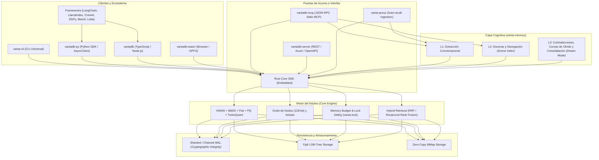
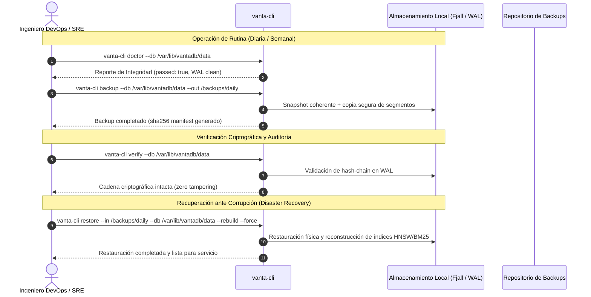

# Análisis Integral de Sistemas, Experiencia de Usuario y Ciclo de Vida: VantaDB (v0.8.0 / v0.9.0)

**Autor:** Principal Systems Engineer & Critical Architecture Review  
**Fecha:** 2026-10-19  
**Estado:** Documento de Evaluación Técnica y Operativa  

---

## 1. Arquitectura de Producto y Superficie del Sistema

VantaDB no es una base de datos vectorial aislada; es un **motor embebido de memoria persistente multimodal** diseñado con un enfoque *local-first* para agentes autónomos y aplicaciones de inteligencia artificial.



---

## 2. Evaluación del Flujo de Instalación y Onboarding (DevX)

### 2.1 Canales de Instalación Disponibles

| Canal / Ecosistema | Mecanismo | Dependencias Externas | Nivel de Madurez | Puntos de Fricción / Riesgos Detectados |
| :--- | :--- | :--- | :--- | :--- |
| **Instalador One-Liner (sh / ps1)** | Descarga de GitHub Releases (`vanta-cli` zip/tar.gz) + Wizard | Ninguna (binario autónomo) | **Producción** | Depende de la API de GitHub si no se pasa `-Version`. En redes corporativas con proxy TLS puede requerir banderas de certificado. |
| **Python (`pip install vantadb-py`)** | Ruedas precompiladas (`manylinux`, macOS universal, Windows MSVC) | Python ≥ 3.9 | **Producción** | Si el usuario no tiene rueda compatible para su arquitectura, pip intenta compilar desde fuente requiriendo `maturin` y Rust. |
| **Node.js (`npm install vantadb`)** | Paquete TS con fallback híbrido (`vantadb-node` nativo o WASM) | Node ≥ 18 | **Producción** | Requiere que `vantadb-node` coincida en binario nativo, de lo contrario degrada a WASM en memoria/OPFS. |
| **Rust (`cargo add vantadb`)** | Crates.io | Toolchain Rust 1.94.1+ (MSRV) | **Producción** | Requiere toolchain C/MSVC en Windows y `libclang`/`librocksdb-dev` si se activan features legacy. |
| **Homebrew / Scoop** | Fórmulas comunitarias / automatizadas | Ninguna | **Estable** | Dependen de actualización automática de SHA256 post-release. |

### 2.2 El Asistente de Configuración (`setup-embeddings.ps1` / `install.sh`)
* **Aspecto Positivo:** Permite seleccionar módulos activos (`engine`, `mcp`, `server`, `proxy`, `embeddings`, `providers`) y descarga de forma asistida el runtime de ONNX (`ort`) y modelos ligeros (`multilingual-e5-small`, 384 dimensiones).
* **Fricción Identificada:** Si el usuario no ejecuta el comando en la misma terminal donde persisten las variables de sesión (`ORT_DYLIB_PATH` y `VANTADB_LOCAL_MODEL`), el motor degrada a *deterministic dummy embeddings* (embeddings sintéticos que no abortan pero carecen de significado semántico).

---

## 3. Configuración y Modos de Despliegue

VantaDB ofrece tres modelos principales de operación según la topología de la aplicación:

### Comparativa de Modos Operativos

| Criterio | Modo 1: Embebido en Proceso (SDK) | Modo 2: Servidor Standalone (`vantadb-server`) | Modo 3: Asistente Agéntico (`vantadb-mcp`) |
| :--- | :--- | :--- | :--- |
| **Latencia de Acceso** | **Sub-milisegundo (< 0.5 ms)** en RAM/mmap | **1.5 - 3 ms** (red local HTTP/JSON) | **5 - 15 ms** (JSON-RPC stdio) |
| **Concurrencia de Procesos** | Monoproceso exclusivo (`vanta.lock`) | Multi-cliente vía HTTP concurrente | Monoproceso cliente MCP (ej. IDE) |
| **Overhead de Memoria** | Ajustable vía `memory_limit_bytes` | Fijo por proceso servidor + cache | Dependiente del cliente host |
| **Seguridad de Acceso** | Permisos de sistema de archivos | JWT / Bearer Token / Rate Limiting | Autenticación implícita por canal stdio |
| **Caso de Uso Ideal** | Microservicios Rust/Python, CLI local, scripts | Arquitecturas cliente/servidor, Docker | Integración con LLMs (Claude, Cursor, Windsurf) |

---

## 4. Experiencia de Uso y Flujo de Trabajo (E2E UX)

### 4.1 La Abstracción Unificada: Registro vs. Nodo de Grafo
Uno de los puntos de mayor fortaleza (y a la vez un vector común de confusión resuelto en la versión 0.9.0 con `DX-04`) es el puente entre el almacenamiento de memoria y el grafo relacional:
1. **Poner Memoria (SDK KV / Vectorial):**
   ```python
   db.put("agent/main", "doc-1", "Contenido indexado", vector=[0.1, ...])
   ```
   El registro vive indexado por `(namespace, key)` y sus vectores se insertan en el índice HNSW.
2. **Enlazar en el Grafo Relacional:**
   Para conectar dos documentos con una arista direccionada, el usuario no inventa un entero; utiliza la función determinista de 128 bits:
   ```python
   src_id = vantadb.memory_node_id("agent/main", "doc-1")
   dst_id = vantadb.memory_node_id("agent/main", "doc-2")
   db.add_edge(src_id, dst_id, weight=0.95, label="references")
   ```

### 4.2 Búsqueda Híbrida (Hybrid Retrieval v1)
La consulta combina la similitud semántica de vectores y la relevancia léxica de BM25 mediante Fusión de Rangos Recíprocos (RRF):
$$\text{Score}(d) = \sum_{m \in \{\text{vector}, \text{bm25}\}} \frac{1}{k + \text{rank}_m(d)}$$
* El usuario no necesita balancear pesos arbitrarios entre 0 y 1; el algoritmo RRF normaliza automáticamente las diferencias de distribución de scores de ambos motores.

---

## 5. Operabilidad en Producción y Mantenimiento Day-2

### 5.1 Prevención de Desastres y Mantenimiento de Rutina



### 5.2 Salud y Métricas Operativas
* **Endpoint Prometheus (`/metrics`):** Expone contadores de inserciones, latencias de búsqueda P50/P95/P99, presión de compactación de Fjall, uso de cache L1 y tasa de hits en el buffer pool.
* **Borrado Certificado (`vanta-cli certificate verify`):** Para cumplimiento de normativas de privacidad (GDPR / Derecho al Olvido), cuando un registro es eliminado físicamente, el motor genera un recibo criptográfico firmado demostrando la purga del registro y de sus vectores en el índice HNSW.

---

## 6. Análisis FMEA (Failure Mode and Effects Analysis)

| Componente | Modo de Falla Potencial | Severidad | Causa Raíz | Mitigación Actual / Propuesta |
| :--- | :--- | :--- | :--- | :--- |
| **Concurrencia** | `Cannot acquire lock: vanta.lock` al reiniciar un contenedor | **ALTA** | Proceso anterior terminado abruptamente sin ejecutar shutdown graceful. | Se documentó la recuperación de orphan locks (`QUICKSTART.md §Operational Notes`). Propuesta: Timeout automático de lock basado en PID vivo (`fs2::FileExt`). |
| **Embeddings** | Pérdida silenciosa de calidad en búsqueda vectorial | **MEDIA** | `ORT_DYLIB_PATH` o modelo ausente, activando *fallback dummy embeddings*. | `vanta-cli status` y MCP emiten alerta explícita `"fallback": true`. Se recomienda advertencia visual de alto contraste en logs de arranque. |
| **Memoria RAM** | OOM en consultas con `top_k` gigantesco o tensores no normalizados | **MEDIA** | Peticiones hostiles de clientes o bucles infinitos en agentes. | Validación en FFI con `clamp_top_k` (`MAX_K = 10,000`) y rechazo de vectores con `NaN` o `Inf` (`FIND-357`). |
| **Almacenamiento** | Saturación de disco (`StorageFull / os error 112`) | **ALTA** | Preasignación agresiva de segmentos WAL y builds pesados. | Incorporado chequeo previo de espacio libre en `run-all-tests.ps1`. Documentado tamaño mínimo de arranque (~50 MB). |
| **Paginación** | Salto doble de registros en listados multi-namespace | **BAJA** | Offset aplicado en cada namespace y re-aplicado en el vector combinado. | Corregido en `FIND-355` (`src/server/list_records.rs`). |

---

## 7. Dictamen de Ingeniería y Recomendaciones de Evolución

1. **Unificación de la Experiencia de CLI vs Server:**  
   El binario `vanta-cli` actual es extremadamente completo. Se recomienda consolidar la bandera `vanta-cli server` como el mecanismo estándar de arranque del demonio, unificando el binario `vantadb-server` en uno solo para reducir la huella de distribución.
2. **Robustez en el Setup Wizard:**  
   El instalador debe persistir de manera obligatoria las variables de entorno en el perfil del usuario (`~/.bashrc`, `~/.zshrc`, o Registro de Windows vía `[Environment]::SetEnvironmentVariable`) para evitar que nuevas sesiones de terminal pierdan la referencia a los modelos locales.
3. **Mantenimiento Automatizado (Self-Healing):**  
   Incorporar en el daemon una tarea cron interna que ejecute `vacuum` y `rebuild-index` en ventanas de baja actividad para mantener la localidad de caché del grafo HNSW sin requerir intervención manual del operador.
