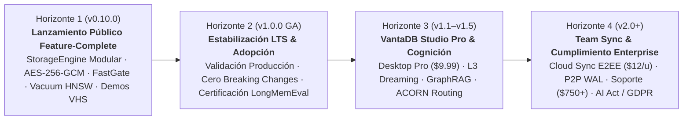

# VantaDB — Master Execution Roadmap ("SQLite for Agents")

> **Posicionamiento Oficial (STRAT-01):** Motor de memoria persistente, embebido y local-first para agentes de IA (Claude Code, Cursor, Windsurf, OpenCode). Cero Docker, un solo binario, búsqueda híbrida nativa (BM25 + HNSW + RRF) con gobernanza cognitiva L0→L3.  
> **Fuente de Tareas Técnicas:** [`docs/dev/Backlog.md`](../Backlog.md)  
> **Fuente de Negocio y Rieles Venezuela:** [`docs/dev/Backlog-negocio.md`](../Backlog-negocio.md)  
> **Historial Previo:** Archivada versión de julio de 2026 en [`ROADMAP-2026-07-archive.md`](ROADMAP-2026-07-archive.md) preservando tareas de investigación y arquitectura histórica.

---

## 1. Principios Rectores y Decisiones Arquitectónicas (D1–D14)

1. **Local-First & Zero Docker:** VantaDB se consume como librería embebida (Python, Node/TS, Rust, WASM) o vía proceso local stdio (MCP). No requiere servicios externos ni orquestadores de contenedores.
2. **Tolerancia Cero a Dummy Embeddings:** En producción, las búsquedas vectoriales e híbridas exigen modelos reales. Si el proveedor no está disponible, el sistema falla de manera explícita y tipada con `Error::Embedding` (prohibido persistir vectores sintéticos o devolver 0 hits silenciosos).
3. **Open-Core Ortodoxo:** Todo el núcleo actual, SDKs, servidor MCP y utilidades residen bajo **Apache-2.0 perpetuo ($0)**. Las extensiones de escritorio avanzadas (VantaDB Studio Pro) y sincronización en la nube (VantaDB Team Sync) se desarrollarán como módulos comerciales desacoplados.
4. **Rieles Comerciales Innegociables para Residencia en Venezuela:**
   - Cuentas a nombre personal y residencia fiscal en Venezuela (sin entidad legal en el extranjero en Fase 1).
   - Pasarelas y donaciones aprobadas: **Ko-fi**, **Patreon** y **Binance (USDT / Cripto)**.
   - Precios oficiales: Core + MCP = **$0**; VantaDB Studio Pro = **$9.99/mes**; VantaDB Team Sync = **$12/usuario/mes**; Soporte Comercial Enterprise = **desde $750/mes o ~$1,000/mes** según esfuerzo de integración.
5. **Infraestructura Web y Waitlist Doble:** Hosting principal en **Vercel** (respaldo en Cloudflare Pages) bajo el dominio `vantadb.dev`, con captura de tracción mediante doble lista de espera: Lanzamiento Oficial VantaDB + VantaDB Team Sync.
6. **Preservación Total de Tareas de Algoritmia Avanzada:** Se mantienen vigentes en el backlog los algoritmos avanzados heredados (ACORN, Semantic Cost Estimator, cuantización SQ8 y streaming JSON shredding) programados secuencialmente sin pérdida de alcance.

---

## 2. Política de Versionado SemVer 2.0.0 y Transición v0.10.0 → v1.0.0 GA

### Regla Técnica SemVer y Gobernanza de Release (`release-plz`)
Bajo la especificación formal **Semantic Versioning 2.0.0** (Cláusula 4: desarrollo inicial `0.y.z`), la semántica de Cargo y la configuración estricta de `release-plz.toml` (`semver_check = true`):
1. **Regla de Versión Menor en `0.y.z`:** Cualquier cambio de API que rompa compatibilidad (`fix!:`) o incorporación de características (`feat:`) incrementa el número menor $y$ (pasando de `0.9.0` a **`0.10.0`**). Los incrementos de parche $z$ quedan reservados para fixes puramente aditivos y correcciones de documentación.
2. **Posicionamiento de `v0.10.0` (Lanzamiento Público Feature-Complete):** Representa el release público completo y endurecido que empaqueta las Fases 1 a 5 (modularización de `StorageEngine`, cifrado AES-256-GCM, vacuum HNSW, `FastGate`, `group_commit`, demos y arneses de estrés) junto a las 4 tareas adelantadas de Fase 6 (`TEC-15`, `FIND-221`, `TEC-14b`, `TEC-16`).
3. **Posicionamiento de `v1.0.0 GA` (Congelación LTS):** Hito formal de estabilidad a largo plazo. No se declara a ciegas en el primer release público con cambios masivos; se alcanza tras la validación en producción por los primeros adoptantes sobre `v0.10.0`, asegurando que la superficie pública de API y los esquemas en disco permanezcan sin divergencias ni roturas.

---

## 3. Los Cuatro Horizontes de Ejecución

---

### Horizonte 1: Lanzamiento Público Feature-Complete & Hardened Release (v0.10.0)

**Objetivo:** Consolidar el núcleo del motor, completar la modularización de subsistemas, garantizar cifrado total en reposo, activar optimizaciones de latencia y lanzar públicamente VantaDB con paridad en todos los SDKs.

#### Brechas Críticas y Tareas de Cierre (P0–P1)

> **Estado al 2026-11-19 (cierre de la campaña de consolidación pre-`v0.10.0`):** todos los ítems de este bloque están **implementados en `develop`** (Backlog §Phase 62, verificados `2026-11-06/07`), salvo la corrida oficial LongMemEval 500q (`ACT-02`, gate de validación pre-anuncio) y el Stranger Test humano `FASE-A` (gate humano, anclado al release `v0.10.0` — ventana objetivo `2026-12-01`).

- ✅ **`ACT-01` + `MEM0-01` + `TEC-06` (`FastGate` Pre-LLM `< 0.1 ms` y Auto-Deduplicación Semántica en Ingest) — implementado:**
  - Cablear `DuplicatePreventionFilter` (filtro Bloom en memoria con hash dual XxHash64) + similitud Jaccard léxica en `src/sdk/api/memory.rs` para verificar colisiones y evitar I/O innecesario.
  - Implementar búsqueda top-5 vectorial previa en HNSW clasificando por bandas de similitud coseno (`>= 0.92` `NOOP`/refuerzo; `0.78..0.92` `MergePolicy::Supersede` bitemporal creando `supersedes_edge`; `< 0.78` `ADD` directo).
- ⏸️ **`ACT-02` + `MEM0-05` Re-medición Oficial LongMemEval (500q) y LOCOMO — re-corrida en curso (`n=500`):**
  - Ejecutar el arnés `evals/eval_longmemeval.py` sobre el dataset completo de 500 preguntas de LongMemEval y el arnés `evals/eval_locomo.py` con embeddings densos locales reales (`BAAI/bge-small-en-v1.5`, 384d, `--strict-embeddings`).
  - Certificar y publicar **`recall_all@5 >= 0.85`** (criterio bloqueante `D2`) en `docs/user/operations/BENCHMARKS.md`.
- ✅ **`MEM0-02` + `MEM0-03` Calibración Matemática de GraphRAG y Guarda Anti-Hub (`EGO-15`) — implementado:**
  - Normalizar `seed_score` de RRF a `[0.0, 1.0]` mediante Min-Max scaling antes de aplicar `0.60 * norm_seed + 0.30 * hop_boost + 0.10 * degree_boost`, y activar `max_degree_per_node = 128` por defecto.
- ✅ **`ACT-03` Group-Commit Productizado en `StorageEngine` — implementado:**
  - Activar por defecto la coalescencia temporal de escrituras (ventana de amortiguación de 2 a 5 ms) en `src/storage/engine/` para compartir un único `batch_append` de WAL y un único `insert_lock` en ráfagas concurrentes (throughput meta > 500 ops/s).
- ✅ **`TEC-02` Descomposición Modular de `StorageEngine` (`Q8 Opción A` — v0.10.0) — implementado:**
  - Extraídos los subsistemas de `StorageEngine` (`IndexCoordinator`, `VectorStoreService` y `WalCoordinator`) para el lanzamiento de v0.10.0.
- ✅ **`ACT-04` Reconciliación Enterprise vs. Freeze-List y Limpieza (`Q14`) — implementado:**
  - Depurado `EXPERIMENTAL_FEATURES.md`: extraídas formalmente las características estabilizadas y activadas en v0.10.0.
  - Alinear la oferta B2B pre-1.0 a servicios realizables (Soporte SLA 48h on-prem, Borrado Certificado GDPR `VER-02`, Dossier de Seguridad AES-256-GCM y SBOM CycloneDX).

#### Paridad de SDKs y APIs

> **Estado al 2026-11-19:** los cuatro ítems están implementados en `develop` (`TEC-03`, `TEC-04`, `TEC-01`, `TEC-08`, `DOC-04`, `DEM-04`).

- ✅ **Wiring de `forget()` en Node.js y TS/WASM — implementado (`TEC-03`):** métodos `forget(key, mode)` en `vantadb-node` y `vantadb-ts` con paridad total frente a Rust y Python (modos `Soft`, `Hard` y `Certified`).
- ✅ **Alerta de Telemetría para Degradación — implementado (`TEC-04`):** alerta en logs/telemetría si `brute_fallback_ratio > 5%` en búsquedas con filtros restrictivos.
- ✅ **Limpieza Documental e Higiene — implementado (`TEC-01`, `TEC-08`, `DOC-04`):**
  - Purgadas las menciones obsoletas a `InMemoryEngine` en `docs/`.
  - Corregido el comentario obsoleto en `src/sdk/search/vector.rs:180` sobre poblamiento de bitsets.
  - Regla en `pre-commit` que impide la inclusión accidental de `.DS_Store` o archivos `.zip`.
- ✅ **Ejemplos TypeScript — implementado (`DEM-04`):** suite canónica `examples/typescript/` (Node.js, Bun y navegador con OPFS).

---

### Horizonte 2: Consolidación, Adopción Temprana y Estabilización LTS (v1.0.0 GA)

**Objetivo:** Congelación definitiva de la API pública y el formato de almacenamiento, validación de durabilidad en producción real por los primeros adoptantes sobre `v0.10.0`, y certificación de compatibilidad hacia adelante a largo plazo (LTS).

#### Activos de Lanzamiento y Demos

> **Estado al 2026-11-19:** los activos de esta sección están construidos en repo (`DEM-01..03`, `DOC-05`, `BNCH-01`, `PRD-02`, `PRD-05`, `GTM-05`); su uso público queda condicionado al release `v0.10.0` + gate `FASE-A`.

- **Demo Terminal Hero (VHS 60s):** Grabación con `vhs` mostrando en panel dividido a Claude Code/Cursor y `vanta-cli`, ilustrando conmutación automática ante storage ocupado (`MCP-35`) e ingesta instantánea.
- **Demo Interactiva de Supersession en Vivo:** Script ejecutable que demuestra cómo un nuevo hecho invalida y archiva un hecho contradictorio anterior en tiempo real.
- **Demo de Borrado Certificado GDPR:** Script ejecutable que emite una orden de purga ejecutiva con recibo criptográfico SHA-256 de eliminación física.
- **Tabla Quickstart 60s por IDE:** Configuración directa en JSON/YAML para Claude Code, Cursor, Windsurf y OpenCode en la cabecera de `README.md` y `README_ES.md`.

#### Validación Científica y Stress-Tests de Lanzamiento
- **Stress-Test Database Sequential-NIAH (`evals/bench_sequential_niah.py`):**
  - Demostración cuantitativa frente a modelos con ventanas de contexto masivas (1M tokens).
  - Ingesta de 10k a 100k distractores en memoria persistente local con secuencias causales multi-salto (5–10 agujas).
  - Certificación de recuperación en tiempo real (< 2.5 ms p50, < 3.0 ms p95) con **estricto 0 tokens de LLM consumidos** y coste \$0.00 USD, frente a los \$15–\$30 USD por llamada que exige procesar 1M tokens en arquitecturas cloud.

#### Infraestructura y Rieles de Monetización (Venezuela)
- **Despliegue Web en Vercel:** Publicar landing page ultrarrápida en `https://vantadb.dev` con demo interactivo, un-liner de instalación y **Doble Waitlist** (Lanzamiento Core + VantaDB Team Sync).
- **Rieles Activos:**
  - Canal de donaciones y patrocinio: **Ko-fi** y **Patreon**.
  - Canal cripto directo: **Binance (USDT / P2P)** para servicios y pagos directos.
  - Estructuración pública de la oferta de Soporte y Hardening Enterprise (desde **$750/mes** o **~$1,000/mes**).
- **Distribución de Binarios y Seguridad:**
  - Manifiesto de publicación en `winget` (Windows) y `brew` (macOS/Linux).
  - Firma digital automatizada con `cosign` y `minisign` en GitHub Actions.

#### Arquitectura Dual de Embeddings Locales
- Estandarización de interfaz para ejecución local parametrizable con dos modelos base:
  1. **`multilingual-e5-small`** (384d, ~45 MB INT8, ultraligero para CPU).
  2. **`EmbeddingGemma 2 (270M)`** (768d, ~270 MB INT8, alta capacidad de razonamiento).
- Asistente de configuración en el instalador para descarga y verificación determinista.

---

### Horizonte 3: Meses 3 a 6 — Expansión Cognitiva Avanzada y VantaDB Studio Pro

**Objetivo:** Desarrollar los diferenciales cognitivos profundos de L2/L3 y monetizar mediante la aplicación de escritorio para desarrolladores individuales.

#### VantaDB Studio Pro (Desktop App — $9.99/mes)
- Aplicación de escritorio sobre Tauri / Rust:
  - Explorador visual 3D e interactivo de grafos de memoria y linaje episódico.
  - Inspector de contradicciones L1 y resolución manual de conflictos de conocimiento.
  - Panel interactivo de auditoría y emisión de certificados de borrado GDPR (`VER-02`).
  - Monitoreo en tiempo real de fragmentación de HNSW, hits de caché y latencia P99.

#### Gobernanza de Memoria y Algoritmos Avanzados
- **Consolidación Autónoma en Background (Dreaming L3):** Orquestador de pasadas de sueño (`vanta_dream`) en periodos de inactividad del agente para sintetizar hechos dispersos en directrices duraderas.
- **Conexión de Decaimiento Temporal:** Conectar `run_decay_pass` con `Embedded::forget()` para purgar automáticamente basura cognitiva envejecida según directivas de retención.
- **GraphRAG de Baja Latencia:** Algoritmos de navegación por propiedades relacionales integrados directamente sobre el índice HNSW sin consultar LLMs intermedios.
- **Algoritmo ACORN (Second-Hop Routing):** Implementación de búsqueda por saltos correlacionados en el grafo para consultas complejas.
- **Semantic Cost Estimator:** Auto-tuning dinámico del presupuesto `ef_search` en HNSW condicionado por la selectividad de los filtros relacionales.
- **Desacoplamiento de `ShreddedRowStore`:** Migración del almacenamiento columnar/JSON a proceso asíncrono para eliminar latencia en el camino crítico.

---

### Horizonte 4: Meses 6 a 12 — Sincronización Local-First, Team Sync y Enterprise

**Objetivo:** Permitir la colaboración de memoria entre equipos de ingeniería y certificar cumplimiento normativo corporativo.

#### VantaDB Team Sync (Cloud E2EE — $12/usuario/mes)
- Sincronización cifrada de extremo a extremo de espacios de memoria entre desarrolladores de un mismo equipo.
- Arquitectura Zero-Knowledge: el servidor de relay no almacena claves de descifrado ni analiza el contenido de los recuerdos.
- Resolución determinista de conflictos en memoria multi-escritor mediante DAGs de supersession.

#### Respaldo Offsite y Replicación P2P
- Replicación incremental de WAL cifrado (P2P WAL Shipping) entre dispositivos personales.
- Conectores de backup offsite para almacenamiento en la nube privada (S3 / R2 / local NAS).

#### Cumplimiento Corporativo y Marco Regulatorio
- **EU AI Act Art. 50:** Marcado y persistencia obligatoria de metadatos de procedencia para memorias generadas o alteradas por modelos de IA.
- **EU AI Act Art. 12:** Registro y trazabilidad técnica inmutable de eventos de recuperación y decisión.
- **GDPR Art. 17 / CCPA Enforcement:** Herramienta formal CLI/GUI para emisión de recibos probatorios ejecutivos ante solicitudes de derecho al olvido.
- **Boundary Seguro de Pro:** Verificación automatizada en CI para garantizar separación estricta entre el core abierto y extensiones comerciales (`vantadb-pro`).

---

## 4. Matriz de Seguimiento de Entregables por Horizonte

| Horizonte | Versión Target | Hito Clave | Estado | Rieles Comerciales |
|---|---|---|---|---|
| **H1: Lanzamiento Público Feature-Complete** | `v0.10.0` | StorageEngine Modular · Cifrado AES-256-GCM · FastGate · Demos VHS · Sequential-NIAH · Winget/Brew | ✅ Completado en Repo (Pre-Lanzamiento) — campaña de consolidación cerrada 2026-11-19; release `v0.10.0` pendiente del gate humano `FASE-A` en la ventana `2026-12-01` | Core $0 · Setup Ko-fi / Patreon / Binance |
| **H2: Estabilización LTS & Adopción** | `v1.0.0 GA` | Validación Producción · Show HN · Certificación LongMemEval 500q · Congelación API | ⏳ Siguiente Hito tras v0.10.0 | Core $0 · Soporte Enterprise ($750–$1,000/mes) |
| **H3: Studio Pro & Cognición** | `v1.1` – `v1.5` | Vanta Studio Desktop ($9.99/mo) · Dreaming L3 · GraphRAG · ACORN | 🔮 Futuro post-v1.0.0 | Lanzamiento Suscripción Desktop ($9.99/mes) |
| **H4: Team Sync & Enterprise** | `v2.0.0+` | Team Sync E2EE ($12/user/mo) · AI Act Compliance · P2P WAL | 🔮 Futuro H3 | Suscripción Equipos ($12/usuario/mes) |
