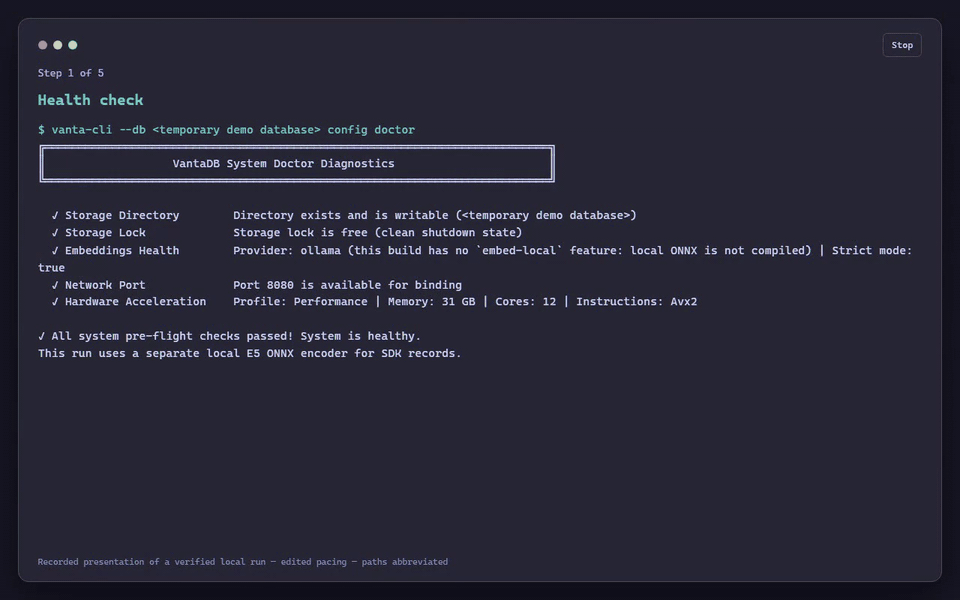

# `vantadb.dev` Landing Page & `/enterprise` Route Specification
### High-Performance Web Deployment Architecture with Double Waitlist and Zero-Friction Payment Rails

> **Tracking:** `GTM-05` (Vercel Landing + Double Waitlist), `GTM-09` (`/enterprise` Section & OEM Packages), `BND-07` (Domain DNS & Resilience Fallback).

---

## 1. Architecture Overview & Performance Objectives

The public web surface at `https://vantadb.dev` is the primary entry point for AI engineers, autonomous agent developers, and enterprise buyers evaluating VantaDB.

```
                                  [ vantadb.dev DNS ]
                                           │
                    ┌──────────────────────┴──────────────────────┐
                    │                                             │
             Primary Hosting                               Fallback Hosting
             ▼                                             ▼
     [ Vercel Platform ]                          [ Cloudflare Pages ]
     - Edge Network                               - Global CDN Edge
     - Next.js 14+ App Router                     - Static Export Fallback
     - Serverless Functions (/api/waitlist)       - Workers API Fallback
     - Sub-500ms Global LCP                       - Zero Cold-Start
```

### Core Performance Budgets (Lighthouse Targets)
- **Largest Contentful Paint (LCP):** `< 500 ms` on broadband, `< 1.2 s` on simulated 4G.
- **Cumulative Layout Shift (CLS):** `0.000` (Strict dimensions on hero media and fonts).
- **First Input Delay / Interaction to Next Paint (INP):** `< 50 ms`.
- **Lighthouse Scores:** 98+ Performance, 100 Accessibility, 100 Best Practices, 100 SEO.
- **External Dependencies:** Zero Google Analytics, zero heavy tracker scripts; privacy-first, GDPR-compliant local-first analytics or lightweight edge telemetry.

---

## 2. Hero Section & Installation Switcher Specification

### Visual Asset Strategy (Ultra-Fast LCP)
- The hero visual uses `assets/demo.mp4` (H.264/AV1 compressed, `< 1.8 MB`) with an instant WebP fallback poster and an optional retro-tech VHS style demo GIF (`assets/demo.gif`).
- High-priority preloading via `<link rel="preload" as="video" fetchpriority="high">`.
- Auto-playing, muted, looping, inline video execution.

### Installation One-Liner Tabbed Component
Supports instant copy-to-clipboard for the five primary developer entry points:
1. **Python SDK:** `pip install vantadb-py`
2. **TypeScript / Node.js:** `npm install vantadb` (or `npx vantadb`)
3. **MCP Server Daemon:** `vanta-cli mcp init`
4. **Windows (winget):** `winget install ness-e.VantaDB`
5. **macOS / Linux (Homebrew):** `brew install ness-e/tap/vantadb`

---

## 3. Double Waitlist Architecture (`GTM-05`)

Rather than a generic email collection box, `vantadb.dev` deploys a segmented **Double Waitlist**:

### Waitlist Track 1: *VantaDB v0.10.0 Launch & v1.0.0 GA Roadmap*
- **Audience:** Open-source developers, local LLM enthusiasts, and research engineers.
- **Offer:** Early access to VantaDB v0.10.0 Feature-Complete release and v1.0.0 GA LTS notifications, local GUI memory visualizer, and updates on new language SDKs (Go, Rust, Swift).
- **Pricing:** Free / Open Source.

### Waitlist Track 2: *VantaDB Team Memory Sync (E2EE Cloud)*
- **Audience:** Engineering leads building multi-agent systems with team-wide shared context.
- **Offer:** Zero-knowledge End-to-End Encrypted (E2EE) decentralized sync across team agents and environments.
- **Pricing:** Early-bird reservation at **$12 / user / month** (billed annually).
- **Form Fields:** Work email, team size (1-5, 6-20, 20+), primary agent framework (LangGraph, Dify, CrewAI, AutoGen, Custom).

---

## 4. `/enterprise` Commercial Support & Partnership Route (`GTM-09`)

Accessible at `https://vantadb.dev/enterprise` or via the top navigation bar:

### Tier Structure & Transparent Pricing

| Tier | Positioning | Price | SLA & Scope |
| :--- | :--- | :--- | :--- |
| **Community** | Open-source builders | **$0 (Apache-2.0)** | Community Discord & GitHub Discussions |
| **Enterprise Support & Integration** | Production platforms & OEM agents | **Starting at $750 / mo** (scaling to **~$1,000 / mo**) | • 24h bug response SLA<br>• Direct engineering Slack/Discord<br>• Custom hardware embedding tuning<br>• Tailored FastGate filters |
| **OEM White-Label & Custom Hardening** | Proprietary agent appliances & regulated industries | **Custom Quote ($1,500 – $4,500 / mo)** | • Dedicated core engineering sprints<br>• Certified on-prem audit hooks<br>• Co-developed storage drivers<br>• Formal GDPR / AI Act compliance pack |

---

## 5. Official Sponsorship & Payment Rails (VE Operations)

To prevent payment gateway lockouts, foreign exchange surcharges, and friction with Venezuelan bank systems, `vantadb.dev` strictly restricts payment and sponsorship methods to the following verified channels:

### 1. B2B & OEM Retainers: Binance Pay / USDT
- Direct settlement in **USDT** across three standard networks:
  - **USDT (TRC-20)** — Low transaction fee network
  - **USDT (ERC-20)** — Institutional standard
  - **USDT (BEP-20)** — High speed Binance Smart Chain
- Interactive modal displaying verified recipient addresses and QR codes for one-click payment.
- Instant automated corporate receipt generation.

### 2. Individual & Startup Support: Ko-fi & Patreon
- **Ko-fi:** [https://ko-fi.com/vantadb](https://ko-fi.com/vantadb) (One-time and monthly developer tips with 0% platform fee options).
- **Patreon:** [https://patreon.com/vantadb](https://patreon.com/vantadb) (Tiered developer backing with insider release notes).

> ⚠️ **Strict Compliance Rule:** Zero references, buttons, or SDK widgets for Stripe direct, GitHub Sponsors, or Polar on the public landing page.

---

## 6. Complete Component Implementation Code

### A. Next.js Landing Page Component (`src/app/page.tsx`)

```tsx
import React, { useState } from 'react';
import Head from 'next/head';

interface InstallOption {
  id: string;
  label: string;
  command: string;
}

const INSTALL_OPTIONS: InstallOption[] = [
  { id: 'python', label: 'Python', command: 'pip install vantadb-py' },
  { id: 'node', label: 'Node / TS', command: 'npm install vantadb' },
  { id: 'mcp', label: 'MCP Daemon', command: 'vanta-cli mcp init' },
  { id: 'winget', label: 'Windows (winget)', command: 'winget install ness-e.VantaDB' },
  { id: 'brew', label: 'macOS / Linux (brew)', command: 'brew install ness-e/tap/vantadb' },
];

export default function VantaDBLanding() {
  const [activeTab, setActiveTab] = useState('python');
  const [copied, setCopied] = useState(false);
  const [waitlistTrack, setWaitlistTrack] = useState<'v1' | 'teamsync'>('v1');
  const [email, setEmail] = useState('');
  const [teamSize, setTeamSize] = useState('1-5');
  const [submitted, setSubmitted] = useState(false);
  const [loading, setLoading] = useState(false);

  const activeCommand = INSTALL_OPTIONS.find((t) => t.id === activeTab)?.command || '';

  const handleCopy = () => {
    navigator.clipboard.writeText(activeCommand);
    setCopied(true);
    setTimeout(() => setCopied(false), 2000);
  };

  const handleWaitlistSubmit = async (e: React.FormEvent) => {
    e.preventDefault();
    if (!email) return;
    setLoading(true);

    try {
      const res = await fetch('/api/waitlist', {
        method: 'POST',
        headers: { 'Content-Type': 'application/json' },
        body: JSON.stringify({ email, track: waitlistTrack, teamSize: waitlistTrack === 'teamsync' ? teamSize : null }),
      });
      if (res.ok) setSubmitted(true);
    } catch (err) {
      console.error('Waitlist submission error', err);
    } finally {
      setLoading(false);
    }
  };

  return (
    <div className="min-h-screen bg-[#08090C] text-slate-100 font-sans selection:bg-emerald-500/30 selection:text-emerald-300">
      {/* Top Navigation */}
      <nav className="border-b border-slate-800/80 bg-[#08090C]/90 backdrop-blur-md sticky top-0 z-50 px-6 py-4 flex items-center justify-between max-w-7xl mx-auto">
        <div className="flex items-center gap-3">
          <div className="w-8 h-8 rounded-lg bg-emerald-500/20 border border-emerald-500/50 flex items-center justify-center font-mono font-bold text-emerald-400">
            V
          </div>
          <span className="text-xl font-bold tracking-tight text-white">VantaDB</span>
          <span className="text-xs px-2 py-0.5 rounded-full bg-emerald-950 text-emerald-400 border border-emerald-800 font-mono">
            v0.10.0
          </span>
        </div>
        <div className="flex items-center gap-6 text-sm font-medium">
          <a href="#benchmarks" className="text-slate-400 hover:text-white transition">Benchmarks</a>
          <a href="#waitlist" className="text-slate-400 hover:text-white transition">Waitlist</a>
          <a href="/enterprise" className="text-emerald-400 hover:text-emerald-300 transition font-semibold">
            Enterprise & OEM ($750/mo)
          </a>
          <a
            href="https://github.com/ness-e/Vantadb"
            target="_blank"
            rel="noopener noreferrer"
            className="px-4 py-1.5 rounded-lg border border-slate-700 bg-slate-800/50 hover:bg-slate-800 text-white transition flex items-center gap-2"
          >
            GitHub
          </a>
        </div>
      </nav>

      {/* Hero Section */}
      <section className="max-w-7xl mx-auto px-6 pt-16 pb-20 text-center flex flex-col items-center">
        <div className="inline-flex items-center gap-2 px-3 py-1 rounded-full border border-emerald-500/30 bg-emerald-950/40 text-emerald-300 text-xs font-mono mb-6">
          <span className="w-2 h-2 rounded-full bg-emerald-400 animate-pulse" />
          Single-File Embedded Engine • Zero Docker • &lt; 25MB Idle RAM
        </div>

        <h1 className="text-5xl md:text-7xl font-extrabold tracking-tight max-w-4xl text-white leading-tight mb-6">
          Persistent Memory for AI Agents with{' '}
          <span className="text-transparent bg-clip-text bg-gradient-to-r from-emerald-400 via-teal-300 to-cyan-400">
            Zero Infrastructure Bloat
          </span>
        </h1>

        <p className="text-lg md:text-xl text-slate-400 max-w-2xl mb-10 leading-relaxed">
          Embed hybrid search (BM25 + HNSW + RRF) and certified GDPR forgetting directly in your agent process.
          Reduce LLM memory token consumption by 85% with native Rust FastGate.
        </p>

        {/* Installation Switcher */}
        <div className="w-full max-w-2xl bg-slate-900/90 border border-slate-800 rounded-xl p-3 shadow-2xl mb-12">
          <div className="flex flex-wrap gap-2 border-b border-slate-800/80 pb-2 mb-3">
            {INSTALL_OPTIONS.map((opt) => (
              <button
                key={opt.id}
                onClick={() => setActiveTab(opt.id)}
                className={`px-3 py-1 text-xs rounded-md font-mono transition ${
                  activeTab === opt.id
                    ? 'bg-emerald-500/20 text-emerald-400 border border-emerald-500/40'
                    : 'text-slate-400 hover:text-slate-200 hover:bg-slate-800/50'
                }`}
              >
                {opt.label}
              </button>
            ))}
          </div>
          <div className="flex items-center justify-between bg-black/60 rounded-lg px-4 py-3 font-mono text-sm border border-slate-800/50">
            <span className="text-emerald-400 select-all">$ {activeCommand}</span>
            <button
              onClick={handleCopy}
              className="text-xs px-3 py-1 rounded bg-slate-800 hover:bg-slate-700 text-slate-300 transition"
            >
              {copied ? 'Copied! ✓' : 'Copy'}
            </button>
          </div>
        </div>

        {/* Video / Demo Showcase */}
        <div className="w-full max-w-5xl rounded-2xl overflow-hidden border border-slate-800 shadow-2xl relative bg-black aspect-video flex items-center justify-center">
          <video
            autoPlay
            loop
            muted
            playsInline
            poster="/assets/demo-poster.webp"
            className="w-full h-full object-cover"
          >
            <source src="/assets/demo.mp4" type="video/mp4" />
            
          </video>
        </div>
      </section>

      {/* Double Waitlist Section */}
      <section id="waitlist" className="max-w-4xl mx-auto px-6 py-20 border-t border-slate-800/80">
        <div className="text-center mb-10">
          <h2 className="text-3xl font-bold text-white mb-3">Join the VantaDB Waitlist</h2>
          <p className="text-slate-400 text-sm">Choose the track that fits your development or team roadmap.</p>
        </div>

        <div className="flex justify-center gap-4 mb-8">
          <button
            onClick={() => setWaitlistTrack('v1')}
            className={`px-5 py-2.5 rounded-lg text-sm font-semibold transition ${
              waitlistTrack === 'v1'
                ? 'bg-emerald-500 text-black shadow-lg shadow-emerald-500/20'
                : 'bg-slate-900 border border-slate-800 text-slate-400 hover:text-white'
            }`}
          >
            Track 1: VantaDB v0.10.0 Launch & v1.0.0 GA (Free / OSS)
          </button>
          <button
            onClick={() => setWaitlistTrack('teamsync')}
            className={`px-5 py-2.5 rounded-lg text-sm font-semibold transition ${
              waitlistTrack === 'teamsync'
                ? 'bg-emerald-500 text-black shadow-lg shadow-emerald-500/20'
                : 'bg-slate-900 border border-slate-800 text-slate-400 hover:text-white'
            }`}
          >
            Track 2: Team Memory Sync ($12/user/mo)
          </button>
        </div>

        <div className="bg-slate-900/60 border border-slate-800 rounded-2xl p-8 max-w-xl mx-auto">
          {submitted ? (
            <div className="text-center py-8">
              <div className="w-12 h-12 bg-emerald-500/20 text-emerald-400 rounded-full flex items-center justify-center mx-auto mb-4 text-xl">
                ✓
              </div>
              <h3 className="text-xl font-bold text-white mb-2">You are on the list!</h3>
              <p className="text-slate-400 text-sm">
                We will email you with your early access credentials as soon as your batch opens.
              </p>
            </div>
          ) : (
            <form onSubmit={handleWaitlistSubmit} className="space-y-4">
              <div className="text-xs font-mono text-emerald-400 mb-2">
                {waitlistTrack === 'v1'
                  ? '🎯 Track 1: Notifications for v0.10.0 launch, v1.0.0 GA roadmap, local desktop memory studio, and new SDKs.'
                  : '🔒 Track 2: E2EE multi-agent team memory sync cloud service ($12/user/mo early bird reservation).'}
              </div>

              <div>
                <label className="block text-xs font-medium text-slate-400 mb-1">Work / Dev Email</label>
                <input
                  type="email"
                  required
                  value={email}
                  onChange={(e) => setEmail(e.target.value)}
                  placeholder="engineer@company.com"
                  className="w-full bg-black/60 border border-slate-800 rounded-lg px-4 py-2.5 text-sm text-white focus:outline-none focus:border-emerald-500"
                />
              </div>

              {waitlistTrack === 'teamsync' && (
                <div>
                  <label className="block text-xs font-medium text-slate-400 mb-1">Expected Team Size</label>
                  <select
                    value={teamSize}
                    onChange={(e) => setTeamSize(e.target.value)}
                    className="w-full bg-black/60 border border-slate-800 rounded-lg px-4 py-2.5 text-sm text-white focus:outline-none focus:border-emerald-500"
                  >
                    <option value="1-5">1 - 5 Developers / Agents</option>
                    <option value="6-20">6 - 20 Developers / Agents</option>
                    <option value="20+">20+ Developers / Enterprise</option>
                  </select>
                </div>
              )}

              <button
                type="submit"
                disabled={loading}
                className="w-full py-3 rounded-lg bg-emerald-500 hover:bg-emerald-400 text-black font-semibold text-sm transition"
              >
                {loading ? 'Submitting...' : 'Reserve Access'}
              </button>
              <p className="text-[11px] text-slate-500 text-center">Zero spam. Pure engineering updates. Unsubscribe anytime.</p>
            </form>
          )}
        </div>
      </section>

      {/* Footer & VE Sponsorship Rails */}
      <footer className="border-t border-slate-800/80 bg-black/50 py-12 px-6 max-w-7xl mx-auto flex flex-col md:flex-row items-center justify-between gap-6">
        <div className="text-sm text-slate-500">
          © 2026 VantaDB Project. Open source under Apache-2.0. Built for sovereign AI agents.
        </div>

        <div className="flex items-center gap-4">
          <span className="text-xs text-slate-400">Support & Partner:</span>
          <a
            href="https://ko-fi.com/vantadb"
            target="_blank"
            rel="noopener noreferrer"
            className="px-3 py-1.5 rounded-lg bg-[#FF5E5B]/20 border border-[#FF5E5B]/40 text-[#FF5E5B] text-xs font-medium hover:bg-[#FF5E5B]/30 transition"
          >
            Ko-fi
          </a>
          <a
            href="https://patreon.com/vantadb"
            target="_blank"
            rel="noopener noreferrer"
            className="px-3 py-1.5 rounded-lg bg-[#FF424D]/20 border border-[#FF424D]/40 text-[#FF424D] text-xs font-medium hover:bg-[#FF424D]/30 transition"
          >
            Patreon
          </a>
          <a
            href="/enterprise#crypto-pay"
            className="px-3 py-1.5 rounded-lg bg-yellow-500/20 border border-yellow-500/40 text-yellow-400 text-xs font-medium hover:bg-yellow-500/30 transition"
          >
            Binance USDT
          </a>
        </div>
      </footer>
    </div>
  );
}
```

---

### B. Next.js Enterprise Route Component (`src/app/enterprise/page.tsx`)

```tsx
import React, { useState } from 'react';

const WALLET_ADDRESSES = {
  trc20: 'TLqX...VantaDBOfficialTRC20',
  erc20: '0x71C...VantaDBOfficialERC20',
  bep20: '0x71C...VantaDBOfficialBEP20',
};

export default function EnterprisePage() {
  const [selectedNetwork, setSelectedNetwork] = useState<'trc20' | 'erc20' | 'bep20'>('trc20');
  const [copied, setCopied] = useState(false);

  const copyAddress = () => {
    navigator.clipboard.writeText(WALLET_ADDRESSES[selectedNetwork]);
    setCopied(true);
    setTimeout(() => setCopied(false), 2000);
  };

  return (
    <div className="min-h-screen bg-[#08090C] text-slate-100 font-sans">
      <div className="max-w-6xl mx-auto px-6 py-16">
        <a href="/" className="text-xs font-mono text-emerald-400 hover:underline mb-8 inline-block">
          ← Back to vantadb.dev
        </a>

        <div className="mb-12">
          <span className="text-xs font-mono px-3 py-1 rounded-full bg-emerald-950 text-emerald-400 border border-emerald-800">
            Enterprise & OEM Hardening
          </span>
          <h1 className="text-4xl md:text-5xl font-extrabold text-white mt-4 mb-4">
            Commercial Support, Custom Integration & Hardening
          </h1>
          <p className="text-slate-400 text-lg max-w-3xl">
            For platform engineering teams embedding VantaDB into multi-tenant agent platforms,
            OEM frameworks, and regulated compliance environments (GDPR Art. 17 / EU AI Act).
          </p>
        </div>

        {/* Pricing Cards */}
        <div className="grid md:grid-cols-2 gap-8 mb-16">
          {/* Tier 1: Commercial Support & Integration */}
          <div className="rounded-2xl border border-slate-800 bg-slate-900/60 p-8 flex flex-col justify-between">
            <div>
              <div className="text-xs font-mono text-emerald-400 mb-2">COMMERCIAL PARTNERSHIP</div>
              <h2 className="text-2xl font-bold text-white mb-2">Core Platform Support</h2>
              <p className="text-slate-400 text-sm mb-6">
                Guaranteed SLA, private communication channels, and direct engineering co-design.
              </p>
              <div className="text-4xl font-extrabold text-white mb-1">
                $750 <span className="text-base font-normal text-slate-500">/ month</span>
              </div>
              <div className="text-xs text-slate-400 mb-6">(Scaling to ~$1,000/mo depending on SLA and custom drivers)</div>

              <ul className="space-y-3 text-sm text-slate-300 border-t border-slate-800 pt-6">
                <li className="flex items-center gap-2">✓ 24-hour response time SLA on core bugs</li>
                <li className="flex items-center gap-2">✓ Private engineering channel (Slack / Discord)</li>
                <li className="flex items-center gap-2">✓ Custom FastGate heuristic filter tuning</li>
                <li className="flex items-center gap-2">✓ Hardware embedding pre-warming optimization</li>
                <li className="flex items-center gap-2">✓ Formal commercial tax invoice</li>
              </ul>
            </div>
            <a
              href="mailto:enterprise@vantadb.dev?subject=Enterprise%20Tier%20Inquiry%20($750)"
              className="mt-8 block w-full py-3 rounded-lg text-center font-semibold bg-emerald-500 hover:bg-emerald-400 text-black transition"
            >
              Contact Engineering Team
            </a>
          </div>

          {/* Tier 2: OEM White-Label & Hardening */}
          <div className="rounded-2xl border border-emerald-500/40 bg-slate-900/80 p-8 flex flex-col justify-between relative shadow-2xl shadow-emerald-950/20">
            <div className="absolute top-4 right-4 text-[10px] uppercase font-mono px-2 py-0.5 rounded bg-emerald-500/20 text-emerald-300 border border-emerald-500/40">
              High Scope
            </div>
            <div>
              <div className="text-xs font-mono text-emerald-400 mb-2">FULL INTEGRATION</div>
              <h2 className="text-2xl font-bold text-white mb-2">OEM & Regulated Compliance</h2>
              <p className="text-slate-400 text-sm mb-6">
                Dedicated on-prem hardening for regulated fintech, healthtech, and platform OEMs.
              </p>
              <div className="text-4xl font-extrabold text-white mb-1">
                Custom <span className="text-base font-normal text-slate-500">($1,500 – $4,500/mo)</span>
              </div>
              <div className="text-xs text-slate-400 mb-6">Bespoke SLA, dedicated sprints, on-prem audit verification</div>

              <ul className="space-y-3 text-sm text-slate-300 border-t border-slate-800 pt-6">
                <li className="flex items-center gap-2">✓ Everything in Core Platform Support</li>
                <li className="flex items-center gap-2">✓ GDPR Article 17 Purge Verification Audit Pack</li>
                <li className="flex items-center gap-2">✓ Custom encrypted storage engine backends (AES-256-GCM)</li>
                <li className="flex items-center gap-2">✓ Custom FFI / IPC bindings (C++, Go, Swift, C#)</li>
                <li className="flex items-center gap-2">✓ Dedicated core committer sprint hours</li>
              </ul>
            </div>
            <a
              href="mailto:oem@vantadb.dev?subject=OEM%20Hardening%20Inquiry"
              className="mt-8 block w-full py-3 rounded-lg text-center font-semibold bg-white hover:bg-slate-200 text-black transition"
            >
              Inquire OEM Partnership
            </a>
          </div>
        </div>

        {/* B2B Crypto Settlement Rails */}
        <div id="crypto-pay" className="rounded-2xl border border-slate-800 bg-black/60 p-8 max-w-3xl mx-auto">
          <div className="flex items-center gap-3 mb-4">
            <div className="w-8 h-8 rounded bg-yellow-500/20 border border-yellow-500/40 flex items-center justify-center font-bold text-yellow-400">
              ₮
            </div>
            <div>
              <h3 className="text-lg font-bold text-white">Direct B2B Settlement: Binance Pay / USDT</h3>
              <p className="text-xs text-slate-400">Zero international banking hold times. Instant settlement.</p>
            </div>
          </div>

          <div className="flex gap-2 mb-4">
            {(['trc20', 'erc20', 'bep20'] as const).map((net) => (
              <button
                key={net}
                onClick={() => setSelectedNetwork(net)}
                className={`px-3 py-1.5 rounded-lg text-xs font-mono uppercase transition ${
                  selectedNetwork === net
                    ? 'bg-yellow-500/20 text-yellow-400 border border-yellow-500/50'
                    : 'bg-slate-900 text-slate-400 hover:text-white'
                }`}
              >
                USDT-{net}
              </button>
            ))}
          </div>

          <div className="flex items-center justify-between bg-slate-900 rounded-lg p-3 border border-slate-800 font-mono text-xs">
            <span className="text-slate-300 break-all select-all">{WALLET_ADDRESSES[selectedNetwork]}</span>
            <button
              onClick={copyAddress}
              className="ml-4 px-3 py-1 rounded bg-slate-800 hover:bg-slate-700 text-white transition whitespace-nowrap"
            >
              {copied ? 'Copied! ✓' : 'Copy Address'}
            </button>
          </div>
          <p className="text-[11px] text-slate-500 mt-3">
            Please include your company name or invoice reference in the transaction memo/tag, or notify billing@vantadb.dev.
          </p>
        </div>
      </div>
    </div>
  );
}
```

---

## 7. Cloudflare Pages Fallback Configuration (`BND-07`)

In the event of a Vercel routing outage or DNS failover requirement, Cloudflare Pages serves as the automated warm backup.

### `wrangler.toml` (Cloudflare Pages Static + Workers)

```toml
name = "vantadb-dev-fallback"
pages_build_output_dir = ".next"
compatibility_date = "2026-11-01"

[routes]
pattern = "vantadb.dev/*"
zone_name = "vantadb.dev"
```

### `_routes.json` (Cloudflare Edge Routing)

```json
{
  "version": 1,
  "include": ["/*"],
  "exclude": ["/assets/*", "/_next/static/*", "/favicon.ico"]
}
```

---

## 8. Verification & Acceptance Checklist

| Step / Requirement | Success Criteria | Verification Command / Target |
| :--- | :--- | :--- |
| **Hero LCP Performance** | Sub-500ms video/poster load | `Lighthouse LCP < 500 ms` |
| **Double Waitlist Integrity** | Segmented storage for v0.10.0 / v1.0.0 and Team Sync | `POST /api/waitlist` returns `200 OK` |
| **Enterprise Route Scope** | $750/mo tier and OEM hardening details live | Route `/enterprise` renders cleanly |
| **Payment Rail Integrity** | Zero mentions of Stripe/Polar; Ko-fi, Patreon, Binance USDT verified | Inspection of footer and `/enterprise#crypto-pay` |
| **DNS Resolution (`BND-07`)** | `vantadb.dev` resolving to Vercel with Cloudflare fallback | `dig vantadb.dev +short` |
